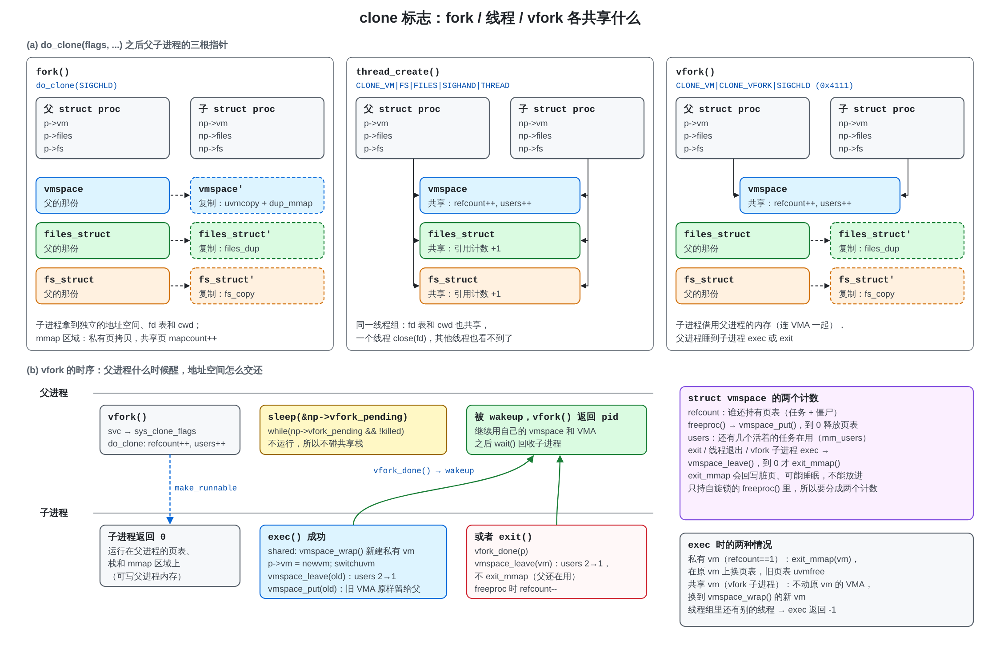

# xv6-aarch64 clone 标志、fork 与 vfork

对应提交：`86608e9 实现 Linux 风格 clone flags：files_struct、fs_struct、CLONE_VFORK、用户态 clone()`，合并进 rpi3-lock 的提交是 `5fc90e5`。书里对应第 5 章“fork() 逐行解析”和“clone 标志与 vfork”两节，以及第 8 章“用户线程”。



图 aa：(a) fork、线程、vfork 之后父子进程的三根指针；(b) vfork 的时序；右侧是 `vmspace` 的两个计数和 exec 的两种情况。

## 1. 思路

Linux 只有一个 `clone(flags, ...)`，flags 逐项说明子任务与父任务共享什么。xv6 照此把 `struct proc` 里原来内嵌的三样东西拆成三个带引用计数的对象：

| 对象 | 标志 | 复制函数 | 内容 |
|---|---|---|---|
| `struct vmspace` | `CLONE_VM` | `uvmcopy` + `dup_mmap` | 页表、`sz`、VMA 链表、`mmap_lock`；`refcount` 和 `users` 两个计数 |
| `struct files_struct` | `CLONE_FILES` | `files_dup` | `fd[NOFILE]`，原来的 `p->ofile[]` |
| `struct fs_struct` | `CLONE_FS` | `fs_copy` | `cwd` inode 和规范化的 `cwdpath` |

代码：`kernel/fs/fdtable.c`（files_struct/fs_struct），`kernel/core/proc.c` 的 `do_clone()`、`vfork_done()`、`vmspace_leave()`，`include/uapi/sched.h`（标志值，与 Linux 相同）。

## 2. 三种常用组合

| 调用 | flags | vm | files | fs |
|---|---|---|---|---|
| `fork()` | `SIGCHLD` | 复制 | 复制 | 复制 |
| `thread_create()` | `CLONE_VM\|CLONE_FS\|CLONE_FILES\|CLONE_SIGHAND\|CLONE_THREAD` | 共享 | 共享 | 共享 |
| `vfork()` | `CLONE_VM\|CLONE_VFORK\|SIGCHLD`（`0x4111`） | 共享 | 复制 | 复制 |

`do_clone()` 照 Linux 检查组合：`CLONE_THREAD` 要求 `CLONE_SIGHAND`，`CLONE_SIGHAND` 要求 `CLONE_VM`；共享地址空间又不是 vfork 时必须给新栈；低字节的退出信号只接受 0 或 `SIGCHLD`。

**行为变化**：线程现在像 pthread 一样共享 fd 表和 cwd，一个线程 `close(fd)`，其他线程也看不到这个 fd 了。

## 3. 用户接口

- 原 ABI 不变：`fork()` 走 `SYS_fork`（内核里是 `do_clone(SIGCHLD, ...)`）；线程库调用 `thread_clone()`，底下仍是固定参数的 `SYS_clone`。
- 新增 `SYS_clone_flags`（95），参数按 arm64 Linux 顺序：`(flags, stack, ptid, tls, ctid)`。TLS 不支持，`tls` 被忽略。`CLONE_PARENT_SETTID`/`CLONE_CHILD_SETTID` 在子进程运行前写 TID。
- libc 提供 glibc 形式的 `clone(fn, stack, flags, arg, ...)`：`usys.pl` 生成的 `__clone` 把 `fn`、`arg` 放在 `x9`/`x10` 里穿过 `svc`，子进程返回 0 时调用 `fn(arg)` 再 `exit`。
- `vfork()` 是一段直接发 `SYS_clone_flags` 的汇编，`x0 = 0x4111`，`stack = 0` 表示子进程借用父进程的栈。

（`SYS_msync` 占了 94，所以合并时 `SYS_clone_flags` 从 94 改成了 95。）

## 4. 共享描述符表

共享之后，一个任务在系统调用里用着的 `struct file` 可能被另一个任务 `close()` 掉：

- `fdget(fd)`：表被共享（`count > 1`）时给 file 多拿一个引用，钉在 `p->fpin[]`，系统调用返回时 `fdput_all()` 放掉；私有表不会被别人改，不必钉。
- `fget(fd)`：返回一个新引用，调用者自己 `fileclose()`（`sys_mmap` 用它）。
- `open()` 等 `struct file` 完全建好才 `fd_install()`，别的线程看不到半成品。
- `exec()` 提交前调用 `unshare_files()`，像 Linux 一样给自己一份私有表。

## 5. vfork

```
父进程                                   子进程
vfork() → do_clone(CLONE_VM|CLONE_VFORK)
  refcount++, users++
  make_runnable(child)  ───────────────▶ 从 vfork() 返回 0
  sleep(&np->vfork_pending)               在父进程的栈和内存上运行
        ▲                                 │
        │                                 ├─ exec() 成功：vmspace_wrap() 新建私有 vm，
        │                                 │   vmspace_leave(old)，vfork_done()
        └──────── wakeup ─────────────────┴─ 或 exit()：vfork_done()，vmspace_leave()
  vfork() 返回 pid
```

父进程在 `do_clone()` 末尾睡在 `&np->vfork_pending` 上，被 kill 也会醒。子进程在 `exec()` 换上自己的地址空间之后、或在 `exit()` 一开始调用 `vfork_done()`。

## 6. vmspace 的两个计数

| 计数 | 含义 | 谁减 | 减到 0 时 |
|---|---|---|---|
| `refcount` | 有多少个 `struct proc`（含僵尸）持有它 | `freeproc()` → `vmspace_put()` | 释放页表 |
| `users` | 有多少个活着的任务在用它（Linux `mm_users`） | `exit()`、线程退出、vfork 子进程 `exec()` → `vmspace_leave()` | `exit_mmap()` 拆 mmap 区并回写脏页 |

分成两个计数，是因为 `exit_mmap()` 要回写、可能睡眠，不能放进只持自旋锁的 `freeproc()`；而在 `exit()` 里无条件 `exit_mmap()` 的话，vfork 子进程退出就会拆掉父进程的映射。这是合并 clone 分支和 mmap 时发现并修掉的问题，`mmaptest` 新增了两项 vfork 测试。

## 7. 测试

- `clonetest`：24 项全部通过：fork/线程旧接口、`CLONE_FILES` 下 open/close 互相可见、不带它时互不影响、`CLONE_FS` 的 `chdir()`、`CLONE_VM` 写入共享、`CLONE_VFORK` 等待 exit/exec、TID 回写、非法组合被拒绝。
- `mmaptest`：49 项全部通过，含 vfork 写父进程映射、子进程退出后映射仍在。
- threadtest、forktest、posixtest 通过；usertests 的失败项与合并前完全相同（14 项，都是合并前就有的问题）。
