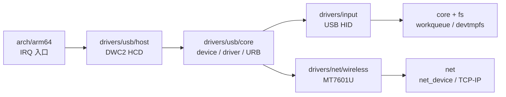

# Linux 风格的内核源码分层

## 1. 目标

本工程不照搬 Linux 的规模，而采用相同的**所有权边界**：体系结构代码、通用内核、
内存管理、驱动、文件系统和网络协议分别放置。此次重排只移动实现文件并调整构建，
不改变符号名、`module_init()` 顺序、设备匹配或运行时行为。

公共内核头文件暂时保留在 `kernel/`。通用 UAPI 包装头仍从 `include/` 搜索；当内核
与用户头同名且语义不同（例如模块装载需要完整 ELF 重定位定义）时，源码显式引用
`kernel/elf.h`，避免依赖“源文件碰巧与头文件同目录”的隐式规则。

## 2. 目录结构

```text
kernel/
├── arch/arm64/                 AArch64 入口、上下文切换、异常向量、定时器、BCM2837 IRQ
├── init/                       main、命令行和根文件系统挂载
├── core/                       进程、系统调用、trap、锁、同步、workqueue
├── mm/                         物理页分配和页表/虚拟内存
├── lib/                        内核字符串、printf、随机数等通用实现
├── drivers/
│   ├── base/                   bus/device/driver、kobject、模块装载、符号导出
│   ├── block/                  块设备注册、根分区和在线更新
│   ├── firmware/               VideoCore mailbox
│   ├── input/                  input core、USB 键盘和 usbmouse.ko
│   ├── media/{i2c,platform}/   SCCB/OV5647 与 Unicam
│   ├── mmc/{core,host}/        SDIO core 与 Arasan/SDHOST host
│   ├── net/{usb,wireless}/     USB 网卡与 BCM43455/MT7601U
│   ├── tty/                    console、TTY、PTY、UART
│   └── usb/{core,host}/        USB core/URB 与 DWC2 HCD
├── fs/{ext2,fat,netfs}/        VFS、xv6fs、ext2、FAT32 和 netfs
├── net/                        net_device、ARP/IP/UDP/TCP 与网络系统调用
├── *.h                         当前阶段的内核公共头文件
└── kernel.ld                   链接布局
```

这种结构把“总线核心”和“具体控制器/设备驱动”分开。例如 USB 路径为：



## 3. 构建分层

`Makefile` 不再维护一个不可读的平面 `OBJS`，而是按子系统声明
`ARCH_OBJS`、`CORE_OBJS`、`DRIVER_USB_OBJS`、`FS_OBJS`、`NET_OBJS` 等，
最后组合成链接顺序。新增实现时应加入拥有它的分组，而不是在任意位置追加。

依赖文件直接从 `OBJS` 推导，因此嵌套目录中的 `.d` 也会被加载。`make clean`
递归删除子目录生成的 `.o/.d/.asm/.sym`，但不会删除源文件。`usbmouse.c` 仍不进入
内核 `OBJS`，而是在 `kernel/drivers/input/usbmouse.ko` 中独立构建并安装到
`/lib/modules`。

## 4. 运行时初始化关系

源码目录表达所有权，运行时依赖仍由 `main()` 与 initcall level 表达：

```text
arch 启动/页表
  -> kobject + driver core
  -> SDIO/USB bus core
  -> console、进程、workqueue、网络、IRQ、VFS 基础设施
  -> do_initcalls(): class/core -> host -> device -> filesystem/root -> firmware driver
  -> userinit()
```

目录位置不能替代依赖声明。一个驱动如果依赖 USB core、workqueue 或已挂载的
bootfs，仍须选择正确 initcall level，不能靠对象文件在 Makefile 中“碰巧排在前面”。

## 5. 后续约束

1. `arch/arm64` 不直接实现文件系统或网络策略，只提供体系结构机制。
2. `drivers/*` 通过 bus、device、net_device、input_dev 等核心对象接入上层。
3. `fs/*` 不直接操作某块特定硬件，块 I/O 通过块设备接口下发。
4. `net/*` 不直接识别 SDIO/USB；网卡驱动只注册 `net_device`。
5. 用户可见 ABI 放在 `include/uapi/`；内核私有结构继续放在 `kernel/*.h`，后续再按
   子系统逐步拆成私有头，避免一次迁移同时改变 ABI。
