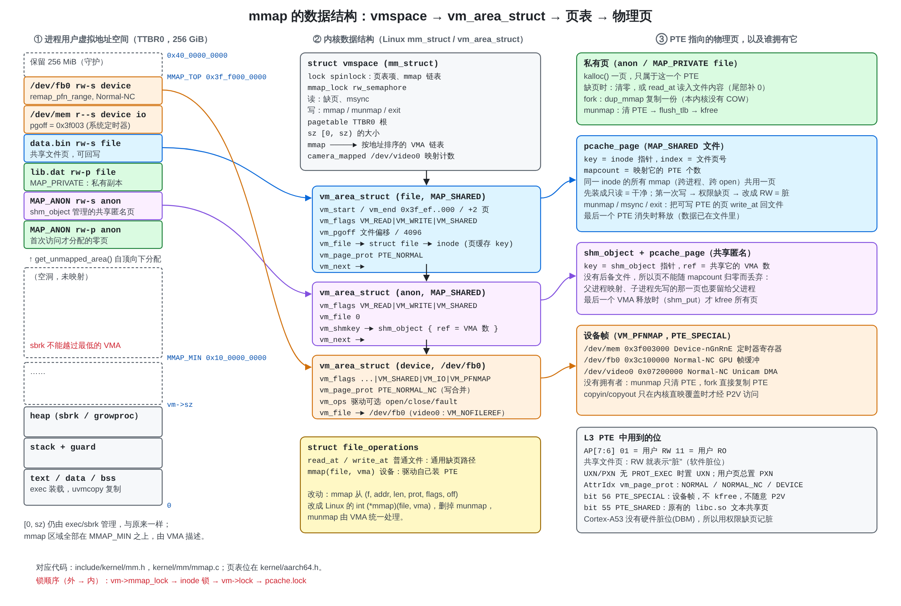
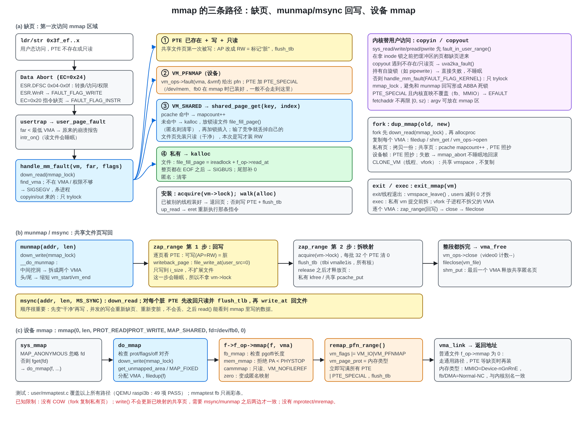

# xv6-aarch64 mmap：普通文件 + 设备文件

对应提交：`3c16f0c 添加普通文件的mmap;改善设备文件的mmap`，以及与 clone/vfork 分支的合并 `5fc90e5`。书里对应第 4 章“mmap：VMA、按需调页与设备映射”一节。

图 y：地址空间布局、vmspace / vm_area_struct、四类物理页的归属、PTE 位。

图 z：(a) 缺页 (b) munmap/msync 回写 (c) 设备 mmap 三条调用链。

## 1. 改之前

- `sys_mmap` 只是把调用转给 `f_op->mmap(f, addr, len, prot, flags, off)`，只有 `/dev/video0` 实现了它，而且地址固定在 `CAM_MMAP_BASE`。
- `sys_munmap` 在 fd 表里找第一个有 `munmap` 的文件，否则调用 `camera_munmap_current`。
- 没有 VMA，也没有缺页处理：`usertrap` 遇到任何数据缺页都直接杀进程。
- `fork` 用 `vm->camera_mapped` 特判来复制摄像头映射。

## 2. 新结构（仿 Linux）

| Linux | xv6 | 位置 |
|---|---|---|
| `mm_struct` | `struct vmspace`，新增 `mmap_lock`（rw_semaphore）和 `mmap` 链表 | `include/kernel/proc.h` |
| `vm_area_struct` / `vm_operations_struct` | 同名，字段是子集 | `include/kernel/mm.h` |
| `do_mmap` / `do_munmap` / `handle_mm_fault` / `dup_mmap` / `exit_mmap` / `remap_pfn_range` | 同名 | `kernel/mm/mmap.c` |
| `file_operations.mmap(file, vma)` | 签名改成 Linux 的形式，删掉 `munmap` | `include/kernel/device.h` |
| page cache | `pcache_page`（只缓存正在被 MAP_SHARED 映射的页） | `kernel/mm/mmap.c` |
| shmem inode | `shm_object`（共享匿名内存） | `kernel/mm/mmap.c` |

地址布局：`[0, sz)` 仍由 exec/sbrk 管理；mmap 区在 `[MMAP_MIN=64 GiB, MMAP_TOP=256 GiB-256 MiB)`，自顶向下分配。`growproc` 不允许堆长进最低的 VMA。

### 通用 slab 小对象层

原先 `mmap.c` 私有的 `objcache` 已提取为 `include/kernel/slab.h` 和
`kernel/mm/slab.c` 的通用 `kmem_cache`。`kalloc/kfree` 仍只负责 4 KiB 物理页；
每个 `kmem_cache` 从 `kalloc()` 取得一页，按对齐后的固定步长切成对象，空闲对象
用首字保存 intrusive free-list 指针。分配时对象清零，释放时填 `0x01`，cache
维护 `pages/total/inuse` 计数。当前没有 shrinker，空 slab 页会留给同一 cache 复用。

已经接入的固定尺寸对象包括：VMA、`pcache_page`、`shm_object`、`struct proc`、
`vmspace`、`files_struct`、`fs_struct`、动态 `struct file`、pipe、USB URB、
`input_dev` 和 `evdev_client`。页表页、用户页、内核栈、DMA 缓冲等整页或特殊
物理内存仍走原来的页分配/保留内存路径，不能放进 slab。

### 页的四种归属

1. **私有页**（匿名 / MAP_PRIVATE 文件）：一个 PTE 独占一页 kalloc 内存，缺页时清零或用 `f_op->read_at` 读文件（整页超出 EOF → SIGBUS）。fork 复制（没有 COW）。
2. **共享文件页**：`pcache_page{key=inode*, index}`，`mapcount` = 映射它的 PTE 数。同一 inode 的所有映射（跨进程、跨 open）共用。最后一个 PTE 消失时释放。
3. **共享匿名页**（`MAP_SHARED|MAP_ANONYMOUS`、`/dev/zero`）：同样在 pcache 里，key 是 `shm_object`。没有后备文件，所以页要活到最后一个 VMA 释放（否则“子进程先写的页”会在子进程退出时丢掉，测试里抓到过这个 bug）。
4. **设备帧**（`VM_IO|VM_PFNMAP`）：驱动的 `f_op->mmap` 调 `remap_pfn_range()` 立即装好 PTE，并打上软件位 `PTE_SPECIAL`（bit 56）。munmap 只清 PTE，fork 照抄 PTE。

### 脏页跟踪

Cortex-A53 没有硬件脏位（DBM 是 ARMv8.1）。共享文件页第一次装成只读；第一次写触发权限缺页，`handle_mm_fault` 把 AP 改成 RW。所以“共享文件 VMA 里可写的 PTE”就等于“脏页”。

- `munmap` / `exit` / `exec`：先把可写 PTE 对应的页 `file_write_at` 回文件（只写到 i_size，不扩展文件），再清 PTE、`flush_tlb`，最后才释放页。
- `msync`：先把 PTE 改回只读并刷 TLB，再写回；并发写会重新缺页，不会丢。

### 设备驱动

| 设备 | major/minor | mmap 行为 |
|---|---|---|
| `/dev/mem` | 8/1 | offset = 物理地址。拒绝 PA < PHYSTOP（STRICT_DEVMEM）；MMIO 用 Device-nGnRnE，ramdisk/模块区用 Normal，其它（DMA、GPU 内存）用 Normal-NC，与内核别名一致 |
| `/dev/zero` | 8/5 | 变成匿名映射（MAP_SHARED 即共享匿名） |
| `/dev/fb0` | 9/0 | 新驱动 `kernel/drivers/video/fbdev/bcm2708_fb.c`：首次 open 用一条多 tag 的 mailbox 消息分配 640x480x32 帧缓冲；`FBIOGET_VSCREENINFO/FSCREENINFO`；mmap 为 Normal-NC（写合并） |
| `/dev/video0` | 5 | 改用 `remap_pfn_range`，地址由内核选（camserver 本来就用返回的指针）；`VM_NOFILEREF` 让映射不持有 file，保持“close 最后一个 fd 就停流”的旧行为；`vm_ops.open/close` 维护 `camera_mapped` 计数 |

`mbox.c` 新增 `mbox_property_list()`（一条消息多 tag），`mbox_property()` 复用同一个发送函数，消息缓冲区扩到 64 字。

### 内核替用户访问

- `sys_read/write/pread/pwrite` 先 `fault_in_user_range()`，在拿 inode 锁之前把缓冲区缺页进来。
- `copyin/copyout/copyinstr` 遇到缺页时调 `uva2ka_fault()`：持有自旋锁则直接失败；否则 `handle_mm_fault(FAULT_FLAG_KERNEL)`，只 trylock `mmap_lock`，避免和 munmap 回写形成 ABBA 死锁。
- `PTE_SPECIAL` 且内核直映不覆盖的页（fb、MMIO）→ copy 失败（EFAULT），不会让内核去碰没映射的物理地址。
- `fetchaddr` 不再限制在 `[0, sz)`，只限制在 256 GiB 用户空间内。

### fork / vfork / exit / exec

- `fork` 先 `down_read(mmap_lock)` 再 `allocproc`，`dup_mmap()` 逐个复制 VMA：私有页拷贝一份，共享页 `mapcount++`、PTE 照抄，设备帧照抄 PTE；失败时用不睡眠的 `mmap_abort()` 回滚。
- 带 `CLONE_VM` 的线程和 vfork 子进程共享 `vmspace`，不复制。
- `vmspace` 有两个计数：`refcount`（谁还持有页表，含僵尸，`freeproc` 时减）和 `users`（还有几个活着的任务在用，相当于 Linux 的 `mm_users`）。`exit()`、线程退出、vfork 子进程 `exec()` 都调用 `vmspace_leave()`，`users` 减到 0 才 `exit_mmap()`。否则 vfork 子进程退出会把父进程的映射拆掉（合并 clone 分支时发现的问题，`mmaptest` 有对应测试）。
- `exec()`：私有 vmspace 在提交新映像前 `exit_mmap()`；vfork 子进程换到 `vmspace_wrap()` 新建的私有 vmspace，旧 VMA 原样留给父进程。
- `sys_mmap` 用 `fget(fd)` 取文件（描述符表现在是可共享的 `files_struct`），VMA 自己再 `filedup`。

## 3. 顺带修的启动问题

用 Linux 交叉编译器（aarch64-linux-gnu-gcc 13）编出的基线内核在 QEMU 上启动即 `panic: kvmmap`：内核 `end` 在 0x1be670，`kinit1` 只有 `[end, 2MB)` 共 65 页可用，而 `kvmmake` 逐页映射 112 MB RAM 需要 ~70 个页表页。改动：`EARLYTOP` 改成 4 MB，`entry.S` 让 `entrypgtinit` 映射到 `EARLYTOP` 而不是 `end`。这和 mmap 无关，但任何让 BSS 变大的改动都会碰到它。

## 4. 测试

`user/mmaptest.c`（已加入 UPROGS），在 QEMU raspi3b 上 49 项全部 PASS，连续跑两遍 `/proc/meminfo` 的 MemFree 不变（第一次多出的 16 KB 是 VMA/pcache 对象的 slab 页）。

覆盖：匿名零页、中间 munmap 拆 VMA、访问空洞/已 munmap/只读页被杀、MAP_FIXED、fork 后共享/私有语义、子进程先写的共享页、vfork 子进程写父进程的映射并退出后映射仍在、MAP_PRIVATE 文件（close fd 后仍可用、尾部补零、写不回文件、offset 映射）、MAP_SHARED 文件（msync、munmap 回写、最后半页、文件大小不变、两个进程各自 open 后共享页）、read() 写进未触碰的映射、write() 从映射读出、超出 EOF → SIGBUS、pipe 不能 mmap、/dev/zero、/dev/mem 读系统定时器（0x3f003004 CLO 递增）、/dev/mem 拒绝内核 RAM、/dev/fb0 ioctl + mmap + 画彩条。

`mmaptest fb` 只画彩条，可在带显示的 QEMU 或真机 HDMI 上看效果。

## 5. 已知限制

- 没有 COW：fork 复制所有已触碰的私有页。
- pcache 只在页被映射期间存在，不是统一的 page cache：`write()` 不会更新已映射的共享页，mmap 里的修改要 `msync`/`munmap` 后 `read()` 才看得到。
- 没有 `mprotect`、`mremap`、`madvise`；没有页回收。
- `/dev/mem` 和 `/dev/fb0` 不支持 read/write，只支持 mmap。
- `kernel/drivers/media/` 在 `.gitignore` 里（`media/`），所以 unicam.c 的改动不会进 git。
- 书里“实验分支：引用计数、写时复制与页缓存”一节描述的是 `wip-cow-mmap-ldso` 分支的另一套设计，尚未合入。
