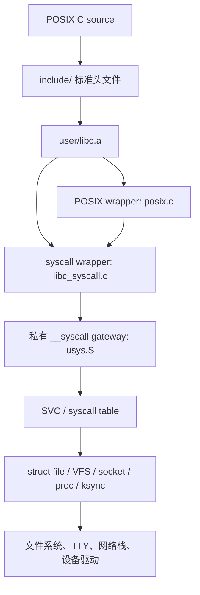
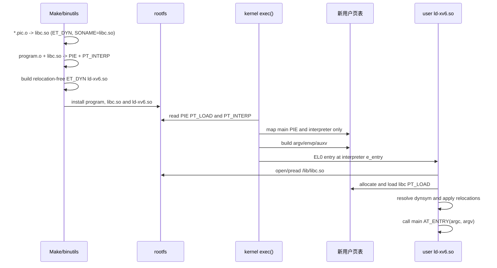

# xv6-aarch64 POSIX 源码兼容层

目标是让只依赖常见 POSIX 接口的 C 源码可以使用 xv6-aarch64 工具链重新编译，而不是兼容 Linux syscall 编号或直接运行 Linux/glibc 二进制。

## 分层结构



POSIX 兼容来自四部分：

1. `include/` 提供标准名称、类型、常量和函数原型；
2. `user/libc_syscall.c` 导出公开系统 API，`user/posix.c` 实现纯用户态适配；
3. `usys.S` 只导出私有的 `__syscall()`，应用程序不再直接执行或链接每个 syscall 的 `svc` stub；
4. 内核补齐无法只靠 libc 包装实现的语义，例如 `lseek()` 和 `socket()` → `bind()` → `listen()` 生命周期。

构建同时生成：

- `user/libc.a`：保留的静态库，只按需抽取对象；
- `user/libc.o`：包含同一组实现的统一可重定位对象，供检查、实验链接和后续模块化工具链使用；
- `user/libc.so`：由独立的 `*.pic.o` 生成的 ELF `ET_DYN` 共享库，SONAME 为 `libc.so`，可用 `make user/libc.so` 单独构建。

用户程序默认以 PIE `ET_DYN` 形式链接 `libc.so`，链接参数为
`-pie -dynamic-linker /lib/ld-xv6.so`。根文件系统构建会把共享库和解释器分别安装到
`/lib/libc.so`、`/lib/ld-xv6.so`；xv6fs 的 `mkfs` 使用 `-L`/`-I`，ext2 的
`debugfs` 脚本写入两个文件。如需制作不依赖共享库的恢复镜像，可使用
`make DYNAMIC_USER=0`，构建标记会保证静态、动态模式切换时重新链接用户程序。

当前动态链接流程如下：



现在的职责边界与 Linux 相同：内核 `exec()` 不再打开 libc、不解析 `DT_NEEDED`，也不做
动态符号解析或重定位；它只装入主 ELF 和 `PT_INTERP`，并通过 `AT_PHDR`、`AT_PHENT`、
`AT_PHNUM`、`AT_PAGESZ`、`AT_BASE`、`AT_ENTRY` 辅助向量把控制权交给用户态解释器。
`ld-xv6.so` 只允许受信任的 `/lib/libc.so`，支持当前 AArch64 工具链生成的
`R_AARCH64_RELATIVE`、`R_AARCH64_JUMP_SLOT`、`R_AARCH64_GLOB_DAT` 和
`R_AARCH64_ABS64`。旧的静态 `ET_EXEC` 仍可执行。尚未实现任意依赖搜索、符号版本、TLS、
`dlopen/dlsym`、延迟 PLT 绑定、ASLR、TLS，以及普通文件的按需分页。解释器当前通过
`sbrk()+pread()` 装入 libc，而不是 Linux 的文件后备 `mmap()`；所以职责已经移到用户态，
但 libc 页暂时仍是每进程私有页。

### 真机验证

在 Pi 3 上以默认的 `DYNAMIC_USER=1` 启动，登录后 shell 会以 PIE `ET_DYN` 形式加载，
内核先报告解释器，随后用户态解释器报告重定位完成：

```text
exec: /bin/login -> interpreter /lib/ld-xv6.so
ld.so: relocated libc.so in user space

xv6-rpi3 login: root
Password: xv6
Welcome root
exec: /bin/sh -> interpreter /lib/ld-xv6.so
ld.so: relocated libc.so in user space
```

第二行由 EL0 中的 `ld-xv6.so` 通过原始 syscall 打印；看到它才能证明 libc 的装载、符号解析和
重定位确实发生在用户态。若程序没有 `PT_INTERP` 且仍能运行，则它走的是静态 `ET_EXEC`
恢复路径。

### UAPI 与内核头文件边界

用户程序不再直接包含任何 `kernel/*.h`，`include/` 下的公开头也不再反向依赖内核源码目录。用户态与内核必须共同遵守的数值、结构体布局和磁盘格式集中放在 `include/uapi/`：

```text
user source -> include/{fcntl.h,sys/*.h,...} -> include/uapi/*.h
kernel      -> kernel/{fcntl.h,stat.h,...}   -> include/uapi/*.h
```

当前 UAPI 包括 `fcntl`、基础整数类型、`stat`、socket、epoll、mmap、设备号、camera、ext2、scheduler、syscall 编号、ELF 可执行格式、xv6fs 磁盘格式、用户可见限制和 VM 测试边界。`user/include/fcntl.h` 等用户头负责 libc 函数原型和 POSIX 兼容名称；`include/kernel/*.h` 包装层只向内核补充私有对象。`struct file`、`struct inode`、spinlock、sleeplock 等实现结构不进入 UAPI。

这种分层既避免用户代码依赖内核源码目录，也避免内核和 libc 各复制一套可能漂移的 ABI 数值。新增 syscall、ioctl 或共享设备结构时应先判断它是否真的是稳定 ABI；只有跨越用户/内核边界的部分才能加入 `include/uapi/`。

## 已实现接口

### libc 与头文件

- `stddef.h`、`stdint.h`、`errno.h`、`ctype.h`
- `stdio.h`、`stdlib.h`、`string.h`
- `unistd.h`、`fcntl.h`、`sys/types.h`、`sys/stat.h`
- `time.h`
- `pthread.h`、`semaphore.h`
- `sys/socket.h`、`netinet/in.h`、`arpa/inet.h`
- `sys/epoll.h`（Linux 扩展，不属于 POSIX，但保留现有能力）

### 文件/VFS

- `open/read/write/close/fstat/stat`
- `getcwd/getpid/getppid/gettid`
- `dup/dup2`，以及 `wait/waitpid(WNOHANG)`
- `readlink()`：目前只有 sysfs 实现了符号链接读取（`/sys/class` 下指回 `/sys/devices` 的链接），其它文件系统如同 Linux 对非链接一样返回 `EINVAL`
- `lseek(SEEK_SET/SEEK_CUR/SEEK_END)`
- `O_CREAT` 到原生 `O_CREATE` 的兼容别名
- `S_ISREG/S_ISDIR/S_ISCHR`
- `sleep()` 使用 POSIX 秒语义；旧的 xv6 tick 语义已显式改名为 `sleep_ticks()`。

### 常用 C 库

- 内存：`malloc/calloc/realloc/free`
- 字符串：`memcpy/memmove/memset/memcmp/memchr`、`strcpy/strncpy/strcat/strncat`、
  `strcmp/strncmp/strlen/strnlen/strchr/strrchr/strstr/strpbrk/strspn/strcspn/strtok/strdup`
- 转换：`atoi/strtol/strtoul/abs/labs`
- 字符分类：`isalnum/isalpha/isascii/isblank/iscntrl/isdigit/isgraph/islower/isprint/ispunct/isspace/isupper/isxdigit/tolower/toupper`
- 格式输出：`printf/fprintf/vprintf/vfprintf/sprintf/snprintf/vsnprintf/puts/putchar`
- 进程辅助：`access/rmdir/abort/execv/_exit`

### 线程与同步

- `pthread_create()`、`pthread_join()`、`pthread_self()`、`pthread_equal()`、`pthread_exit()`
- `pthread_mutex_init/lock/unlock/destroy`
- `PTHREAD_MUTEX_INITIALIZER` 延迟初始化
- `sem_init/wait/post/destroy`

这些接口最终使用共享 `vmspace` 的 xv6 用户线程以及内核 `ksync` 对象。`pthread_join()` 同时回收用户栈和 POSIX 线程记录。

### 时间

- `clock_gettime(CLOCK_MONOTONIC)`
- `sleep()`、`usleep()`、`nanosleep()`

系统 tick 当前为 100 ms，因此 sleep 系列的实际分辨率也是 100 ms。`CLOCK_REALTIME` 尚未接入 RTC，返回 `ENOSYS`。

### 网络

TCP 服务端现在可以使用标准调用顺序：

```c
int fd = socket(AF_INET, SOCK_STREAM, 0);
bind(fd, (struct sockaddr *)&address, sizeof(address));
listen(fd, 4);
int client = accept(fd, 0, 0);
read(client, buffer, sizeof(buffer));
write(client, buffer, length);
close(client);
```

`socket()` 先建立统一 `struct file`；`bind()` 记录本地端口；`listen()` 才向 TCP 层建立 listener。监听 socket、已连接 socket、普通文件、PTY 和 pipe 因而能统一使用 fd、`read/write/close/fcntl/epoll`。

当前 TCP 栈还没有标准客户端 `connect()`，`accept()` 也还不能返回真实 peer 地址。

## 验证

`user/posixtest.c` 只包含标准风格头文件，验证：

- 文件创建、读写、`lseek()` 和 `fstat()`；
- `getcwd()`、`dup2()`、`waitpid()` 和 `getppid()`；
- `calloc/realloc`、字符串检索与 `ctype`；
- POSIX semaphore；
- 两个 pthread 并发更新共享变量并返回 `void *` 结果；
- 静态初始化的 pthread mutex；
- `socket/bind/listen/close` 生命周期。

运行：

```sh
/bin/posixtest
```

预期：

```text
posixtest: PASS pid=... tid=... counter=1000
```

## 仍需补齐的关键语义

这仍是 POSIX 兼容层的第一阶段，不应宣称完整 POSIX：

- syscall 目前只返回 `-1`，没有向 libc 传递具体内核错误码；`errno` 入口已经建立，但尚不是线程局部存储。
- `waitpid()` 当前支持指定直接子进程、任意子进程 `-1` 和 `WNOHANG`，尚未支持进程组选择以及
  `WUNTRACED/WCONTINUED`；`WIFEXITED` 也暂时只对应 xv6 的普通退出状态。
- 尚无完整权限位、用户/组、符号链接和标准目录流 API。
- stdio 仍是最小实现：尚无 `FILE` 缓冲层、`fopen/fread/fwrite`，格式化函数目前覆盖整数、字符串、
  字符和指针，没有浮点、位置参数以及完整的宽度/精度规则。
- pthread 尚缺 condition variable、rwlock、detach、cancel、TLS key 和线程属性。
- 网络尚缺 TCP `connect()`、UDP socket fd、`getsockopt/setsockopt` 和 peer 地址。
- `NFILE`、`NOFILE`、同步对象表等其他内核资源仍有固定上限。
- 没有 glibc/musl 动态加载 ABI，因此 Linux ELF 二进制不能直接运行。

后续优先级建议是：线程局部 `errno` 与内核错误码、pthread condition variable、目录流与完整
stdio、TCP `connect()`，最后再逐步扩展 libc。
