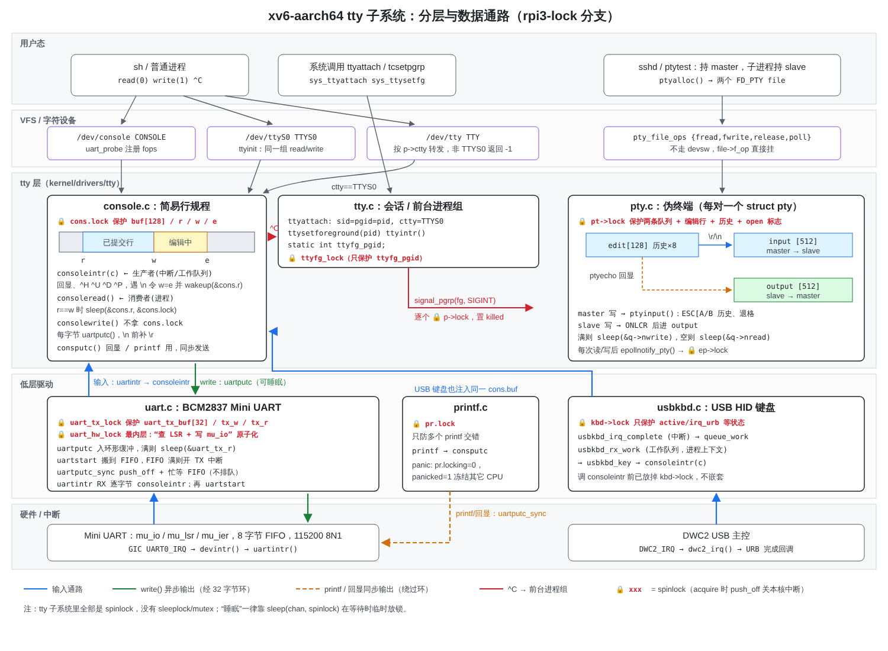
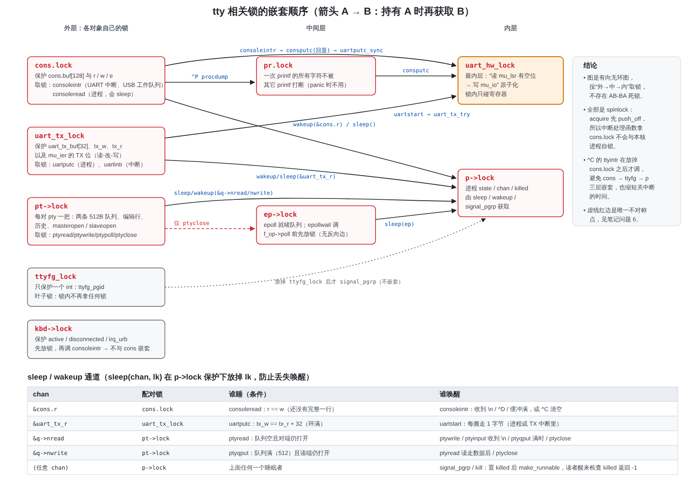
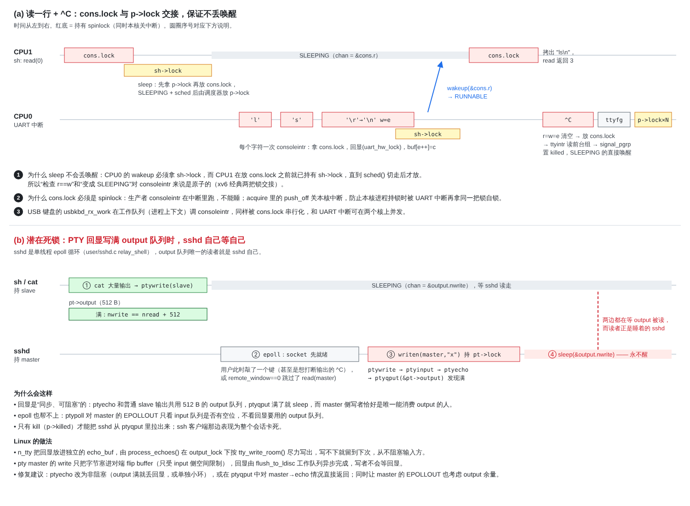
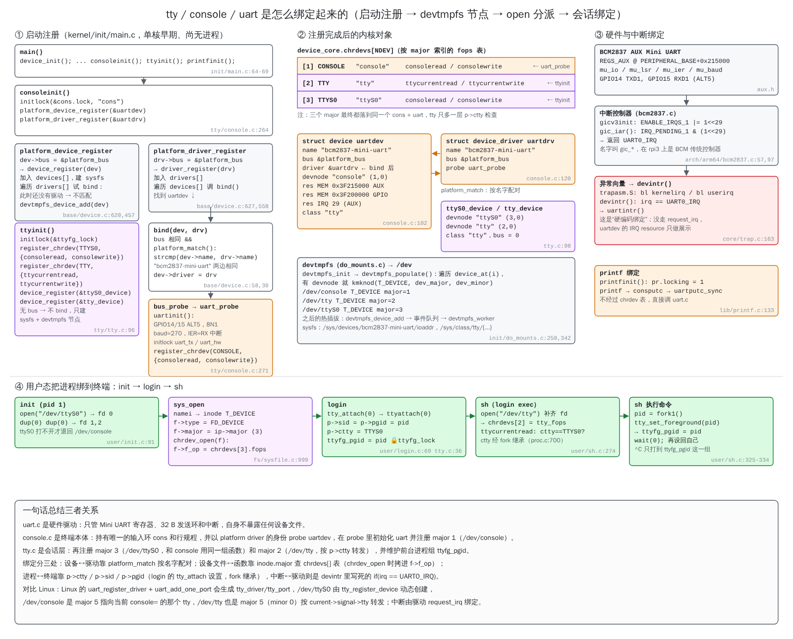
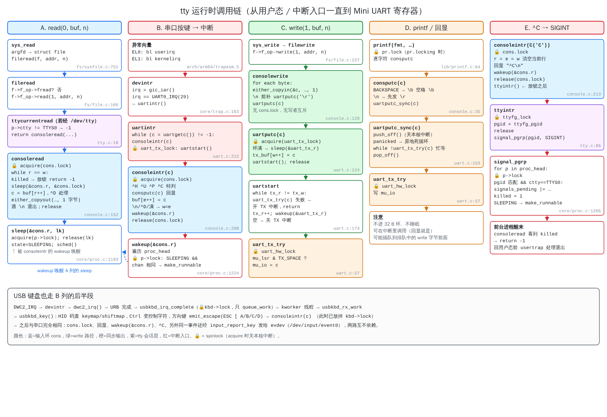

# xv6-aarch64 tty 驱动与锁机制分析

代码在 `kernel/drivers/tty/`，行号对应 2026-10-25 的 rpi3-lock（合并 clone 分支前；tty 代码在合并中没有改动）。书里对应第 7 章“控制台、UART 与 TTY”一节。

| 图 | 内容 |
|---|---|
|  `fig-t` | 分层结构和三条数据通路：输入、write() 输出、printf/回显 |
|  `fig-u` | 全部锁的保护对象、嵌套顺序图，以及 sleep/wakeup 通道表 |
|  `fig-v` | (a) 读一行和 ^C 的双核时序；(b) PTY 回显死锁 |
|  `fig-w` | tty / console / uart 的绑定过程：启动注册、platform 匹配和 probe、chrdevs 表、devtmpfs 节点、open 分派、login/sh 会话绑定 |
|  `fig-x` | 五条运行时调用链：read、串口中断输入、write、printf/回显、^C |

## 0. 绑定关系（图 w）

tty、console、uart 在四个地方绑定：
- **设备 ↔ 驱动**：`consoleinit` 先注册 platform 设备 `uartdev`，再注册驱动 `uartdrv`；`platform_match` 按名字 `"bcm2837-mini-uart"` 配对，调用 `uart_probe` → `uartinit()`，并注册 major 1（/dev/console）。
- **设备文件 ↔ 函数**：`ttyinit` 注册 major 3（/dev/ttyS0，和 console 同一组函数）和 major 2（/dev/tty，按 `p->ctty` 转发）。`open` 时 `chrdev_open` 用 inode 的 major 查 `chrdevs[]`，把 fops 填进 `f->f_op`。
- **硬件 ↔ 中断**：写死在 `devintr` 里 `irq == UART0_IRQ`，没有走 `request_irq`。
- **进程 ↔ 终端**：login 调 `tty_attach` 设置 `ctty/sid/pgid`，fork 继承；sh 每条命令用 `tty_set_foreground` 切前台进程组。
- 内核 `printf` 不经过 chrdevs 表，`consputc` 直接调 `uartputc_sync`。

---

## 1. 分层：四个文件各管什么

| 文件 | 角色 | 对应 Linux |
|---|---|---|
| `uart.c` | BCM2837 Mini UART 低层驱动，包括 32 B 发送环、TX/RX 中断和同步输出 | `8250`/`pl011` + `serial_core` 的 `uart_port` |
| `console.c` | 唯一的“行规程”：128 B 输入环，处理回显、^H ^U ^D ^C ^P，并注册 `/dev/console` 的 platform driver | `n_tty` 和 `tty_struct` 合在一起 |
| `tty.c` | 会话和前台进程组：`/dev/ttyS0`、`/dev/tty`（经 `p->ctty` 转发）、`ttyfg_pgid`、^C 时的 `signal_pgrp` | `tty_io.c`/`tty_jobctrl.c` 里的 pgrp/session 部分 |
| `pty.c` | 伪终端：每对一个 `struct pty`，两条 512 B 队列，自带一个迷你行规程（ESC[A/B 历史、退格、ONLCR） | `pty.c` + 两个 `tty_struct` + 各自的 n_tty |

输入的生产者有两个，最终都进入 `consoleintr()`：
- **UART**：GIC `UART0_IRQ` → `devintr` → `uartintr` → 逐字节 `consoleintr`（中断上下文）
- **USB 键盘**：`DWC2_IRQ` → `usbkbd_irq_complete` → `queue_work` → `usbkbd_rx_work` → `usbkbd_key` → `consoleintr`（工作队列，进程上下文）

输出有两条路，见图 t：
- **write()**：`consolewrite` 每字节调 `uartputc`，进 32 B 环；环满就 sleep；`uartstart` 搬进 8 B 硬件 FIFO，FIFO 满时打开 TX 中断。
- **printf / 回显**：`consputc` → `uartputc_sync`，在关中断状态下忙等 FIFO，**绕过发送环**。

## 2. 锁清单

tty 子系统里**全部是 spinlock**，没有 sleeplock 或 mutex。需要等待时一律用 `sleep(chan, spinlock)`，等待期间临时放锁。`acquire()` 先执行 `push_off()` 关闭本核中断（`kernel/core/spinlock.c:26`），然后用 `ldaxrb/stxrb` 加 `wfe` 自旋。

| 锁 | 保护什么 | 在哪拿 | 上下文 |
|---|---|---|---|
| `cons.lock` | `cons.buf[128]`、`r/w/e` | `consoleintr` console.c:208，`consoleread` :152 | 中断、工作队列、进程 |
| `uart_tx_lock` | `uart_tx_buf[32]`、`tx_w/tx_r`、`mu_ier` 的 TX 位 | `uartputc` uart.c:124，`uartintr` :223 | 进程、中断 |
| `uart_hw_lock` | 把“查 `mu_lsr` 有空位”和“写 `mu_io`”合成一步，防止两个核同时抢到最后一个 FIFO 槽而丢字节 | `uart_tx_try` uart.c:57 | 任意，最内层 |
| `pr.lock` | 一次 printf 的字符不与其它 printf 交错（panic 时 `pr.locking=0` 不再加锁） | printf.c | 任意 |
| `ttyfg_lock` | 只保护 `ttyfg_pgid` 一个 int | tty.c:46/61/79/89 | 进程、中断（^C） |
| `pt->lock` | 一对 pty 的两条队列、编辑行、历史、`masteropen/slaveopen` | pty.c 各入口 | 进程 |
| `kbd->lock` | `active/disconnected/irq_urb/irq_count` | usbkbd.c | 中断、工作队列 |
| `p->lock` | 进程 `state/chan/killed/pgid` | `sleep`/`wakeup`/`signal_pgrp` | 任意 |
| `ep->lock` | epoll 就绪队列 | `epollnotify_pty` | 进程 |

**嵌套顺序**（见图 u，A → B 表示持 A 再拿 B）：

```
cons.lock    → uart_hw_lock          (回显 consputc)
cons.lock    → pr.lock → uart_hw_lock (^P procdump)
cons.lock    → p->lock               (wakeup / sleep)
uart_tx_lock → uart_hw_lock          (uartstart)
uart_tx_lock → p->lock               (wakeup / sleep)
pt->lock     → p->lock               (sleep / wakeup)
pt->lock     → ep->lock              (仅 ptyclose)
ep->lock     → p->lock               (epollwait 的 sleep)
ttyfg_lock, kbd->lock：叶子锁，锁内不再拿别的锁
```

这是一个有向无环图，所以**不存在 AB-BA 死锁**。几处细节是有意为之的：
- `consoleintr` 处理 ^C 时**先放 `cons.lock` 再调 `ttyintr()`**（console.c:220-221），避免形成 cons → ttyfg → 所有 p->lock 的长链，也缩短关中断的时间。
- `ttyintr` 读出 pgid 后就放掉 `ttyfg_lock`，然后才 `signal_pgrp`，所以 ttyfg_lock 一直是叶子锁。
- `usbkbd_rx_work` 在调用 `usbkbd_key → consoleintr` 之前已经放掉 `kbd->lock`，所以 kbd 和 cons 两把锁不嵌套。
- `epollwait` 在调 `f_op->poll`（即 `ptypoll` 拿 `pt->lock`）之前先放 `ep->lock`，所以不存在 ep → pt 这条反向边。

## 3. 两个关键机制

**(1) 为什么 sleep 不丢唤醒**（图 v-a）：`consoleread` 持 `cons.lock` 时发现 `r==w`，于是调 `sleep(&cons.r, &cons.lock)`，它会**先拿 `p->lock` 再放 `cons.lock`**。另一个核上的 `consoleintr` 想 `wakeup` 就必须拿到这个 `p->lock`，而 `p->lock` 要等 `sched()` 切走后才由调度器释放。所以“检查条件”和“变成 SLEEPING”对唤醒方来说是原子的。`uartputc` 用 `&uart_tx_r`、pty 用 `&q->nread/&q->nwrite`，都是同样的结构。

**(2) 为什么这些锁必须是 spinlock**：`consoleintr` 和 `uartintr` 在中断里跑，不能睡。`push_off` 保证本核持锁期间 UART 中断不会进来，否则中断处理函数再去拿同一把锁就会自锁（`acquire` 里的 `holding()` 检查会直接 panic）。

## 4. 发现的问题（按严重程度）

1. **PTY 回显会让 sshd 自己等自己，导致死锁**（图 v-b）
   `ptyecho` 把回显写进与 slave 输出共用的 512 B `output` 队列。`ptyqput`（pty.c:63）发现队列满就 `sleep(&q->nwrite)`。master 一侧的写者 sshd 恰好又是 `output` 唯一的读者，而且 sshd 是单线程 epoll 循环（`user/sshd.c` relay_shell）。
   触发方式：`cat` 大文件把 output 写满，或者 `remote_window==0` 导致 sshd 跳过 `read(master)`；这时用户敲任意一个键，sshd 就在 `writen(master)` 里永久睡眠，只有 kill 能解开。
   epoll 也挡不住：`ptypoll` 对 master 的 EPOLLOUT 只检查 input 队列（pty.c:325）。
   修复建议：回显改为非阻塞（output 满就丢掉回显，或者给回显单独一个小环）；或者在 master 侧把回显的 `ptyqput` 改成满了直接返回。Linux 的 n_tty 用独立的 `echo_buf`，由 `process_echoes()` 按 `tty_write_room()` 尽力写出，写不下就留到下次。

2. **PTY 行规程丢掉所有控制字符**（不是锁的问题，但影响很直接）
   `ptyinput` 只接受 `ch >= ' '` 的字符（pty.c:185），所以 ^C(0x03)、^D(0x04)、Tab(0x09) 都被静默丢弃。sshd 在收到 `CHANNEL_EOF` 时写入 `eof=4`，这一步实际没有效果。
   另外 `signal_pgrp` 只给 `ctty==TTYS0` 的进程发信号，所以 ssh 会话里没有 ^C 打断能力。

3. **`consoleintr` 持 `cons.lock` 并关中断，同时忙等串口**
   回显走 `uartputc_sync`。115200 波特率下每字节约 87 µs；^U 删除 127 个字符要发 381 字节，本核关中断约 33 ms。^P 会在 `cons.lock` 下 `procdump` 打印整张进程表，时间更长。
   Linux 的做法是中断里只把字节塞进 flip buffer，行规程处理和回显放到 `flush_to_ldisc` 工作队列里做。

4. **`consolewrite` 没有写者互斥，输出顺序也可能不一致**
   两个进程同时 write 时按字节交错。printf 和回显绕过 32 B 发送环直接写 FIFO，所以内核消息可能比之前已经排队的用户字节先出来。Linux 对应的是 `tty->atomic_write_lock`（mutex，保证一次 write 不被打断）加 n_tty 的 `output_lock`。

5. **`ttyattach` 不加 `p->lock` 就写 `sid/pgid/ctty`**（tty.c:43-45）
   `signal_pgrp`、`ttysetforeground` 在其它核上是持 `p->lock` 读这几个字段的，所以这里是一个数据竞争。目前影响基本无害，但规则不统一。`ttysetforeground` 先在 `p->lock` 下确认目标进程，放锁后才发布 `ttyfg_pgid`（tty.c:79），中间目标进程可能已经退出，后果只是向一个空进程组发信号。

6. **`ptyclose` 在持 `pt->lock` 时调 `pty_epollnotify`**（pty.c:240）
   `ptyread`/`ptywrite` 都是放锁之后才通知，只有这里多出一条 pt → ep 边（图 u 的红色虚线）。现在因为 `epollwait` 放掉 `ep->lock` 再 poll，所以是安全的；但只要以后有人在 `ep->lock` 下调 `filepoll`，就会形成 ABBA 死锁。建议挪到放锁之后、`kfree` 之前。

7. **在 spinlock 下做 copyout/copyin**（console.c:184，pty.c:267、290）
   mmap 加入按需调页之后，目标页可能还没缺页进来。`uva2ka_fault()` 发现调用者持有自旋锁就直接失败（返回 -1），不会睡眠，所以不会死锁；而 `sys_read`/`sys_write` 在进入驱动之前已经用 `fault_in_user_range()` 把整个缓冲区缺页进来，正常的 `read(0, buf, n)` 不受影响。更彻底的做法仍是先拷到内核缓冲区、放锁后再拷给用户。Linux 的 n_tty 读路径用的是 `atomic_read_lock` 这个 mutex。

8. **小问题**
   - `emit_escape` 用三次独立的 `consoleintr` 发出 ESC [ X（usbkbd.c:102），中间可能插进另一个核上的 UART 输入。
   - `wakeup` 和 `signal_pgrp` 不加链表锁就遍历 `proc_head`，依赖的前提是“链表只在头部插入、节点从不摘除”。

## 5. 与 Linux tty 锁的对照

| 方面 | xv6-aarch64 | Linux |
|---|---|---|
| tty 对象 | 全局 `cons`，只有一个终端 | 每个终端一个 `tty_struct` + `tty_port`，有引用计数 |
| 硬件发送 | `uart_tx_lock` + `uart_hw_lock` | `uart_port->lock`（`spin_lock_irqsave`），同时保护 xmit 环和寄存器 |
| 中断收字节 | 直接在中断里跑行规程 | `tty_insert_flip_char` 写 flip buffer（生产端无锁），`flush_to_ldisc` 工作队列消费（`buf->lock` mutex） |
| 行规程切换 | 写死在 console.c/pty.c 里 | `tty->ldisc_sem`（`ld_semaphore`） |
| 读 | `cons.lock` + `sleep(&cons.r)` | `ldata->atomic_read_lock` mutex + `wait_woken(read_wait)` |
| 写 | 无互斥 | `tty->atomic_write_lock` mutex；回显和 OPOST 用 `ldata->output_lock` |
| termios | 无 | `tty->termios_rwsem` |
| 前台组 / 会话 | `ttyfg_pgid` + `ttyfg_lock`，`p->sid/pgid` | `tty->ctrl.lock` 保护 `pgrp/session`，发信号走 `kill_pgrp` |
| printk | `pr.lock` + `uartputc_sync` 忙等 | `console_lock`（console_sem）/ nbcon，驱动 `write()` 在 oops 时用 trylock |
| panic | `pr.locking=0`，`panicked=1` 冻结其它核 | `oops_in_progress`、`bust_spinlocks` |
| pty | 一个 `struct pty` + 一把 `pt->lock` | 两个互为 link 的 `tty_struct`，各有 ldisc，写入经对端的 flip buffer |

总结：xv6 用很少的几把 spinlock 和 sleep/wakeup 就实现了“中断生产 + 进程消费”的终端，锁顺序是干净的。和 Linux 相比，主要缺少的是**把行规程从中断里拆出来**（flip buffer + 工作队列），以及**进程侧的 mutex**（atomic_read/write_lock）。问题 1、3、4、7 都源于这两点。
