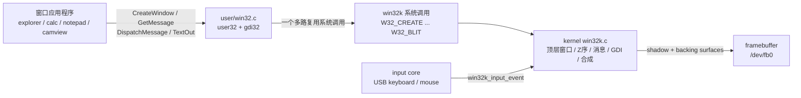
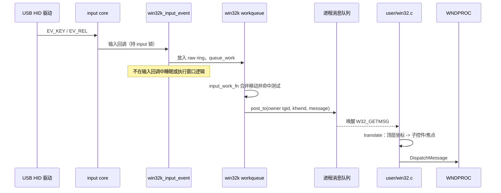
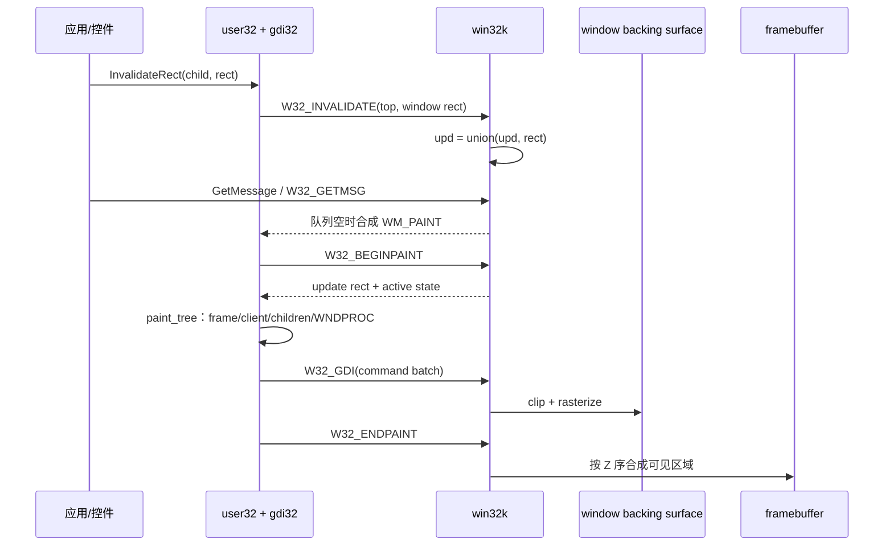

# xv6 的 Windows 风格窗口系统：win32k、消息驱动与 GDI

本文说明以下源码的设计与调用关系：

- `kernel/drivers/video/win32k.c`：内核窗口管理器、输入路由、消息队列、GDI 光栅化和屏幕合成；
- `user/win32.c` / `user/win32.h`：用户态 `user32 + gdi32` 兼容层；
- `include/uapi/win32k.h`：用户态与内核共同使用的系统调用操作号、消息和绘图命令格式。

这套实现借用了 Windows NT 的分层思想和 Win32 API 外形，但不是 Windows ABI 的复刻。它的目标是用尽量少的对象解释三个核心问题：窗口消息为何能驱动应用程序、GDI 命令如何画进窗口，以及多个进程的窗口如何安全地共享一块屏幕。

## 1. 总体分层



职责边界如下：

| 层 | 负责的对象和操作 |
|---|---|
| 应用程序 | 注册窗口类、实现 `WNDPROC`、运行消息循环、响应 `WM_COMMAND/WM_PAINT` |
| `user/win32.c` | 用户态 `HWND`、子控件树、焦点、捕获、本地消息、定时器、控件过程、GDI 命令批处理 |
| `win32k.c` | 内核顶层窗口、不可伪造的内核 `HWND`、进程消息队列、全局 Z 序、激活窗口、输入命中、backing surface、屏幕合成 |
| framebuffer/input 驱动 | 提供像素输出和原始键鼠事件 |

最重要的安全边界是：**应用进程不直接写 `/dev/fb0`**。每个顶层窗口拥有一块内核 backing surface，应用只能向自己的窗口提交经过检查的绘图命令。最终由内核按 Z 序合成到 framebuffer，因此一个进程不能直接覆盖另一个进程的窗口。

## 2. Windows NT 对照

真实 Windows 中常见的几个组件是：

- `USER32.DLL`：窗口、消息、控件等用户 API；
- `GDI32.DLL`：设备上下文、字体、画笔、位图等绘图 API；
- `win32k.sys`：内核态 USER/GDI 系统服务、窗口对象、输入和绘制基础设施；
- DWM：现代 Windows 中独立的用户态桌面合成器。

xv6 的对应关系是：

| Windows | xv6 实现 | 差异 |
|---|---|---|
| USER32 + GDI32 | `user/win32.c` | 合并为一个静态链接库，功能是最小子集 |
| win32k.sys | `kernel/drivers/video/win32k.c` | 用单一 `SYS_win32k` 加操作号模拟 NtUser/NtGdi 服务表 |
| 每 GUI 线程消息队列 | 每个 `tgid` 一个 `struct kq` | 当前默认每进程只有一个 GUI 线程 |
| DWM | `compose()` / `window_to_screen()` | 合成也放在内核，并非独立进程 |
| 内核 GDI 对象表 | `w32_gdicmd` 批和轻量 `struct dc` | 没有完整的画笔、字体、区域和设备上下文句柄表 |

因此这里的“Windows 风格”是**机制相似**，不是二进制兼容。

## 3. 两种 HWND：用户窗口对象与内核顶层句柄

`user/win32.c` 的 `HWND` 实际是当前进程中 `struct window *`。它既表示顶层窗口，也表示 `BUTTON/EDIT/LISTBOX/STATIC` 等子控件。子控件不会进入内核，它们组成用户态父子树：

```text
struct window (top level, user HWND)
  khwnd ───────────────────────> struct kwnd (kernel top-level object)
  child -> BUTTON -> EDIT -> ...       owner / rect / style / title
                                      update / backing surface / Z order
```

只有顶层窗口有 `khwnd`。内核句柄编码为：

```c
khwnd = (generation << 8) | (slot + 1);
```

低 8 位定位 `wins[MAXW]` 槽，高位 generation 防止窗口销毁后旧句柄误命中新窗口。内核每次通过 `index_of()` 同时校验槽是否在用和代数是否匹配。

`CreateWindow()` 的顺序也体现了这条边界：

1. 用户态从 `windows[MAXWIN]` 分配 `struct window`；
2. 同步调用该窗口的 `WM_CREATE`，让应用创建子控件；
3. 如果是顶层窗口，构造 `w32_create` 并执行 `W32_CREATE`；
4. 内核分配 `struct kwnd` 和 `width * height * 4` 的 backing surface，加入 Z 序并返回 `khwnd`。

先执行 `WM_CREATE` 再建立内核顶层对象，可以保证第一条 `WM_PAINT` 到来时，用户态子控件树已经完整。

## 4. Windows 消息驱动机制

### 4.1 消息循环

典型窗口程序不主动循环检查按钮状态，而是等待消息：

```c
MSG msg;
while(GetMessage(&msg, 0, 0, 0))
  DispatchMessage(&msg);
```

`DispatchMessage()` 根据 `msg.hwnd` 找到窗口过程并调用：

```c
return msg.hwnd->proc(msg.hwnd, msg.message,
                      msg.wParam, msg.lParam);
```

应用的 `WNDPROC` 因而是一个事件分派器：`WM_CREATE` 初始化，`WM_COMMAND` 响应按钮，`WM_CHAR` 接收字符，`WM_PAINT` 绘制，`WM_DESTROY` 退出。

### 4.2 PostMessage 与 SendMessage

- `PostMessage()` 是异步的。顶层窗口消息通过 `W32_POST` 进入内核队列；子控件消息进入当前进程的本地环形队列。调用者提交后立即返回。
- `SendMessage()` 是同步的。当前实现直接调用 `w->proc(...)`，因此只支持进程内窗口，不实现真实 Windows 的跨进程同步 SendMessage。
- `DispatchMessage()` 处理已经从队列取出的消息，也直接调用目标 `WNDPROC`。

### 4.3 内核消息队列

内核的 `struct kq` 以 `tgid` 为键，包含 256 项环形队列。`post_to()` 在队列自旋锁 `qlk` 内写入，然后 `kick_locked(q)`：把 `q->kick` 加一并 `wakeup(q)`。连续的 `MOUSEMOVE` 和 `SHELLHOOK` 会合并，避免慢应用被过时的移动消息淹没；队列已满时新消息会被丢弃。

`sys_getmsg()` 的等待逻辑是：

1. 队列非空：复制一条 `w32_msg` 到用户态；
2. 队列为空但某窗口存在无效区域：低优先级合成一条 `W32M_PAINT`；
3. 非阻塞或超时：返回 2；
4. 否则记下 `q->kick`，释放窗口锁 `wm`，在 `qlk` 下确认 `kick` 未变且队列仍空后 `sleep(q, &qlk)`，等待 `post_to()`、`InvalidateRect` 或 delayed work 定时器唤醒。`kick` 计数保证“放开 `wm` 之后、睡眠之前”到达的消息或重绘请求不会丢失唤醒。

这正是消息驱动“不耗 CPU”的关键：没有事件时，GUI 进程睡在内核消息队列上，而不是轮询。

### 4.4 输入事件如何变成窗口消息



`win32k_input_event()` 只把原始事件放入 `raw[RAWQ]`，然后排 `input_work`。真正的鼠标移动、按钮、键码转换、Z 序命中和发消息由 `input_work_fn()` 在可调度上下文中执行。

内核首先决定事件属于哪个**顶层窗口**：鼠标使用 `window_at()` 从 Z 序顶端向下命中，键盘送给 active window。用户态收到顶层消息后，`translate()` 再通过 `deepest_child()`、focus 和 capture 将消息送给具体子控件。这样全局安全决策留在内核，进程内部控件分派留在用户态。

标题栏拖动、最小化、关闭按钮和鼠标光标属于非客户区行为，由内核处理；应用不能用自己的子控件树伪造跨进程 Z 序和输入归属。

## 5. WM_PAINT 与无效区域

窗口系统不是每次像素暴露都立即调用应用。`InvalidateRect()` 只把区域转换到顶层窗口坐标，然后调用 `W32_INVALIDATE`。内核用 `runion()` 将它并入 `kwnd.upd`。只有消息队列为空时，`sys_getmsg()` 才合成 `WM_PAINT`，所以输入和普通消息优先于重绘。



用户态的 `paint_toplevel()` 只对内核返回的 update rectangle 绘制：

1. `W32_BEGINPAINT` 把 `kwnd.upd` 移到 `kwnd.painting` 并清空待更新区；
2. `paint_tree()` 先画顶层边框和客户区，再递归绘制可见子控件；
3. 每个窗口过程收到 `WM_PAINT`，但 `BeginPaint()` 返回的是用户态准备好的轻量 DC；
4. 批处理提交完后 `W32_ENDPAINT` 只合成刚绘制的区域；第一次完整绘制则合成整个窗口。

窗口移动或被遮挡后重新露出时，不一定要求应用重绘。因为 backing surface 保存了窗口的完整图像，内核可以直接重新合成。这一点接近 DWM 的 retained surface 思想。

## 6. GDI 如何工作

### 6.1 HDC 是绘图状态，不是像素内存

当前 `struct dc` 保存：目标 `HWND`、客户区原点、裁剪矩形、文字色、背景色和背景模式。`FillRect/TextOut/DrawEdge` 不直接写 framebuffer，而是把客户坐标转换为顶层窗口坐标，再生成 `w32_gdicmd`。

### 6.2 命令批处理

用户态有一个 16 KiB `batch[]`：

```text
[w32_gdicmd][可选文字，4字节对齐]
[w32_gdicmd][可选文字，4字节对齐]
...
```

支持的内核命令目前只有：

- `GDI_FILL`：填充矩形；
- `GDI_TEXT`：用固定 8x16 字体绘制文字；
- `W32_BLIT`：`SetDIBitsToDevice()` 传输 COLORREF 像素块。

批满或一次顶层绘制结束时，`batch_flush()` 调用 `W32_GDI`。内核 `sys_gdi()`：

1. 限制批大小为 32768 字节并 `copyin`；
2. 校验 `khwnd`、generation 和 owner tgid；
3. 对每条命令同时裁剪到命令 clip box 和 surface 边界；
4. 将 Win32 `COLORREF`（`0x00BBGGRR`）转换为 framebuffer 像素顺序；
5. 在该窗口的内核 surface 中光栅化。

这既减少系统调用次数，也把不可信坐标和用户指针挡在 framebuffer 之外。

### 6.3 合成

`z[]` 从底到顶保存顶层窗口槽号。`compose()` 使用 painter's algorithm：先填桌面，再按 Z 序把所有可见 surface 覆盖到内存 shadow screen，最后将损坏矩形一次复制到非缓存 framebuffer，并重画光标。

`window_to_screen()` 在只更新一个窗口时计算它未被更高窗口遮挡的可见片段；片段太多时退化为 `compose()`。shadow screen 既用于减少对 uncached framebuffer 的反复写入，也用于光标擦除时恢复底下像素。

### 6.4 前后缓冲

每个顶层窗口有两块同尺寸 surface：

```text
W32_GDI / W32_BLIT ──> back      （绘制中，合成器看不到）
W32_ENDPAINT:  back[painting] ──copy──> surf（front）──> window_to_screen()
compose() / window_to_screen() 只读 surf
```

这样合成器永远不会读到“刚填完背景、图还没贴上”的半成品。没有前后缓冲时，多核下
另一 CPU 的合成会把 camview 每帧的中间状态显示出来，重叠区域闪烁（见
`readme_bug_fix.md`）。

## 7. 并发、锁与输入合并

| 锁 | 类型 | 保护对象 | 为什么 |
|---|---|---|---|
| `wm` | 可睡眠 `struct mutex` | 窗口表、Z 序、active/capture/drag、合成与 shadow | 合成写非缓存 framebuffer 要数毫秒，必须开中断执行；否则会饿死 dwc2 的 split 传输中断，USB 鼠标停住 |
| `qlk` | 自旋锁 | 各进程消息环 `ring/head/tail/kick` | `GetMessage` 要在其上 `sleep()`（xv6 的 `sleep()` 需要自旋锁），持有时间极短 |
| `rawlk` | 自旋锁 | 原始输入环 `raw[]` | 由 input core 在持设备锁的回调里调用，只做入队 |

加锁顺序是 `wm` → `qlk`；`qlk` 内不再获取其他锁。`W32_GDI`/`W32_BLIT` 光栅化时不持
`wm`：只有窗口所有者会画、也只有所有者（或其退出）会释放 surface，而且画的是后缓冲。

输入方面，`input_work_fn()` 把 raw ring 中当前所有事件处理完后才执行一次
`mouse_move()`（`SYN_REPORT` 不再立即移动）；按钮、滚轮之前会先结算累计位移。拖动
时新旧窗口矩形若重叠，就合并成一次 `compose()`。这样 500 Hz 的游戏鼠标不会触发每秒
500 次合成。

## 8. 系统调用 ABI

所有操作通过一个入口：

```c
long win32k(int op, long a1, long a2, long a3);
```

`sys_win32k()` 按 `op` 分派。主要类别是：

| 类别 | 操作 |
|---|---|
| 生命周期 | `W32_CREATE`、`W32_DESTROY`、`W32_SHOW`、`W32_MOVE` |
| 属性/Z 序 | `W32_SETTEXT`、`W32_GETTEXT`、`W32_GETINFO`、`W32_ACTIVATE`、`W32_ENUM` |
| 消息 | `W32_GETMSG`、`W32_POST`、`W32_QUIT`、`W32_SETSHELL` |
| 重绘 | `W32_INVALIDATE`、`W32_BEGINPAINT`、`W32_ENDPAINT` |
| GDI | `W32_GDI`、`W32_BLIT`、`W32_SCREEN` |

对窗口执行销毁、移动和绘制等操作时，内核要求 `kwnd.owner == current->tgid`。进程退出时 `win32k_exit(tgid)` 销毁它的全部窗口、队列和 surface，避免悬挂对象。

## 9. 一个应用程序的完整路径

以 `user/calc.c` 为例：

1. `WinInit()` 查询屏幕尺寸并注册 `BUTTON/STATIC/EDIT/LISTBOX` 等内建类；
2. `RegisterClass("Calculator", CalcProc, ...)` 注册窗口过程；
3. `CreateWindow()` 同步发送 `WM_CREATE`，`CalcProc` 创建显示框和 16 个按钮；
4. 主线程进入 `run_message_loop()`，最终阻塞在内核 `W32_GETMSG`；
5. 鼠标点击经 input core、win32k hit test、内核消息队列和用户态 child hit test 到达按钮；
6. `ButtonProc` 给父窗口发送 `WM_COMMAND`；
7. `CalcProc` 更新数字并 `SetWindowText()`，控件区域被置为无效；
8. 队列空闲时收到 `WM_PAINT`，GDI 命令写入 surface，内核合成新画面。

## 10. 当前限制与可继续演进的方向

- 固定池：顶层窗口 64、进程队列 16、用户窗口 128；没有动态对象表。
- 消息队列按 `tgid`，不是每 GUI 线程一份；尚无跨进程同步 `SendMessage`。
- 本地队列和内核队列满时会丢消息，没有错误回传和优先级分类。
- GDI 只有矩形、固定字体和位图复制；没有真正的 pen/brush/font/region、路径、变换或打印设备。
- surface（前后两块）和 shadow 都用内核普通内存，每个顶层窗口占 `2 × w × h × 4` 字节；窗口缩放需要重新分配并重绘；没有 GPU 加速和透明合成。
- 合成仍是 CPU 拷贝；视频窗口每帧要做 `SetDIBitsToDevice` 拷入、后缓冲到前缓冲、前缓冲到 shadow、shadow 到 framebuffer 四次复制。
- 合成器在内核中。更接近现代 Windows 的下一步应是保留内核窗口/输入权限，把 surface 合成移到独立桌面进程。
- 用户指针和 owner 已校验，但窗口/GDI 对象还没有统一的引用计数与并发生命周期模型。

尽管是最小实现，它已经完整贯通了“输入事件 → 消息队列 → WNDPROC → 无效区域 → GDI 批处理 → backing surface → Z 序合成”这条 Windows 图形栈的核心链路。
