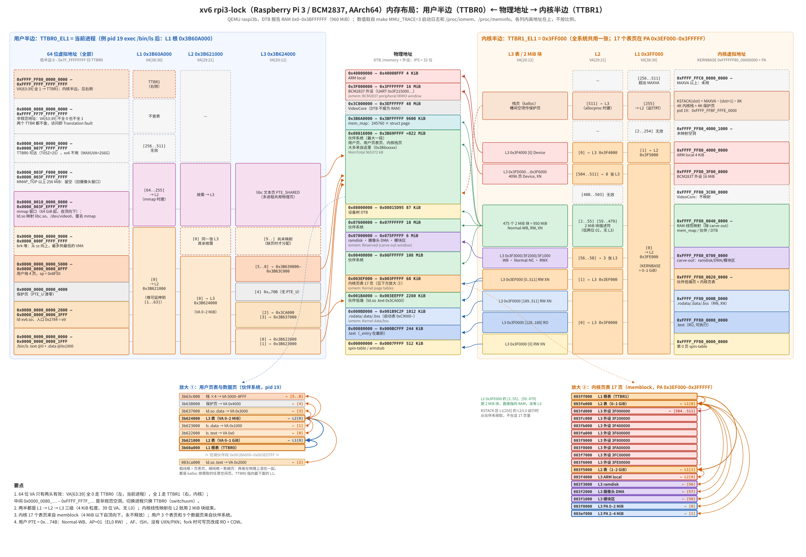
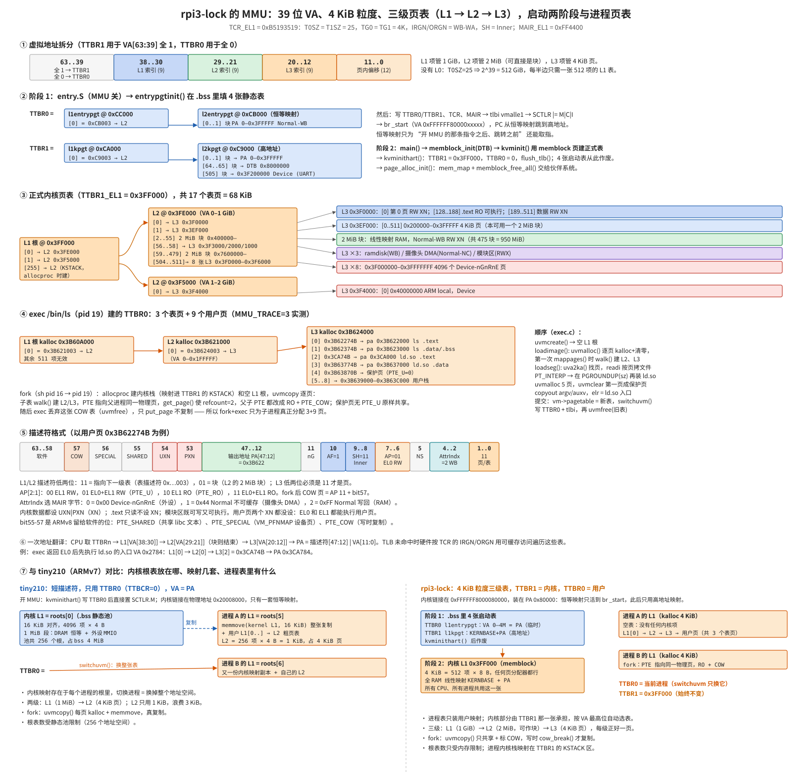
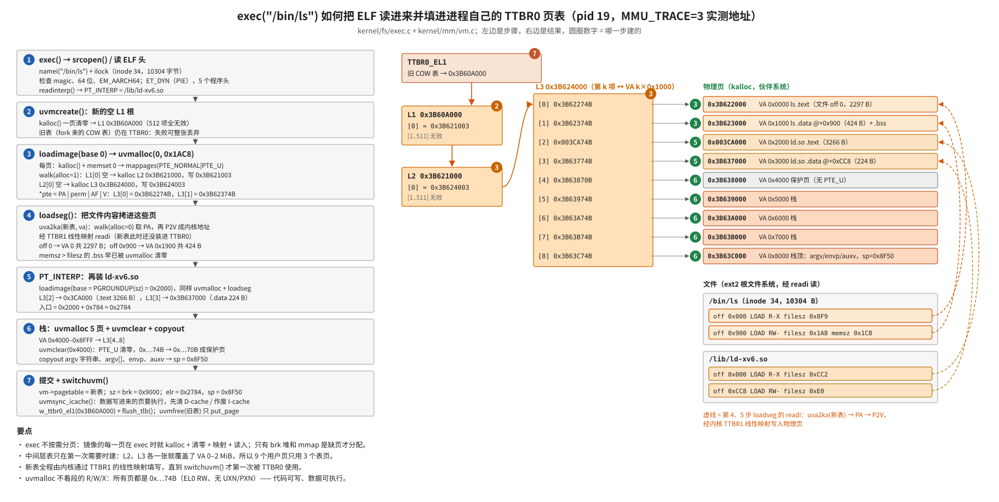

# rpi3-lock（Raspberry Pi 3 / BCM2837, AArch64）内存布局、MMU 初始化与进程页表

本文分析 rpi3-lock 分支内核的物理内存布局、MMU 的两阶段开启、内核页表 `kernel_pagetable`
的结构，以及 fork/exec 装载一个进程时页表页和用户页是怎么一页一页分配出来的。
所有数字取自 QEMU raspi3b 上 `make MMU_TRACE=3` 的一次真实启动（日志保存在
`tools/manim/rpi3-mmu-trace3.log`），以及登录后 `cat /proc/meminfo`、`cat /proc/iomem` 的输出。





动画（约 73 秒，三幕：内存初始化 / 打开 MMU / fork+exec 装载）：`videos/memory-anim.mp4`。
图和动画都可重新生成，见文末“复现”。

## 1. 物理内存（QEMU raspi3b，DTB 报告 960 MiB）

QEMU 用 `-dtb firmware/bcm2710-rpi-3-b.dtb` 启动，固件桩把 DTB 地址放在 x0。`entry.S` 把它暂存在
x21，`memblock_init()` 再从 DTB 的 `/memory` 节点读出 RAM：`0x0–0x3BFFFFFF`（983040 KiB）。
没有 DTB 时退回内建的 `PHYSTOP = 0x07000000`（112 MiB）。

| 物理地址 | 大小 | 内容 | 谁决定 |
|---|---|---|---|
| 0x00000000–0x0007FFFF | 512 KiB | 第 0 页 spin-table（0xE0/0xE8/0xF0 放副核入口）、armstub | `memblock_reserve(0, end)` |
| 0x00080000–0x000BCFFF | 244 KiB | 内核 `.text`（`_entry` 在最前，`kernel.ld` 的 `AT(0x80000)`） | Pi 固件约定 |
| 0x000BD000–0x001B9C2F | 1012 KiB | `.rodata/.initcall/.data` 48 KiB + `.bss` 964 KiB | 链接结果 |
| 0x001BA000–0x003EEFFF | 2260 KiB | 伙伴系统（低端空闲页，最早的用户页就从这里来） | `memblock_free_all()` |
| 0x003EF000–0x003FFFFF | 68 KiB | 内核页表 17 页 | `kvmmake()` 经 `memblock_alloc()` 自顶向下取 |
| 0x00400000–0x06FFFFFF | 108 MiB | 伙伴系统 | |
| 0x07000000–0x075FFFFF | 6 MiB | carve-out 窗口：ramdisk 1M、摄像头 DMA 2M、模块区 1M | `memlayout.h` 固定地址，`memblock_reserve` |
| 0x07600000–0x07FFFFFF | 10 MiB | 伙伴系统 | |
| 0x08000000–0x08015D95 | 87 KiB | DTB（QEMU 放在 128 MiB 处） | `memblock_reserve(dtb, totalsize)` |
| 0x08016000–0x3B69FFFF | ≈822 MiB | 伙伴系统（最大一段） | |
| 0x3B6A0000–0x3BFFFFFF | 9600 KiB | `mem_map`：245760 个 `struct page` × 40 B | `page_alloc_init()` 的 `memblock_alloc` |
| 0x3C000000–0x3EFFFFFF | 48 MiB | VideoCore GPU 内存，不是 System RAM | DTB 不报告 |
| 0x3F000000–0x3FFFFFFF | 16 MiB | BCM2837 外设（Mini UART 0x3F215000、EMMC、DWC2…） | `PERIPHERAL_BASE_PA` |
| 0x40000000–0x40000FFF | 4 KiB | ARM local（mailbox、本地定时器） | `LOCAL_BASE_PA` |

`.bss` 里值得注意的对象（`aarch64-elf-nm -S --size-sort kernel/kernel`）：`diskmap` 256 KiB、
`tcp_connections` 218 KiB、`ext2_instances` 80 KiB、`mt_rx_buf`/`module_image`/`ko_image` 各 64 KiB、
四张启动页表 `l2kpgt 0xC9000 / l1kpgt 0xCA000 / l2entrypgt 0xCB000 / l1entrypgt 0xCC000`、
每 CPU 4 KiB 的 `stack0`（0xCD000，共 16 KiB）。

`memblock` 的结果（启动日志 `memblock_dump()`）：

```
memory.cnt = 1, total = 983040 KiB
  [0] 0x0-0x3bffffff
reserved.cnt = 5, total = 17667 KiB
  [0] 0x00000000-0x001b9fff 1768 KiB   第 0 页 + 内核镜像
  [1] 0x003ef000-0x003fffff   68 KiB   17 个内核页表页
  [2] 0x07000000-0x075fffff 6144 KiB   carve-out 窗口
  [3] 0x08000000-0x08015d95   87 KiB   DTB
  [4] 0x3b6a0000-0x3bffffff 9600 KiB   mem_map
```

`memblock_free_all()` 把 memory − reserved 的四段交给伙伴系统，共 241343 页，
`/proc/meminfo` 里 `MemTotal: 965372 kB`。登录、跑几个命令之后 `MemFree` 仍有 964016 kB，
`Reserved: 17667 kB` 正好等于上面的 reserved 总和。

## 2. 两阶段打开 MMU

### 阶段 1：entry.S（MMU 关，物理地址运行）

1. `_entry`：保存 x0（DTB）到 x21；从 EL3/EL2 降到 EL1h；把 SCTLR_EL1 设成已知值（MMU、cache 全关）。
2. 副核在 `secondary_wait` 等；CPU0 打 `E`、清 `.bss`（打 `B`），设临时栈 `stack0`。
3. `entrypgtinit(l1entrypgt, l2entrypgt, l1kpgt, l2kpgt, EARLYTOP, dtb)`（`start.c`，C 代码但只用
   PC 相对寻址，所以在物理地址下也能跑）填 4 张静态表，L2 全部用 2 MiB 块：

   | 表 | 内容 |
   |---|---|
   | TTBR0：`l1entrypgt[0]` → `l2entrypgt` | `[0..1]` 块：VA 0–4 MiB = PA 0–4 MiB（恒等映射） |
   | TTBR1：`l1kpgt[0]` → `l2kpgt` | `[0..1]` 块：VA KERNBASE+0–4 MiB → PA 0–4 MiB |
   | | `[64..65]` 块：DTB 所在 2 MiB（及下一块）→ PA 0x8000000 |
   | | `[505]` 块：0x3F200000 Device-nGnRnE，让 Mini UART 在开 MMU 后还能打字 |

   为什么是 `EARLYTOP = 4 MiB` 而不是只映射内核：阶段 2 的页表页要从 memblock 里取，而那时
   只有这 4 MiB 是映射了的，所以 `memblock_init()` 结尾调用 `memblock_set_current_limit(EARLYTOP)`。
   `main()` 开头还会检查 `V2P(end) <= EARLYTOP`。
4. `entryothers`（所有核共用）：写 TTBR0 = l1entrypgt、TTBR1 = l1kpgt，TCR、MAIR，`tlbi vmalle1`，
   `ic iallu`，然后 `SCTLR_EL1 |= M | C | I`，`br x1` 跳到 `_start` 的**链接地址**（0xFFFFFF80000xxxxx）。
   开 MMU 那条指令之后的取指仍是低地址，所以必须有恒等映射；跳过去之后它就没用了。
5. `_start`：按 `mpidr` 设每核栈，打 `H`，进 `main()`。

寄存器（MMU_TRACE 读回并解码）：

```
TCR_EL1=b5193519: T0SZ=25 -> user VA 0-7fffffffff (39 bits), T1SZ=25 -> kernel VA ffffff8000000000-
  TG0=4K TG1=4K granule, walk = L1 -> L2 -> L3 (9+9+9+12 bits, no L0), IPS=32-bit PA
  table walks: IRGN0=WB-WA ORGN0=WB-WA SH0=3, IRGN1=WB-WA ORGN1=WB-WA SH1=3
MAIR_EL1=ff4400: Attr0=0 Device-nGnRnE, Attr1=44 Normal non-cacheable, Attr2=ff Normal write-back
SCTLR_EL1=30d01805: M(MMU)=1 C(D-cache)=1 I(I-cache)=1 A(align check)=0 WXN=0
ID_AA64MMFR0_EL1=1122: CPU supports 40-bit PA, 4K granule yes
```

T0SZ = T1SZ = 25 表示每半边 2^39 = 512 GiB，起始级是 L1（没有 L0），三级各 9 位索引。
IPS = 32 位物理地址足够覆盖 BCM2837（外设在 0x3F000000，ARM local 在 0x40000000）。

### 阶段 2：main() 建正式内核页表

```
memblock_init(boot_dtb_pa)   RAM + reserved，current_limit = EARLYTOP
kvminit() → kvmmake()        页表页由 kalloc() 的早期分支走 memblock_alloc(PGSIZE)
kvminithart()                TTBR1 = V2P(kernel_pagetable)，TTBR0 = 0，flush_tlb()
page_alloc_init()            mem_map + memblock_free_all() → 伙伴系统
```

`kvmmake()` 按区域映射，MMU_TRACE 记录了每个区域及其新建的表页（memblock 自顶向下，从 0x3FF000 往下）：

| 区域 | VA → PA | 属性 | 新建的表页 |
|---|---|---|---|
| BCM2837 外设 16 MiB | 0xFFFFFF803F000000 → 0x3F000000 | Device-nGnRnE, XN | L1 根 0x3FF000、L2 0x3FE000、L3 ×8（0x3FD000–0x3F6000） |
| ARM local 4 KiB | 0xFFFFFF8040000000 → 0x40000000 | Device, XN | L2 0x3F5000（L1[1]）、L3 0x3F4000 |
| ramdisk 1 MiB | 0xFFFFFF8007000000 | Normal-WB, XN | L3 0x3F3000 |
| 摄像头 DMA 2 MiB | 0xFFFFFF8007200000 | **Normal-NC**, XN | L3 0x3F2000 |
| 模块区 1 MiB | 0xFFFFFF8007400000 | Normal-WB, **可写且可执行** | L3 0x3F1000 |
| 第 0 页 | 0xFFFFFF8000000000 | Normal-WB, XN | L3 0x3F0000 |
| 内核 `.text` 244 KiB | 0xFFFFFF8000080000 | Normal-WB, **RO**, 可执行 | （同 L3 0x3F0000） |
| data+bss+早期 RAM | 0xFFFFFF80000BD000–0x3FFFFF | Normal-WB, XN | L3 0x3EF000 |
| RAM 线性映射 | 0xFFFFFF8000400000–0x3BFFFFFF | Normal-WB, XN | 无（全是 L2 的 2 MiB 块） |

最终内核表：**17 个表页（68 KiB）**，475 个 2 MiB 块 + 6018 个 4 KiB 页；对 RAM 而言是
1921 个 4 KiB + 475 个 2 MiB，即 `/proc/meminfo` 的 `DirectMap4k: 7684 kB`、`DirectMap2M: 972800 kB`。
线性映射跳过 carve-out 窗口（它在上面已经以各自属性映射过），也跳过 VideoCore 区（不是 RAM）。

`kvminithart()` 之后 TTBR0 = 0：内核运行时用户半边没有任何映射，四张启动表虽然还在 `.bss`
里，但已不被任何 TTBR 引用。副核同样走阶段 1 的启动表，进 `main()` 后再 `kvminithart()` 换到正式表。

## 3. 虚拟地址空间

**内核（TTBR1，所有核共用一张）**：

- `0xFFFFFF8000000000 + PA`：线性映射（`P2V/V2P` 就是加减 KERNBASE），外设和 ARM local 也在这个窗口里。
- `KSTACK(slot) = MAXVA − (slot+1)·8 KiB`，`MAXVA = KERNBASE + 2^38 = 0xFFFFFFC000000000`：
  每个任务一个 4 KiB 内核栈 + 4 KiB 不映射的保护页，落在 L1[255]。栈页由 `alloc_kstack()` 从伙伴系统
  kalloc 后 `mappages(kernel_pagetable, …)` 映射进来（例：pid 19 的内核栈 VA 0xFFFFFFBFFFFE0000）。
  这是 TTBR1 中唯一在运行时还会增删映射的区域。

**用户（TTBR0，每进程一张，`vm->pagetable`）**，以 `exec /bin/ls` 为例：

| VA | 内容 |
|---|---|
| 0x0000–0x1FFF | /bin/ls（ET_DYN PIE，基址 0）：`.text` @0（0x8F9 字节）、`.data/.bss` @0x1900 |
| 0x2000–0x3FFF | `/lib/ld-xv6.so`（PT_INTERP），基址 = `PGROUNDUP(sz)`；入口 0x2784 就是 `trapframe->elr` |
| 0x4000 | 保护页：`uvmclear()` 清掉 PTE_U，EL0 访问即缺页 |
| 0x5000–0x8FFF | 用户栈 4 页（`USTACKPAGES`），sp = 0x8F50，存 argv 字符串、argv[]、envp、auxv |
| 0x9000 = sz 起 | brk 堆（lazy：`sbrk` 只改 `vm->brk`，缺页时再分配） |
| 64 GiB – 0x3FF0000000 | mmap 窗口（`MMAP_MIN`–`MMAP_TOP`，自顶向下）：ld.so 在用户态 mmap 进 libc.so，`/dev/video0` 等 |
| – 0x7FFFFFFFFF | TTBR0 上限（39 位） |

## 4. 进程装载时的页表分配（MMU_TRACE=3 逐页实录）

### fork（`sh` pid 16 → pid 19）

```
mmu:   L1 root: kalloc pa 3b654000 (user TTBR0 table, 512 x 8-byte entries, empty)
mmu:   L2 table: kalloc pa 3b655000 -> user L1[0] = 3b655003 (VA 0-3fffffff)
mmu:   L3 table: kalloc pa 3b656000 -> user L2[0] = 3b656003 (VA 0-1fffff)
mmu:   cow: VA 0 pa 3b603000 now mapped by parent and child (refcount 2), both PTEs RO+COW
...
mmu:   cow: VA 5000 pa 1f5000 now mapped by parent and child (refcount 2), stack guard (no PTE_U), shared as is
...
mmu: fork: sh pid 16 -> pid 19: kstack VA ffffffbffffe0000 pa 3b653000, child root pa 3b654000, sz a000: 10 user pages shared COW, 3 table pages
```

1. `allocproc()` → `newprocslot()/alloc_kstack()`：kalloc 一页内核栈，映射到 TTBR1 的 KSTACK 槽
   （复用 UNUSED 槽位且栈页还在时直接沿用，pid 19 就复用了 pid 17/18 的槽 VA 0xFFFFFFBFFFFE0000）。
2. `vmspace_alloc()` → `uvmcreate()`：kalloc 一页空 L1 根。
3. `uvmcopy()`：对父进程 `[0, sz)` 每个页，子表 `mappages()` → `walk(alloc=1)` 按需建 L2、L3；
   子 PTE 指向**同一物理页**，`get_page()` 使 refcount = 2；用户可写页在父子两边都改成
   `PTE_RO | PTE_COW`。只读页和没有 PTE_U 的保护页原样共享。之后 `flush_tlb()`，因为父进程的
   可写 PTE 刚被改成只读。
4. 结果：子进程只花了 3 个表页（外加至多 1 个内核栈页），用户页一个没复制。谁先写，谁在缺页里
   `cow_break()`：最后一个持有者直接复用，否则 kalloc 新页拷贝（`/proc/meminfo` 的
   `CowShared/CowCopied/CowReused`）。

### exec("/bin/ls")（pid 19）



分步动画：`videos/exec-ls.mp4`（约 40 秒，`tools/manim/rpi3_exec_anim.py`）。

```
exec: /bin/ls pid 19: inode 34, 10304 bytes, ET_DYN ELF, entry 5a8, 5 program headers
mmu:   L1 root: kalloc pa 3b60a000
exec:   image at base 0: 2 PT_LOAD, uvmalloc VA 0-1fff (2 pages, zero-filled)
mmu:   L2 table: kalloc pa 3b621000 -> user L1[0] = 3b621003 (VA 0-3fffffff)
mmu:   L3 table: kalloc pa 3b624000 -> user L2[0] = 3b624003 (VA 0-1fffff)
mmu:   page: kalloc pa 3b622000 -> VA 0 (L3[0] = 3b62274b Normal-WB RW EL0+EL1 ISH)
mmu:   page: kalloc pa 3b623000 -> VA 1000 (L3[1] = 3b62374b Normal-WB RW EL0+EL1 ISH)
exec:   LOAD VA 0 memsz 8f9 filesz 8f9 file off 0 flags R-X (mapped RWX: no per-segment permissions)
exec:   read file off 0 -> VA 0 (pa 3b622000) 2297 bytes
exec:   LOAD VA 1900 memsz 1c8 filesz 1a8 file off 900 flags RW- (mapped RWX: no per-segment permissions)
exec:   read file off 900 -> VA 1900 (pa 3b623900) 424 bytes
exec:   image at base 2000: 2 PT_LOAD, uvmalloc VA 2000-3fff (2 pages, zero-filled)
mmu:   page: kalloc pa 3ca000 -> VA 2000 ...      （ld.so .text）
mmu:   page: kalloc pa 3b637000 -> VA 3000 ...    （ld.so .data）
exec: /bin/ls -> interpreter /lib/ld-xv6.so
mmu:   page: kalloc pa 3b638000 -> VA 4000 ... 3b63c000 -> VA 8000   （保护页 + 4 页栈）
exec:   stack: guard page VA 4000 (PTE_U cleared), stack VA 5000-8fff
exec:   argv: 2 strings + argv[]/envp/auxv 18 words copied to VA 8f50-8fff
exec: /bin/ls pid 19: sz 9000 sp 8f50 entry 2784, 3 table pages + 9 user pages, TTBR0 = root 3b60a000, old image freed
```

步骤（`kernel/fs/exec.c`）：

1. `srcopen()`：`namei` + `ilock`，读 ELF 头；ET_DYN 时 `readinterp()` 找 PT_INTERP。
2. `uvmcreate()`：新 L1 根（此时旧表还在用，失败可以整个回滚）。
3. `loadimage(base=0)`：先扫一遍程序头求 `[minstart, maxend)`，一次 `uvmalloc()` 把整段逐页
   kalloc + 清零 + `mappages(PTE_NORMAL|PTE_U)`；第一次 `mappages` 时 `walk()` 建出 L2、L3。
   然后 `loadseg()` 用 `uva2ka()` 查到每页的内核地址，按页 `readi` 拷文件内容；`memsz > filesz`
   的部分（`.bss`）已经是 0。
4. 解释器：在 `PGROUNDUP(sz)` 处用同样的 `loadimage()` 装 ld-xv6.so；入口 = ld.so 基址 + e_entry。
5. 栈：`uvmalloc` 再 5 页，`uvmclear()` 让最低一页失去 PTE_U 成保护页；`copyout` argv 字符串和
   argv[]/envp/auxv（AT_PHDR、AT_PHENT、AT_PHNUM、AT_PAGESZ、AT_BASE、AT_ENTRY）。
6. 提交：`exit_mmap(旧 vm)`，`vm->pagetable = 新表`，`sz/brk` 更新；`elr = ld.so 入口`、`sp`；
   `uvmsync_icache()`；`switchuvm()` 写 TTBR0 + `tlbi`；最后 `uvmfree(旧表)` —— 对 fork 留下的
   COW 页只是 `put_page()`，refcount 回到 1，父进程之后写它时走 `cow_break()` 的“最后持有者复用”。
7. 回到 EL0 后先执行 ld.so，它在用户态 mmap libc.so 并做重定位（日志 `ld.so: relocated libc.so in user space`）。

一次 fork+exec 小程序的总开销：至多 1 个内核栈页 + 3 个表页（fork，随后被 exec 释放）+ 3 个表页 + 9 个用户页（exec）。

### 一次地址翻译

ld.so 入口 VA 0x2784：TTBR0 = 0x3B60A000 → L1[0] = 0x3B621003（表）→ L2[0] = 0x3B624003（表）
→ L3[2] = 0x3CA74B（页）→ PA = 0x3CA000 | 0x784 = 0x3CA784。

描述符 0x…74B 拆开：bit[1:0]=11 页；AttrIndx=2（MAIR 0xFF，Normal 写回）；AP[2:1]=01（EL0/EL1 都可读写）；
SH=11（Inner Shareable）；AF=1；UXN=PXN=0。

## 5. 与 tiny210（ARMv7）的对比

见页表图第 ⑦ 块。根本差别在于页表格式：tiny210 用 ARMv7 短描述符，只用 TTBR0（TTBCR=0）；
rpi3 用 ARMv8 4 KiB 粒度三级表，TTBR0、TTBR1 各管半个地址空间。

### 5.1 内核根表：静态 .bss 还是动态分配

- **tiny210** `kernel/arch/arm/vm.c`：`static uint32 roots[256][4096] __attribute__((aligned(16384)))`
  是 .bss 里 4 MiB 的根表池，`kvminit()` 里 `kernel_pagetable = rootalloc()` 取的就是 `roots[0]`。
  ARMv7 L1 表 4096 项 × 4 B = 16 KiB 且必须 16 KiB 对齐，4 KiB 的 kalloc 给不出，只能预留静态池。
- **rpi3**：每级表 512 项 × 8 B = 4 KiB，正好一页。正式内核表由 `kvmmake()` 的 `kalloc()` 分配，
  此时伙伴系统还没建好，走早期分支 `memblock_alloc(PGSIZE, PGSIZE)`（`kernel/mm/kalloc.c`），
  从 EARLYTOP（4 MiB）往下取：根 0x3FF000，整棵树 17 页，都不在 .bss。
- 但 rpi3 也有 .bss 里的表：`kernel/arch/arm64/start.c` 的 `l1entrypgt/l2entrypgt/l1kpgt/l2kpgt`
  （0xC9000–0xCC000），只用于阶段 1 开 MMU，`kvminithart()` 之后不再被任何 TTBR 引用。

### 5.2 恒等映射之外的第二套映射

- **tiny210**：内核链接在物理地址 0x20008000，VA = PA。`kvminit()` 用 1 MiB 段恒等映射
  `[EXTMEM, PHYSTOP)`，`kvminithart()` 写 TTBR0 后直接置 SCTLR.M。开 MMU 前后地址不变，只有一套映射。
- **rpi3**：内核链接在 0xFFFFFF8000080000（`kernel/kernel.ld`：`. = 0xffffff8000080000; .text : AT(0x80000)`），
  却被装在物理 0x80000，所以 `entry.S` 要两套：
  - TTBR0 = `l1entrypgt`，VA 0–4 MiB = PA：只为置 SCTLR.M 那条指令之后、`br x1` 之前还能按低地址取指；
  - TTBR1 = `l1kpgt`，VA = KERNBASE + PA：跳到 `_start` 之后内核一直在这里运行。
  正式表 `kernel_pagetable` 把全部 960 MiB RAM 线性映射到 KERNBASE + PA（`P2V/V2P`，即 Linux 的 linear map）。
  `kvminithart()` 执行 `w_ttbr0_el1(0)`，恒等映射就此消失，内核运行时低半边地址为空。

### 5.3 用户页表

| | tiny210（ARMv7） | rpi3（ARMv8） |
|---|---|---|
| 新进程 L1 | `uvmcreate()`：`rootalloc()` 后 `memmove(p, kernel_pagetable, 16384)`，整张复制内核 L1（日志 “copy of the kernel L1”） | `uvmcreate()`：`kalloc()` 一页清零，空表，没有任何内核项 |
| 原因 | 只有 TTBR0，内核映射必须出现在每个进程的表里 | 内核在 TTBR1、用户在 TTBR0，`switchuvm()` 只换 TTBR0 |
| 级数 | L1（1 MiB 段/粗页表）→ L2（256 项 × 4 B = 1 KiB，占一整页 kalloc，浪费 3 KiB） | L1（1 GiB）→ L2（2 MiB，可作块）→ L3（4 KiB），每级 4 KiB；小程序共 3 个表页 |
| fork | `uvmcopy()` 每页 `kalloc + memmove`，真复制；mmap 段只复制 L1 项 | `uvmcopy()` 共享物理页，refcount = 2，PTE 改 RO + `PTE_COW`（bit57），写时 `cow_break()` 才复制 |
| PTE | 32 位：AP、domain、TEX/C/B | 64 位：AttrIndx→MAIR、AF、SH、AP、UXN/PXN，bit55–57 软件位（SHARED/SPECIAL/COW） |
| 根表上限 | 静态池 256 个地址空间 | 只受内存限制 |

一句话：tiny210 的进程页表 = 内核表副本 + 用户 L2；rpi3 的进程页表只有用户映射，内核部分由所有 CPU
共享的那一张 TTBR1 表承担。

## 6. 发现的问题与可改进点

1. **用户页没有任何执行/写保护区分。** `uvmalloc()` 一律 `PTE_NORMAL|PTE_U`，ELF 的 R-X / RW- 标志被忽略
   （MMU_TRACE 的 `mapped RWX: no per-segment permissions`）。`.text` 可写，`.data`/栈可执行。
   按 `ph.flags` 给 `.text` 设 `PTE_RO`、给数据和栈设 `PTE_UXN` 就能实现 W^X。
2. **用户页不设 PXN，SCTLR.WXN = 0，也没开 PAN。** EL1 可以直接执行用户页，内核被劫持时可以跳到用户
   准备的代码。所有用户 PTE 都应加 `PTE_PXN`。
3. **VA 0 是有效地址。** PIE 的基址是 0，空指针解引用读到的是程序自己的 `.text`，不会缺页。Linux 的
   做法是给 ET_DYN 一个非零基址（`ELF_ET_DYN_BASE`）并保留 `mmap_min_addr`。
4. **0x200000–0x3FFFFF 用了 512 个 4 KiB 页。** `kvmmake()` 把 `[etext, EARLYTOP)` 整段交给 `kvmmap()`，
   第二个 2 MiB 本可以是一个块描述符（省一个 L3 表页和 TLB 项）。改用 `kvmmap_linear()` 即可。
5. **模块区 1 MiB 永久 RWX。** 可以在 `.ko` 重定位完成后把 text 页改成 RO、把数据页改成 XN。
6. 内核页表页来自 EARLYTOP 以下的 memblock 区域，永不释放；`KSTACK` 区的 L2/L3 是运行时从伙伴系统来的，
   这些也不在 `/proc/iomem` 的 “Kernel page tables” 里。

## 7. MMU_TRACE 开关（本次新增）

`include/kernel/mmu_trace.h`、`kernel/mm/mmu_trace.c`，`make MMU_TRACE=n`（默认 0，关闭时代码被编译器删掉）：

| 级别 | 输出 |
|---|---|
| 1 | 启动：内核各段、DTB 位置、4 张启动表（合并成块区间）、`kvmmake()` 每个区域及其新建的表页、TCR/MAIR/SCTLR/TTBR/ID_AA64MMFR0 解码、最终 TTBR1 树（L1/L2/L3 合并区间 + 属性）、DirectMap、mem_map、伙伴系统收到的每一段 |
| 2 | 另加 userinit / fork / exec 的摘要：ELF 程序头、各 PT_LOAD、栈、sz/sp/入口、用了几个表页几个用户页 |
| 3 | 另加 fork/exec 期间的每一页：新 L1/L2/L3 表页、kalloc 的用户页及其 L3 描述符、COW 共享、每段 ELF 读入、argv 拷贝 |

所有行以 `mmu:` 或 `exec:` 开头，`grep '^mmu:\|^exec:'` 即得到干净的日志。它与已有的
`MM_TRACE`（分配器每个事件一行）、`VM_TRACE`（完整的 L1/L2/L3 转储）互补。
第 3 级的逐页输出只对“正在 fork/exec 的那个进程”打开（`p->mmutrace`），不会被别的进程的缺页刷屏。

## 8. 复现

```
make MMU_TRACE=3 fs.img qemu-sd-image
make qemu                              # 登录 root / xv6，然后 cat /proc/meminfo; cat /proc/iomem; ls /
python3 tools/rpi3_memory_svg.py doc/readme/rpi3/images      # 两张 SVG
rsvg-convert -z 1.5 doc/readme/rpi3/images/memory-layout.svg -o doc/readme/rpi3/images/memory-layout.png
tools/manim/render_rpi3.sh m           # 读 tools/manim/rpi3-mmu-trace3.log，输出 videos/memory-anim.mp4
manim -qm --media_dir build/manim tools/manim/rpi3_exec_anim.py ExecDetail   # exec 分步动画 → 拷到 videos/exec-ls.mp4
```

注意：本分支的 Makefile 引用 `kernel/drivers/media/{i2c/i2c.c,i2c/ov5647.c,platform/unicam.c}`，但
`.gitignore` 里的 `media/` 规则把它们排除在仓库外（hdmi 分支的提交 8f15516 已修正为 `/media/`）。
干净 clone 编不过；这次是从 8f15516 取出这三个文件放进工作区才编译成功的。
