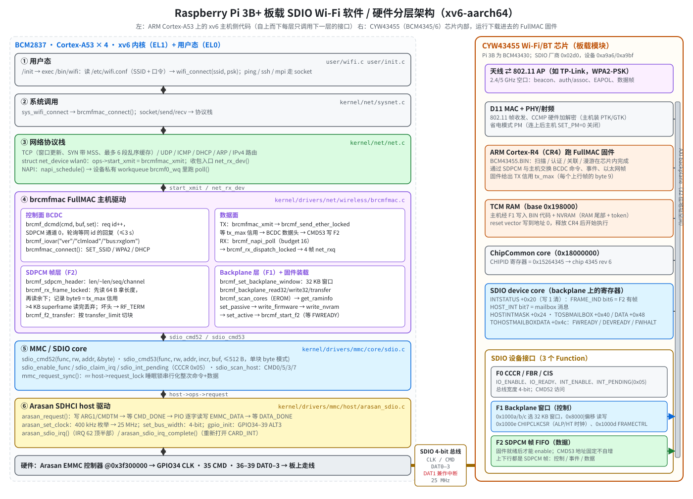
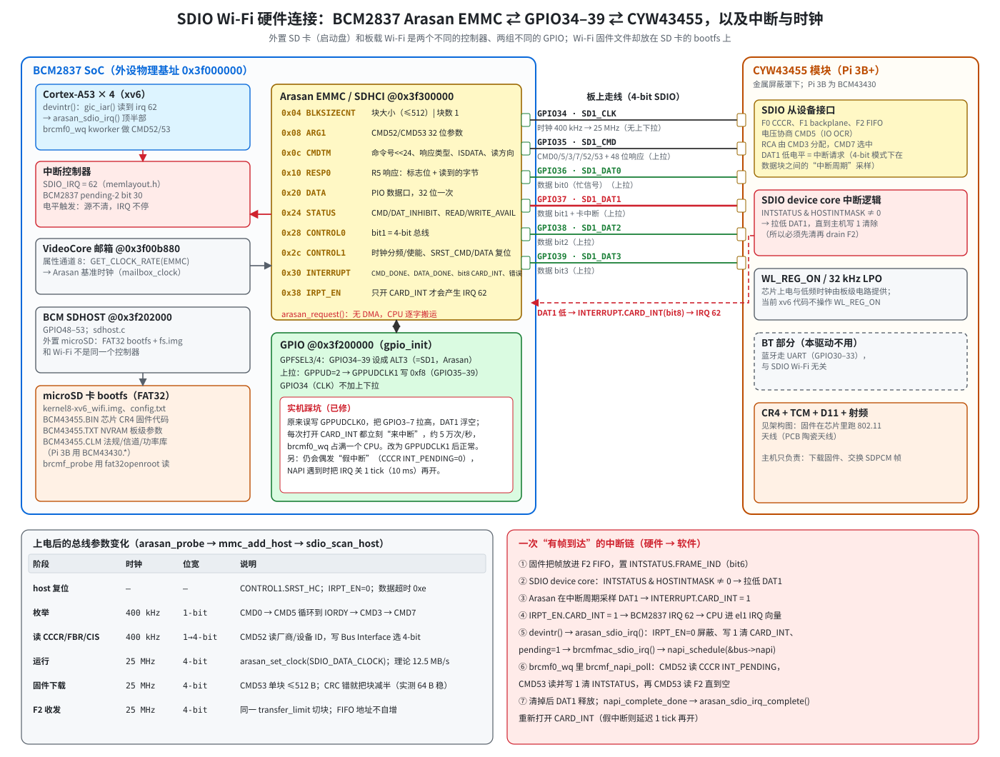
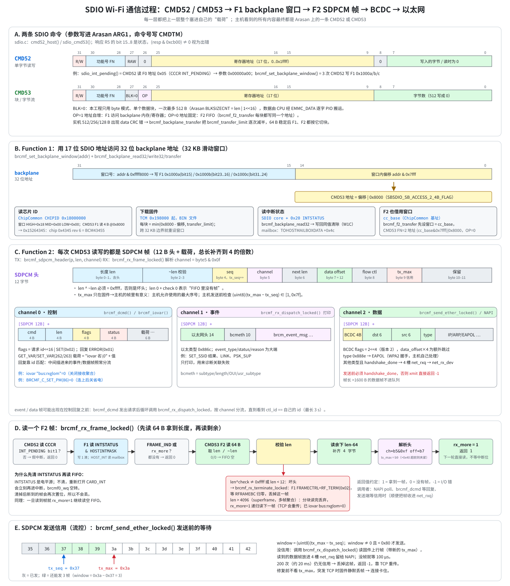
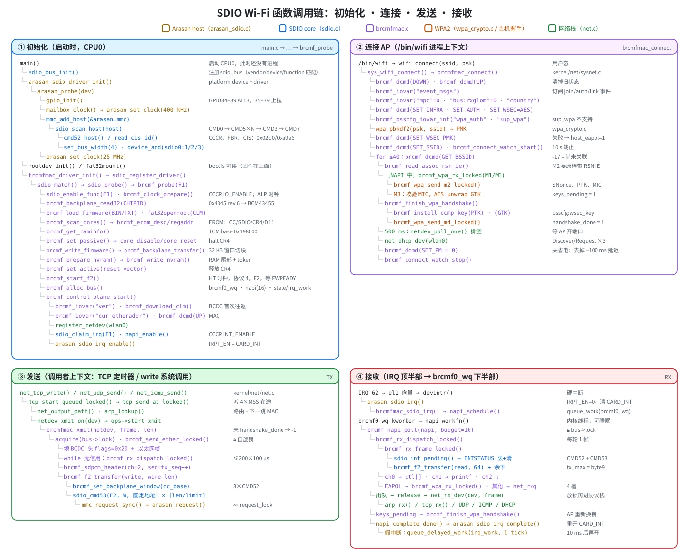
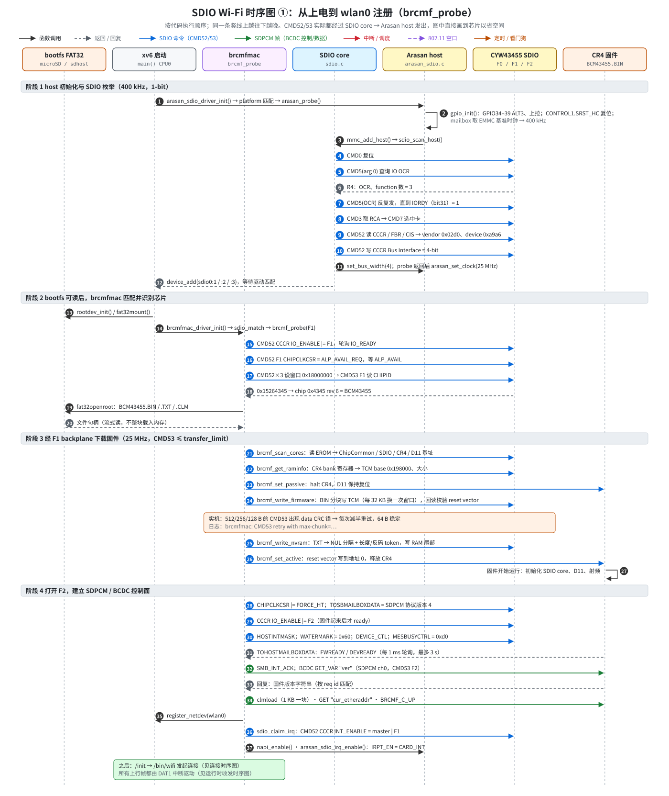
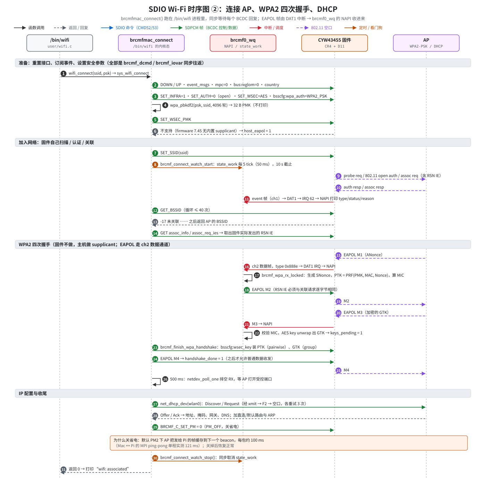
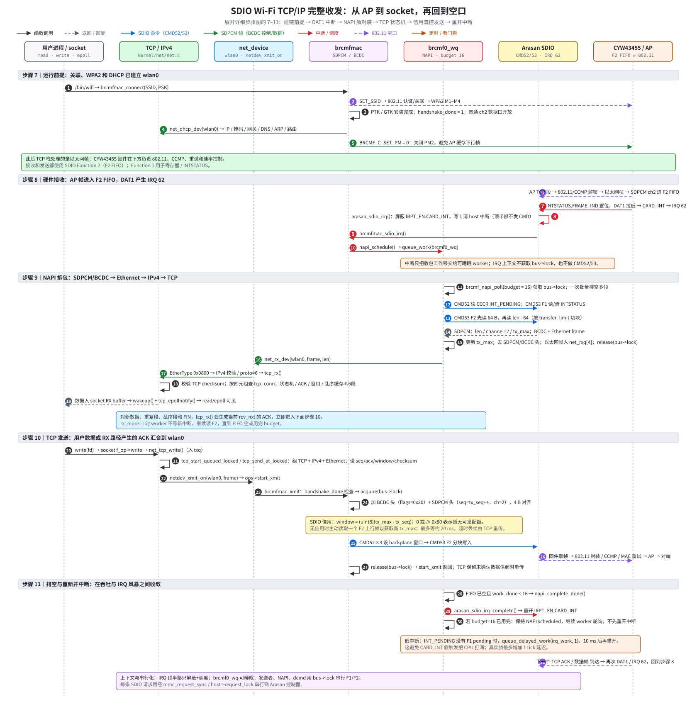
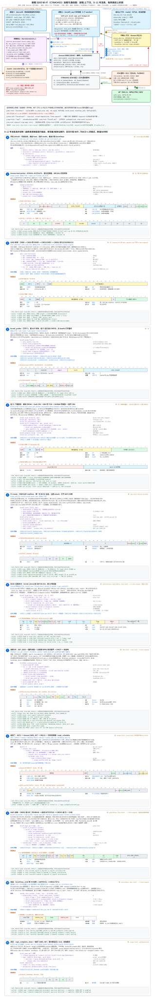

# 图解 Raspberry Pi 3 板载 SDIO Wi-Fi（xv6-aarch64）

本文用 7 张图把板载 Wi-Fi 从硬件走线到 TCP 收发串起来：架构、硬件连接、通信协议分层、
函数调用链，以及三张时序图（初始化、连接 AP、运行时收发）。文字版的完整说明见
[readme_sdio_wifi.md](../readme_sdio_wifi.md)，本文只讲图里的要点。

- 板子：Pi 3B+（CYW43455 = BCM4345 rev 6）；Pi 3B 是 BCM43430，流程相同，固件文件名不同
- 主机控制器：BCM2837 的 Arasan EMMC/SDHCI，基址 `0x3f300000`，走 GPIO34–39
- 代码：`kernel/drivers/mmc/host/arasan_sdio.c` → `kernel/drivers/mmc/core/sdio.c` →
  `kernel/drivers/net/wireless/brcmfmac.c` → `kernel/net/net.c`

| 图 | 文件 | 回答的问题 |
|---|---|---|
| 1 | `images/sdio-wifi-arch.svg` | 软件分几层？芯片里有什么？ |
| 2 | `images/sdio-wifi-hw.svg` | 线怎么接？时钟、上拉、中断怎么走？ |
| 3 | `images/sdio-wifi-proto.svg` | 一个以太网帧在 SDIO 上长什么样？ |
| 4 | `images/sdio-wifi-callchain.svg` | 每条路径调用了哪些函数？ |
| 5 | `images/sdio-wifi-seq-init.svg` | 上电到 `wlan0` 注册的先后顺序 |
| 6 | `images/sdio-wifi-seq-connect.svg` | 连接 AP、WPA2 握手、DHCP 的先后顺序 |
| 7 | `images/sdio-wifi-seq-rxtx.svg` | 详细步骤 7–11：从 AP 、SDIO/NAPI、TCP/IP 到 socket 的完整收发闭环 |

每张图另有同名 `.png`（2 倍分辨率）备用。图由 `tools/sdio_wifi_diagrams/` 下的脚本生成，见文末。

---

## 1. 架构：主机六层 + 芯片内的 FullMAC 固件



- **FullMAC**：扫描、认证、关联、加密都在芯片里的 Cortex-R4 固件中完成，xv6 的
  `brcmfmac` 只负责下载固件、发控制命令（BCDC）、收发以太网帧。唯一例外是 WPA2 四次握手：
  这版固件不带 supplicant，所以 EAPOL 由主机处理（见时序图 ②）。
- 主机侧每层只调用下一层：协议栈通过 `ops->start_xmit` / `net_rx_dev()` 和驱动交互，
  驱动只调用 `sdio_cmd52()` / `sdio_cmd53()`，SDIO core 只调用 `host->ops->request`。
- 芯片侧三个 SDIO Function：**F0** 是 CCCR 标准寄存器；**F1** 是进入芯片 AXI backplane 的
  32 KB 窗口，用来下载固件、读写 SDIO core 的 `INTSTATUS` 和 mailbox；**F2** 是运行时的
  SDPCM 帧 FIFO，固件跑起来之后才能打开。

## 2. 硬件连接：六根线、一个电平中断



| GPIO | ALT3 信号 | 作用 | 上下拉 |
|---|---|---|---|
| 34 | SD1_CLK | 时钟：枚举 400 kHz，运行 25 MHz | 无 |
| 35 | SD1_CMD | 命令与 48 位响应 | 上拉 |
| 36 | SD1_DAT0 | 数据 bit0 / 忙 | 上拉 |
| 37 | SD1_DAT1 | 数据 bit1 **兼卡中断** | 上拉 |
| 38 | SD1_DAT2 | 数据 bit2 | 上拉 |
| 39 | SD1_DAT3 | 数据 bit3 | 上拉 |

要点：

1. 外置 microSD 走的是另一个控制器（SDHOST `0x3f202000`，GPIO48–53），但 Wi-Fi 的
   `BCM43455.BIN/.TXT/.CLM` 放在它的 bootfs 上，所以 `brcmfmac_driver_init()` 必须排在
   `fat32mount()` 之后。
2. 中断链：固件置 `INTSTATUS.FRAME_IND` → 芯片拉低 DAT1 → Arasan `INTERRUPT.CARD_INT`
   → IRQ 62 → `arasan_sdio_irq()`。这是**电平**中断：主机不把 `INTSTATUS` 写 1 清掉，
   DAT1 就一直低，重新打开 `CARD_INT` 会立刻再进中断。
3. 已修过的实机问题：上拉原来写到了 `GPPUDCLK0`（GPIO0–31），DAT1 浮空，每秒约 5 万次
   假中断，`brcmf0_wq` 占满一个 CPU。改成 `GPPUDCLK1` 后正常。剩余偶发假中断由 NAPI 识别
   （CCCR `INT_PENDING` 里 F1 没置位），把 IRQ 关 1 tick 再开。
4. Arasan 没用 DMA，`arasan_request()` 由 CPU 逐字读写 `EMMC_DATA`；CMD53 一次最多 512 B，
   实机大块传输出现 data CRC 错，驱动减半重试后稳定在 64 B。

## 3. 通信过程：CMD52/53 → F1 窗口 → SDPCM → BCDC → 以太网



- **A. 命令**：CMD52 读写一个字节（寄存器），CMD53 读写一段数据。F1 用地址自增
  （OP=1），F2 用固定地址（OP=0，FIFO）。
- **B. F1 窗口**：backplane 地址高 17 位写到 F1 `0x1000a/b/c`，低 15 位或上 `0x8000` 作为
  CMD53 地址。读芯片 ID 就是“窗口 0x18000000 + CMD53 读 4 字节 @0x8000”。
- **C. SDPCM 帧**：12 字节头（`len`、`~len`、`seq`、`channel`、`data offset`、`tx_max`……）。
  channel 0 = BCDC 控制（`brcmf_dcmd`，按请求 id 匹配回复），1 = 事件，2 = 数据（4 字节
  BCDC 头 + 以太网帧）。
- **D. 读一帧**：先读 64 字节拿到长度，再读剩余。坏头发 `RF_TERM` 丢弃；大于 4 KB 的
  superframe（固件把多帧聚合在一起）读完丢弃，同时用 iovar `bus:rxglom=0` 尽量关闭聚合。
  先清 `INTSTATUS` 再读 FIFO，读到帧后 `rx_more=1` 一直读到空。
- **E. 发送信用**：固件在每个上行帧的 byte 9 告诉主机 `tx_max`。
  `(uint8)(tx_max − tx_seq)` 为 0 或 ≥ 0x80 时不能发，要先读上行帧拿新信用；20 ms 还没有就
  丢帧靠 TCP 重传。修复前不看信用，几个 TCP 段同时在途时固件丢帧，连接卡死。

## 4. 函数调用链



颜色表示函数所在的文件。四条路径：

- **初始化**（启动时，CPU0）：`arasan_probe` → `sdio_scan_host` 枚举；`brcmf_probe` 识别芯片、
  下载固件和 NVRAM、`brcmf_start_f2`、`brcmf_control_plane_start` 注册 `wlan0`、打开中断。
- **连接**（`/bin/wifi` 的内核态）：`brcmfmac_connect` 发一串 BCDC 命令，`SET_SSID` 之后轮询
  `GET_BSSID`，EAPOL 由 NAPI 里的 `brcmf_wpa_rx_locked` 处理，最后 DHCP、关省电。
- **发送**：协议栈 `netdev_xmit_on` → `brcmfmac_xmit` → `brcmf_send_ether_locked`（等信用）
  → `brcmf_f2_transfer` → `sdio_cmd53` → `arasan_request`。
- **接收**：IRQ 62 顶半部只屏蔽和调度；`brcmf0_wq` 里 `brcmf_napi_poll` 循环
  `brcmf_rx_dispatch_locked`，数据帧放锁后交给 `net_rx_dev`。

## 5. 时序图

### ① 上电到 wlan0 注册



四个阶段：枚举（400 kHz、1-bit，CMD0/5/3/7/52）→ 读固件文件、识别芯片 → 经 F1 下载固件
（halt CR4、写 BIN、写 NVRAM、释放 CR4）→ 打开 F2、等 `FWREADY`、第一次 BCDC 往返
（`"ver"`）、下载 CLM、`register_netdev(wlan0)`、打开 DAT1 中断。

### ② 连接 AP、WPA2、DHCP



`brcmfmac_connect()` 同步等待每个 BCDC 回复；`SET_WSEC_PMK` 失败说明固件不做握手，于是
主机自己处理 M1–M4（M2 必须带上固件关联请求里原样的 RSN IE）。装好 PTK/GTK、发出 M4 后
`handshake_done = 1`，普通数据才能收发。DHCP 成功后发 `BRCMF_C_SET_PM = 0`：默认 PM2 下
AP 把发给 Pi 的帧缓存到下一个 beacon，每个包约 100 ms。

### ③ 运行时收发



这张图是「SDIO Wi-Fi 通信全流程」第 7–11 步的 TCP/IP 展开图：第 7 步先建立
`handshake_done` 和 DHCP/ARP/路由状态；第 8–9 步把 AP 的 802.11 帧经 DAT1 中断、NAPI、
SDPCM/BCDC 解封装交给 `net_rx_dev()` 和 `tcp_rx()`；第 10 步把用户 `write()` 数据或
`tcp_rx()` 产生的 ACK 通过 `netdev_xmit_on()` 和 F2 FIFO 发回 AP；第 11 步负责
排空 FIFO、处理 budget/假中断，并重新使能 `CARD_INT`。

接收：DAT1 → IRQ 62 → 顶半部屏蔽 + `napi_schedule` → `brcmf0_wq` 里 CMD52 查
`INT_PENDING`、CMD53 读清 `INTSTATUS`、CMD53 读 F2 → `net_rx_dev` → `tcp_rx`；读空后
`napi_complete_done` 重开中断。发送：`brcmfmac_xmit` 拿 `bus->lock`，检查信用，
写 SDPCM 头，CMD53 写 F2。发送者、NAPI、`brcmf_dcmd` 共用 `bus->lock`；每条 SDIO 命令再由
`host->request_lock` 串行化。

### ④ 时序步骤流（总览 + 0–11 号消息逐步说明）



画法同 tiny210 的 `usbkbd-comm-steps`：上半张是总览，把启动上下文、`/bin/wifi`、`brcmf0_wq`、
IRQ 62、网络核心、Arasan、芯片 SDIO 接口、CR4 固件、AP 画成框，0–11 号箭头标出每条消息
和路上拿的锁；下面每一号一张卡片：调用链（缩进函数树）、这一步实际发出的 CMD52/CMD53、
寄存器或帧按位/按字节展开，以及对应的 `WIFI_TRACE=1` 日志行（数值是示例，以实机为准）。

## 6. 图里提到的近期修复

| 提交 | 内容 | 在哪张图 |
|---|---|---|
| `e031e7f` | 坏头 / 过大帧用 `RF_TERM` 终止；连接时设 `bus:rxglom=0` | 3-D、6 |
| `e91d3d2` | 读完并丢弃 superframe；Wi-Fi 上 TCP 窗口 2 KB | 3-D |
| `a78b5ec` | 遵守 SDPCM 发送信用 `tx_max`；4 槽 RX 队列 | 3-E、7 |
| `208415a` | 连上后关闭省电（`SET_PM = 0`） | 6 |
| `e2026a9`、`e8a6695` | TCP 窗口更新、SYN 带 MSS、最多 6 段乱序缓存 | 1、7 |
| （GPIO 上拉） | `GPPUDCLK1` 修正 DAT1 浮空；假中断延迟 1 tick 再开 | 2、7 |

## 7. 重新生成图

```sh
python3 tools/sdio_wifi_diagrams/gen_sdio_wifi_diagrams.py            # 输出到 doc/readme/rpi3/images/*.svg
python3 tools/sdio_wifi_diagrams/gen_sdio_wifi_steps.py doc/readme/rpi3/images/sdio-wifi-comm-steps.svg   # 步骤流
node tools/sdio_wifi_diagrams/render_png.js doc/readme/rpi3/images/sdio-wifi-*.svg   # 转 2x PNG（需要 playwright）
```

图中的函数名、寄存器偏移和常量取自当前代码；改驱动后请同步修改 `fig_*.py`。

## 8. WIFI_TRACE 日志与 manim 动画

### 8.1 打开日志

`include/kernel/wifi_trace.h` 定义了按步骤编号的日志，每行格式是
`wifi<步骤>: t=<开机毫秒> ...`，`grep '^wifi[0-9]'` 就能拿到完整过程。默认关闭（`WIFI_TRACE=0`
时所有打印都被编译器删掉）。

| 步骤 | 位置 | 内容 |
|---|---|---|
| wifi1 | arasan_sdio.c | host probe、GPIO、时钟 400 kHz / 25 MHz |
| wifi2 | sdio.c、arasan_sdio.c | CMD0/5/3/7、CCCR 4-bit、FBR/CIS 里的 vendor/device |
| wifi3 | sdio.c、brcmfmac.c | F1 enable、CHIPID、bootfs 文件大小 |
| wifi4 | brcmfmac.c | EROM、TCM、halt CR4、BIN 窗口数与耗时、NVRAM、释放 CR4 |
| wifi5 | 三个文件 | F2 ready、FWREADY mailbox、INT_ENABLE、wlan0、IRPT_EN |
| wifi6 | brcmfmac.c | 每条 BCDC 命令：id、cmd、iovar 名、seq，回复的 status 和耗时 |
| wifi7 | brcmfmac.c | SET_SSID、固件事件、BSSID、EAPOL M1–M4、WPA2 完成、DHCP、SET_PM=0 |
| wifi8 | arasan_sdio.c 计数，NAPI 打印 | DAT1 卡中断次数（顶半部不 printf，避免和 printf 锁死锁） |
| wifi9 | brcmfmac.c | 每个读到的 SDPCM 帧：channel、len、seq、tx_max、INTSTATUS |
| wifi10 | brcmfmac.c | 每个发出的数据帧：以太类型、seq、tx_max、window、等信用的次数 |
| wifi11 | brcmfmac.c | 每次 NAPI poll：读了几帧、是否读空、之前有几次假中断 |

级别：`WIFI_TRACE=1` 打印 1–7 的全部，以及 8–11 的前 `WIFI_TRACE_LIMIT`（默认 300）行；
`WIFI_TRACE=2` 另外打印固件每个 32 KB 窗口，以及 BCDC 命令等回复时顺带读到的帧。
串口 115200 波特率下打印会拖慢收发，测吞吐时请关掉。

构建：在 `Makefile` 的 `$K/core/proc.o: $(PROC_SCHED_TRACE_CONFIG)` 这一行后面加一行
`include Makefile.wifi_trace.mk`，然后：

```sh
make WIFI_TRACE=1
make install-rpi3 RPI3_XV6_DEV=/dev/rdiskNs2 WIFI_FIRMWARE_DIR=firmware
# 串口抓日志（macOS 示例），开机连上 Wi-Fi 后跑一次 ping / 一段 TCP 再退出
script -q wifi-trace.log screen /dev/tty.usbserial-XXXX 115200
```

### 8.2 渲染动画

```sh
pip install manim                                   # 需要 pango / cairo / ffmpeg
tools/sdio_wifi_diagrams/manim/render_sdio_wifi.sh m wifi-trace.log
# → doc/readme/rpi3/videos/sdio-wifi-anim.mp4
```

动画分三段：`Bringup`（wifi1–5 和开机时的 BCDC 命令）、`Join`（BCDC 设置 → 关联 → WPA2 → DHCP →
关省电）、`DataPath`（DAT1 中断 → NAPI 收帧 → 信用流控发送）。日志每一行对应动画里的一拍，
底部滚动显示原始日志行，右上角是这行的 `t=`。

仓库里的 `sample-wifi-trace.log` 是**示例日志**：按格式串和代码执行顺序写出，时间、长度、序号等
数值是示意值，不是实机记录；用它渲染的视频会在画面里标出“示例日志”。抓到实机日志后，用上面的
命令重新渲染即可替换。
