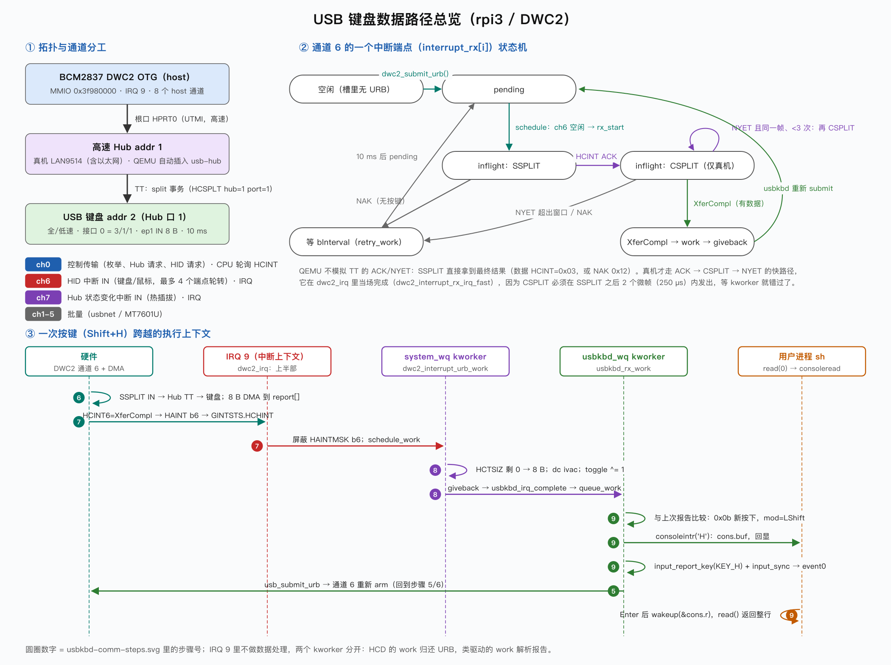
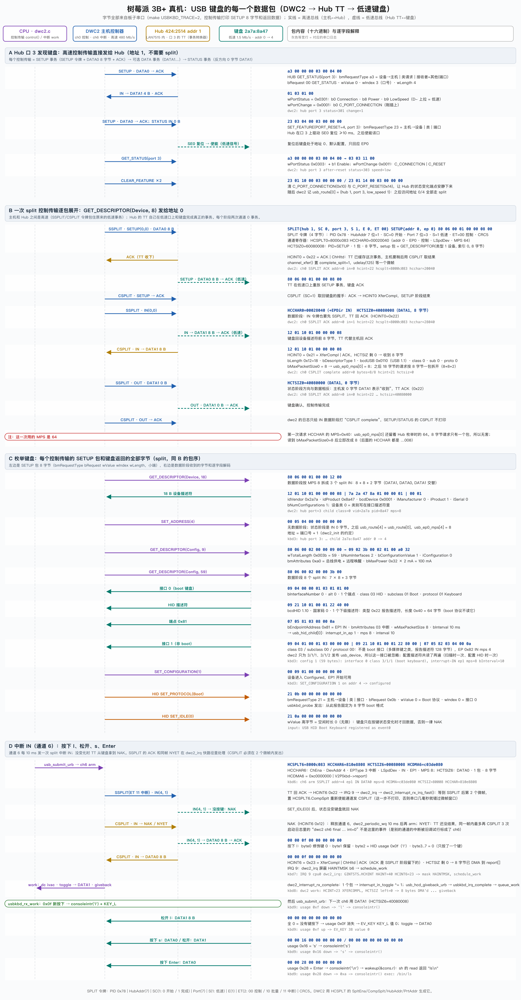
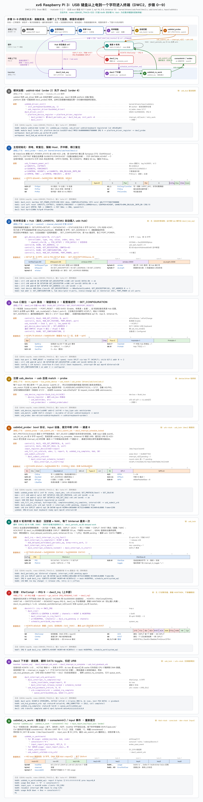

# USB 键盘通信流程（Raspberry Pi 3 / DWC2）

本文按步骤 0–9 走一遍 rpi3-lock 分支上 USB 键盘从“驱动加载”到“一个字符进入 shell”的全过程，
所有寄存器值和报文都取自 QEMU raspi3b 的实际日志（`make USBKBD_TRACE=2`）。
更早的排查记录、真机日志和设计演变见 [../readme_usb_keyboard.md](../readme_usb_keyboard.md)。

| 材料 | 内容 |
| --- | --- |
| [images/usbkbd-overview.svg](images/usbkbd-overview.svg) | 拓扑与通道分工、通道 6 状态机、一次按键跨越的 5 个执行上下文 |
| [images/usbkbd-comm-steps.svg](images/usbkbd-comm-steps.svg) | 步骤 0–9 卡片：上下文、调用树、锁、寄存器/报文按位展开、对应日志 |
| [images/usbkbd-packets-3bplus.svg](images/usbkbd-packets-3bplus.svg) | **3B+ 真机逐包图**：Hub 口复位、一次 split 控制传输的 9 个包、键盘返回的全部描述符字节逐字段解码、通道 6 中断 IN（l/s/Enter） |
| [images/dwc2-channel-queues.svg](images/dwc2-channel-queues.svg) | DWC2 通道“队列”收发图（对照 tiny210 的 ehci-qh-queues）：ch0 控制、ch6 + interrupt_rx[4]、完成路径、ch7、EHCI/DWC2 对照 |
| [videos/usbkbd-packets-3bplus.mp4](videos/usbkbd-packets-3bplus.mp4)（新版带泳道+队列定位：`-540p.mp4`，压缩版 `-small.mp4`；不带定位的旧 1080p 版为本文件） | 3B+ 真机逐包动画：每个令牌/数据/握手包和通道寄存器逐位解释 + 函数调用链，`tools/manim/rpi3_usbkbd_packets_anim.py` |
| [videos/dwc2-channel-queues.mp4](videos/dwc2-channel-queues.mp4) | DWC2 通道队列动画，`tools/manim/rpi3_dwc2_queues_anim.py` |
| [videos/usbkbd-flow.mp4](videos/usbkbd-flow.mp4) | manim 动画（约 2 分钟），源码 `tools/manim/rpi3_usbkbd_anim.py` |
| [logs/qemu-usbkbd-trace2.log](logs/qemu-usbkbd-trace2.log) | QEMU 全量日志（USBKBD_TRACE=2，键入 `echo Hi`） |
| [logs/qemu-usbkbd-trace3-idle.log](logs/qemu-usbkbd-trace3-idle.log) | USBKBD_TRACE=3 下的空闲轮询（NAK）片段 |



## 和 tiny210（EHCI）的区别

| | tiny210：S5PV210 EHCI | rpi3：BCM2837 DWC2 OTG |
| --- | --- | --- |
| 周期调度 | 硬件走 frame list → 中断 QH，每 1 ms 自动轮询 | **没有**调度表：驱动每次手动 arm 一个通道事务，NAK 后用 delayed work 等 bInterval 再 arm |
| 控制传输 | async 环上的 EP0 QH + qTD 链 | 通道 0，SETUP/DATA/STATUS 三个事务，CPU 轮询 HCINT0 |
| 全/低速设备 | QH 里的 S-mask/C-mask，TT 由 EHCI 硬件按微帧发 split | 驱动写 HCSPLT；真机 SSPLIT 的 ACK、CSPLIT 的 NYET 都会回到 CPU（`dwc2_irq` 快路径里当场续发） |
| 中断 | IRQ 55/39，USBSTS.USBINT | IRQ 9（BCM2837 legacy），GINTSTS.HCHINT → HAINT → HCINTn |
| DMA 地址 | 物理地址 | `0xc0000000 | phys`（VideoCore 总线别名），收数据后要 `dc ivac` |
| 输入到控制台 | input handler "kbd"（keyboard.c） | usbkbd 直接 `consoleintr()`，evdev 是另一路独立消费者 |

## 拓扑与通道

```
DWC2 OTG (host, MMIO 0x3f980000, IRQ 9)
  └─ 根口 HPRT0（高速）
       └─ Hub addr 1   真机 3B：LAN9514；3B+：LAN7515 = Hub 424:2514（口 1 再挂一个 2514 Hub + LAN7800 网卡）
                       QEMU raspi3b：自动插入的 usb-hub 409:55aa
            └─ 口 1：键盘 addr 2（全/低速 → split）   QEMU usb-kbd 627:1；真机例：2a7a:8a47
                 接口 0 = class 3/1/1（HID boot keyboard），EP 0x81 中断 IN，mps 8，bInterval 10
```

| 通道 | 用途 | 完成方式 |
| --- | --- | --- |
| ch0 | 所有控制传输（枚举、Hub 请求、HID SET_PROTOCOL/SET_IDLE） | `channel_xfer()` 忙等 HCINT0 |
| ch6 | HID 中断 IN；`interrupt_rx[4]` 最多 4 个端点轮流（无线键鼠接收器的键盘+鼠标接口） | IRQ |
| ch7 | Hub 状态变化端点（热插拔） | IRQ |
| ch1–5 | 批量：ch1/2 QEMU usb-net（CDC），ch3 IN / ch5 OUT MT7601U 同步，ch4 MT7601U 异步接收 | 轮询；ch4 IRQ |

> QEMU raspi3b 的 DWC2 只有一个根口，`-device usb-kbd` 会被 QEMU 自动挂到一个 usb-hub 后面
> （`info usb` 显示 Port 1 = QEMU USB Hub，Port 1.1 = Keyboard），所以 QEMU 的拓扑和真机一样是“Hub 后的全速键盘”，
> split 路径都会走到。区别只是 QEMU 不模拟 TT 的 ACK/NYET（见步骤 6）。

## 步骤 0：模块加载顺序

`module_init_ord("usbhid-kbd", usbkbd_driver_init, 2)` 早于 `module_init_ord("dwc2", dwc2_driver_init, 4)`。

* `usbkbd_driver_init()`（`kernel/drivers/input/usbkbd.c:387`）：建单 worker 的 `usbkbd_wq`，`usb_register_driver()` 把
  id_table（只匹配 CLASS|SUBCLASS|PROTOCOL = 3/1/1）挂到 usb 总线。
* `dwc2_driver_init()`（`dwc2.c:2629`）：注册 platform 设备（MMIO + IRQ 9 资源）和驱动 → `dwc2_probe()`：建
  `dwc2_periodic_wq`（bInterval 重试）、`dwc2_hub_wq`（热插拔），给 `interrupt_rx[i]` 初始化 work/delayed_work，然后 `dwc2_init()`。

顺序的意义：开机前就插着的键盘在 `dwc2_init()` 第一次扫描、`usb_device_register()` 时就能立刻匹配到驱动。

## 步骤 1：主控初始化（`dwc2_init`，`dwc2.c:1991`）

1. `usb_firmware_power_on()`：邮箱属性通道 8，tag `0x28001 SET_POWER_STATE`，设备 id 3（USB HCD），等待上电完成。
2. 读 `GSNPSID`，高 16 位须为 `0x4f54`（"OT"），QEMU 为 `0x4f54294a`。
3. `GAHBCFG=0` → 等 `GRSTCTL.AHBIDLE` → `GRSTCTL.CSFTRST` 软复位 → 再等 AHBIDLE。**先复位再置 `GUSBCFG.FORCEHOST`**（反过来在真机上会被复位冲掉），等 `GINTSTS.CURMOD=1`。
4. 关掉所有通道中断，`GINTMSK = HCHINT`（全局只关心 host channel 中断），`GAHBCFG = DMA_EN | GLBL_INTR_EN`。
5. 根口：`HPRT0 |= PWR` → 等 `CONNSTS` → `PWR|RST` 50 ms → 清 RST → 看到 `PrtEna`。注意 HPRT0 的 b1/b3/b5 是写 1 清除，改写前要屏蔽（`HPRT_W1C`）。

```
kbd1: dwc2_init: mailbox SET_POWER_STATE(USB HCD) done, GSNPSID=4f54294a (OT2 core) @0xffffff803f980000
kbd1: core soft reset (GRSTCTL.CSFTRST), GUSBCFG.FORCEHOST -> GINTSTS.CURMOD=host; GINTMSK=HCHINT, GAHBCFG=DMA_EN|GLBL_INTR_EN (IRQ 9)
kbd1: root port HPRT0: PWR -> CONNSTS -> RST 50ms -> ENA, speed=full
dwc2: host hprt=2100d hcfg=0 hfnum=34a
```

`HPRT0=0x2100d`：Conn(b0)、Ena(b2)、EnChng(b3)、Pwr(b12)、PrtSpd(b18:17)=01。

## 步骤 2：枚举 Hub（地址 1）

3B+ 真机上这一步看到的是 `root device 424:2514 class=9 … mps=64`，Hub 有 4 个口、状态端点 bInterval 12（高速，2^(12-1) 微帧）；
口 1 是嵌套的第二个 2514 Hub（地址 2，`find_boot_input_below_hub()` 递归扫描），其口 1 是 LAN7800 网卡 424:7800。

控制传输都由 `control()`（`dwc2.c:557`）拆成三次 `channel_xfer(0, …)`：

| 阶段 | PID | 方向 | 内容 |
| --- | --- | --- | --- |
| SETUP | SETUP | OUT | 8 字节 setup 包（`setup_buf`，64 字节对齐） |
| DATA（可选） | DATA1 起 | 由 bmRequestType b7 决定 | `wLength` 字节 |
| STATUS | DATA1 | 与数据相反 | 0 字节 |

`channel_xfer()` 写 `HCSPLT/HCDMA/HCTSIZ/HCCHAR(ChEna)` 后轮询 HCINT：NAK 就重新 arm（NAK 会让通道停下），
split 的 ACK/NYET 在这里循环处理，XferCompl 后从 `HCTSIZ.XferSize` 剩余量算出实收长度。

枚举顺序（`get_device_descriptor()` 先读 8 字节拿 bMaxPacketSize0，再读 18 字节）：

```
kbd-: ctrl ch0 addr=0 IN SETUP{80 GET_DESCRIPTOR v=100 i=0 len=8} DATA1-IN -> ok
kbd-: ctrl ch0 addr=0 IN SETUP{80 GET_DESCRIPTOR v=100 i=0 len=18} DATA1-IN -> ok
kbd-: ctrl ch0 addr=0 OUT SETUP{0 SET_ADDRESS v=1 i=0 len=0} -> ok
kbd2: root device 409:55aa class=9: GET_DESCRIPTOR(8) -> bMaxPacketSize0=8, GET_DESCRIPTOR(18), SET_ADDRESS 0 -> 1
kbd-: ctrl ch0 addr=1 IN SETUP{80 GET_DESCRIPTOR v=200 i=0 len=9} DATA1-IN -> ok
kbd-: ctrl ch0 addr=1 IN SETUP{80 GET_DESCRIPTOR v=200 i=0 len=25} DATA1-IN -> ok
kbd-: ctrl ch0 addr=1 OUT SETUP{0 SET_CONFIGURATION v=1 i=0 len=0} -> ok
kbd-: ctrl ch0 addr=1 IN SETUP{a0 HUB_GET_DESCRIPTOR v=2900 i=0 len=9} DATA1-IN -> ok
kbd-: ctrl ch0 addr=1 OUT SETUP{23 HUB_SET_FEATURE v=8 i=1 len=0} -> ok      （PORT_POWER，口 1..8）
kbd2: hub addr 1: SET_CONFIGURATION 1, hub descriptor 8 ports, status-change ep1 in (bInterval 255), PORT_POWER on all ports
```

从 Hub 的配置描述符里记下状态变化中断端点（ep1，mps 2），枚举结束时 `dwc2_start_hub_monitor()` 用通道 7 监视它（热插拔）。

## 步骤 3：Hub 口复位、split 路由、键盘地址与配置

对每个口：`HUB_GET_STATUS` 等连接（最多 500 ms）→ `SET_FEATURE(PORT_RESET)` → 轮询到 `Enable` 且 `Reset` 清零 →
清 C_PORT_CONNECTION / C_PORT_RESET。口状态 `0x0103` = Connection | Enable | Power，且 b10（高速）为 0 → 全速。

全/低速设备在高速 Hub 后面必须用 split 事务，于是 `usb_route[0] = {hub=1, port=1}`（地址 0 的临时路由），
地址分配后复制到 `usb_route[2]`；此后 `channel_xfer` 和通道 6 都按它写 `HCSPLT = SpltEna | XactPos=ALL | HubAddr=1 | PrtAddr=1 = 0x8000c081`。

```
kbd3: hub port 1: PORT_RESET -> enabled full speed; route SPLIT via hub TT (HCSPLT); child 627:1 addr 0 -> 2
kbd-: ctrl ch0 addr=2 split IN SETUP{80 GET_DESCRIPTOR v=200 i=0 len=34} DATA1-IN -> ok
kbd3: config 1 (34 bytes): interface 0 class 3/1/1 (boot keyboard), interrupt-IN ep1 mps=8 bInterval=10
kbd-: ctrl ch0 addr=2 split OUT SETUP{0 SET_CONFIGURATION v=1 i=0 len=0} -> ok
kbd3: SET_CONFIGURATION 1 on addr 2 -> configured
```

HID 设备的设备描述符 class 通常是 0，class/subclass/protocol 在**接口描述符**里，所以 dwc2 遍历整个配置描述符：
遇到 dtype 4（接口）且为 3/1/1 或 3/1/2 就开一个 `usb_hid_child[]`，后面属于该接口的 dtype 5（端点）里第一个中断 IN
端点填进 `interrupt_in_ep / max_packet / interval`。

## 步骤 4：注册设备 → 总线匹配 → probe

每个 boot-HID 接口发布一个 `usb_device`（`usbH0..3`，共用地址和 EP0）——这样键鼠一体接收器的鼠标接口不会被键盘驱动吞掉，
没有内建驱动时总线用 modalias `usb:c03s01p02` 去 `request_module` 加载 usbmouse.ko。

```
kbd4: usb_device_register(usbH0) addr=2 intf=0 -> bus_type usb: match/probe
kbd4: usb_match: usbH0 (627:1 c3s1p1) ~ id_table of driver usbhid-keyboard -> match
kbd4: usb_probe: dev->driver=usbhid-keyboard -> usbhid-keyboard->probe()
```

`usb_match()`（`usb.c:13`）只比较 `match_flags` 选中的字段；`usb_probe()`（`usb.c:49`）调 `usbkbd_probe()`。

## 步骤 5：usbkbd_probe 与第一次提交 URB

`usbkbd_probe()`（`usbkbd.c:267`）：

1. 分配 `usbkbd_state`、`input_dev`、URB，`init_work(rx_work)`。
2. `SET_PROTOCOL(0)`（`21 0b 00 00 …`）：强制 8 字节 boot 报告格式。`SET_IDLE(0)`（`21 0a …`）：只在状态变化时上报。
3. `input_register_device()` → `/dev/input/event0`，能力位按 `hid_to_key[]` 设置。
4. `usb_fill_int_urb(urb, udev, 1, report, 8, usbkbd_irq_complete, kbd, 10)`，`usb_submit_urb()`：URB 状态 `IDLE → SUBMITTED`，所有权交给 HCD。
5. `dwc2_submit_urb()`（`dwc2.c:1220`）：在 `interrupt_rx[4]` 里找已绑定此 URB 的槽或空槽，清零缓冲并 `dc civac`，`pending=1`，
   `dwc2_interrupt_schedule_locked()`（`dwc2.c:914`）按 round-robin 选一个 pending 槽占用通道 6 → `dwc2_interrupt_rx_start()`（`dwc2.c:850`）。

```
kbd5: usbkbd_probe 627:1 intf 0: state, input_dev, urb allocated; SET_PROTOCOL(boot) + SET_IDLE(0)
kbd-: ctrl ch0 addr=2 split OUT SETUP{21 HID_SET_PROTOCOL v=0 i=0 len=0} -> ok
kbd-: ctrl ch0 addr=2 split OUT SETUP{21 HID_SET_IDLE v=0 i=0 len=0} -> ok
input: USB HID Boot Keyboard registered as event0
kbd5: usb_fill_int_urb(ep1, buf=report[8], complete=usbkbd_irq_complete, interval=10) -> usb_submit_urb
kbd5: dwc2_submit_urb: urb ep1 len=8 -> interrupt_rx[0] pending, channel 6 free
kbd6: ch6 arm SSPLIT addr=2 ep1 IN DATA0 mps=8 HCDMA=c803b080 HCTSIZ=80008 HCCHAR=8c8808 frame=1296
```

通道 6 寄存器：

| 寄存器 | 值 | 含义 |
| --- | --- | --- |
| HCSPLT6 (0x5c4) | `8000c081` | SpltEna、XactPos=ALL、HubAddr 1、PrtAddr 1；CSPLIT 时再置 b16 |
| HCDMA6 (0x5d4) | `c803b080` | `0xc0000000 \| V2P(report)` |
| HCTSIZ6 (0x5d0) | `00080008` / `40080008` | XferSize 8、PktCnt 1、PID DATA0 / DATA1（`interrupt_in_toggle`） |
| HCINTMSK6 / HAINTMSK | `7ff` / `\|= 1<<6` | 打开该通道全部结束原因 |
| HCCHAR6 (0x5c0) | 写 `808c8808` | ChEna、DevAddr 2、EPType 3（中断）、EPDir IN、EPNum 1、MPS 8（回读时 ChEna 已被硬件清掉） |

## 步骤 6：通道 6 轮询（没按键 = NAK）

DWC2 在这份驱动里没有周期调度表，一次只发一个事务，**轮询节奏由软件决定**：

* NAK（`HCINT6 = 0x12` = NAK | ChHltd）：键盘状态没变。`dwc2_interrupt_rx_complete()` 释放通道 6，
  `mod_delayed_work(&dwc2_periodic_wq, &req->retry_work, dwc2_interrupt_interval_jiffies())`——bInterval 10 ms 向上取整到 1 个 jiffy（10 ms）。
  到点 `dwc2_interrupt_retry_work()`（`dwc2.c:1286`）把槽重新置 pending 并调度 → 再 arm 一次 SSPLIT。NAK 不翻转 DATA toggle。
* 真机的 split：SSPLIT 被 Hub 的 TT 接受时回 **ACK**，必须在 SSPLIT 之后第 2 个微帧（250 µs 内）发 CSPLIT；CSPLIT 回 **NYET** 表示 TT 还没拿到结果，
  同一帧内最多再试 3 次。这两步都在 `dwc2_irq()` → `dwc2_interrupt_rx_irq_fast()`（`dwc2.c:973`）里当场完成，
  因为 kworker 被调度到时早已错过微帧窗口（这也是 `dwc2_irq` 在快路径之前不许 `printf` 的原因）。
* QEMU 不模拟 TT 的时序：SSPLIT 直接得到最终结果（数据 `0x03` 或 NAK `0x12`），所以 QEMU 日志里看不到 ACK/NYET。

```
kbd6: dwc2_periodic_wq: bInterval elapsed, interrupt_rx[0] pending again
kbd6: ch6 arm SSPLIT addr=2 ep1 IN DATA0 mps=8 HCDMA=c803c080 HCTSIZ=80008 HCCHAR=8c8808 frame=38c
kbd7: IRQ 9 cpu0 dwc2_irq: GINTSTS.HCHINT HAINT=40 HCINT6=12 -> mask HAINTMSK, schedule_work(system_wq)
kbd6: ch6 NAK (no key change) -> release ch6, retry in 1 jiffies
```

（USBKBD_TRACE=3 才打印这一轮，空闲时每 10 ms 一次。）

## 步骤 7：按键 → IRQ 9 → `dwc2_irq`（上半部）

键盘状态变化后，下一次轮询得到 8 字节数据：DMA 写进 `report[]`，`HCINT6 = XferCompl | ChHltd = 0x03`，`HAINT` b6 置位 →
`GINTSTS.HCHINT` → BCM2837 legacy 中断控制器 `IRQ_PENDING_1` b9 → CPU 进 EL1 IRQ 向量 → `devintr()`（`trap.c:196`）→ `gic_iar()` 返回 9 → `dwc2_irq()`（`dwc2.c:1926`）：

1. `GINTSTS & GINTMSK & HCHINT` 确认是通道中断，`channels = HAINT & HAINTMSK`（=0x40）。
2. 先给 `dwc2_interrupt_rx_irq_fast()` 处理 split 中间态（ACK/同帧 NYET）；这里是最终结果，返回 0。
3. **屏蔽** `HAINTMSK` 里的 b6（HCINT6 还没清，不屏蔽就会反复进中断），`dwc2_irq_pending |= 0x40`。
4. `schedule_work(&interrupt_rx[0].work)` 交给 `system_wq`。上半部不碰数据、不拿睡眠锁。

```
kbd7: IRQ 9 cpu0 dwc2_irq: GINTSTS.HCHINT HAINT=40 HCINT6=3 -> mask HAINTMSK, schedule_work(system_wq)
```

## 步骤 8：dwc2 下半部，归还 URB

`dwc2_interrupt_urb_work()`（`dwc2.c:1436`）→ `dwc2_interrupt_rx_complete()`（`dwc2.c:1311`），持 `usb_lock`：

1. 确认通道 6 的主人就是这个请求、`dwc2_irq_pending` b6 置位；读 HCINT6 并写回清除。
2. `left = HCTSIZ6.XferSize = 0` → 实收 8 字节；`cache_invalidate_range(report, 8)`（`dc ivac`），之后 CPU 才读得到 DMA 写入的数据。
3. 包数为奇数 → `interrupt_in_toggle ^= 1`（下次 DATA1）。
4. 释放通道 6 并调度下一个 pending 端点（键鼠接收器时轮到鼠标）。
5. 出锁后 `usb_hcd_giveback_urb(urb, 0, 8)`（`usb.c:236`）：`SUBMITTED → IDLE`，URB 归还类驱动，调用 `urb->complete`。
6. `usbkbd_irq_complete()`（`usbkbd.c:250`）只做 `queue_work(&usbkbd_wq, &kbd->rx_work)`。

```
kbd8: dwc2 work: HCINT=3 XFERCOMPL, HCTSIZ left=0 -> 8 bytes DMA'd, dc ivac, next PID DATA1 -> giveback
kbd8: usb_hcd_giveback_urb: ep1 status=0 actual=8, URB_SUBMITTED -> IDLE, call complete()
kbd8: usbkbd_irq_complete: status=0 len=8 -> queue_work(usbkbd_wq)
```

## 步骤 9：报告差分 → 控制台 / evdev → 重新提交

Boot 键盘报告 8 字节：`[modifier, reserved, key1..key6]`，modifier b0 LCtrl、b1 LShift、b2 LAlt、b3 LGUI、b4–7 右侧同序；
key 为 HID usage（0x04='a' … 0x1d='z'，0x28 Enter，0x2c 空格；0x01–0x03 是 ErrorRollOver，整份报告忽略）。

`usbkbd_rx_work()`（`usbkbd.c:153`，在 `usbkbd_wq` 的单 worker 上，所以报告严格按序）：

1. modifier 逐位和上一份比较，变化的报 `EV_KEY KEY_LEFTSHIFT…`。
2. 本次有、上次没有的 usage = 按下 → `usbkbd_key()`（`usbkbd.c:109`）：Shift/CapsLock 选 `shiftmap`/`keymap`，Ctrl 把字母变成控制字符，方向键变 `ESC [ A..D`，
   然后 **直接 `consoleintr(c)`**（`console.c:208`，和 Mini UART 收字符是同一个入口：回显、退格/^U/^C、行满或回车时 `wakeup(&cons.r)`），再 `input_report_key(…, 1)`。
3. 上次有、本次没有的 usage = 松开 → `input_report_key(…, 0)`。
4. `input_sync()` 发 `EV_SYN`，evdev 读者（`/dev/input/event0`，比如 `evtest` 或 GUI）一次拿到完整一帧。
5. `memmove(previous, report, 8)`，`usb_submit_urb()` 重新提交 → 回到步骤 5/6。

控制台路径刻意不经过 input 核心：evdev 读者卡住或 input 锁出问题都不会让系统控制台失去键盘。

```
kbd9: usbkbd_rx_work(usbkbd_wq): report 8 bytes [2 0 b 0 0 0 0 0] prev keys=0,0
kbd9: usage 0xb down -> 'H' -> consoleintr()
kbd9: input_sync -> event0 evdev clients (EV_SYN)
kbd9: resubmit interrupt URB (back to step 5/6)
...
kbd9: usage 0x28 down -> 0xa -> consoleintr()
Hi
```

## 3B+ 真机验证（2026-11-18）

板子：Raspberry Pi 3B+（LAN7515：Hub 424:2514 → 口 1 嵌套 Hub 424:2514 → LAN7800），键盘 2a7a:8a47 插在 Hub 1 口 3，
**低速**。内核用 `tftpclient 192.168.0.104` 拉到 `/boot` 后 reboot。启动日志：
[logs/pi3bplus-usbkbd-boot-trace1.log](logs/pi3bplus-usbkbd-boot-trace1.log)（USBKBD_TRACE=1）、
[logs/pi3bplus-usbkbd-boot-trace2.log](logs/pi3bplus-usbkbd-boot-trace2.log)（=2，已删 WiFi 行）。

和 QEMU 对比：

| | QEMU | 3B+ 真机 |
| --- | --- | --- |
| 键盘速度 | 全速，HCCHAR `008c8808` | 低速，HCCHAR `010e8808`（b17 LSpdDev），HCSPLT `8000c083`（Hub 1 口 3） |
| 控制传输 | SSPLIT 直接完成 | 每个阶段都是 `SSPLIT ACK (HCINT=22)` → `CSPLIT complete (HCINT=21/23)` |
| 按键数据中断 | `HCINT6=03` | `HCINT6=23`（XferCompl \| ChHltd \| ACK）：SSPLIT 的 ACK 已在 IRQ 快路径里处理，CSPLIT 拿到数据时 ACK 位仍留在 HCINT6 |

输入 `ls⏎`（minicom 截取，行尾被截断）：

```
$ kbd7: IRQ 9 cpu0 dwc2_irq: GINTSTS.HCHINT HAINT=40 HCINT6=23 -> mask HAINTMSK, ...
kbd8: dwc2 work: HCINT=23 XFERCOMPL, HCTSIZ left=0 -> 8 bytes DMA'd, dc ivac, ...
dwc2: ch6 transfer complete addr=4 ep=1 bytes=8 data=0,0,f,0,0,0,0,0
kbd8: usb_hcd_giveback_urb: ep1 status=0 actual=8, URB_SUBMITTED -> IDLE, ...
kbd8: usbkbd_irq_complete: status=0 len=8 -> queue_work(usbkbd_wq)
kbd9: usbkbd_rx_work(usbkbd_wq): report 8 bytes [0 0 f 0 0 0 0 0] prev keys=0,0
kbd9: usage 0xf down -> 'l' -> consoleintr()
kbd9: resubmit interrupt URB (back to step 5/6)
kbd6: ch6 arm SSPLIT addr=4 ep1 IN DATA1 mps=8 HCDMA=c03dd080 HCTSIZ=40080008 ...
...
kbd9: usage 0x28 down -> 0xa -> consoleintr()
exec: /bin/ls -> interpreter /lib/ld-xv6.so
```

启动日志末尾的 `dwc2 ch6 final p=… int=0 …`（最多 12 行）是 dwc2_irq 里旧的诊断打印：只要通道 6 有主人就打印，
即使这次中断来自别的通道（ch7 Hub 等），所以 `int=0`。它不是通道 6 的事件，可以忽略。

### 逐包图

`make USBKBD_TRACE=2` 现在还会把每个控制传输的 SETUP 8 字节和返回数据原样打印（`kbd-:   SETUP DATA0 …` / `kbd-:   IN DATA +0: …`），
真机字节日志见 [logs/pi3bplus-usbkbd-bytes-trace2.log](logs/pi3bplus-usbkbd-bytes-trace2.log)，图由 `tools/rpi3_usbkbd_packets_svg.py` 生成：



## 日志开关 USBKBD_TRACE

`include/kernel/usbkbd_trace.h`，`make USBKBD_TRACE=N`（Makefile 里有配置戳，改值后 dwc2.o/usb.o/usbkbd.o 自动重编）。

| 值 | 打印 |
| --- | --- |
| 0（默认） | 原有消息不变（`dwc2: …`、`usbkbd: IRQ-driven … ready`、第一份报告、错误） |
| 1 | + 步骤 0–5 每一步一行（`kbd0:`…`kbd5:`），每份报告、每个按下/松开、送进控制台的字符（`kbd9:`） |
| 2 | + 每个控制传输的解码（`kbd-: ctrl ch0 … SETUP{…}`），每次 URB 提交/归还、提交后的通道 6 arm、每个**数据** IRQ（`kbd5/6/7/8:`） |
| 3 | + 空闲轮询：每个 NAK/NYET 中断、每次 bInterval 重试（空闲时约 400 行/秒）。真机上串口输出会拖慢 IRQ 路径，影响 split 时序，只在 QEMU 用 |

行首 `kbdN:` 就是本文和图里的步骤 N，`grep '^kbd'` 即可得到一条完整的通信记录。

## QEMU 验证

```bash
make -j8 USBKBD_TRACE=2 kernel/kernel8-xv6_wifi.img fs.img qemu-sd-image
python3 tools/qemu_usbkbd_run.py --log /tmp/kbd.log --text 'echo Hi\n'
grep -a '^kbd' /tmp/kbd.log
```

`tools/qemu_usbkbd_run.py` 用 `make -n qemu` 的命令行启动 raspi3b，加 `-device usb-hub` + `-device usb-kbd`（以及一个 HMP unix 监视器），
从串口登录 root/xv6，再用 HMP `sendkey` 通过 **USB 键盘** 打字，把整段串口输出存成日志。

2026-11-18 结果（QEMU 11.0.0）：

| 构建 | 输入（USB 键盘） | 结果 |
| --- | --- | --- |
| `USBKBD_TRACE=0` | `echo zero⏎` | shell 输出 `zero`，没有 `kbd` 行，原有消息不变 |
| `USBKBD_TRACE=2` | `echo Hi⏎`（含 Shift） | 输出 `Hi`，步骤 0–9 全部出现，见 [logs/qemu-usbkbd-trace2.log](logs/qemu-usbkbd-trace2.log) |
| `USBKBD_TRACE=3` | `ls⏎` | `ls` 正常执行；空闲时每 10 ms 一轮 SSPLIT → NAK → retry |

## 图和动画的重新生成

```bash
python3 tools/rpi3_usbkbd_svg.py
for f in usbkbd-comm-steps usbkbd-overview; do
  rsvg-convert -z 1.5 doc/readme/rpi3/images/$f.svg -o doc/readme/rpi3/images/$f.png; done
manim -qh --media_dir build/manim tools/manim/rpi3_usbkbd_anim.py UsbKbdRpi3
cp build/manim/videos/rpi3_usbkbd_anim/1080p60/UsbKbdRpi3.mp4 doc/readme/rpi3/videos/usbkbd-flow.mp4
```

SVG 里的日志行是从 `logs/qemu-usbkbd-trace2.log` 按正则抽取的，重新跑 QEMU 后再生成即可同步。

## 当前边界

* 通道 6 一次只服务一个中断端点，多个 HID 接口轮流用；轮询周期最小 10 ms（workqueue jiffy），不按 1 ms 精度。
* 热插拔由通道 7 的 Hub 状态端点触发，但拓扑变化时整棵 DWC2 树拆掉重新枚举（`dwc2_hub_event_worker`），不是逐口增删。
* 只用 boot 协议（8 字节固定格式），不解析 HID report descriptor；没有 LED（Caps Lock 灯）输出报告。
* QEMU 不模拟 split 的 ACK/NYET，`dwc2_interrupt_rx_irq_fast` 的路径只能在真机上验证（3B+ 上已验证，见上节）。


