# Tiny210 开发者指南

本文档集面向在 FriendlyARM Tiny210（Samsung S5PV210、ARM Cortex-A8）上开发
xv6 的人员。默认目标是 Tiny210；同一端口也可通过 `S5PV210_BOARD=x210`
构建九鼎 X210，但两块板的 DRAM、串口和机器号不同。

> 当前状态：S5PV210 实板路径与 QEMU 替身路径共用 ARM32 内核框架。QEMU
> 使用 `cubieboard`（Allwinner A10）验证通用 ARM32、initcall、platform bus、
> 进程和文件系统逻辑，并不能验证 S5PV210 的 VIC、PWM、FIMD、DDR 时序和引脚。
> 修改寄存器驱动后仍需 Tiny210 实板验证。

## 1. 阅读顺序

1. [启动与内存初始化](boot.md)：从 iROM/BL1 到第一个用户进程。
2. [异常、中断与系统时钟](interrupts.md)：异常向量、VIC、PWM Timer 4 和调度 tick。
3. [LCD/FIMD](lcd.md)：面板时序、FIMD DMA scanout、fbdev mmap/ioctl、
   win32k 合成与前后缓冲。
4. [MT7601U Wi-Fi](wifi.md)：EHCI 枚举、固件、SoftMAC、WPA2、NAPI 和 DHCP。
5. [文件系统](filesystem.md)：内嵌 xv6fs、bcache、redo log 和 `/init`。
6. [驱动模型与板载按键](drivers.md)：platform device/driver、resource、initcall、
   K1--K8 输入子系统和 `event0`。
7. [上板调试记录](bringup-notes.md)：串口乱码、EHCI 欠载、iROM 读第 0 扇区卡死、BL1 入口偏移与对齐错误等问题的现象、原因和解决办法。

## 2. 代码地图

```text
ports/tiny210/
├── Makefile             Tiny210/X210 构建入口
├── mktiny210.py         BL1、uImage、整卡镜像生成与校验
└── test_shell.py        QEMU shell 回归测试

kernel/arch/arm/
├── vectors.S            ARMv7 异常向量和 trapframe 保存/恢复
├── irq.c                request_irq() 与通用 IRQ 分派
├── time.c               clocksource、ticks、调度 tick
├── vm.c                 ARMv7 short-descriptor 页表和 MMU
└── initcall.c           按 level/order 执行内置驱动

kernel/arch/arm/mach-s5pv210/
├── bl1/                 自带第一阶段引导程序
├── entry.S              内核物理入口、各模式栈、VBAR
├── setup.c              x210_main() 和板级启动
├── devices.c            S5PV210 platform device/resource 表
├── board.h              Tiny210/X210 板级差异
├── memlayout.h          DRAM、用户空间和 framebuffer 布局
└── atag.c               ARM Linux ATAG 解析

kernel/drivers/
├── clk/clk-s5pv210.c
├── irqchip/irq-vic.c
├── clocksource/samsung_pwm_timer.c
├── tty/serial/samsung.c
├── watchdog/s3c2410_wdt.c
├── video/fbdev/s3c-fb.c
├── video/fbdev/fbcon.c
├── video/win32k.c
├── input/keyboard/s5pv210-keys.c
├── usb/host/ehci-hcd.c
├── usb/core/usb.c
├── net/wireless/mt7601u.c
└── block/ramdisk_embed.c
```

## 3. 快速构建

在仓库根目录执行：

```sh
make tiny210
```

等价的显式 Tiny210 构建是：

```sh
make -f ports/tiny210/Makefile \
  S5PV210_BOARD=tiny210 \
  S5PV210_LCD=s70
```

主要产物位于 `build/tiny210/`：

| 产物 | 作用 |
| --- | --- |
| `tiny210-bl1.bin` | 16 KiB、带 iROM 头的 BL1，写入 SD 扇区 1 |
| `xv6-tiny210.uImage` | legacy uImage；BL1 优先从 MBR 指定的 FAT32 分区加载，扇区 49 仅作救援回退 |
| `tiny210-sd.img` | BL1 与 fallback uImage 已放到固定扇区的整卡原始镜像 |
| `kernel.elf` / `kernel.map` | 带符号调试文件和链接映射 |
| `fs.img` | 4 MiB xv6fs；构建时会被嵌入内核 `.ramdisk` |

构建与 QEMU 回归测试：

```sh
make tiny210-check
make tiny210-qemu
```

更换 `S5PV210_BOARD`、LCD 型号或 `BUILD` 配置时先清理，避免复用旧目标文件：

```sh
make tiny210-clean
```

## 4. 默认硬件参数

| 项目 | Tiny210 默认值 |
| --- | --- |
| CPU | Samsung S5PV210 / Cortex-A8，单核 |
| DRAM | 512 MiB，物理起始 `0x20000000` |
| 内核入口 | `0x20008000` |
| ATAG | `0x20000100` |
| 机器号 | 3466（MINI210） |
| 串口 | UART0 / COM0，115200 8N1 |
| IRQ 控制器 | 4 个 PL192 VIC，IRQ 0..127 |
| 系统 tick | PWM Timer 4，IRQ 25 |
| LCD | S70 800×480，XRGB8888（可编译选择其他面板） |
| 根文件系统 | 优先 FAT32 中的 `FS.IMG`，找不到时回退内嵌 xv6fs RAM 镜像 |

## 5. 启动全景

```mermaid
flowchart LR
  ROM["S5PV210 iROM / BL0"] --> BL1["xv6 BL1<br/>iRAM 0xD0020010"]
  BL1 --> DDR["时钟、UART、DDR2"]
  DDR --> MBR["SD LBA 0<br/>解析 MBR"]
  MBR --> FAT["首个 FAT32 分区<br/>根目录 xv6_tiny210.img"]
  FAT --> IMG["沿 cluster chain<br/>加载 uImage"]
  IMG --> ENTRY["_entry<br/>DRAM+0x8000"]
  ENTRY --> MAIN["x210_main()"]
  MAIN --> MMU["MMU / kalloc / device core"]
  MMU --> DEV["platform devices + initcalls"]
  DEV --> PROC["proc / bcache / inode / file"]
  PROC --> U0["userinit() / initcode"]
  U0 --> INIT["exec /init"]
  INIT --> SH["/bin/sh"]
```



## 6. 当前实现边界

- 内核使用 ARMv7 short-descriptor 页表和恒等映射；cache 在当前 bring-up 中关闭。
- 只启用单 CPU；没有 SMP/GIC 路径。
- UART 输入不是 UART IRQ 驱动，而是每次 PWM tick 调用 `uartintr()` 轮询。
- K1--K8 使用 GPH2/GPH3 外部中断和 20 ms 延迟消抖，通过
  `/dev/input/event0` 输出 Linux 风格 `EV_KEY`/`EV_SYN` 事件。
- LCD 使用 FIMD Window 0、32 bpp，`/dev/fb0` 已有 mmap/ioctl 和两个扫描帧；
  win32k 窗口另有 front/back surface。尚未实现 VSync IRQ 和鼠标/触摸输入。
- 实板构建已包含 SDHCI、FAT32、VFS 和 ext2；QEMU 构建仍使用内嵌 RAM 镜像。
- USB-A/EHCI 和 MT7601U 已接入，但 EHCI 尚无运行时热插拔，QEMU 也无法验证。
- `DEVICE_MAX` 和字符设备表等仍是静态上限，不是 Linux 的动态对象模型。

## 7. 实板调试入口

- 串口先看 BL1 是否打印；完全无输出时优先检查启动拨码、COM0、115200 8N1。
- BL1 可单独构建串口测试：`make -f ports/tiny210/Makefile uarttest`。
- 内核加载前失败依次看 `tiny210-bl1.bin`、MBR 分区类型、FAT32 BPB、根目录
  `xv6_tiny210.img` 和 fallback 固定扇区；内核入口失败看 `_entry`。
- 进入内核后按 `initcall:` 日志判断失败属于 clock、VIC、timer、serial 还是 LCD probe。
- LCD 无显示但串口正常时，先选择正确 `S5PV210_LCD`，再核对 RGB 排线、供电和背光。
- 完整烧录步骤与风险提示见 [ports/tiny210/README.md](../../../ports/tiny210/README.md)。

