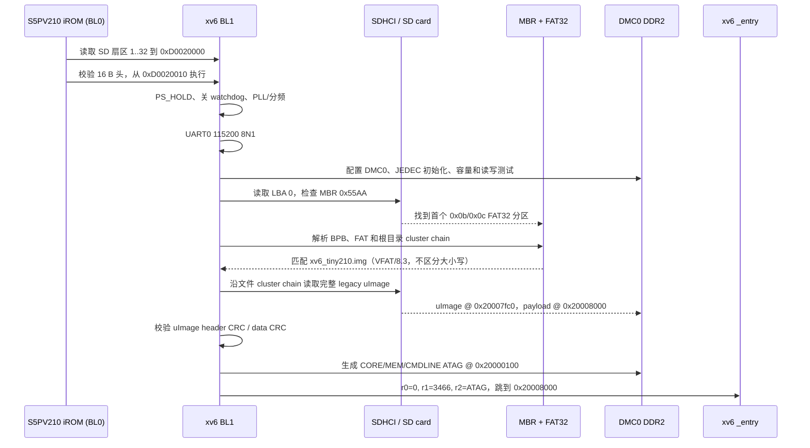

# Tiny210 启动与内存初始化

## 1. SD 启动布局

Tiny210 不依赖 U-Boot。S5PV210 iROM（BL0）从 SD 卡固定位置加载本仓库的 BL1；
BL1 初始化 SDHCI 后读取 MBR，在第一个 FAT32 分区的根目录中查找并加载
`xv6_tiny210.img`：

| SD 扇区 | 内容 | 运行/加载位置 |
| --- | --- | --- |
| 0 | MBR，制作镜像时保留 | 不执行 |
| 1..32 | 16 KiB `tiny210-bl1.bin` | iRAM `0xD0020000`，代码入口 `0xD0020010` |
| 33..48 | 保留 | — |
| 49.. | 原始 uImage 救援副本（可选） | FAT32 文件不可用时才读取 |
| MBR 指定的 FAT32 分区 | 根目录 `xv6_tiny210.img` | 主启动内核；先放到 DRAM+`0x7fc0`，uImage payload 位于 DRAM+`0x8000` |

BL1 的前 16 字节是 iROM 所需的大小、保留字段和字节校验和。链接脚本
[`bl1/bl1.ld`](../../../kernel/arch/arm/mach-s5pv210/bl1/bl1.ld) 强制代码不超过
`16 KiB - 16 B`。

## 2. BL0 → BL1 → 内核



BL1 入口在 [`bl1/start.S`](../../../kernel/arch/arm/mach-s5pv210/bl1/start.S)，
硬件初始化和加载决策在 [`bl1/bl1.c`](../../../kernel/arch/arm/mach-s5pv210/bl1/bl1.c)，
FAT32 只读实现位于 [`bl1/bl1fat.c`](../../../kernel/arch/arm/mach-s5pv210/bl1/bl1fat.c)。
由于实板 iROM 的 `CopySDMMCtoMem` 读取 LBA 0 会卡住，主路径复用
[`sdcore.c`](../../../kernel/drivers/mmc/host/sdcore.c) 的小型 SDHCI PIO 核心读取
MBR、FAT 和文件数据；iROM 复制服务只保留给扇区 49 的救援回退。

BL1 的 FAT32 加载顺序为：

```text
LBA 0
  -> 校验 0x55AA
  -> 扫描 4 个 MBR partition entry
  -> 选择第一个 type=0x0b/0x0c 的 FAT32 分区
  -> 读取 VBR/BPB，计算 fat_lba、data_lba、root_cluster
  -> 遍历根目录 cluster chain
  -> 匹配 xv6_tiny210.img 的 VFAT 长文件名或 8.3 别名
  -> 沿 FAT cluster chain 把文件读到 DRAM+0x7fc0
  -> 校验 uImage header、load/entry、文件长度和 data CRC
```

只有 MBR/FAT32 无效或根目录找不到内核文件时，BL1 才读取固定扇区 49 的救援
uImage。这样日常升级只需替换 FAT32 文件，不必重新写内核原始扇区。

交接遵循 ARM Linux 传统启动约定：

```text
r0 = 0
r1 = 3466 (MINI210 machine ID)
r2 = 0x20000100 (ATAG list)
CPU = SVC mode，IRQ/FIQ 屏蔽，MMU/D-cache 关闭
```

## 3. `_entry` 做什么

内核入口是 [`entry.S`](../../../kernel/arch/arm/mach-s5pv210/entry.S) 中的 `_entry`：

1. 检查实际运行地址是否等于链接地址。
2. 拒绝 USR mode 或仍开启 MMU 的错误启动方式。
3. 关闭 I-cache/D-cache，设置低向量/非 VIC vectored 模式。
4. 分别设置 IRQ、Abort、Undefined 和 SVC 各模式的栈。
5. 清空 `.bss`。
6. 把 VBAR 指向 [`vectors.S`](../../../kernel/arch/arm/vectors.S) 的 `vectors`。
7. 保留 `r0/r1/r2` 并调用 `x210_main()`。

链接地址由 [`kernel.ld`](../../../kernel/arch/arm/mach-s5pv210/kernel.ld) 的
`KERNEL_LOAD` 决定；Tiny210 默认为 `0x20008000`。代码、只读数据、initcall 表、
数据和内嵌 ramdisk 都位于镜像中，`.bss` 不占镜像文件空间。

## 4. `x210_main()` 内核初始化顺序

[`setup.c`](../../../kernel/arch/arm/mach-s5pv210/setup.c) 的 `x210_main()` 是板级
启动主线：

```text
uartinit()                         早期串口可立即打印
read_bootparams(r2)               解析 ATAG 或 DTB
kvminit(); kvminithart()          建立并启用内核页表
kinit1()                          初始化物理页分配器
device_init()                     注册 platform bus
consoleinit(); ttyinit()          控制台与 tty 字符设备
printfinit()
arm32_time_init()                 初始化 tickslock
s5pv210_register_devices()        登记板级控制器资源
do_initcalls()                    驱动注册、匹配并 probe
procinit(); binit(); iinit(); fileinit()
userinit()                        创建第一个用户进程
scheduler()                       不再返回
```

文件系统初始化没有直接放在 `x210_main()` 中，因为日志恢复和 buffer lock 可能睡眠。
第一个普通进程第一次执行 `forkret()` 时调用 `fsinit(ROOTDEV)`，然后才返回用户态。

## 5. 内存布局与 MMU

Tiny210 DMC0 的物理 DRAM 从 `0x20000000` 开始。当前端口只把前 128 MiB 交给
页分配器，并在紧随其后的区域保留 2 MiB framebuffer：

```text
0x20000000  +-------------------------------+
            | ATAG @ +0x100                 |
            | kernel @ +0x8000              |
            | text/rodata/data/ramdisk/bss  |
            | kalloc 可用页                  |
0x28000000  +-------------------------------+  DRAM + 128 MiB
            | LCD framebuffer (2 MiB)       |
0x28200000  +-------------------------------+
            | 当前内核未交给页分配器的 DRAM |
0x40000000  +-------------------------------+  512 MiB 顶端
```

[`vm.c`](../../../kernel/arch/arm/vm.c) 使用 ARMv7 short-descriptor：

- 内核 DRAM 采用 1 MiB section 恒等映射，VA 等于 PA。
- `devices.c` 中每个 `IORESOURCE_MEM` 也建立恒等映射。
- 控制器寄存器映射为 privileged、strongly ordered、XN。
- framebuffer 映射为 privileged、Normal non-cacheable、XN。
- 用户地址范围为 `[0, 0x20000000)`，低于 Tiny210 DRAM 起始地址。
- 当前 bring-up 中 CPU cache 保持关闭，便于先保证设备一致性，但性能较低。

## 6. 第一个用户进程

`userinit()` 的一页用户地址空间里放入 [`initcode.S`](../../../kernel/arch/arm/initcode.S)：

```text
userinit()
  -> uvminit(..., initcode)
  -> PC=0, SP=4096, CPSR=user mode
  -> RUNNABLE
  -> scheduler()
  -> forkret()
       -> 首次 fsinit(ROOTDEV)
       -> usertrapret()
  -> initcode: exec("/init")
  -> /init: 创建 /dev 节点、连接 ttyS0、fork/exec /bin/sh
```

Tiny210 构建实际使用 [`kernel/arch/arm/init.c`](../../../kernel/arch/arm/init.c)，
而不是仓库根用户集合中的 `user/init.c`。

## 7. 启动故障定位

| 最后可见信息 | 优先检查 |
| --- | --- |
| 完全无串口 | SD 启动拨码、BL1 扇区、UART0/COM0、波特率 |
| `BL1: ... halted` | PLL、DDR、SDHCI、MBR/FAT32、uImage CRC |
| `_entry` early error | 加载地址、`bootm` 交接、MMU 状态 |
| 打印内核 banner 后停止 | MMU 映射、kalloc、platform device/initcall |
| timer 日志前停止 | VIC 或 PWM 资源/时钟 |
| `panic: invalid file system` | 内嵌 `fs.img`、superblock 或构建目录混用 |
| `/init` 或 shell 找不到 | `mkfs` 输入程序和 `/bin` 目录内容 |

