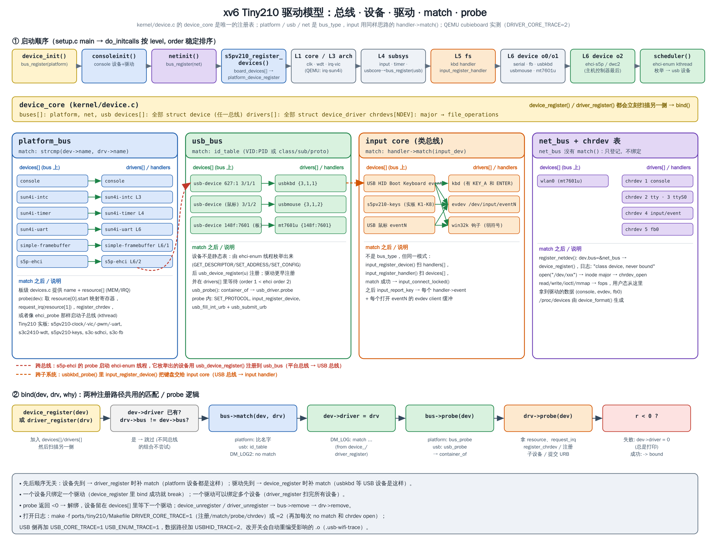
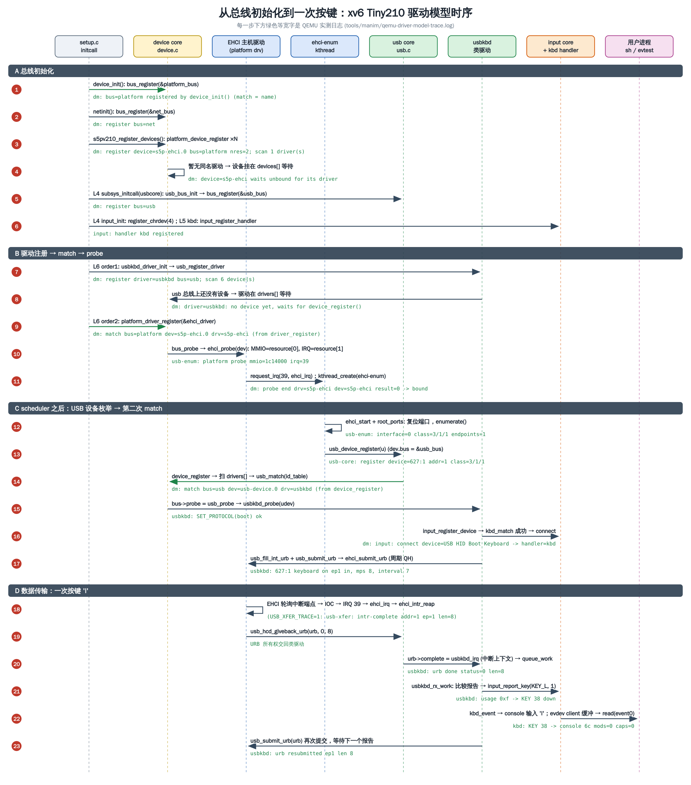

# Tiny210 驱动总线架构：初始化、注册、match、probe 与数据传输

本文以 QEMU cubieboard 替身（`QEMU_TEST=1 QEMU_USB=1`，一个 USB 键盘）的实测日志为主线，
说明 xv6 Tiny210 port 的驱动模型。实板的设备表不同（见 [drivers.md](drivers.md) 第 5 节），
但注册、匹配和 probe 走的是同一套代码。





动画：[videos/driver-model-anim.mp4](videos/driver-model-anim.mp4)（4 段：总线初始化、platform match、
USB match、数据传输，全部由日志驱动）。

## 1. 核心对象和唯一的注册表

[`kernel/device.h`](../../../kernel/device.h) 定义三个对象：

| 对象 | 关键字段 | 说明 |
| --- | --- | --- |
| `struct bus_type` | `name, match, probe, remove` | 一条“总线”就是一套 match/probe 规则 |
| `struct device` | `name, bus, resource[], driver, driver_data` | 设备；`driver` 非 0 表示已绑定 |
| `struct device_driver` | `name, bus, probe, remove` | 驱动 |

[`kernel/device.c`](../../../kernel/device.c) 的 `device_core` 是**所有总线共用**的静态注册表：
`buses[]`、`devices[]`、`drivers[]`（各 32 项）和 `chrdevs[NDEV]`（major → `file_operations`）。
USB 设备、网卡和 platform 设备都在同一个 `devices[]` 里，只是 `dev->bus` 不同。

当前有三条 `bus_type`，再加上一个思路相同的 input handler 机制：

| 总线 | 注册位置 | match 规则 | probe |
| --- | --- | --- | --- |
| `platform` | `device_init()` | `strcmp(dev->name, drv->name)` | `bus_probe` → `drv->probe(dev)` |
| `net` | `netinit()` | 无 match：网卡只登记，不绑定 | — |
| `usb` | `subsys_initcall("usbcore")` | `usb_match()`：遍历 `id_table`，按 `match_flags` 比 VID/PID/class/subclass/protocol | `usb_probe` → `container_of` → `usb_driver.probe(udev)` |
| input handler | `subsys_initcall("input")` | `handler->match(input_dev)`（如 kbd：有 KEY_A 和 ENTER） | `input_connect_locked()` |

## 2. 各总线如何初始化

`kernel/arch/arm/mach-s5pv210/setup.c` 的 `main()`：

```text
kinit1()
device_init()               清空 device_core，bus_register(&platform_bus)
consoleinit()               platform_device_register(console) + platform_driver_register(console)
procinit(); workqueue_init()
netinit()                   bus_register(&net_bus)
s5pv210_register_devices()  board_devices[] → platform_device_register() ×N
do_initcalls()              按 (level, order) 排序执行 .initcall.list
  L1 core   clk-s5pv210, s3c2410-wdt
  L3 arch   irq-vic (QEMU: irq-sun4i)
  L4 subsys samsung-pwm-timer, input (register_chrdev(4)), usbcore (bus_register(&usb_bus)), win32k
  L5 fs     kbd (input_register_handler)
  L6 device serial, s5pv210-keys, sdhci (o0) → s3c-fb, usbkbd, usbmouse, mt7601u (o1) → ehci-s5p, dwc2 (o2)
scheduler()                 ehci-enum 内核线程开始枚举 USB
```

USB 总线在 L4 就注册好，USB 类驱动在 L6 order 1 注册，主机控制器驱动在 L6 order 2 最后注册——
这样主机控制器开始枚举时，类驱动一定已在 `drivers[]` 里。

## 3. 驱动、设备如何加载，如何 match

两个入口共用一个 `bind(dev, drv, why)`：

```c
device_register(dev):  加入 devices[]，遍历 drivers[]，bind 成功就 break（一个设备只绑定一个驱动）
driver_register(drv):  加入 drivers[]，遍历 devices[]，每个能绑定的设备都 bind（一个驱动可服务多个设备）

bind(dev, drv):
  dev 已绑定 / 总线不同 / 总线没有 match  → 跳过
  !bus->match(dev, drv)                   → 跳过（DRIVER_CORE_TRACE=2 打印 no match）
  dev->driver = drv
  r = bus->probe(dev)                     → drv->probe(dev)
  r < 0 → dev->driver = 0（解绑，设备留着等别的驱动）
```

所以**谁先注册都行**：

* platform 设备先到（`s5pv210_register_devices()` 在 `do_initcalls()` 之前），日志里是
  `device=... waits unbound`，之后 `driver_register()` 补上 match：`(from driver_register)`。
* USB 驱动先到，`usbkbd` 注册时 usb 总线上还没有设备：`driver=usbkbd: no device yet`；
  键盘枚举后 `device_register()` 补上 match：`(from device_register)`。

USB 的 match 比 platform 细：`usbkbd` 的 `id_table` 是 `{class 3, subclass 1, protocol 1,
flags CLASS|SUBCLASS|PROTOCOL}`，`mt7601u` 用 VID:PID。`match_flags == 0` 的旧式两字段表视为精确 VID:PID。

## 4. match 之后发生什么（probe）

probe 是驱动“接管硬件”的地方，典型动作：

* **platform 驱动**：从 `dev->resource[]` 取 MMIO 基址和 IRQ，`request_irq()`，初始化控制器，
  需要用户态访问的再 `register_chrdev()`（fb0、console…）。
* **`ehci_probe`**（platform 驱动，同时是 USB 总线的“源头”）：记下 `resource[0]` 寄存器、
  `request_irq(resource[1], ehci_irq)`，`kthread_create(ehci_enum_thread)`，立刻返回 0。
  枚举需要几百毫秒的复位/延时，放在调度器启动后的线程里：
  `ehci_start()` → `root_ports()` → `enumerate()`（GET_DESCRIPTOR、SET_ADDRESS、读配置、SET_CONFIGURATION）
  → `usb_device_register(u)`。这一步把**新设备**送到 usb 总线，触发第二轮 match。
* **`usbkbd_probe`**（USB 类驱动）：`SET_PROTOCOL(boot)`、`SET_IDLE(0)`、`SET_REPORT(LED)`；
  `input_register_device()`（得到 `/dev/input/event0`，并在 input core 内与 kbd handler match/connect）；
  `usb_fill_int_urb()` + `usb_submit_urb()` → `ehci_submit_urb()` 在周期调度表挂一个中断 QH。

## 5. 之后的数据如何传输

以按下 `l` 为例（日志第 144 行起）：

```text
键盘 ep1 IN 8 字节 boot report  00 00 0f 00 00 00 00 00
  EHCI 周期调度：每帧经锚点 QH 轮询键盘 QH，qTD 完成，IOC
  IRQ 39 → ehci_irq() → ehci_intr_reap() → usb_hcd_giveback_urb(urb, 0, 8)
  urb->complete = usbkbd_irq()            中断上下文，只 queue_work(usbkbd_wq)
  usbkbd_rx_work()                        与上一份报告比较：usage 0x0f → KEY_L(38) 按下
    input_report_key(KEY_L, 1); input_sync()
      → 每个 connected handler->event：kbd_event → 字符 0x6c 进入 console 输入缓冲 → sh 的 read(0)
      → 每个打开 /dev/input/event0 的 evdev client 缓冲（evtest 的 read）
      → win32k 原始输入队列（若链接）
    usb_submit_urb(urb)                   再次提交，等待下一份报告
```

用户态拿数据永远经过字符设备：`open("/dev/...")` → inode 的 major → `chrdev_open/read/ioctl/mmap`
→ 驱动的 `file_operations`。

## 6. 日志开关

新开关 `DRIVER_CORE_TRACE`（`ports/tiny210/Makefile`，默认 0；与 `MMU_TRACE`、`USB_*_TRACE` 同样写进
`build/.usb-wifi-trace`，改值会只重编 `device.o`/`input.o`）：

| 值 | 输出（前缀 `dm:`） |
| --- | --- |
| 1 | 总线注册、设备/驱动注册（含扫描了多少对端）、每次 match 及触发方、probe begin/end 结果、解绑、chrdev 注册、input handler connect |
| 2 | 另加每个失败的 match 尝试（`try ... no match`）和每次 chrdev open |

probe 失败无论开关都会打印。配合已有开关看完整链路：

```sh
# QEMU，USB 键盘（cubieboard 需要 usb=on 才有 EHCI0/usb-bus.0）
make -f ports/tiny210/Makefile BUILD=build/q QEMU_TEST=1 QEMU_USB=1 \
     DRIVER_CORE_TRACE=2 USB_CORE_TRACE=1 USB_ENUM_TRACE=1 USBHID_TRACE=2 MMU_TRACE=0
qemu-system-arm -M cubieboard,usb=on -m 512M -nographic \
     -kernel build/q/xv6-tiny210.uImage -append console=ttySAC0,115200 \
     -device usb-kbd,bus=usb-bus.0

# 实板
make -f ports/tiny210/Makefile DRIVER_CORE_TRACE=1 USB_CORE_TRACE=1
```

本文的图和动画用的日志在 [`tools/manim/qemu-driver-model-trace.log`](../../../tools/manim/qemu-driver-model-trace.log)。
重新生成：

```sh
python3 tools/driver_model_svg.py doc/readme/tiny210/images
rsvg-convert -z 1.5 doc/readme/tiny210/images/driver-model-overview.svg -o doc/readme/tiny210/images/driver-model-overview.png
rsvg-convert -z 1.5 doc/readme/tiny210/images/driver-model-flow.svg -o doc/readme/tiny210/images/driver-model-flow.png
tools/manim/render_driver_model.sh h      # -> doc/readme/tiny210/videos/driver-model-anim.mp4
```

## 7. 观察到的限制

* `device_core` 各表是 32 项定长数组，没有引用计数；`driver_register()` 扫描时不持锁（启动期单线程，ehci-enum 线程只在之后注册设备）。
* platform 只按名字匹配，没有 compatible/id_table；USB 设备名都是 `usb-device`，日志里要配合 `usb-core:` 行看 VID:PID。
* EHCI 只在启动时扫描根端口，无热插拔；全速/低速设备在根端口上属于 OHCI（未驱动）。
* `net_bus` 没有 match，网卡永远显示 `driver=(unbound)`，它只是借 `devices[]` 出现在 `/proc/devices`。
