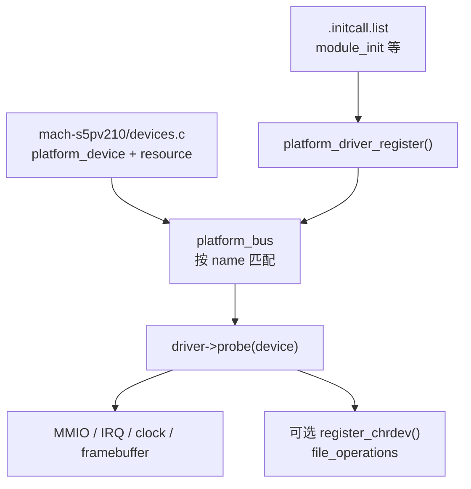

# Tiny210 设备模型与驱动开发

## 1. 分层

当前代码借鉴 Linux 的 bus/device/driver 和 initcall 思想，但保持 xv6 的小型实现：



板级代码只描述“有什么硬件和资源”；驱动只描述“如何操作这种控制器”。

## 2. 核心对象

定义位于 [`kernel/device.h`](../../../kernel/device.h)：

```c
struct resource {
  uint64 start, end;
  int type;                 // IORESOURCE_MEM / IORESOURCE_IRQ
  char *name;
};

struct device {
  char *name;
  int id;
  struct bus_type *bus;
  struct resource resource[DEVICE_RES_MAX];
  int nresource;
  struct device_driver *driver;
  void *driver_data;        // 板级参数或 probe 后私有数据
};

struct device_driver {
  char *name;
  struct bus_type *bus;
  int (*probe)(struct device *dev);
  void (*remove)(struct device *dev);
};
```

`platform_bus.match()` 当前只比较 `dev->name == drv->name`。没有 device tree
compatible、ACPI、modalias 或延迟 probe。

## 3. 注册和匹配

启动顺序是：

```text
device_init()
  -> 初始化静态 device_core
  -> bus_register(&platform_bus)

s5pv210_register_devices()
  -> platform_device_register(clock/wdt/vic/pwm/uart/gpio/fb)
  -> 此时大多数 driver 尚未注册，device 暂时 unbound

do_initcalls()
  -> 各驱动 platform_driver_register()
  -> driver_register() 遍历已存在 device
  -> name 匹配
  -> bus_probe()
  -> driver->probe(dev)
```

反过来，如果 driver 先存在，`device_register()` 也会遍历驱动并立即匹配。
[`device.c`](../../../kernel/device.c) 支持 device/driver/bus unregister，ARM32 IRQ 层也有
`free_irq()`。不过多数 S5PV210 外设是不可热拔插的板载设备，驱动的 `.remove` 和资源
回滚仍不完整，不能把当前模型视为完整热拔插框架。

## 4. initcall

[`module.h`](../../../kernel/module.h) 把静态 `module_desc` 放入链接器
`.initcall.list`，[`initcall.c`](../../../kernel/arch/arm/initcall.c) 按
`(level, order)` 稳定排序执行：

| level | 宏 | Tiny210 用途 |
| --- | --- | --- |
| 1 core | `core_initcall` | clock、关闭 watchdog |
| 3 arch | `arch_initcall` | 根 VIC |
| 4 subsys | `subsys_initcall` | PWM clocksource/tick、input core |
| 5 fs | `fs_initcall` | 当前 Tiny210 无内置条目 |
| 6 device | `module_init` | serial、K1--K8、LCD；`s3c-fb` 用 order 1 |
| 7 late | `late_initcall` | 当前 Tiny210 无内置条目 |

典型依赖关系是 clock → IRQ controller → timer → 普通设备。相同 level 有明确依赖时
使用 `module_init_ord()`，不要依赖目标文件链接顺序。

## 5. 当前 S5PV210 platform devices

| device/driver name | resource | initcall | 当前行为 |
| --- | --- | --- | --- |
| `s5pv210-clock` | clock MMIO `0xE0100000` | core | 读取 APLL/MPLL 和总线频率 |
| `s3c2410-wdt` | WDT `0xE2700000` | core | `WTCON=0`，只关闭看门狗 |
| `s5pv210-vic` | VIC0..3 `0xF2000000` | arch | 安装 IRQ 0..127 根分派器 |
| `s5pv210-pwm` | PWM `0xE2500000`, IRQ25 | subsys | Timer 4 tick/clocksource |
| `s5pv210-uart` | UART0, IRQ42 | device | 控制台；RX 当前按 tick 轮询 |
| `s5pv210-gpio` | GPIO `0xE0200000` | — | 只有 device，当前无匹配 driver |
| `s5pv210-keys` | GPIO/EINT, IRQ16 | device | K1--K8，中断 + 20 ms 延迟消抖，输出到 `event0` |
| `s3c-fb` | FIMD + framebuffer | device order 1 | Window0 XRGB8888 + fbcon |

此外 `ramdisk_embed.c` 是构建时直接链接的块后端，没有 platform device/driver 和
initcall；它由 `bread()` 路径直接调用。

## 6. MMIO 映射

`devices.c` 的 `x210_map_devices()` 在 `kvminit()` 阶段遍历每个
`IORESOURCE_MEM`：

- 普通控制器寄存器：1 MiB section、privileged RW、XN、strongly ordered；
- 名称为 `framebuffer` 的资源：privileged RW、XN、Normal non-cacheable。

因此 probe 中可直接把 `resource.start` 转为指针。当前是恒等映射，尚未实现 Linux
风格的 `ioremap()` 动态虚拟地址；新增资源若不进入 board device 表，也不会自动
出现在页表中。

## 7. 字符设备与 file_operations

硬件 driver 如果需要用户接口，可调用：

```c
register_chrdev(major, "name", &fops);
```

[`file_operations`](../../../kernel/device.h) 支持：

- 简单的 `read/write`；
- 每次 open 的 `open/release`；
- 可看到 `struct file` 和 `private_data` 的 `fread`。

文件系统中的 `T_DEVICE` inode 保存 major/minor。`open()` 后由字符设备表找到 fops，
read/write 再分派到驱动。device core 不会自动创建 `/dev` 节点；Tiny210 的 `/init`
当前使用 `mknod()` 创建 console、ttyS0、fb0 和 `input/event0`。

## 8. 板载 K1--K8：输入子系统和 event 接口

Tiny210 SDK 底板的按键是低电平有效的 GPIO 外部中断输入：

| 按键 | GPIO | 外部中断 | event code |
| --- | --- | --- | --- |
| K1--K4 | GPH2[0:3] | EINT16--19 | `KEY_1`--`KEY_4` |
| K5--K8 | GPH3[0:3] | EINT24--27 | `KEY_5`--`KEY_8` |

EINT16--31 在 VIC0 上共用 IRQ 16。驱动
[`s5pv210-keys.c`](../../../kernel/drivers/input/keyboard/s5pv210-keys.c) 把 GPH2/GPH3
的前四个引脚配置为外部中断功能、内部上拉、双边沿触发。硬中断只完成三件事：读取
`EXT_INT_*_PEND`、屏蔽并清除触发的按键、把 20 ms 延迟工作加入 `system_wq`。它不在
IRQ 上下文中忙等。

```text
按下或释放 K1--K8（低电平为按下）
  -> GPH2/GPH3 检测双边沿，置 EXT_INT_2/3_PEND
  -> VIC0 IRQ 16
  -> keys_irq(): mask + acknowledge + schedule_delayed_work(20 ms)
  -> keys_debounce_work(): 读取稳定的 GPH2DAT/GPH3DAT，再解除 mask
  -> input_report_key(KEY_n, 1/0)
  -> input_sync(): EV_SYN / SYN_REPORT
  -> evdev_client 环形缓冲
  -> read(/dev/input/event0)
```

按一次 K1 会产生一个按下帧和一个释放帧，每帧以 `SYN_REPORT` 结束：

```text
EV_KEY  code=KEY_1(2) value=1
EV_SYN  code=SYN_REPORT value=0
EV_KEY  code=KEY_1(2) value=0
EV_SYN  code=SYN_REPORT value=0
```

`input.c` 是设备无关的输入核心。每次打开 `event0` 都分配独立的 `evdev_client`
环形缓冲，因此多个读者不会互相抢事件；读者落后时会收到 `SYN_DROPPED`。驱动只调用
`input_report_key()`/`input_sync()`，不直接了解字符设备或用户地址。

实板测试：

```sh
/bin/evtest
# 或 /bin/evtest /dev/input/event0
```

预期启动日志包含：

```text
input: Tiny210 GPIO Keys registered as event0
input: Tiny210 K1-K8 GPIO keys on EINT16-19/24-27, IRQ 16
```

该接口是事件设备，不会自动把 K1--K8 转成 shell 字符；需要控制菜单或窗口系统的用户
程序读取 `event0` 并解释 `KEY_1`--`KEY_8`。

## 9. 新增一个 platform driver

### 9.1 描述板级资源

在 [`devices.c`](../../../kernel/arch/arm/mach-s5pv210/devices.c) 增加：

```c
{ .name = "s5pv210-demo",
  .resource = {
    MEM(0xE1230000, 0x1000, "demo"),
    IRQ(60, "demo")
  },
  .nresource = 2 },
```

这一步同时让 `x210_map_devices()` 建立 MMIO 映射。

### 9.2 编写驱动

```c
static void demo_irq(int irq, void *arg)
{
  struct device *dev = arg;
  /* 读取并清除设备 pending；不要睡眠 */
}

static int demo_probe(struct device *dev)
{
  uintptr regs = dev->resource[0].start;
  int irq = dev->resource[1].start;
  /* 配置时钟、pinmux 和控制器 */
  return request_irq(irq, demo_irq, dev);
}

static struct device_driver demo_driver = {
  .name = "s5pv210-demo",
  .probe = demo_probe,
};

static void demo_init(void)
{
  platform_driver_register(&demo_driver);
}

module_init("demo", demo_init);
```

### 9.3 加入构建

把不带 `.c` 的相对路径加入 `ports/tiny210/Makefile` 的 `DRIVERS`。若 QEMU 没有对应
设备，只加入非 `QEMU_TEST` 分支，或者提供一个 QEMU 替代 driver。

### 9.4 验证

1. `make tiny210-clean && make tiny210`，确保交叉编译和链接通过。
2. `kernel.map` 中确认 driver/initcall 未被 `--gc-sections` 删除。
3. 启动日志确认 `initcall: demo`。
4. 确认 device 与 driver 名称完全相同且 probe 被调用。
5. 读回关键寄存器；如果使用 IRQ，确认 pending 清除和中断计数。

## 10. 当前模型与 Linux 的差异

| 当前 xv6 | Linux |
| --- | --- |
| 静态数组，`DEVICE_MAX=16` | 动态对象/kobject/klist |
| platform 只按 name 匹配 | OF/ACPI/platform id table |
| resource 直接恒等映射 | request_mem_region + ioremap/devm_ioremap_resource |
| 简单 `request_irq` | irqdomain、irqchip、shared/threaded IRQ、devm |
| 内置 `.initcall.list` | 内置 initcall + 可装卸 `.ko` module |
| `/init` 手工 mknod | devtmpfs + uevent/udev/mdev |
| 基本 remove 框架 | 完整引用计数、runtime PM、热拔插生命周期 |

Tiny210 bring-up 阶段应优先保持路径简单；新增复杂子系统时，应先补生命周期、资源
所有权和错误回滚，而不是只复制 Linux 结构体名称。

