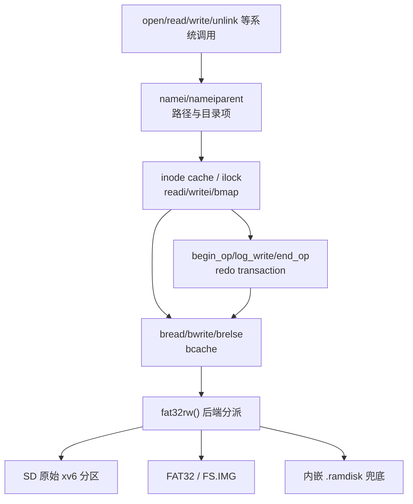

# Tiny210 根文件系统、bcache 与日志

## 1. 当前根文件系统来源

Tiny210 的根文件系统格式仍是 xv6fs，但后端按以下优先级选择：

```text
SD 卡原始 xv6 分区
  -> FAT32 启动分区中的 FS.IMG
  -> 都不可用时，回退到内核 .ramdisk 中的内嵌 fs.img
```

实板构建已经编入 SDHCI、FAT32、VFS 和只读 ext2。FAT32 启动分区可挂载到
`/boot`；兼容 ext2 分区可通过 VFS 挂载读取。QEMU 替身构建没有 S5PV210 SDHCI，
仍使用内嵌 RAM 镜像。

## 2. 镜像生成

[`ports/tiny210/Makefile`](../../../ports/tiny210/Makefile) 先编译 ARM32 用户程序，再调用
[`mkfs/mkfs.c`](../../../mkfs/mkfs.c)：

```text
UPROGS
  -> _init, _armcheck, _sh, _echo, _cat, _ls, ...
  -> mkfs fs.img UPROGS...
       创建根 inode 1
       创建 /bin inode
       所有命令放到 /bin
       /init 与 /bin/init 是同一 inode 的两个硬链接
  -> .incbin "fs.img"
  -> kernel .ramdisk
```

默认 `TINY210_FSBLOCKS=4096`，块大小 `BSIZE=1024`，总容量 4 MiB。可在构建时调整：

```sh
make -f ports/tiny210/Makefile TINY210_FSBLOCKS=8192
```

增大文件系统也会直接增大内核/uImage 和 BL1 从 SD 读取的扇区数，必须确保镜像仍
位于预留原始区内。

## 3. 磁盘格式

xv6fs 使用固定布局：

```text
block 0       boot/reserved
block 1       superblock
block 2..     redo log
随后          inode blocks
随后          free-block bitmap
随后          data blocks
```

superblock 字段定义在 [`kernel/fs.h`](../../../kernel/fs.h)：

```text
magic, size, nblocks, ninodes,
nlog, logstart, inodestart, bmapstart
```

根目录 inode 号是 `ROOTINO=1`。每个 inode 有 12 个直接块和 1 个一级间接块，
最大文件块数为 `12 + BSIZE/4 = 268`，约 268 KiB。目录本身也是普通 inode，
数据是一组 `{inum, name[30]}` 目录项。

## 4. 运行时 I/O 层次



`fat32rw()` 是当前 xv6fs 的兼容后端入口。它根据启动探测结果，把同一个 xv6fs
逻辑块映射到原始 SD 分区、FAT32 文件 `FS.IMG` 的 cluster chain，或最终交给
[`ramdisk_embed.c`](../../../kernel/drivers/block/ramdisk_embed.c) 访问内嵌镜像。

## 5. bcache

[`bio.c`](../../../kernel/bio.c) 提供块缓存：

- key 是 `(dev, blockno)`；
- cache miss 时复用 LRU 链表尾部且 `refcnt==0` 的 buffer；
- 每个 buffer 用 sleeplock 保证同一块只有一个使用者修改；
- `bread()` 在 `valid==0` 时调用底层 `fat32rw(..., read)`；
- `bwrite()` 同步调用底层写；
- 日志中的脏块通过 `bpin()` 防止提交前被回收。

它缓存的是 1 KiB 文件系统块，不是文件级 page cache。使用 SD/FAT32 后端时，bcache
还会避免重复的介质访问；日志中的脏块通过 pin 保证提交前不会被替换。

## 6. redo log

[`log.c`](../../../kernel/log.c) 实现物理块 redo log。文件系统修改调用：

```text
begin_op()
  -> 修改 inode/bitmap/directory/data 对应的 cached block
  -> log_write(buf)                 记录 home block，pin buffer
end_op()
  -> 最后一个 outstanding 操作触发 commit()
       1. write_log()               cache -> log data blocks
       2. write_head()              写 log header；事务提交点
       3. install_trans()           log blocks -> home blocks
       4. write_head(n=0)           清事务
```

启动时 `initlog()` 调用 `recover_from_log()`：若 log header 的 `n>0`，把日志块
重新安装到 home block，再清 header。

使用 SD 原始分区或 FAT32 `FS.IMG` 时，日志能让 xv6fs 修改跨重启恢复；使用内嵌
ramdisk 兜底时，重启会重新装入构建时镜像，因此运行时写入不会持久化。

## 7. 文件系统何时初始化

`x210_main()` 先完成 `binit()`、`iinit()` 和 `fileinit()`，然后创建 `initproc`。
第一次调度到普通用户进程时：

```text
forkret()
  -> fsinit(ROOTDEV)
       -> bread(dev, 1) 读取 superblock
       -> 校验 FSMAGIC
       -> initlog() / recover_from_log()
  -> usertrapret()
  -> initcode exec("/init")
```

`fsinit()` 放在进程上下文，是因为 bcache 的 sleeplock 和日志路径可能睡眠，不能在
尚无当前进程的早期 `x210_main()` 中执行。

## 8. `/init` 与设备节点

Tiny210 使用 [`kernel/arch/arm/init.c`](../../../kernel/arch/arm/init.c)：

1. 创建 `/dev`；
2. 创建 `/dev/console`（major 1）和 `/dev/ttyS0`（major 3）；
3. `tty_attach(0)`，打开 ttyS0 并复制为 fd 0/1/2；
4. fork 子进程并 `exec("/bin/sh")`；
5. shell 退出后重新启动。

`mkdir/mknod` 遇到镜像中已存在的对象时返回失败；当前 init 没有严格检查 mkdir 和
mknod 的返回值，因此已有正确节点不会阻止继续启动，但错误类型/major 也不会被
自动修复。更稳定的方向是在 `mkfs` 时创建固定目录和设备命名空间。

## 9. 后续改进

当前已完成 SDHCI、FAT32、VFS、只读 ext2 和 xv6fs 后端选择。下一步应：

1. 把 xv6fs 的兼容 `fat32rw()` 入口替换为标准 block-device operations。
2. 让 bcache 按设备逻辑块大小工作，减少 FAT32 file-sector 的重复转换。
3. 完善 ext2 写入、缓存一致性和挂载生命周期。
4. 加入可靠的 flush/barrier，保证真实介质上 journal commit 的持久化顺序。
5. 增加断电恢复测试，区分 xv6fs 日志、FAT32 容器元数据和 SD 卡内部缓存三层风险。

