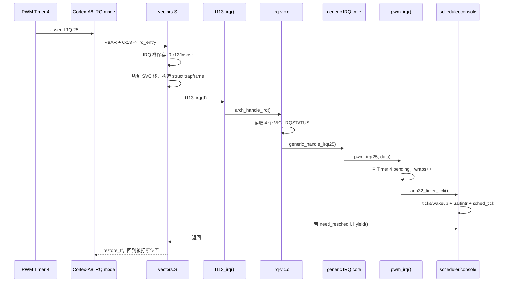

# Tiny210 异常、中断与系统时钟

## 1. 硬件结构

S5PV210 使用 4 个 PL192 VIC。当前驱动把它们展平成 128 条逻辑 IRQ：

```text
VIC0 @ 0xF2000000  bit 0..31  -> IRQ   0..31
VIC1 @ 0xF2100000  bit 0..31  -> IRQ  32..63
VIC2 @ 0xF2200000  bit 0..31  -> IRQ  64..95
VIC3 @ 0xF2300000  bit 0..31  -> IRQ 96..127
```

当前系统节拍来自 PWM Timer 4（IRQ 25）。UART platform device 虽声明 IRQ
`42 + UART 编号`，但串口驱动目前没有 `request_irq()`，输入由 timer tick 轮询。

## 2. 从硬件到驱动 handler 的调用链



`t113_irq()` 这个名字是 ARM32 多端口共用代码遗留的命名，并不表示 Tiny210
使用 T113 中断控制器；真正的根控制器由 `set_handle_irq()` 安装。

## 3. 异常向量与 trapframe

[`vectors.S`](../../../kernel/arch/arm/vectors.S) 定义 8 个 ARM 低向量入口：

| 偏移 | 异常 | 当前处理 |
| --- | --- | --- |
| `0x00` | Reset | 不从这里启动，原地循环 |
| `0x04` | Undefined | `t113_fault(kind=1)` |
| `0x08` | SVC | 保存 trapframe 后进入 `t113_svc()` |
| `0x0c` | Prefetch abort | `t113_fault(kind=2)` |
| `0x10` | Data abort | `t113_fault(kind=3)` |
| `0x18` | IRQ | `irq_entry` → `t113_irq()` |

IRQ 硬件先进入独立的 banked IRQ stack。汇编保存最小现场后切到 SVC mode，
在当前进程内核栈上构造统一的 272 字节 `struct trapframe`，因此 IRQ 末尾可以安全
调用 `yield()`。返回时 `restore_tf` 根据原 CPSR 判断回用户态还是内核态。

## 4. VIC 初始化

[`irq-vic.c`](../../../kernel/drivers/irqchip/irq-vic.c) 通过
`arch_initcall("irq-vic", ...)` 注册 platform driver。probe 时：

1. 从 device resource 得到 VIC0 基址，按 1 MiB 间隔计算 VIC1..3。
2. `VIC_INTENCLEAR = ~0`，清除 bootloader 遗留使能。
3. `VIC_SOFTINTCLEAR = ~0`。
4. `VIC_INTSELECT = 0`，全部配置为 IRQ 而非 FIQ。
5. `set_handle_irq(vic_handle_irq, &vic_chip)` 安装根分派器。

`request_irq(irq, handler, data)` 在全局 `irq_desc[]` 保存 handler，并通过
`vic_chip.unmask()` 设置相应 `VIC_INTENABLE` 位。当前接口没有 Linux 的
shared IRQ、触发类型、线程化 IRQ、affinity 和 `free_irq()`。

## 5. PWM Timer 4

[`samsung_pwm_timer.c`](../../../kernel/drivers/clocksource/samsung_pwm_timer.c)
使用 `pclk_psys`（正常约 66.7 MHz）：

```text
probe
  -> 停 Timer 4
  -> prescaler=0, divider=1/1
  -> TCNTB4 = pclk_psys / HZ_TICK - 1
  -> 清 pending，使能 Timer 4 IRQ
  -> manual update
  -> auto-reload + start
  -> register_clocksource("pwm-timer4", ...)
  -> request_irq(25, pwm_irq, NULL)
```

每个硬件 tick 调用 `arm32_timer_tick()`；每 10 个子 tick 才增加一次 xv6 全局
`ticks` 并唤醒 `sleep(&ticks)` 的进程。每次硬件 tick 还会：

- 调用 `uartintr()` 轮询 UART RX FIFO；
- 调用 `sched_tick()` 更新进程时间片并设置重调度标志。

这意味着 timer/VIC 故障不只会停止时钟，也会表现为串口键盘无输入、sleep 不返回、
进程不抢占。

## 6. 中断启用时机与锁

`_entry` 和 `x210_main()` 初始化阶段保持 IRQ 屏蔽。驱动先完成 `request_irq()` 和
VIC unmask；进入 `scheduler()` 后才由调度循环打开 CPU IRQ。两层使能缺一不可：

```text
设备 pending
  AND VIC_INTENABLE 对应位为 1
  AND CPSR.I = 0
  -> CPU 才进入 irq_entry
```

spinlock 的临界区会暂时关闭本 CPU 中断；中断 handler 中不能调用可能睡眠的接口。
Timer handler 只做清 pending、计数、唤醒、轮询字符和调度记账，没有长耗时工作。

## 7. 新增 IRQ 驱动的最小步骤

```c
static void my_irq(int irq, void *data)
{
  struct mydev *d = data;
  uint status = read_status(d);
  clear_status(d, status);       // 必须清设备侧 pending
  /* 只做短小、不可睡眠的工作 */
}

static int my_probe(struct device *dev)
{
  int irq = dev->resource[1].start;
  setup_controller(dev);
  return request_irq(irq, my_irq, dev->driver_data);
}
```

同时在 [`devices.c`](../../../kernel/arch/arm/mach-s5pv210/devices.c) 增加
`IORESOURCE_MEM` 和 `IORESOURCE_IRQ`。当前没有 `free_irq()`，因此还不适合真正的
运行时驱动卸载。

## 8. 调试建议

- 没有任何 IRQ：检查 `irqchip: 4 x PL192 VIC` 是否出现、CPSR.I 是否清零。
- Timer 不进：读 `TINT_CSTAT`、`TCNTO4`，确认 PCLK 和 IRQ 25。
- IRQ 风暴：设备 pending 未清，或 W1C 写法错误；先屏蔽对应 VIC 位定位。
- 串口能输出但不能输入：首先检查 timer 是否工作，因为当前 RX 依赖 timer 轮询。
- 只在 QEMU 正常：QEMU 使用 `irq-sun4i.c`/`timer-sun4i.c`，不能证明 VIC/PWM 正确。

