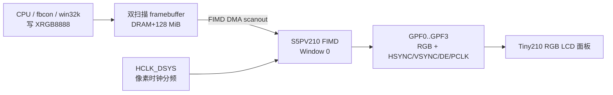
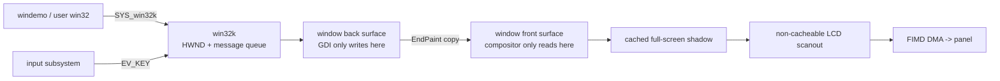

# Tiny210 LCD、FIMD 与 framebuffer

## 1. 数据通路

Tiny210 的 S5PV210 FIMD 是显示控制器。CPU 把像素写进 DDR framebuffer，FIMD
作为总线 master 周期性读取这块物理内存，再按面板时序从 RGB 引脚输出：



这里的“DMA”是 FIMD 自己读取 DDR，并没有单独启动通用 DMA 控制器。写入
`VIDW00ADD0B0/VIDW00ADD1B0` 的是 framebuffer 总线物理地址；当前恒等映射下，
内核指针数值与物理地址相同。

## 2. 资源和内存

[`devices.c`](../../../kernel/arch/arm/mach-s5pv210/devices.c) 给 `s3c-fb` 提供：

| resource | 地址 | 作用 |
| --- | --- | --- |
| MEM 0 | `0xF8000000..0xF800ffff` | FIMD 寄存器 |
| MEM 1 | `DRAM_BASE + 128 MiB`，大小 4 MiB | 两帧连续 framebuffer |
| win32k arena | `DRAM_BASE + 112 MiB`，大小 16 MiB | 缓存 shadow、窗口 front/back surface |
| driver_data | `s3c_fb_platdata` | 面板参数与 GPIO setup 回调 |

Framebuffer 不由 `kalloc()` 动态分配，而是通过
[`memlayout.h`](../../../kernel/arch/arm/mach-s5pv210/memlayout.h) 静态保留在页分配器
范围之外。`setup.c` 的静态断言防止它和 kalloc 区重叠。

800×480×4 = 1,536,000 字节，两个扫描帧约 3 MiB，小于 4 MiB。扫描区映射为
privileged、Normal non-cacheable、XN，以避免 CPU cache 与 FIMD scanout 不一致；
窗口表面池是 cached Normal memory，合成完成后才一次性复制到扫描区。

## 3. 面板选择

编译时用 `S5PV210_LCD` 选择 `devices.c` 的时序表：

```sh
make -f ports/tiny210/Makefile S5PV210_BOARD=tiny210 S5PV210_LCD=s70
make -f ports/tiny210/Makefile S5PV210_BOARD=tiny210 S5PV210_LCD=h43
make -f ports/tiny210/Makefile S5PV210_BOARD=tiny210 S5PV210_LCD=w50
make -f ports/tiny210/Makefile S5PV210_BOARD=tiny210 S5PV210_LCD=a70
```

| 名称 | 分辨率 | 默认刷新率 |
| --- | --- | --- |
| S70（默认） | 800×480 | 60 Hz |
| H43 | 480×272 | 60 Hz |
| W50 | 800×480 | 60 Hz |
| A70 | 800×480 | 60 Hz |

换面板后先 `make tiny210-clean`。这些参数来自 FriendlyARM BSP；实际模组若只亮背光、
图像滚动或偏移，需要对照面板 datasheet 核对 hfp/hbp/hsw、vfp/vbp/vsw 和极性。

## 4. probe 配置过程

[`s3c-fb.c`](../../../kernel/drivers/video/fbdev/s3c-fb.c) 的
`s3c_fb_probe()` 按以下顺序执行：

```text
检查 xres*yres*4 是否装得进保留 framebuffer
  -> fb_setup_gpio()
       GPF0..GPF2 全部 function 2
       GPF3[3:0] function 2
       设置驱动强度
       打开 FIMD gate
       DISPLAY_CONTROL 路由到 RGB 输出
  -> 从 clk_get_rate("hclk_dsys") 计算像素时钟分频
  -> 关闭 VIDCON0，避免配置中输出半成品
  -> 设置极性和水平/垂直时序
  -> Window 0 = XRGB8888
  -> 设置窗口坐标、大小和 line stride
  -> 设置 framebuffer start/end 总线地址
  -> 开 Window 0、ENVID、ENVID_F
  -> CPU 写彩条测试
  -> fbcon_register() 清屏并接管文本输出
```

关键寄存器关系：

```text
VIDW00ADD0B0 = framebuffer 起始物理地址
VIDW00ADD1B0 = 起始 + xres*yres*4
VIDW00ADD2   = PAGEWIDTH=xres*4, OFFSIZE=0
WINCON0      = XRGB8888 + ENWIN
VIDCON0      = pixel clock divider + ENVID/ENVID_F
```

像素时钟估算：

```text
htotal = xres + hfp + hbp + hsw
vtotal = yres + vfp + vbp + vsw
wanted_pclk = htotal * vtotal * refresh_hz
actual_pclk = hclk_dsys / (CLKVAL + 1)
```

## 5. LCD 文本控制台

[`fbcon.c`](../../../kernel/drivers/video/fbdev/fbcon.c) 提供固定 8×16 字体、浅灰前景、
深蓝背景和逐行滚屏。`uartputc_sync()` 每输出一个字符，也调用弱符号
`fbcon_putc()`，所以 framebuffer 注册以后串口日志和 shell 输出会同步显示在 LCD。

对于 800×480 面板，文本区是 100 列 × 30 行。输入仍来自串口，LCD 本身不提供
键盘或触摸输入路径。

## 6. `/dev/fb0`、mmap 与 ioctl

`fbmem.c` 已提供统一字符设备：

- `FBIOGET_FSCREENINFO`：返回物理起点、4 MiB 显存长度和 stride；
- `FBIOGET_VSCREENINFO`：返回可见分辨率、`yres_virtual=2*yres` 和 XRGB8888；
- `FBIOPAN_DISPLAY`：在 `yoffset=0` 与 `yoffset=yres` 间切换 FIMD Window 0；
- `mmap(MAP_SHARED)`：把完整 4 MiB 映射到用户地址空间。

调用链为：

```text
ioctl(fd, FBIOGET_*/FBIOPAN_DISPLAY)
  -> sys_ioctl -> chrdev_ioctl -> fb_fops.ioctl

mmap(..., fd=/dev/fb0)
  -> sys_mmap -> chrdev_mmap -> fb_fops.mmap
  -> remap_pfn_range (ARMv7 1 MiB section mapping)
```

## 7. win32k 与窗口双缓冲

当前 Tiny210 版从 `hdmi` 分支移植了 Windows 风格的分层边界：用户程序链接
`user/win32.c`，通过单一 `SYS_win32k` 进入内核；内核管理 HWND、Z 顺序、消息队列、
输入路由、GDI batch 和合成。它没有让用户进程直接持有窗口 surface 指针。



这样有两层不同目的的双缓冲：窗口 front/back 防止合成器看到半画完的窗口；LCD
4 MiB 双扫描区供直接 framebuffer 程序 page flip。win32k 默认在缓存 shadow 中合成，
再写当前扫描帧，不依赖每次硬件 page flip。

测试：

```sh
/bin/fbtest
/bin/windemo
```

`windemo` 不是单个测试矩形，而是同时创建桌面、任务栏、文件资源管理器、系统信息
和终端五个窗口。资源管理器通过普通 `open/read/stat` 读取当前根文件系统；终端通过
`pty_open()` 创建主从 PTY，子进程把标准输入输出连接到 PTY slave 后执行
`/bin/sh`，用户线程阻塞读取 PTY master，并用 `InvalidateRect` 把输出交回窗口消息
循环。启动终端后会先执行一次 `pwd` 和 `ls /`，用于确认窗口、PTY、线程和 VFS
四条路径能一起工作。窗口标题栏、激活颜色和任务栏由用户态 `win32.c/windemo`
绘制，内核仍只负责 surface、Z 顺序、消息和最终合成。

## 8. 当前限制与改进方向

当前实现：

- 只使用 FIMD Window 0；
- `FBIOPAN_DISPLAY` 已能换帧，但还没有 VSYNC IRQ/等待垂直消隐；
- win32k 当前接入板载按键，USB 鼠标/触摸的相对与绝对坐标路径仍待接入；
- 没有 dirty rectangle、硬件光标、overlay；
- framebuffer 是 non-cacheable，CPU 大面积绘制较慢；
- 背光亮度/电源没有驱动管理。

建议的演进顺序：

1. 增加 FIMD VSYNC IRQ，在垂直消隐期完成 page flip，消除 tearing。
2. 给 input core 增加 `EV_REL/EV_ABS`，接入 USB mouse 或触摸屏光标。
3. 在现有 PTY terminal 基础上增加光标、选择、滚动条和更多通用控件，再移植
   camview 等应用。

## 9. 故障定位

| 现象 | 检查 |
| --- | --- |
| 串口正常，LCD 全黑 | 面板供电/背光、FIMD gate、DISPLAY_CONTROL、排线方向 |
| 背光亮但无图 | GPF pinmux、面板型号、framebuffer 地址、ENVID |
| 有图但滚动/偏移 | porch/sync/极性/像素时钟 |
| 彩条正确，文字不出现 | `fbcon_register()` 是否执行、串口输出是否经过 `uartputc_sync()` |
| 花屏或越界 | 分辨率×4、ADD0/ADD1、PAGEWIDTH、framebuffer 保留大小 |
| QEMU 没有 LCD 日志 | `tiny210-qemu` 使用替代硬件模型，不编译 `s3c-fb.c`，这是预期行为 |

### 字迹模糊与单像素测试

Tiny210 的 GPF0--GPF3 在切换到 FIMD 功能后仍必须关闭内部上下拉。驱动按 Linux
`s5pv210_fb_gpio_setup_24bpp()` 的顺序配置 pinmux、PUD=none 和 4x drive；未关闭
复位下拉时，并行 RGB 和 VCLK 的边沿可能变慢，在文字竖边表现为横向重影。

控制台默认启用受限加粗，但不改变 8x16 字符格和 100x30 容量。诊断时运行：

```sh
/bin/fbtest sharp 30
```

四段图案分别是单像素竖线、横线、棋盘格和窄 RGB 条。图案清晰而文字不清晰，
说明应调整字体；图案本身出现彩边或相邻像素粘连，则应检查 VCLK 采样边沿、排线
和面板选择。可用 `make -f ports/tiny210/Makefile FBCON_BOLD=0` 关闭加粗作 A/B 对比。
默认使用 BSP 的反相 VCLK；若单像素竖线仍有固定方向的重影，可再用
`LCD_VCLK_INVERT=0` 编译作一次采样边沿 A/B 测试，不能仅凭普通照片判断极性。

