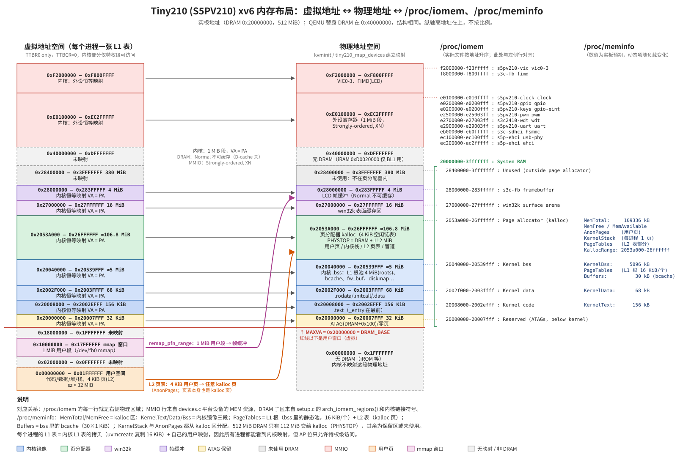
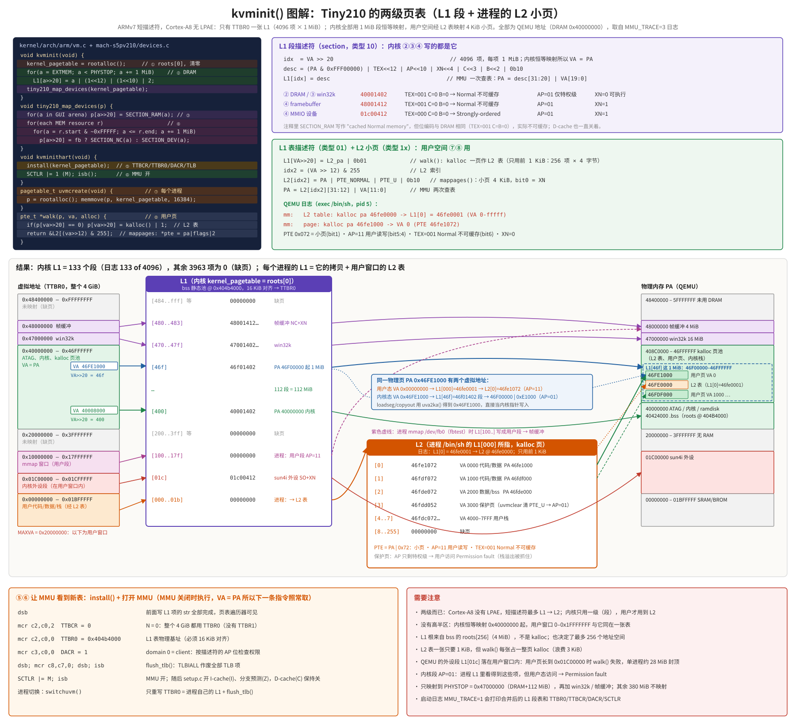

# Tiny210 (S5PV210) 内存布局分析与 /proc/meminfo、/proc/iomem

本文分析 tiny210 分支 ARM32 内核的内存布局：物理 RAM、内核镜像、页分配器、MMIO 外设区、
用户/内核虚拟地址空间，并说明新增的 Linux 风格 `/proc/meminfo` 与 `/proc/iomem` 如何把它们显示出来。


（PNG 版：`images/memory-layout.png`；由 `tools/memory_layout_svg.py` 生成。）

数值分两列：**实板**（Tiny210，DRAM 在 0x20000000）和 **QEMU**（cubieboard 替身，DRAM 在 0x40000000）。

## 1. 物理内存

| 区域 | 实板 | QEMU | 来源 |
|---|---|---|---|
| DRAM bank 0 | 0x20000000–0x3fffffff (512 MiB) | 0x40000000–0x5fffffff (512 MiB) | ATAG_MEM（BL1 / QEMU 传入），`board.h` 的 `BOARD_DRAM_SIZE` 兜底 |
| ATAG / 零页 | DRAM+0x0 – DRAM+0x7fff | 同 | BL1 把 ATAG 放在 DRAM+0x100，内核不回收 |
| 内核镜像 | 0x20008000 起 | 0x40008000 起 | Linux `TEXT_OFFSET` 约定，`kernel.ld` 的 `KERNEL_LOAD` |
| 页分配器 (kalloc) | `end` – DRAM+112 MiB | 同 | `setup.c` 的 `USE_DRAM = S5PV210_USE_DRAM` |
| win32k 表面缓存区 | DRAM+112 MiB – +128 MiB | 同 | `memlayout.h` `S5PV210_GUI_*`，不交给 kalloc |
| LCD 帧缓冲 | DRAM+128 MiB – +132 MiB | 同（simplefb） | `devices.c` 的 framebuffer MEM 资源 |
| 未使用 | DRAM+132 MiB – DRAM 顶 | 同 | 约 380 MiB 闲置 |

要点：

- **只用了 512 MiB 中的 112 MiB 做通用内存。** 因为 D-cache 关闭，`kinit` 逐页填垃圾很慢，所以
  `PHYSTOP = DRAM_BASE + 112 MiB`，ATAG 报告的其余内存不进分配器。
- `PHYSTOP` 是变量 `tiny210_phystop`：若 ATAG 报告的 bank 更小会被下调；若内核比它还大会被上调到 `end + 16 MiB`。

## 2. 内核镜像（实板 build 实测符号）

| 段 | 地址 | 大小 | 内容 |
|---|---|---|---|
| Kernel code (.text) | 0x20008000–0x2002efff | 156 KiB | `_entry` 在最前（`.text.entry`） |
| Kernel data (.rodata/.initcall/.data) | 0x2002f000–0x2003ffff | 68 KiB | 含 MT7601U 固件 45 KiB（`fw_mt7601u`） |
| Kernel bss | 0x20040000–0x20539fff | 约 5 MiB | 见下 |

bss 的大头：

- `roots`：**4 MiB**，256 个 16 KiB 对齐的 ARMv7 L1 页表根的静态池（`vm.c`）。这也是进程数上限（约 255 个地址空间）。
- `fw_buf` 256 KiB、`diskmap` 256 KiB（FAT32 簇表）、`tcp_connections` 220 KiB、`mt_rx_buf` 64 KiB。
- `bcache`：30 个 1 KiB 块缓存（`NBUF = MAXOPBLOCKS*3`）。

QEMU build 额外把根文件系统 `fs.img` 链接进 `.ramdisk` 段（4 MiB），位于 data 和 bss 之间。

## 3. 页分配器

`kernel/kalloc.c`：单链表 freelist，4 KiB 页，一把自旋锁，无 buddy、无 slab。
管理范围 `[PGROUNDUP(end), PHYSTOP)`，实板约 0x2053a000–0x26ffffff ≈ **106.8 MiB**，
QEMU 实测 0x408c0000–0x46ffffff = 105728 kB。

从 kalloc 拿页的使用者：内核栈（每进程 1 页）、用户页、L2 页表（每个 1 MiB 区段一个 kalloc 页，
但 ARMv7 L2 表只用 1 KiB，浪费 3 KiB）、管道缓冲、/proc 读缓冲等。L1 根不来自 kalloc，来自上面的静态池。

本次给 kalloc 加了 `nfree`/`managed`/`lo`/`hi` 计数，`kfreepages()` 不再遍历整条链表。

## 4. MMIO（外设）区

所有 MMIO 都按 `devices.c` 平台设备表里的 MEM 资源映射成 1 MiB 段（`tiny210_map_devices()`），
属性为 Strongly-ordered + XN + 仅特权级可访问：

| 设备 | 物理地址 | 驱动 |
|---|---|---|
| s5pv210-clock | 0xE0100000 (64 KiB) | clk-s5pv210，同段里还有 SWRESET 0xE0102000、PS_HOLD 0xE010E81C、USB_PHY_CONTROL |
| s5pv210-gpio / keys | 0xE0200000 (4 KiB) | GPIO、EINT16-31 按键 |
| s5pv210-pwm | 0xE2500000 | 时钟源 timer3 / tick timer4（IRQ 25） |
| s3c2410-wdt | 0xE2700000 | 看门狗 |
| s5pv210-uart | 0xE2900000 | UART0 控制台 |
| s3c-sdhci | 0xEB000000 + 1 MiB×通道 | 启动 SD 通道（iROM 变量 0xD0037488 决定） |
| s3c-hsotg（可选） | 0xEC000000 | `S5PV210_USB_OTG=1` |
| USB PHY | 0xEC100000 | EHCI/OTG 共用 |
| s5p-ehci | 0xEC200000（IRQ 55） | USB-A 主机口 |
| s5pv210-vic | 0xF2000000 (4 MiB) | VIC0-3 |
| s3c-fb (FIMD) | 0xF8000000 | LCD 控制器 |

iRAM（0xD0020000，BL1 运行处）只在 MMU 打开前访问，不映射。
QEMU 版换成 Allwinner A10 外设：intc 0x01C20400、timer 0x01C20C00、uart0 0x01C28000。

## 5. 虚拟地址空间

ARMv7 短描述符页表，**只用 TTBR0**（TTBCR=0），内核与用户共用一张 L1 表，**内核恒等映射**（`V2P(a)=a`，`KERNBASE=0`）：

```
0x00000000 ┌──────────────────────────┐
           │ 用户代码/数据/堆/栈       │  4 KiB 页 (L2)，sz < 32 MiB (uvmalloc 上限 0x02000000)
0x02000000 ├──────────────────────────┤
           │ （空）                    │
0x10000000 ├──────────────────────────┤
           │ mmap 窗口                 │  1 MiB 用户可访问段 (/dev/fb0 等)，fork 共享
0x18000000 ├──────────────────────────┤
           │ （空）                    │
0x20000000 ├══════════════════════════┤  MAXVA：用户窗口结束 = DRAM_BASE
           │ DRAM 恒等映射 (0–112 MiB) │  1 MiB 段，仅特权级，Normal 不可缓存
           │ win32k 区、帧缓冲         │  1 MiB 段
0xE0000000 ├──────────────────────────┤
           │ 外设 MMIO 段              │  Strongly-ordered, XN, 仅特权级
0xFFFFFFFF └──────────────────────────┘
```

- `uvmcreate()` 把内核 L1 表整张（16 KiB）复制进每个进程的根，所以内核映射存在于所有进程中，靠 AP 位挡住用户态。
- `_Static_assert(DRAM_BASE >= MAXVA)` 保证用户窗口不会与内核恒等映射重叠；这也是 QEMU（DRAM 0x40000000）
  用户窗口仍只到 0x20000000 的原因。
- 缓存：I-cache 和分支预测开启，**D-cache 关闭**。DRAM 段用 TEX=001/C=0/B=0（Normal 不可缓存）。
  注意 `devices.c` 的 `SECTION_RAM` 注释写的是 "cached Normal memory"，但位编码与 DRAM 段相同，实际也是不可缓存的。

### 5.1 kvminit() 图解：两级页表



（仿照 minios 的 `__create_page_tables` 图：左上代码 ①–⑧，右上两种描述符，中间 VA → L1 → L2 → PA，下面是 install() 和注意事项；
`tools/mmu_page_tables_svg.py` 生成。）Cortex-A8 没有 LPAE，所以只有两级：内核只用 L1 段（145 个），
用户窗口经 L1 表描述符（01 型）指向 kalloc 来的 L2 表，再映射 4 KiB 小页。

## 6. /proc/meminfo 与 /proc/iomem

实现位于 `kernel/memstat.c`，由 `kernel/vfs.c` 的 procfs 调用；板级区域由 `setup.c` 的
`arch_iomem_regions()` 提供（弱符号默认值是 `EXTMEM..PHYSTOP` 一段 System RAM），
MMIO 自动取自已注册平台设备的 MEM 资源，所以以后在 `devices.c` 加设备，`/proc/iomem` 会自动出现。
`init` 现在启动时 `mount("proc","/proc","procfs",RDONLY)`；QEMU 版也编进了 VFS（没有 SD 时 fat32 退回内嵌 RAM 盘）。

QEMU 实测：

```
$ cat /proc/meminfo
MemTotal:         105728 kB      kalloc 管理的总页数
MemFree:          105556 kB
MemAvailable:     105556 kB
Buffers:              30 kB      静态块缓存 NBUF*BSIZE
Cached:                0 kB
SwapTotal:             0 kB
SwapFree:              0 kB
AnonPages:            80 kB      各进程 sz 之和（线程不重复计）
KernelStack:          24 kB      每进程 1 页
PageTables:          124 kB      L1 根×16 KiB + L2 表×4 KiB
KernelText:           96 kB      以下为 xv6 特有字段
KernelData:           12 kB
KernelBss:          4724 kB
RamdiskRoot:        4096 kB      仅 QEMU
KallocRange:    408c0000-46ffffff
Processes:             6

$ cat /proc/iomem
01c20400-01c207ff : sun4i-intc intc
01c20c00-01c20fff : sun4i-timer timer
01c28000-01c283ff : sun4i-uart uart0
40000000-5fffffff : System RAM
  40000000-40007fff : Reserved (ATAGs, below kernel)
  40008000-4001ffff : Kernel code
  40020000-4002220f : Kernel data
  40023000-40422fff : Kernel ramdisk (root fs)
  40423000-408bffff : Kernel bss
  408c0000-46ffffff : Page allocator (kalloc)
  47000000-47ffffff : win32k surface arena
  48000000-483fffff : simple-framebuffer framebuffer
  48400000-5fffffff : Unused (outside page allocator)
```

实板预期（未上板验证）：System RAM 20000000-3fffffff，下面依次是 ATAG 保留区、内核三段、
kalloc 2053a000-26ffffff、win32k 27000000-27ffffff、`s3c-fb framebuffer` 28000000-283fffff、
Unused 28400000-3fffffff，然后是第 4 节表里的各个 MMIO 段。

## 7. MMU / 内存日志（MMU_TRACE）与动画

`make ... MMU_TRACE=n`（默认 1，定义在 `kernel/mmtrace.h`）：

| 级别 | 打印内容 |
|---|---|
| 0 | 关闭 |
| 1 | 启动时：DRAM 区域、内核 code/data/bss、kinit 页数、内核 L1 表（合并后的 1 MiB 段 + 属性）、TTBR0/TTBCR/DACR/SCTLR、整棵 /proc/iomem |
| 2 | 另加 userinit / fork / exec 的摘要（ELF LOAD 段、栈、取了多少 kalloc 页、新 L1 根） |
| 3 | 另加 fork/exec 期间的每一个 kalloc 页、L2 页表、readi 读入的每一块 |

QEMU 下抓日志：`make -f ports/tiny210/Makefile BUILD=build/tiny210-qemu QEMU_TEST=1 MMU_TRACE=3 qemu`。
`exec("/bin/sh")` 在 3 级下的片段：

```
exec: /bin/sh pid 5: inode 5, 45356 bytes, ELF entry 37c, 3 program headers
mm:   L1 root roots[6] at 404cc000: copy of the kernel L1 (16 KiB, 4096 entries)
exec:   LOAD VA 0 memsz 2254 filesz 21de file off 94 flags 7
mm:   L2 table: kalloc pa 46fe0000 -> L1[0] = 46fe0001 (VA 0-fffff)
mm:   page: kalloc pa 46fe1000 -> VA 0 (PTE 46fe1072)
exec:   readi inode 5 off 94 -> VA 0 (pa 46fe1000) 4096 bytes
exec:   stack: guard page VA 3000 (PTE_U cleared), stack VA 4000-7fff
exec: /bin/sh pid 5: sz 8000 sp 7fe0 entry 37c, 9 kalloc pages, new L1 root 404cc000
```

动画 `videos/memory-anim.mp4`（约 2 分钟，manim，`tools/manim/memory_anim.py`）分三段：

1. 内存初始化与 kinit 空闲链表（读日志 `tools/manim/qemu-mmu-trace3.log`）；
2. MMU 初始化，按 5.1 节的 kvminit 图解：左边代码 ①–⑧ 逐行高亮，中间 L1 表 roots[0] 逐项填入段描述符（附位分解），
   右边物理内存；⑤⑥ install() 写 TTBCR/TTBR0/DACR、清 TLB、置 SCTLR.M；⑦⑧ 进程拷贝 L1，walk() kalloc 一页作 L2 表，
   L2 小页 PTE 取自日志；
3. fork + exec `/bin/sh` 时的 L1 根、L2 表、kalloc 页和 readi 加载（读日志）。

重新生成：`tools/manim/render.sh`。

## 8. 观察到的可改进点

1. 512 MiB 只用 112 MiB：打开 D-cache 并处理好 DMA 缓存维护后，可以把 `USE_DRAM` 提到接近 DRAM 顶。
2. L1 根池 4 MiB 静态占用 bss，可以改成按需从 kalloc 分配 4 个连续页（需要 16 KiB 对齐的分配器）。
3. L2 表每张占一整页只用 1 KiB，可以 4 张合用一页。
4. `SECTION_RAM` 注释与实际属性不一致（见第 5 节）。
