# Tiny210 MT7601U Wi-Fi 驱动架构详解

本文说明 Tiny210（S5PV210）上 xv6 的 USB Wi-Fi 链路：一个 MT7601U USB 网卡
从插在 SDK 底板 USB-A Host 口开始，到用 WPA2 连上 TP-Link_B114 路由器、DHCP
拿到 IP 为止，每一层用的是哪个驱动、哪个函数，以及实板串口上对应打印哪一行日志。

文中的日志都是 2026-11-14 在实板上抓到的真实输出（只删掉了重复行）。
LaTeX/PDF 版见 `doc/latex/tiny210-wifi/main.pdf`，内容相同，图用 TikZ 重画。
第 2 版结合了 rpi3-lock 分支 xv6-book 的 MT7601U 章节，细化了 USB 传输、硬件连接、中断处理和 802.11/WPA2 的逐项实现。

目录

1. 与 RPi3 版本（rpi3-lock 分支 xv6-book）的对照
2. 总体分层
3. 硬件连接
4. 软件架构与源文件
5. USB 各层架构
6. 中断与下半部：一帧怎样从 IRQ 55 走到协议栈
7. MT7601U 硬件层
8. 802.11 与 WPA2：网卡如何和路由器通信
9. 网络协议层
10. 时序图
11. 函数调用链与日志对照
12. 实板调试中踩过的坑（和架构的对应）

---

## 1. 与 RPi3 版本（rpi3-lock 分支 xv6-book）的对照

rpi3-lock 分支 xv6-book 第 7 章“USB 无线网卡：MT7601U”记录了同一颗网卡在树莓派 3B 上的驱动。Tiny210 的
`mt7601u.c` 就是从那里移植的：802.11 状态机、WPA2 密码学和 TXWI/RXWI 格式相同，不同的是下面的 USB 主机控制器、
Hub、中断控制器，以及几处后来才修好的细节。

| 项目 | RPi3（xv6-book） | Tiny210（本文） |
|---|---|---|
| CPU | BCM2837，Cortex-A53，AArch64 | S5PV210，Cortex-A8，ARMv7-A |
| USB 主机控制器 | Synopsys DWC2，按主机通道（channel）调度 | 标准 EHCI，按 QH/qTD 链表调度 |
| 端点到硬件 | ch0 控制，ch3 同步 bulk IN，ch4 异步 bulk IN（EP4×4 + EP5），ch5 bulk OUT | 每端点一个 QH，挂在同一个异步环上；EP4 QH 下排 4 个 qTD |
| 板上 Hub | LAN9514（带以太网），网卡在端口 4，地址 3 | USB2514（纯 Hub），网卡在端口 3，地址 2 |
| DMA 地址 | 总线地址要加 0xC0000000 别名 | 物理 = 虚拟，D-cache 关，不需要 cache 维护 |
| 中断控制器 | BCM2836 本地中断 + ARMCTRL | 4 个 PL192 VIC，EHCI = IRQ 55（VIC1 bit 23） |
| probe 时机 | `main()` 里同步执行，中断未开，等 EP5 应答时要同步读空 EP4 | `ehci-enum` 内核线程里执行，中断已开 |
| 换信道 | MCU 命令 `RANDOM_WRITE`（12 号）写 RF R17–R20 | 主机直接写 `RF_CSR_CFG`（0x0500） |
| 校准 | R、TXDCOC、BW×2、LOFT、TXIQ、RXIQ、DPD + RXDC | R、TXDCOC、LOFT、TXIQ、RXIQ、DPD |
| 接收队列 | 8 帧环，锁外交付 | 单槽 `net_rx`，聚合包里多帧时只交付第一帧（待改进） |
| deauth | 自动重连 | 未处理 |
| 网卡名 | `wlan1`（`wlan0` 是板载 BCM43455） | `wlan0` |
| SSID/口令 | 早期写死在驱动里 | `/etc/wifi.conf` → `wifi_connect()`；关联请求里残留的写死 SSID 已在本版修正 |

---

## 2. 总体分层

和 Linux 一样，整个链路按“谁只关心哪一层”切开。每层只通过一个窄接口和上下层说话：

| 层 | 作用 | xv6 中的实现 | 和下一层的接口 |
|---|---|---|---|
| 用户程序 | 读配置、连接、DHCP、ping | `user/wifi.c` `user/dhcp.c` `user/ping.c`，`init` 后台启动 | 系统调用 `wifi_connect` `net_dhcp` `icmp_send` |
| 系统调用 | 参数拷贝、找设备 | `kernel/sysnet.c` | `mt7601u_connect()` `net_dhcp_dev()` |
| 网络协议栈 (L3/L4) | IPv4 / UDP / ICMP / TCP / ARP / DHCP / 路由 | `kernel/net.c` | `struct net_device` + `netdev_xmit_on()` / `net_rx_dev()` |
| 网络设备层 | `wlan0`、NAPI、workqueue | `kernel/net.c`（register_netdev、napi_*），`kernel/workqueue.c` | `net_device_ops.start_xmit` |
| 802.11 SoftMAC (L2) | 扫描、认证、关联、WPA2 四次握手、802.11↔Ethernet 转换 | `kernel/drivers/net/wireless/mt7601u.c` + `wpa_crypto.c` | 厂商 USB 寄存器请求 + bulk 帧（TXWI/RXWI） |
| USB 设备驱动 | 匹配 VID:PID，probe，固件下载 | `mt7601u.c` 的 `usb_driver` | `usb_host_ops`（control / bulk / bulk_rx_arm / bulk_rx_complete） |
| USB core | usb 总线、设备/驱动匹配 | `kernel/drivers/usb/core/usb.c` | `usb_device_register()` |
| USB 主机控制器 (HCD) | EHCI 异步调度、qTD/QH、Hub、split | `kernel/drivers/usb/host/ehci-hcd.c` | 寄存器 + DMA 描述符 |
| 平台/板级 | 时钟、PHY 上电、中断号、物理地址 | `kernel/arch/arm/mach-s5pv210/devices.c` | platform device 资源 |
| 硬件 | S5PV210 USB Host PHY1 → USB2514 Hub → MT7601U → 2.4 GHz 射频 → 路由器 | | |

一句话：**用户态只看到“连接/DHCP/ping”；net.c 只看到一个能收发 Ethernet 帧的 `wlan0`；
mt7601u.c 把 Ethernet 帧翻译成 802.11 帧并管理连接状态；ehci-hcd.c 只负责把字节
按 USB 协议搬到设备的某个端点。**

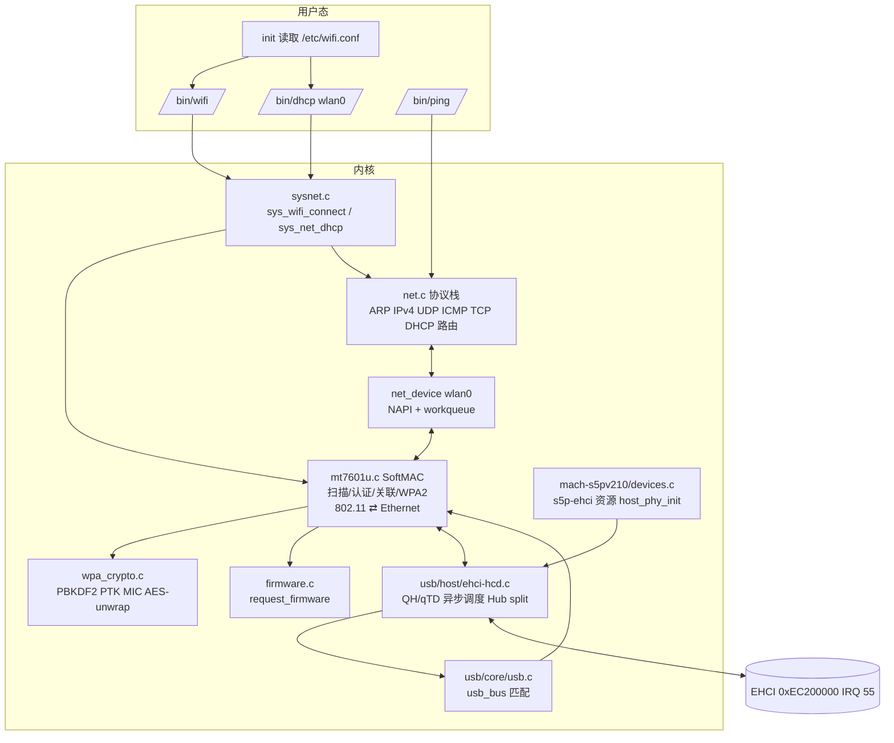

---

## 3. 硬件连接

```mermaid
flowchart LR
  subgraph SoC[S5PV210 核心板]
    CPU[Cortex-A8 1 GHz]
    DDR[(DDR2 512 MiB<br/>0x20000000)]
    EHCI[USB Host EHCI<br/>0xEC200000 IRQ 55]
    OHCI[OHCI 0xEC300000<br/>未使用]
    PHY[USB PHY1 Host<br/>寄存器 0xEC100000]
    VIC[VIC 中断控制器]
    CPU <-->|AXI/AHB| EHCI
    EHCI <-->|DMA 读写 qTD/QH/缓冲区| DDR
    EHCI --> PHY
    EHCI -->|IRQ 55| VIC --> CPU
  end
  subgraph SDK[Tiny210 SDK 底板]
    HUB[SMSC USB2514<br/>4 口 HS Hub<br/>424:2514]
    A1[USB-A 口]
  end
  subgraph Dongle[USB 网卡]
    MT[MT7601U<br/>148f:7601<br/>MCU+MAC+BBP+RF]
    ANT((2.4 GHz 天线))
  end
  PHY -- USB 2.0 HS 480 Mbit/s D+/D- --> HUB
  HUB -- 端口 3 --> A1 --> MT
  MT --- ANT
  ANT -. 802.11n 1T1R 信道 9 .-> AP[TP-Link_B114<br/>BSSID f0:09:0d:cb:b1:14<br/>WPA2-CCMP<br/>DHCP 192.168.0.1]
```

要点：

* **只走 EHCI（USB-A Host 口），不走 OTG 口。** OTG 口是 DWC2 控制器（0xEC000000，
  IRQ 56），代码保留了但默认不启用（`S5PV210_USB_OTG=1` 才编）。
* SoC 的 Host 口只有一个根端口，SDK 底板上焊了一颗 USB2514 Hub，网卡插在 Hub
  的端口 3，所以枚举顺序是“根端口 → Hub(地址 1) → MT7601U(地址 2)”。
  Hub 是 HS Hub，网卡也是 HS，所以不需要 split transaction；全/低速设备才会
  用 Hub 的 TT（代码支持）。
* EHCI 是总线主设备，它自己从 DDR 读 QH/qTD 描述符和数据缓冲区。xv6 在 Tiny210
  上 D-cache 关闭，所以不需要做 cache 维护，但也意味着 CPU 访存很慢、会和
  EHCI 抢 DDR 带宽（见第 10 节 INSNREG01 问题）。
* MT7601U 内部有一个 8051 风格的 MCU（运行我们下载的固件），MAC、BBP（基带）、RF
  三组寄存器，以及自带的 AES-CCMP 硬件加解密引擎。

MT7601U 的 USB 端点（实板日志 `bulk in 4,5/512 out 8/512`）：

| 端点 | 方向 | 用途（本驱动） |
|---|---|---|
| EP0 | control | 厂商请求：读写 32 位寄存器（`mt7601u_read32/write32`）、eFuse、固件 DMA 控制 |
| EP 0x84 (IN#0) | bulk IN | 接收数据：RXWI + 802.11 帧（4 个 16 KiB 缓冲区循环） |
| EP 0x85 (IN#1) | bulk IN | MCU 命令响应 |
| EP 0x08 (OUT#0) | bulk OUT | 固件下载、MCU 命令、**以及本驱动的所有 802.11 发送帧** |
| EP 0x04-0x07, 0x09 | bulk OUT | Linux 中的各 AC/管理队列；Tiny210 上 0x09 一开始就 NAK，故不用 |

---

### 3.1 SoC 内部：USB Host 子系统

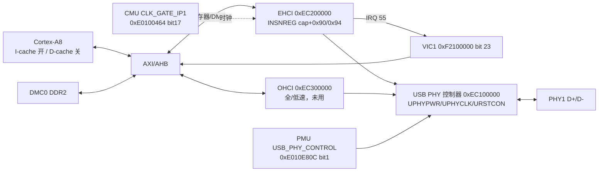

* EHCI 和 OHCI 共用 PHY1。高速设备归 EHCI；根端口上的全/低速设备要交给 OHCI（`PORT_OWNER`），xv6 没写 OHCI，
  `root_ports()` 只打印 “left to OHCI”。高速 Hub 后面的全/低速设备由 EHCI 用 split 事务访问。
* 时钟、去隔离、上电、复位四个开关分别在 CMU、PMU、USB PHY 控制器里，都由 `host_phy_init()` 打开。
* EHCI 是 AHB 主设备，自己读写 DDR 里的 QH/qTD 和缓冲；D-cache 关闭，所以不需要 clean/invalidate，代价是 CPU 访存慢、和 EHCI 抢带宽。

| 资源 | 值 | 在哪里用 |
|---|---|---|
| EHCI 寄存器 | 0xEC200000（1 MiB 段映射） | `devices.c` 资源 0，`ehci_probe` |
| EHCI 中断 | IRQ 55（VIC1 bit 23） | `request_irq(55, ehci_irq)` |
| USB PHY 控制器 | 0xEC100000 | `host_phy_init` |
| CLK_GATE_IP1 | 0xE0100464 bit17（USBHOST） | `host_phy_init` |
| USB_PHY_CONTROL | 0xE010E80C bit1（PHY1 去隔离） | `host_phy_init` |
| PHY 参考时钟 | 24 MHz（UPHYCLK = 3） | `host_phy_init` |

### 3.2 板上：USB2514 Hub 与 USB-A 口

SDK 底板把 SoC 唯一的 Host 口接到 SMSC USB2514（0424:2514，4 口高速 Hub），网卡插在下行口 3。Hub 自己也是 USB 设备（类 9），
所以枚举分两级：Hub 地址 1，再经 Hub 类请求逐口上电、复位，给网卡地址 2。VBUS 由底板经 Hub 端口电源开关供给，xv6 不控 GPIO。
Hub 和网卡都是高速，包在 Hub 里只是转发，不经过事务转换器（TT），QH 的 `epcap` 不填 split 目标。

### 3.3 电气与链路层

* D+/D- 差分，高速 400 mV 摆幅；NRZI 编码，连续 6 个 1 插一个 0（bit stuffing）。
* 每个包：32 位 SYNC、8 位 PID（4 位 + 反码）、地址/数据、CRC、EOP。
* 端口复位期间设备发 Chirp K、主机回 KJKJ，切到高速。EHCI 只有高速握手成功才置 `PORTSC.PE`，所以 `root_ports()` 复位后看 PE；
  Hub 后面的设备看端口状态 bit10（高速）/bit9（低速）。
* 高速以 125 µs 微帧为单位，每微帧开头 SOF；一个微帧最多 13 个 512 字节 bulk 包。

### 3.4 空口

MT7601U 是 1T1R 2.4 GHz 802.11b/g/n。TP-Link_B114 在信道 9（2452 MHz，20 MHz）。本驱动所有发送帧都用 CCK 1 Mbit/s
（TXWI `rate_ctl = 0`）；ACK、重传、FCS 由芯片完成。

## 4. 软件架构与源文件

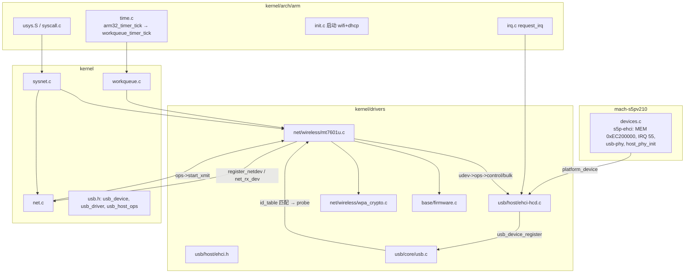

| 文件 | 主要内容 |
|---|---|
| `kernel/arch/arm/mach-s5pv210/devices.c` | `host_phy_init()`（USB PHY1 上电、时钟、复位），`s5p-ehci` 平台设备资源 |
| `kernel/drivers/usb/host/ehci-hcd.c` | `ehci_probe` → `ehci-enum` 内核线程；`ehci_start`、`root_ports`、`hub_ports`、`enumerate`、`parse_config`；`qh_create` `qh_append` `qh_flush` `wait_qtd`；`ehci_usb_control/bulk/bulk_rx_arm/bulk_rx_complete`；`ehci_irq` |
| `kernel/drivers/usb/core/usb.c` | `usb_bus`、`usb_match`（VID:PID 表）、`usb_probe`、`usb_device_register`、`usb_register_driver`、urb 辅助 |
| `kernel/usb.h` | `struct usb_device`（vendor/product、`bulk_in_ep`、`bulk_out_ep`、`ops`），`struct usb_host_ops` |
| `kernel/drivers/net/wireless/mt7601u.c` | probe、固件下载、eFuse/EEPROM、MAC/BBP/RF 表与校准、信道切换、扫描、认证/关联、EAPOL、CCMP 密钥安装、TX/RX 帧格式、NAPI、`net_device_ops`、`mt7601u_connect` |
| `kernel/drivers/net/wireless/wpa_crypto.c` | SHA1/HMAC、`wpa_pbkdf2`、`wpa_make_snonce`、`wpa_derive_ptk`、`wpa_eapol_mic`、AES-128 与 `wpa_aes_unwrap` |
| `kernel/drivers/base/firmware.c` | `request_firmware("mt7601u.bin")`：先读 FAT32 `/boot`（SD 卡），再退回内置副本 |
| `kernel/net.c` | `register_netdev`、`netdev_xmit_on`、`net_rx_dev`、`napi_schedule/napi_workfn`、ARP、IPv4、UDP、ICMP、TCP、DHCP 客户端、路由 |
| `kernel/sysnet.c` | `sys_wifi_connect`、`sys_net_dhcp` 等 |
| `kernel/arch/arm/time.c` | 100 Hz 时钟中断里调 `workqueue_timer_tick()`，驱动所有 delayed work |
| `user/wifi.c` `user/dhcp.c` `user/ping.c` | 用户程序；`/etc/wifi.conf`（`ssid=`/`psk=`，由 `ports/tiny210/wifi.conf` 打进 fs.img，不进 git） |

### 4.1 执行上下文（谁在哪个线程里跑）

| 上下文 | 做什么 |
|---|---|
| `ehci-enum` 内核线程 | 启动 EHCI、上电端口、枚举 Hub 和网卡；在这个线程里调用 `mt7601u_probe`（固件下载、射频初始化）。因为要等几百毫秒的复位/上电，所以不放在 initcall 里 |
| EHCI 中断（IRQ 55） | `ehci_irq` 清 USBSTS，调用 `mt7601u_rx_irq()` → `napi_schedule()`，只做排队 |
| `mt7601u_wq` 工作队列线程 | ① NAPI：`mt7601u_napi_poll` → `mt7601u_service(1,0)` 处理接收缓冲区；② `state_work`：`mt7601u_state_worker` → `mt7601u_service(0,1)` 推进扫描/认证/关联/超时状态机 |
| 时钟中断（PWM timer4，100 Hz） | `arm32_timer_tick` → `workqueue_timer_tick()`：到期的 delayed work 入队 |
| 用户进程（系统调用里） | `mt7601u_connect` 只设置目标并 `sleep(&ticks)` 等待 `handshake_done`；`dhcp`/`ping` 在系统调用里发帧、等回包 |

---

## 5. USB 各层架构

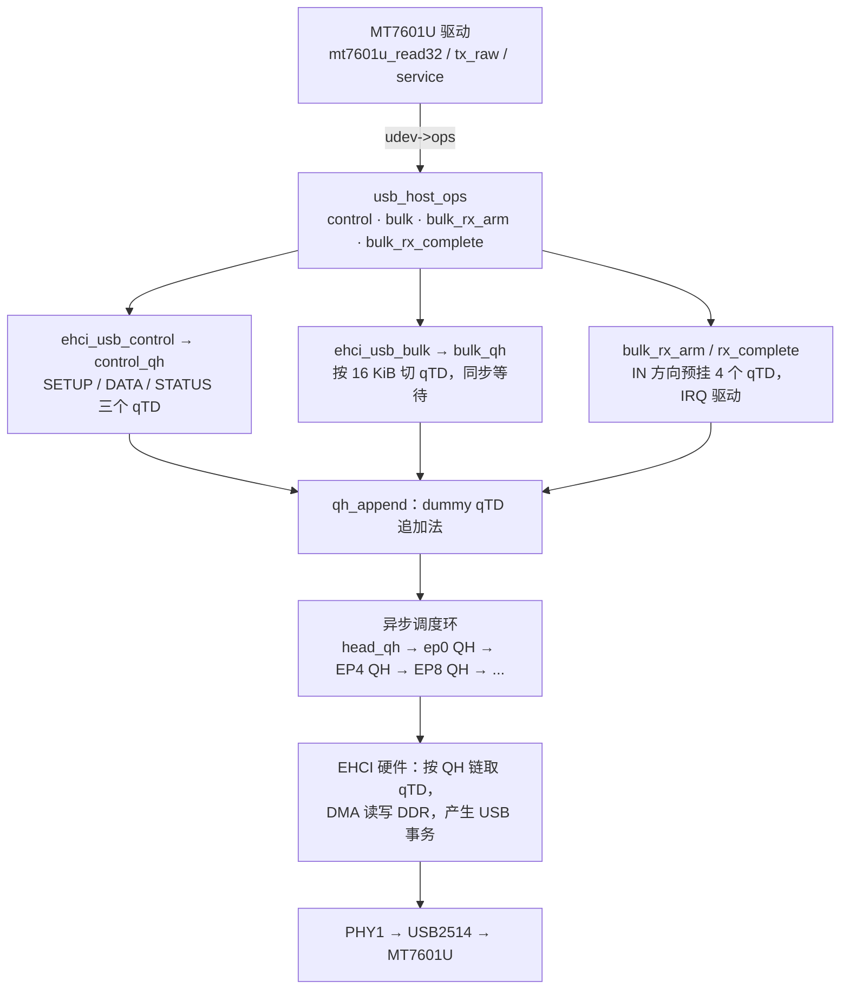

### 5.1 平台层：PHY 与控制器启动

* `devices.c: host_phy_init()`（参考 Linux `phy-s5pv210-usb2.c`）：
  `CLK_GATE_IP1`(0xE0100464) bit17 打开 USBHOST 时钟；`USB_PHY_CONTROL`(0xE010E80C) bit1
  解除 PHY1 隔离；PHY 寄存器块 0xEC100000 里 `UPHYCLK` 选 24 MHz 参考时钟，`UPHYPWR`
  清 bit6/7 让 PHY1 上电，`URSTCON` bit3/4 脉冲复位 PHY1 和 Host link。
* `ehci_start()`：
  1. `phy_init()`；读 CAPLENGTH 得到操作寄存器基址、HCSPARAMS 得到端口数（1）。
  2. 写 Samsung 私有寄存器 INSNREG00（burst 使能），**INSNREG01 = 0x00800080**
     （OUT/IN 包阈值都设为 512 字节：控制器缓存满一整包再上总线）。
  3. 停止、复位控制器；建立异步环的头 QH（H 位、halted overlay、指向自己）。
  4. `ASYNCLIST = head_qh`，`USBINTR = USBINT|ERR`，`USBCMD = RUN|ASE|ITC(1)`，
     `CONFIGFLAG = 1`；端口上电，等待 100 ms。

日志：

```text
ehci: s5p-ehci at -13e00000, enumeration deferred to ehci-enum
ehci: INSNREG01 thresholds <复位值> -> 800080
ehci: 1 port(s), running, async schedule on
```

（`-13e00000` 是 `0xEC200000` 被 `%d` 风格打印成有符号数。）

### 5.2 HCD 层：QH/qTD 与 dummy 追加法

EHCI 的异步调度是一个 QH（Queue Head，每个端点一个）组成的环。每个 QH 下挂一串
qTD（Queue Transfer Descriptor），每个 qTD 最多描述 5 个 4 KiB 页（≈16–20 KiB）。

* `qh_create(addr, ep, speed, mps, control, hub, port)`：填 epchar（设备地址、
  端点号、速度、最大包长）、epcap（Hub 地址/端口，用于 split），挂进环里。每个
  QH 初始挂一个不活动的 **dummy qTD**。
* `qh_append(q, first, last)`：Linux 的追加方法。不去改正在被硬件执行的链表，
  而是把新传输的第一个 qTD 的内容**拷进当前 dummy**，再接一个新的 dummy 在尾部；
  先激活后面的 qTD，最后才把第一个（原 dummy）的 Active 置位。这样硬件永远看到
  一致的链表，不用停异步调度。
* `wait_qtd(last, timeout)`：轮询最后一个 qTD 的 Active 位（同步传输）。
* `qh_flush(q, from)`：超时/出错时停异步调度，丢掉排队的 qTD，QH 重新指向 dummy；
  **保留 data toggle（DT）位**（见第 10 节）。
* `ehci_usb_bulk_rx_arm`：给 EP4 预挂一个 IN qTD（带 IOC），不等待；
  `ehci_usb_bulk_rx_complete`：从 `q->head` 取一个已完成的 qTD，返回实际长度。
  mt7601u 预挂 4 个 16 KiB 缓冲区，形成接收环。
* `ehci_irq`：USBSTS 的 USBINT/ERR 置位时调用弱符号 `mt7601u_rx_irq()`。

一次 bulk OUT 的硬件过程：EHCI 读 QH → 取 qTD → 从 DDR DMA 取数据 → 在 USB 上发
OUT token + DATA0/1 包（每包 512 字节）→ 设备回 ACK（或 NAK/NYET，HC 自动 PING
重试）→ qTD 的 Total Bytes 递减，完成后清 Active，若 IOC 则置 USBINT。

### 5.3 枚举与 Hub

`ehci_enum_thread` → `ehci_start` → `root_ports()`：

1. 根端口检测到连接 → 端口复位 50 ms → 确认高速（PORTSC.PE）→ `enumerate(speed, hub=0, port=0)`。
2. `enumerate`：在地址 0 上用 ep0 QH 读设备描述符前 8 字节（得到 ep0 最大包长）
   → `SET_ADDRESS` → 读完整设备描述符、配置描述符 → `parse_config` 记录 bulk/
   interrupt 端点 → `SET_CONFIGURATION`。
3. 设备类 9（Hub）→ `hub_ports()`：读 Hub 描述符（4 口），每口 `SET_FEATURE(PORT_POWER)`，
   读端口状态，有设备则 `SET_FEATURE(PORT_RESET)`，再对该口递归 `enumerate(…, hub=1, port=3)`。
4. 非 Hub 设备 → `usb_device_register(udev)` → usb 总线遍历驱动 `id_table`，
   148f:7601 命中 → `mt7601u_probe(udev)`。

日志：

```text
ehci: port 0: high-speed device connected
ehci: high-speed device 424:2514 class 9 at address 1 (hub 0 port 0)
ehci:   bulk in 0,0/0 out 0/0 intr in 1
ehci: hub 1: 4 ports
ehci: high-speed device 148f:7601 class 255 at address 2 (hub 1 port 3)
ehci:   bulk in 4,5/512 out 8/512 intr in 0
```

### 5.4 USB core 与设备驱动接口

```c
struct usb_host_ops {                       /* kernel/usb.h */
  int (*control)(struct usb_device*, uint8 type, uint8 req, uint16 value,
                 uint16 index, void *data, uint16 len);
  int (*bulk)(struct usb_device*, int ep, int in, void *data, int len);
  int (*bulk_rx_arm)(struct usb_device*, int ep, void *data, int len);
  int (*bulk_rx_complete)(struct usb_device*, int ep, void **data);
};
```

MT7601U 驱动完全不知道 EHCI 的存在，只调用 `udev->ops->…`；同一份驱动在
`S5PV210_USB_OTG=1` 时也能挂在 DWC2 上（日志里的 “EP4 receive uses DWC2 IRQ”
就是早期走 OTG 口时打印的）。

---

### 5.5 USB 数据传输细节

#### 总线上的包与事务

一次事务 = 主机发的 Token 包 + 可选 Data 包 + 接收方的 Handshake 包。

| 类别 | PID | 本驱动中的位置 |
|---|---|---|
| Token | SETUP | 只用于 EP0：枚举、MT7601U 寄存器读写 |
| Token | OUT | EP0 数据/状态阶段；EP8 的固件、MCU 命令、802.11 帧 |
| Token | IN | EP0 数据阶段；EP4 接收帧；EP5 MCU 应答 |
| Token | PING | 高速 OUT 先问有没有空间，EHCI 用 qTD 的 Ping 状态位自动处理 |
| Data | DATA0 / DATA1 | 交替（data toggle），接收方据此识别重传；SETUP 恒为 DATA0 |
| Handshake | ACK | 正确收到 |
| Handshake | NAK | 暂时不行（EP4 没帧、EP8 缓冲满），流控不是错误，EHCI 按 NAK reload 计数自动重试 |
| Handshake | NYET | 高速 OUT：这个收了，下一个先 PING |
| Handshake | STALL | 端点停住，qTD 上表现为 Halted |

本驱动只用控制传输（EP0）和 bulk 传输（EP4/5/8）。

#### EHCI 数据结构：QH 与 qTD

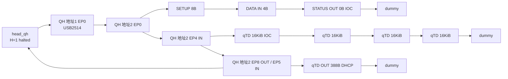

| QH 字 | 字段 | 本驱动的值（`qh_create`） |
|---|---|---|
| 0 | horiz | 下一个 QH 物理地址 \| Typ=QH；新 QH 插在 head_qh 后，一次对齐写发布 |
| 1 | epchar | [6:0] 地址；[11:8] 端点；[13:12] 速度 2=高速；[14] DTC（控制端点=1）；[15] H（仅 head_qh）；[26:16] 最大包长 512/64；[27] 全/低速控制端点；[31:28] NAK 重载 8 |
| 2 | epcap | [22:16] Hub 地址、[29:23] Hub 端口（仅 split）；[31:30] Mult=1 |
| 3 | cur | 当前 qTD（HC 写） |
| 4–11 | overlay | HC 正在执行的 qTD 副本 |
| 12–16 | buf_hi | 64 位扩展，HC 会回写，软件字段放在它后面 |

| token 位 | 名称 | 含义 |
|---|---|---|
| 7 | Active | 交给 HC；完成后清零（`wait_qtd` 轮询它） |
| 6 | Halted | 出错停住，整个 QH 停 |
| 5 | Data Buffer Error | 欠载/溢出（固件下载失败时 0xa0 = Active + 这一位） |
| 4/3/2 | Babble / XactErr / Missed µframe | |
| 9:8 | PID | 0 OUT，1 IN，2 SETUP |
| 11:10 | CERR | 重试次数，填 3 |
| 15 | IOC | 完成时置 USBINT |
| 30:16 | Total Bytes | 完成后为剩余数，实际长度 = length − TOK_LEFT |
| 31 | DT | data toggle |

每个 qTD 有 5 个页指针，16 KiB 接收缓冲、14 KiB 固件块都只要一个 qTD。

#### EHCI 怎样执行异步调度

1. `USBCMD.ASE=1` 后 HC 从 `ASYNCLIST`（head_qh）沿 `horiz` 一圈圈走 QH。
2. overlay 不活动就沿 `next` 取下一个 qTD；活动就执行事务（按最大包长切包）。
3. 设备 NAK：NAK 计数减一，用完就去下一个 QH，下一圈再试。EP4 没帧时 HC 一直发 IN 收 NAK，不占 CPU。
4. qTD 传完或 IN 收到短包：写回 token、清 Active，有 IOC 就置 `USBSTS.USBINT`。
5. 出错且 CERR 用完：置 Halted 和错误位、置 `USBSTS.ERR`，QH 停住等软件修复。

`qh_append` 的 dummy 法：HC 永远停在一个不活动的 dummy 上，追加时把新传输第一个 qTD 复制进 dummy、尾部接新 dummy、
最后才置原 dummy 的 Active，所以不用停调度也不用门铃。只有出错时 `async_stop()` → `qh_flush()` → `async_start()`。

#### 控制传输：MT7601U 的寄存器读写

3 个 qTD：SETUP 8 B（DATA0）→ DATA（DATA1）→ 反向 0 字节 STATUS（DATA1，IOC）。

| 操作 | bmRequestType | bRequest | wValue | wIndex |
|---|---|---|---|---|
| 读 32 位寄存器（DATA IN 4 B） | 0xC0 | 7 MULTI_READ | 0 | 地址 |
| 写 32 位寄存器 | 0x40 | 2 WRITE | 低/高 16 位 | 地址/地址+2 |
| 写 FCE 寄存器 | 0x40 | 0x42 WRITE_FCE | 值 | 地址 |
| 复位/启动 MCU | 0x40 | 1 DEV_MODE | 模式 | 0 |

```text
读 ASIC_VERSION（日志 ASIC=76010001）：
SETUP 事务:  SETUP(addr 2, EP0) | DATA0 C0 07 00 00 00 00 04 00 | ACK
DATA  事务:  IN(addr 2, EP0)    | DATA1 01 00 01 76             | ACK
STATUS事务:  OUT(addr 2, EP0)   | DATA1 （0 字节）              | ACK
```

BBP/RF 寄存器要经间接端口 `BBP_CSR_CFG`(0x101c)/`RF_CSR_CFG`(0x0500)：写“寄存器号 + 值 + 写位 + 忙位”，再轮询忙位，一个 RF 写要 4–6 次控制传输。

#### Bulk OUT：一帧怎样从内存到网卡

```text
Ethernet 帧 342 B = 14 B 以太头 + 328 B (IP+UDP+BOOTP)
802.11 MPDU = 24 B 头 + 8 B LLC/SNAP + 328 B = 360 B            mt7601u_send_llc
EP8 包     = TXINFO 4 + TXWI 20 + MPDU 360 + 4 B 0 = 388 B      mt7601u_tx_raw
qTD        = OUT, 388 B, IOC, CERR 3                            bulk_qh -> qh_append
总线       = [PING -> ACK] OUT + DATAx 388 B（短包）+ ACK
```

固件块 14336 + 8 = 14344 字节：一个 qTD，总线上 28 个 512 字节包 + 一个 8 字节短包。网卡忙时 NAK/NYET，EHCI 自动 PING；
`bulk_qh` 对 OUT 最多等 3 s（IN 1 s），超时打印现场、停调度、`qh_flush`、重启。

#### Bulk IN：EP4 的接收环

1. probe 末尾 `bulk_rx_arm(EP4)` ×4：每次一个 16 KiB、IN、IOC 的 qTD 追加到 EP4 QH，不等待。
2. HC 反复对 EP4 发 IN，网卡没帧就 NAK。
3. 网卡把一个或多个“DMA 长度 + RXWI + MPDU + 尾”段聚合成一次 bulk IN（`USB_DMA_CFG` 聚合上限 0x80、超时 0x20），以短包结束。
4. HC 写回 token、置 USBINT → IRQ 55。
5. NAPI 里 `bulk_rx_complete` 摘下最老的已完成 qTD，`rx_parse` 拆帧后同一缓冲 `bulk_rx_arm` 挂回队尾。

#### MCU 命令与 EP5

```text
TXINFO = bit30 命令 | (2 << 27) 端口 CPU_TX | (cmd << 20) | (seq << 16) | 载荷长度
FUN_SET(Q_SELECT=1)  cmd 1，不要应答：此后应答从 EP5 送出
CALIBRATE(id, 0)     cmd 31，seq 1..15，EP5 上同步 bulk IN 等 16 B 应答，核对 seq(bit16-19) 和事件(bit20-23 = 0)
```

#### 枚举请求序列

| # | 请求 | 作用 |
|---|---|---|
| 1 | 根端口复位 50 ms，看 PORTSC.PE | 高速握手成功 |
| 2 | 80/06 GET_DESCRIPTOR(设备, 8 B) @地址 0 | 拿 bMaxPacketSize0 |
| 3 | 00/05 SET_ADDRESS(1) | Hub 地址 1 |
| 4 | 80/06 设备描述符 18 B、配置描述符 9 B 再全长 | 0424:2514，类 9 |
| 5 | 00/09 SET_CONFIGURATION | |
| 6 | A0/06 GET_DESCRIPTOR(Hub 0x29) | 4 口、上电时间 |
| 7 | 23/03 SET_FEATURE(PORT_POWER) ×4 | 下行口上电 |
| 8 | A3/00 GET_STATUS(端口) | bit0 连接，bit10 高速 |
| 9 | 23/01 CLEAR_FEATURE(C_PORT_CONNECTION)，23/03 SET_FEATURE(PORT_RESET) | 复位端口 3，轮询 bit4 结束、bit1 使能 |
| 10 | 对端口 3 的设备重复 2–5，地址 2 | 148f:7601 |
| 11 | `parse_config` | bulk IN 4、5，bulk OUT 8 |
| 12 | `usb_device_register` → `usb_match` | 绑定 mt7601u |

#### 出错处理与 data toggle

`TOK_ERRMASK`(0x7c) 覆盖 Halted、Buffer、Babble、XactErr、Missed。出错或超时：`async_stop()` 等 ASS 归零 → `qh_flush()` 丢弃未完成 qTD、
QH 指回 dummy → `async_start()`。`qh_flush` 保留 DT 位：设备的 toggle 没复位，主机若从 DATA0 重来，设备会把新包当重传丢掉
（实板“握手后 EP8 一直 NAK”，f649f28）。

## 6. 中断与下半部：一帧怎样从 IRQ 55 走到协议栈

接收是唯一由中断驱动的方向。上半部只确认中断、登记有活要干；USB 收取、802.11 解析、协议处理在内核线程里做。

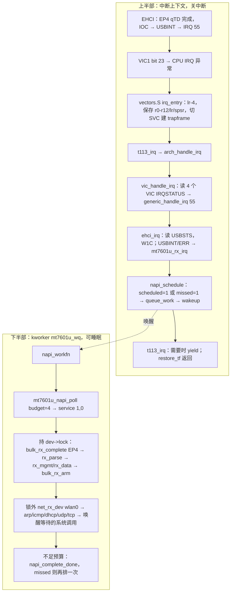

* **上半部为什么短**：`ehci_irq` 只 W1C 清 USBSTS 和 `napi_schedule`。EHCI 中断写 1 清掉就撤销，不像 SDIO 卡中断那样要先屏蔽、读空再打开（对比 xv6-book 的 BCM43455）。
  下半部要拿 `dev->lock`，解析管理帧和 EAPOL 时还会发 USB 传输（拿睡眠锁 `xfer_lock`、等 HC 完成），中断里做不了。
* **NAPI 三个状态位**：`scheduled` 防重复排队；`missed` 记住 poll 运行中到来的中断，结束时再排一次；`weight` = 4（接收缓冲数），用满预算直接再排队。
  工作队列本身也防重入：work 运行中再 `queue_work` 只置 `rerun`。

时钟中断：

```text
PWM timer4 中断（100 Hz） -> VIC -> arm32_timer_tick()
   |- 每 10 次：ticks++，wakeup(&ticks)        mt7601u_connect 在这里 sleep 等握手
   |- workqueue_timer_tick()                    到期的 delayed_work 入队 -> state_work -> mt7601u_service(0,1)
   `- sched_tick()
```

发送方向没有中断：调用者上下文 → `netdev_xmit_on` → `mt7601u_net_xmit`（`dev->lock`）→ `tx_raw` → `ehci_usb_bulk`（`xfer_lock`）→ `wait_qtd` 轮询 Active。

| 锁 | 类型 | 保护什么 |
|---|---|---|
| `ehci_lock` | 自旋锁 | qTD 池、QH 的 qTD 队列 |
| `xfer_lock` | 睡眠锁 | 同一时刻一个同步控制/bulk 传输（共享 `setup_buf`/`ctrl_buf`） |
| `dev->lock` | 自旋锁 | 连接状态、密钥、接收槽、TX 序号 |
| `napi->lock` | 自旋锁 | scheduled/missed/enabled |
| `wq->lock` | 自旋锁 | 工作队列链表 |

---

## 7. MT7601U 硬件层

### 7.1 芯片内部

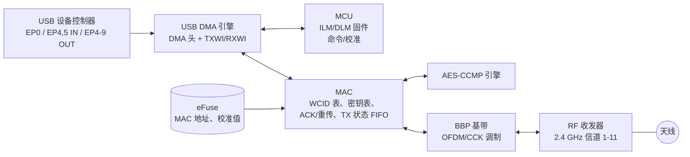

### 7.2 probe 时的初始化（`mt7601u_probe`）

| 步骤 | 函数 | 做什么 | 日志 |
|---|---|---|---|
| 1 | `mt7601u_read32(MT_ASIC_VERSION)` | EP0 厂商请求读寄存器，确认 ASIC=0x7601 | `USB device 148f:7601 ASIC=76010001 MAC=76010500` |
| 2 | `mt7601u_validate_firmware` → `request_firmware` | 从 `/boot/mt7601u.bin` 读固件头，检查 ILM/DLM 长度 | `firmware v0.1.0 build=7640 size=45412 validated` |
| 3 | `mt7601u_load_firmware` → `mt7601u_dma_fw_range` → `mt7601u_dma_fw_chunk` | 每块 14 KiB：EP0 厂商请求 `WRITE_FCE` 写 `FCE_DMA_ADDR`/`FCE_DMA_LEN`，EP8 bulk OUT 送“TXINFO(目的 CPU_TX_PORT)+数据”，`TX_CPU_FROM_FCE_CPU_DESC_IDX`+1，轮询 `MCU_COM_REG1` bit31；先 ILM 后 DLM；最后启动 MCU，轮询 `COM_REG0` | `ILM firmware upload 14336/45316 … 45316/45316`，`MCU firmware running` |
| 4 | `mt7601u_read_eeprom` → `mt7601u_efuse_read_block` | 从 eFuse 读 MAC 地址、频偏、温度补偿等 | `EEPROM ver=d …`，`permanent mac=90:de:80:14:95:94` |
| 5 | `mt7601u_basic_hw_init` | WLAN 时钟/PLL、BBP 就绪、RF 引导 | `MAC/BBP/RF bootstrap ready; rx-ep=4 data, 5 MCU` |
| 6 | `mt7601u_mcu_channel_init` | MCU 命令通道（命令走 EP8，响应走 EP5） | `MCU command channel ready tx-ep=8 resp-ep=5` |
| 7 | `mt7601u_full_hw_init` | 写 MAC（44 项）/BBP（59 项）/RF（138 项）寄存器表，`mt7601u_calibrate` 做 RF 校准 | `MAC register table initialized (44 entries)` … `RF calibration complete; bulk endpoints ready` |
| 8 | `mt7601u_set_channel(1)` | 选信道 1，开始扫描 | |
| 9 | `bulk_rx_arm` ×4 | EP4 挂 4 个 16 KiB 接收缓冲 | `EP4 receive uses USB host IRQ with 4 buffers` |
| 10 | `queue_delayed_work(state_work, 50)` | 启动状态机（每 0.5 s 换一个信道） | `transport and MCU ready; SoftMAC initialization pending` |

### 7.3 USB 上的帧格式

MT7601U 是 **SoftMAC**：802.11 帧由主机驱动组好，芯片只负责加 PHY 头、调制、
ACK、重传和（可选的）加解密。

**发送**（`mt7601u_tx_raw`）：

```text
+-----------+---------------------------+--------------------------+--------+------+
| DMA 头 4B | TXWI 20B                  | 802.11 MPDU              | 填充   | 0 4B |
| len|80211 | rate=CCK1M ack=1 wcid len | FC Dur A1 A2 A3 Seq LLC… | 到 4B  | 结束 |
| [|WIV]    |                           |                          |        |      |
+-----------+---------------------------+--------------------------+--------+------+
```

* `MT_TXD_PKT_INFO_80211`：载荷是原始 802.11 帧。
* `WIV`（Without IV）：置位表示“帧里自带 IV / 不需要硬件加密”。管理帧和握手前的
  EAPOL 都置 WIV；**握手完成后数据帧不置 WIV**，`wcid=1`（AP 条目），MAC 用 WCID 1
  的 PTK 做 CCMP 加密并自动插入 CCMP 头和 MIC。
* 发完后 `mt7601u_tx_stat_drain` 读空 TX_STAT_FIFO。

**接收**（`mt7601u_rx_parse`）：一个 USB 缓冲区里可能有多个段，每段：

```text
| DMA 长度 4B | RXWI 28B (rxinfo, ctl=MPDU 长度, RSSI…) | 802.11 MPDU | 填充 | 4B |
```

RXINFO 关键位：bit8 CRC 错，bit9 ICV 错，bit10 MIC 错，bit14 L2 填充，
**bit16 DECRYPT（硬件已解密）**，bit4 单播给我，bit5 组播，bit6 广播，bit7 本 BSS。

实板 `rxinfo=1520e2` = DECRYPT + MYBSS + BROADCAST + MULTICAST + DATA；
`rxinfo=112092` = DECRYPT + MYBSS + U2M（发给我的单播，ARP 回复）。

### 7.4 WCID 与密钥表（`mt7601u_install_ccmp_keys`）

| 寄存器区 | 地址 | 内容 |
|---|---|---|
| 单播密钥表 | `0x8000 + WCID*32` | WCID 1（AP）的 TK = PTK[32..47] |
| IV/EIV 表 | `0xA000 + WCID*8` | 初始 PN，KeyID 位 `0x20`（ExtIV） |
| WCID 属性 | `0xA800 + WCID*4` | cipher=4（AES-CCMP），pairwise=1 |
| 共享（组）密钥 | `0xAC00 + idx*32` | GTK（从 M3 解出） |
| 共享密钥模式 | `0xB000` | 每个 key index 4 位，填 4 |

---

## 8. 802.11 与 WPA2：网卡如何和路由器通信

### 8.1 连接状态机

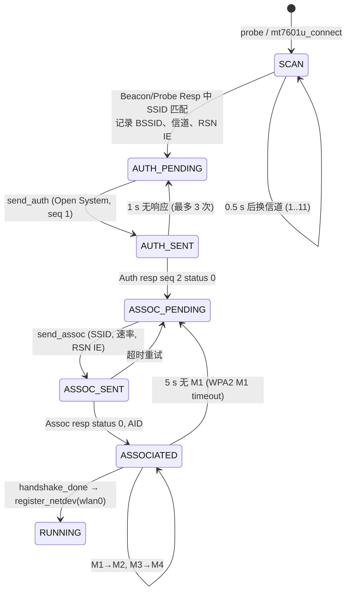

时间常量（jiffy = 10 ms）：扫描驻留 `MT_SCAN_DWELL_JIFFIES=50`（0.5 s），响应超时
`MT_RESPONSE_TIMEOUT_JIFFIES=100`（1 s），WPA 看门狗 `MT_WPA_TIMEOUT_JIFFIES=500`（5 s）。
状态机靠 delayed work 推进，**所以必须有 `workqueue_timer_tick()`**。

### 8.2 各阶段帧

| 阶段 | 方向 | 802.11 帧 | 驱动函数 | 关键字段 |
|---|---|---|---|---|
| 扫描 | AP→STA | Beacon (FC 0x0080) | `mt7601u_rx_mgmt` | SSID IE、DS 参数（信道）、RSN IE（WPA2/CCMP/PSK） |
| 认证 | STA→AP | Authentication (0x00B0) | `mt7601u_send_auth` | 算法 0 Open System，seq 1 |
| | AP→STA | Authentication | `mt7601u_rx_mgmt` | seq 2，status 0 |
| 关联 | STA→AP | Association Request (0x0000) | `mt7601u_send_assoc` | Capability、Listen interval、SSID、支持速率、**RSN IE（22 字节）** |
| | AP→STA | Association Response (0x0010) | `mt7601u_rx_mgmt` | status 0、AID=1 |
| 握手 M1 | AP→STA | Data + LLC/SNAP + EAPOL-Key (0x888e) | `mt7601u_rx_data` → `mt7601u_rx_eapol` | ANonce，key-info 0x008a |
| 握手 M2 | STA→AP | Data（未加密） | `mt7601u_send_m2` | SNonce、RSN IE、MIC(KCK) |
| 握手 M3 | AP→STA | Data | `mt7601u_rx_eapol` | MIC、Install、加密的 Key Data（GTK KDE） |
| 握手 M4 | STA→AP | Data | `mt7601u_send_m4` | MIC |
| 数据 | 双向 | Data，Protected，CCMP | `mt7601u_send_llc` / `mt7601u_rx_data` | ToDS/FromDS、CCMP 头 8 字节 |

### 8.3 WPA2-PSK 密钥推导（`wpa_crypto.c`）

```text
PMK  = PBKDF2-HMAC-SHA1(passphrase, SSID, 4096 次, 32 字节)       wpa_pbkdf2      (mt7601u_connect)
SNonce = PRF(PMK, ANonce, 计数器)                                   wpa_make_snonce (收到 M1)
PTK  = PRF-512(PMK, "Pairwise key expansion",
               min(AA,SPA)|max(AA,SPA)|min(AN,SN)|max(AN,SN))       wpa_derive_ptk
       PTK[0..15]  = KCK  → EAPOL MIC (HMAC-SHA1 截 16 字节)       wpa_eapol_mic
       PTK[16..31] = KEK  → 解 M3 里的 GTK (AES Key Wrap)          wpa_aes_unwrap
       PTK[32..47] = TK   → 写进芯片 WCID 1 密钥表，硬件 CCMP
GTK  = AES-Unwrap(KEK, M3 Key Data) 中 OUI 00-0f-ac type 1 的 KDE  → 共享密钥表
```

PBKDF2 要做 8192 次 HMAC-SHA1，在 D-cache 关闭的 Cortex-A8 上要几秒，所以只在
`mt7601u_connect` 里算一次。

### 8.4 802.11 帧头

```text
偏移  0 Frame Control 2 B   2 Duration 2 B（硬件填）
      4 Address 1  6 B      10 Address 2  6 B      16 Address 3  6 B
     22 Sequence Control 2 B（高 12 位序号）        [24 QoS Control 2 B]
```

| FC 位 | 含义 | 本驱动 |
|---|---|---|
| [3:2] | 类型 0 管理 / 1 控制 / 2 数据 | `rx_parse` 分流 |
| [7:4] | 子类型 | 管理：0 关联请求、1 关联应答、5 探测应答、8 Beacon、11 认证、10/12 解除；数据 8 = QoS |
| 0x0100 | ToDS | STA→AP 数据帧（0x0108） |
| 0x0200 | FromDS | AP→STA（日志 fc=4208） |
| 0x0800 | Retry | 日志 fc=4a08 |
| 0x2000 | More Data | 日志 fc=6208 |
| 0x4000 | Protected | CCMP 加密 |

| 帧 | A1（接收者） | A2（发送者） | A3 |
|---|---|---|---|
| 管理帧 | 目的 | 源 | BSSID |
| 数据 ToDS | BSSID | 本机 SA | 目的 DA |
| 数据 FromDS | DA | BSSID | 源 SA |

### 8.5 硬件替主机做的事

* 找到目标 AP 后 `rx_mgmt` 写 BSSID 到 0x1010/0x1014 和 WCID 1 地址表 0x1800+8，MAC 对发给本机的单播帧自动回 ACK；接收过滤 0x1400 = 0x17f97 先放宽，便于扫描。
* 发送：PHY 前导、FCS、等 ACK、重传，结果进 TX 状态 FIFO（`tx_stat_drain` 每帧后读空）；Duration 由硬件填。
* 握手后数据帧的 CCMP 加解密。

### 8.6 扫描：Beacon 解析

帧体 = 12 字节固定字段（时间戳 8、间隔 2、能力 2）+ IE 串：

| IE | 名称 | 用途 |
|---|---|---|
| 0 | SSID | 与 `want_ssid` 比较；长度 0 为隐藏网络 |
| 3 | DS Parameter Set | AP 实际信道 |
| 48 | RSN | WPA2；整段保存，关联请求和 M2 里原样回送（防降级） |
| 221 | 00:50:f2 type 1 | 老 WPA |

```text
TP-Link_B114 的 RSN IE（22 B，典型）：
30 14 | 01 00 | 00 0f ac 04 | 01 00 00 0f ac 04 | 01 00 00 0f ac 02 | 0c 00
 id 长   版本1    组密码 CCMP    1 个成对密码 CCMP     1 个 AKM：PSK      RSN 能力
```

### 8.7 认证与关联：逐字节

```text
Authentication（STA->AP，30 B）  mt7601u_send_auth
  b0 00 | 00 00 | A1=f0:09:0d:cb:b1:14 | A2=90:de:80:14:95:94 | A3=f0:09:0d:cb:b1:14 | seq
  00 00 (Open System) | 01 00 (事务 1) | 00 00 (状态)
Authentication（AP->STA）：算法 0、事务 2、状态 0                 rx_mgmt subtype 11

Association Request（STA->AP，74 B）  mt7601u_send_assoc
  00 00 | 地址同上 | seq
  能力 = (AP 能力 & 0x0531) | 0x0001 | 监听间隔 0a 00
  00 0c "TP-Link_B114"                    SSID IE（取自 wifi_connect 参数）
  01 08 82 84 8b 96 0c 12 18 24           1/2/5.5/11(基本) + 6/9/12/18 Mb/s
  30 14 ...                               AP 的 RSN IE 原样
Association Response：能力 | 状态 | AID（& 0x3fff = 1）
```

### 8.8 EAPOL-Key 帧结构

帧体 = LLC/SNAP `aa aa 03 00 00 00 88 8e` + EAPOL 头 4 B（版本、类型 3、长度）+ 95 B 固定部分 + key data：

```text
偏移  0 描述符类型 2(RSN)   1-2 key-info         3-4 密钥长度 16
      5 重放计数器 8 B      13 nonce 32 B
     45 EAPOL-Key IV 16 B   61 RSC 8 B             69 保留 8 B
     77 MIC 16 B            93 key data 长度 2 B   95 key data
```

| key-info 位 | 含义 |
|---|---|
| 0–2 | 版本 2 = HMAC-SHA1 MIC + AES key wrap |
| 3 (0x0008) | Pairwise |
| 6 (0x0040) | Install（M3） |
| 7 (0x0080) | ACK（M1、M3） |
| 8 (0x0100) | MIC（M2、M3、M4） |
| 9 (0x0200) | Secure（M3、M4） |
| 12 (0x1000) | Key data 已用 KEK 加密（M3） |

`rx_eapol`：`(info & 0x0088) == 0x0088` 且无 MIC → M1（0x008a）；`(info & 0x0188) == 0x0188` → M3。M2 = 0x010a，M4 = 0x030a。
重放计数器：M1=1，M2 回显（日志 `replay=0001`），M3=2，M4 回显 M3。每个合法 EAPOL-Key 都把 5 s 看门狗往后推。

### 8.9 密码学细节（`wpa_crypto.c`，全部软件）

| 步骤 | 实现 |
|---|---|
| PMK | `wpa_pbkdf2`：PBKDF2-HMAC-SHA1(口令, SSID, 4096 轮)，32 B 需两个 20 B 块，共 8192 次 HMAC。在 `mt7601u_connect` 里算一次，耗时数秒 |
| SNonce | `wpa_make_snonce`：HMAC-SHA1(PMK, ANonce ‖ 计数器 8 B) 取 20 B，末字节异或 0xa5 再算取 12 B；同一 ANonce 重发时复用 |
| PTK | `wpa_derive_ptk`：PRF-512 = 4 次 HMAC-SHA1(PMK, "Pairwise key expansion" ‖ 0 ‖ min/max(AA,SPA) ‖ min/max(AN,SN) ‖ i) |
| KCK/KEK/TK | PTK[0..15] / [16..31] / [32..47] |
| MIC | `wpa_eapol_mic`：HMAC-SHA1(KCK, MIC 清零的 EAPOL 帧) 前 16 B |
| GTK | `wpa_aes_unwrap`：RFC 3394（AES-128 解密 6×n 轮，校验 A6…A6），得到 RSN IE + GTK KDE `dd len 00 0f ac 01 \| keyid \| 00 \| GTK` |

### 8.10 CCMP：数据帧加密（硬件）

```text
加密后 MPDU:  MAC 头 24 B | CCMP 头 8 B | 密文(LLC+载荷) | MIC 8 B | FCS 4 B
CCMP 头:      PN0 PN1 | 00 | (KeyID<<6)|0x20 ExtIV | PN2 PN3 PN4 PN5
Nonce:        优先级 1 B | A2 6 B | PN 6 B
AAD:          MAC 头中会变的位清零后的字段
算法:         AES-128-CCM：CTR 加密 + CBC-MAC 8 B MIC
```

* 发送：`send_llc(encrypted=1)` 置 Protected（0x4108），`tx_raw(hardware_iv=1)` 不置 WIV、用 WCID 1；MAC 从 IV 表 0xA008 取 PN（初值 1，自动加一），插 CCMP 头、加密、加 MIC。
* 接收：单播用 WCID 1 的 TK，组播/广播按 KeyID 用 GTK。DECRYPT 位表示已解密、MIC 已去，但 Protected 位和 CCMP 头还在，`rx_data` 要跳过（b2326c2）。
* 先明文发 M4、再装密钥：AP 收到 M4 才装自己的密钥。

### 8.11 Tiny210 上尚未实现

* deauth/disassoc（子类型 12/10）不处理，被 AP 踢掉后不会重连（RPi3 版已处理）。
* AP 定期的组密钥更新（Group Key Handshake）不处理，GTK 过期后组播/广播解不开。
* 不发 null-data 保活，不做省电。
* 发送固定 CCK 1 Mbit/s。
* 找到目标后不显式切到 DS IE 的信道（RPi3 版会切）。
* 单槽接收，聚合包里多个数据帧只交付第一个（RPi3 版是 8 帧环）。
* `mt7601u_service` 持自旋锁 `dev->lock` 时经 `rx_mgmt`/`rx_eapol` 发起 USB 传输（睡眠锁 `xfer_lock`），单核无竞争时不出事，但不规范。

### 8.12 802.11 数据帧 ⇄ Ethernet 帧

发送（`mt7601u_send_llc`）：

```text
Ethernet: | DA 6 | SA 6 | type 2 | payload |
   ↓
802.11:   | FC=0x4108 (Data, ToDS, Protected) | Dur | A1=BSSID | A2=本机 MAC | A3=DA | Seq |
          | AA AA 03 00 00 00 | type 2 | payload |          （CCMP 头和 MIC 由硬件插入）
```

接收（`mt7601u_rx_data`）：

```text
802.11:   | FC=0x4208 (Data, FromDS, Protected) | Dur | A1=DA | A2=BSSID | A3=SA | Seq |
          | [QoS 2] | [L2 填充 2] | CCMP 头 8 (PN, KeyID) | AA AA 03 00 00 00 | type | payload |
   ↓ 跳过 24(+2+2)+8 字节头，校验 LLC/SNAP
Ethernet: | DA=A1 | SA=A3 | type | payload |  → net_rx_dev(&wlan0)
```

`type == 0x888e`（EAPOL）交给 `mt7601u_rx_eapol`，其它在握手完成后交给协议栈。

---

## 9. 网络协议层

| 层 | 协议 | 实现函数（`kernel/net.c`） | 本链路中的作用 |
|---|---|---|---|
| L2 设备 | `net_device` | `register_netdev`、`netdev_find`、`netdev_xmit_on`、`net_rx_dev` | `wlan0` 对上层就是一块“以太网卡” |
| L2 | ARP | `arp_request`、`arp_rx`、`arp_lookup` | 解析网关 192.168.0.1 的 MAC（就是 AP 的 BSSID） |
| L3 | IPv4 + 路由 | `net_output_path`、`route_lookup`、`checksum` | 选出接口和下一跳；DHCP 后加默认路由 |
| L4 | UDP | `net_udp_send`、`udp_rx` | DHCP（67/68）、DNS |
| L4 | ICMP | `net_icmp_send`、`icmp_rx`、`net_icmp_recv` | ping |
| L4 | TCP | `tcp_rx`、`tcp_send_*` | socket 程序 |
| 应用 | DHCP 客户端 | `net_dhcp_dev`、`dhcp_send`、`dhcp_rx`、`dhcp_wait` | DISCOVER → OFFER → REQUEST → ACK |

接收分发（`net_rx_dev`）：`eth->type` = 0x0806 → `arp_rx`；0x0800 → 校验 IP 头 →
`proto` = 1 `icmp_rx`，6 `tcp_rx`，17 → 源端口 67/目的 68 时 `dhcp_rx`，再交 `udp_rx`。

DHCP 过程：

```text
DISCOVER  0.0.0.0:68 → 255.255.255.255:67   以太网 dst ff:ff:ff:ff:ff:ff（data tx type=800 len=342）
OFFER     192.168.0.1:67 → 广播               组播/广播加密帧，用 GTK 解密（rxinfo=1520e2）
REQUEST   广播，选项 50 = 192.168.0.219，54 = 服务器
ACK       → 设置 dev->ip_addr、网关、DNS，加默认路由
ARP       who-has 192.168.0.1（data tx type=806 len=42） → reply（单播，PTK 解密，rxinfo=112092）
```

---

## 10. 时序图

### 10.1 上电、枚举与固件下载

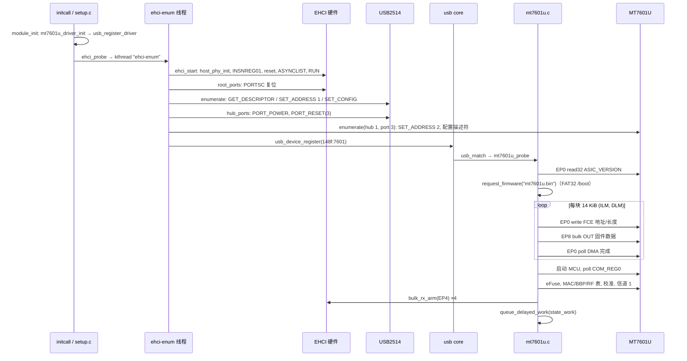

### 10.2 连接与 WPA2 四次握手

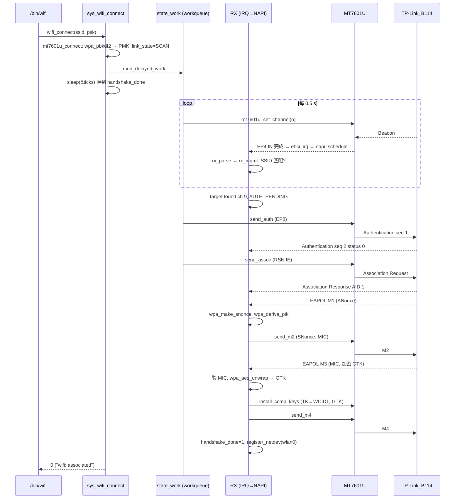

### 10.3 DHCP 与 ARP（数据路径）

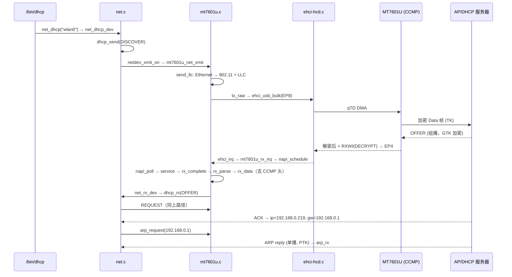

---

## 11. 函数调用链与日志对照

### 11.1 驱动注册与 probe

```text
do_initcalls()
 ├─ mt7601u_driver_init()                     module_init
 │   └─ usb_register_driver(&mt7601u_driver)   id_table: 148f:7601 …
 └─ ehci_probe(platform dev "s5p-ehci")
     └─ kthread ehci_enum_thread()
         ├─ ehci_start()
         │   ├─ pdata->phy_init() = host_phy_init()
         │   └─ INSNREG01 = 0x800080, RUN, ASE         "ehci: INSNREG01 thresholds … -> 800080"
         └─ root_ports()                               "ehci: port 0: high-speed device connected"
             └─ enumerate(HS, 0, 0)                     "ehci: high-speed device 424:2514 class 9 at address 1"
                 └─ hub_ports(hub)                      "ehci: hub 1: 4 ports"
                     └─ enumerate(HS, 1, 3)             "ehci: high-speed device 148f:7601 class 255 at address 2"
                         ├─ parse_config()              "ehci:   bulk in 4,5/512 out 8/512 intr in 0"
                         └─ usb_device_register(udev)
                             └─ usb_match() → usb_probe() → mt7601u_probe(udev)
                                 ├─ mt7601u_read32(MT_ASIC_VERSION)
                                 │   └─ udev->ops->control → ehci_usb_control → control_qh
                                 │                       "mt7601u: USB device 148f:7601 ASIC=76010001 MAC=76010500"
                                 ├─ mt7601u_validate_firmware → request_firmware → fat32 /mt7601u.bin
                                 │                       "mt7601u: firmware v0.1.0 build=7640 size=45412 validated"
                                 ├─ mt7601u_load_firmware → mt7601u_dma_fw_range → mt7601u_dma_fw_chunk
                                 │   └─ udev->ops->bulk(EP8) → ehci_usb_bulk → bulk_qh → qh_append → wait_qtd
                                 │                       "mt7601u: ILM firmware upload 14336/45316" … "MCU firmware running"
                                 ├─ mt7601u_read_eeprom → mt7601u_efuse_read_block
                                 │                       "mt7601u: permanent mac=90:de:80:14:95:94"
                                 ├─ mt7601u_basic_hw_init / mt7601u_mcu_channel_init
                                 ├─ mt7601u_full_hw_init → bbp_write / rf_write / mt7601u_calibrate
                                 │                       "mt7601u: RF calibration complete; bulk endpoints ready"
                                 ├─ mt7601u_set_channel(1)
                                 ├─ netif_napi_add / init_delayed_work(state_work)
                                 ├─ ehci_usb_bulk_rx_arm(EP4) ×4
                                 │                       "mt7601u: EP4 receive uses USB host IRQ with 4 buffers"
                                 └─ queue_delayed_work(state_work, 50)
                                                         "mt7601u: transport and MCU ready; SoftMAC initialization pending"
```

### 11.2 接收路径（所有收到的帧都走这条）

```text
EHCI 完成 EP4 上的 IN qTD（IOC）
 └─ IRQ 55 → VIC → ehci_irq()                 清 USBSTS
     └─ mt7601u_rx_irq() → napi_schedule(&napi) → queue_work(mt7601u_wq)
         ⋯ 工作队列线程 ⋯
         napi_workfn() → mt7601u_napi_poll(budget)
          └─ mt7601u_service(service_rx=1, 0)
              ├─ udev->ops->bulk_rx_complete(EP4) = ehci_usb_bulk_rx_complete   取一个已完成 qTD
              ├─ mt7601u_rx_parse(buf, len)                                       逐段：DMA 长度 + RXWI
              │   ├─ 管理帧 → mt7601u_rx_mgmt()       Beacon / Auth / Assoc resp
              │   └─ 数据帧 → mt7601u_rx_data(frame, len, rxinfo)
              │        ├─ Protected 且 DECRYPT → 跳过 CCMP 头 8 字节
              │        ├─ type 0x888e → mt7601u_rx_eapol()      M1 / M3
              │        └─ 其他 → 拷成 Ethernet 帧到 dev->net_rx
              ├─ bulk_rx_arm(EP4, 同一缓冲)                                       重新挂回接收环
              └─ net_rx_dev(&wlan0, net_rx, len)     (握手完成且已注册)
                  ├─ arp_rx()                       "arp: dev=wlan0 gateway 192.168.0.1 is f0:9:d:cb:b1:14"
                  ├─ icmp_rx()
                  └─ dhcp_rx() / udp_rx()
```

### 11.3 连接（系统调用 + 状态机）

```text
init → fork → exec /bin/wifi                       读 /etc/wifi.conf
 └─ wifi_connect(ssid, psk)  [usys.S: r7=SYS_wifi_connect, svc 0]
     └─ sys_wifi_connect() (sysnet.c)              "wifi: connecting to TP-Link_B114"
         └─ mt7601u_connect(ssid, psk, 30000)
             ├─ wpa_pbkdf2(psk, ssid, pmk)
             ├─ link_state = SCAN; mod_delayed_work(state_work)   "mt7601u: joining TP-Link_B114"
             └─ sleep(&ticks) 循环，直到 dev->handshake_done

时钟中断 arm32_timer_tick → workqueue_timer_tick → state_work 到期
 └─ mt7601u_state_worker → mt7601u_service(0, 1)
     ├─ SCAN 且超时 → mt7601u_set_channel(next)
     ├─ AUTH_PENDING → mt7601u_send_auth → build_mgmt_header → mt7601u_tx_mgmt → mt7601u_tx_raw(wcid 0xff, WIV)
     │                                                         "mt7601u: authentication request sent"
     └─ ASSOC_PENDING → mt7601u_send_assoc → tx_mgmt → tx_raw  "mt7601u: association request sent rsn=22 bytes"

RX 路径 mt7601u_rx_mgmt:
 ├─ Beacon, SSID 匹配 → 记录 BSSID/信道/RSN IE, 写 BSSID 寄存器
 │                         "mt7601u: target TP-Link_B114 found bssid=f0:9:d:cb:b1:14 channel=9 WPA2"
 ├─ Auth seq 2 status 0 → ASSOC_PENDING        "mt7601u: Open-System authentication accepted"
 └─ Assoc resp status 0 → ASSOCIATED           "mt7601u: 802.11 associated aid=1; WPA2 handshake pending"

RX 路径 mt7601u_rx_eapol:
 ├─ M1: wpa_make_snonce → wpa_derive_ptk        "mt7601u: received WPA2 EAPOL M1 key-info=8a"
 │   └─ mt7601u_send_m2 → wpa_eapol_mic → mt7601u_send_llc(…, 0x888e, encrypted=0) → tx_raw(WCID 1, WIV)
 │                                               "mt7601u: sent WPA2 EAPOL M2 replay=0001"
 └─ M3: wpa_eapol_mic 校验 → wpa_aes_unwrap(KEK) → GTK KDE
     ├─ mt7601u_install_ccmp_keys()              TK→0x8000+32, IV→0xA000+8, attr→0xA800+4, GTK→0xAC00
     ├─ mt7601u_send_m4 → send_llc(encrypted=1)   "mt7601u: sent WPA2 EAPOL M4"
     └─ handshake_done = 1                        "mt7601u: WPA2 four-way handshake complete"

下一次 mt7601u_service → register_netdev(&wlan0)  "mt7601u: wlan0 registered mac=90:de:80:14:95:94"
mt7601u_connect 返回 0                            "wifi: associated"
```

### 11.4 发送路径（DHCP 举例）

```text
init → /bin/dhcp wlan0
 └─ net_dhcp("wlan0") → sys_net_dhcp → netdev_find("wlan0") → net_dhcp_dev(dev)
     └─ dhcp_send(DISCOVER) → 组 Ethernet+IP+UDP+BOOTP
         └─ netdev_xmit_on(dev, frame, 342) → dev->ops->start_xmit
             └─ mt7601u_net_xmit()
                 └─ mt7601u_send_llc(dst=ff:ff…, type 0x0800, encrypted=1)    FC=0x4108
                     └─ mt7601u_tx_raw(frame, n, MT_WCID_AP, hardware_iv=1)   DMA 头 + TXWI，无 WIV
                         ├─ udev->ops->bulk(EP8, OUT) → ehci_usb_bulk → bulk_qh → qh_append → wait_qtd(3 s)
                         └─ mt7601u_tx_stat_drain()
                                     "mt7601u: data tx type=800 len=342 dst=ff:ff:ff:ff:ff:ff -> 0"
     ⋯ OFFER 经 9.2 接收路径 → dhcp_rx ⋯   "mt7601u: data rx fc=4208 len=616 rxinfo=1520e2 a1=ff:ff:ff:ff:ff:ff"
     dhcp_send(REQUEST) → … → dhcp_rx(ACK)
                                     "dhcp: dev=wlan0 address=192.168.0.219 gateway=192.168.0.1 dns=192.168.0.1"
     arp_request(gw) → netdev_xmit_on → …  "mt7601u: data tx type=806 len=42 dst=ff:ff:ff:ff:ff:ff -> 0"
     arp_rx(reply)                         "mt7601u: data rx fc=4a08 len=68 rxinfo=112092 a1=90:de:80:14:95:94"
                                           "arp: dev=wlan0 gateway 192.168.0.1 is f0:9:d:cb:b1:14"
```

### 11.5 完整的实板日志（成功的一次）

```text
mt7601u: firmware v0.1.0 build=7640 size=45412 validated
mt7601u: ILM firmware upload 14336/45316
mt7601u: ILM firmware upload 28672/45316
mt7601u: ILM firmware upload 43008/45316
mt7601u: ILM firmware upload 45316/45316
mt7601u: MCU firmware running
mt7601u: EEPROM ver=d fae=0 country=ff freq=96 rssi=0,0 temp=-7 lna=0
mt7601u: permanent mac=90:de:80:14:95:94
mt7601u: MAC/BBP/RF bootstrap ready; rx-ep=4 data, 5 MCU
mt7601u: MCU command channel ready tx-ep=8 resp-ep=5
mt7601u: MAC register table initialized (44 entries)
mt7601u: BBP register table initialized (59 entries)
mt7601u: RF register table initialized (138 entries)
mt7601u: RF calibration complete; bulk endpoints ready
mt7601u: transport and MCU ready; SoftMAC initialization pending
mt7601u: joining TP-Link_B114
mt7601u: AP ssid=<hidden> bssid=4:17:b6:80:3d:2f channel=1 WPA2
mt7601u: target TP-Link_B114 found bssid=f0:9:d:cb:b1:14 channel=9 WPA2
mt7601u: authentication request sent
mt7601u: Open-System authentication accepted
mt7601u: association request sent rsn=22 bytes
mt7601u: 802.11 associated aid=1; WPA2 handshake pending
mt7601u: received WPA2 EAPOL M1 key-info=8a
mt7601u: sent WPA2 EAPOL M2 replay=0001
mt7601u: sent WPA2 EAPOL M4
mt7601u: WPA2 four-way handshake complete
mt7601u: wlan0 registered mac=90:de:80:14:95:94
wifi: associated
mt7601u: data tx type=800 len=342 dst=ff:ff:ff:ff:ff:ff -> 0
mt7601u: rx so far: usb buffers 244, frames 244 (mgmt 236 data 8), dropped 0
mt7601u: data rx fc=4208 len=616 rxinfo=1520e2 a1=ff:ff:ff:ff:ff:ff
dhcp: dev=wlan0 address=192.168.0.219 gateway=192.168.0.1 dns=192.168.0.1
mt7601u: data tx type=806 len=42 dst=ff:ff:ff:ff:ff:ff -> 0
arp: dev=wlan0 gateway 192.168.0.1 is f0:9:d:cb:b1:14
mt7601u: data rx fc=4a08 len=68 rxinfo=112092 a1=90:de:80:14:95:94
```

日志字段解读：

* `key-info=8a`：0x008a = 版本 2（HMAC-SHA1/AES）+ Pairwise + ACK，即 M1。
* `fc=4208`：Data + FromDS + Protected；`6208` 多了 More Data；`4a08` 多了 Retry。
* `rxinfo=1520e2`：bit16 DECRYPT=1（硬件用 GTK 解好了），广播/组播，本 BSS。
* `rx so far … dropped 0`：USB 缓冲 244 个，帧 244 个，其中管理帧 236（多为 Beacon），数据帧 8。
* `-> 0`：`mt7601u_tx_raw` 返回 0，即 EP8 bulk OUT 整帧送达。

---

## 12. 实板调试中踩过的坑（和架构的对应）

详见 `bringup-notes.md`，这里只按层列出：

| 层 | 现象 | 根因 | 修复 |
|---|---|---|---|
| HCD | 固件下载 `bulk ep8 out 14344 bytes failed`，qTD 状态 0xa0（Data Buffer Error） | D-cache 关闭、I-cache 也关时 CPU 取指占满 DDR，EHCI 默认阈值下发包中途欠载 | INSNREG01=0x800080 + 打开 I-cache（f9bfbc6） |
| 内核定时 | 扫描一直停在信道 1，`no handshake within 30000 ms` | ARM32 时钟中断从未调用 `workqueue_timer_tick()`，delayed work 永不到期 | `arm32_timer_tick` 里调用（0bd029e） |
| HCD | 握手后 EP8 永远 NAK | 出错后 `qh_flush` 把 QH 的 data toggle 清零，设备把下一个包当重传丢弃 | 保留 `TOK_DT`（f649f28） |
| 设备驱动 | 改用 EP 0x09 后第一个帧就 NAK | MT7601U 在本驱动的初始化方式下 OUT#5 不可用 | 回到 EP 0x08，并每帧后读空 TX 状态 FIFO（5ac8c59） |
| 802.11 | 连其他 SSID 时关联被拒 | `send_assoc` 的 SSID IE 写死为 TP-Link_B114 | 改用 `want_ssid`（本版修改，未上板） |
| 802.11 | 握手成功但 `dhcp: no offer` | 硬件解密后的帧仍保留 Protected 位和 8 字节 CCMP 头，LLC/SNAP 校验失败，所有数据帧被丢 | `rx_data` 在 DECRYPT 时跳过 8 字节（b2326c2）→ DHCP 成功 |

还没做：ping 外网的实板确认；去掉/开关化 `data tx`、`data rx`、`rx so far`、`rx drop` 这些调试打印。
