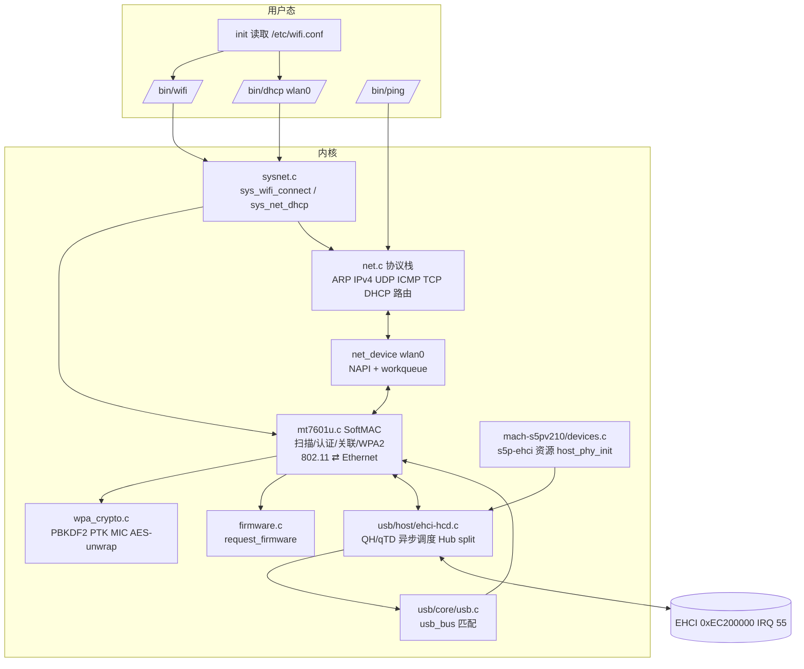
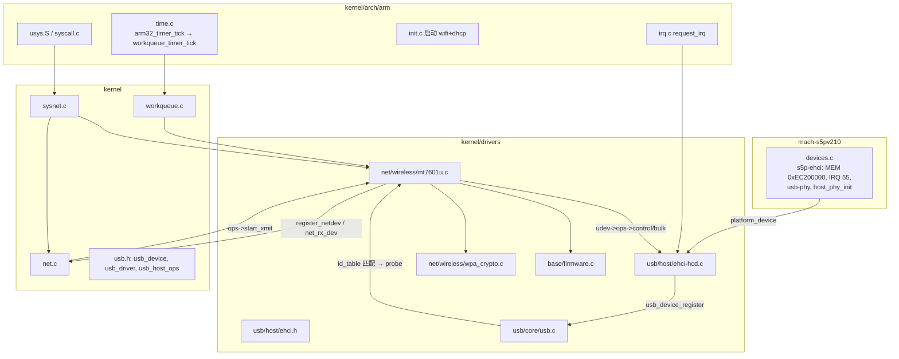
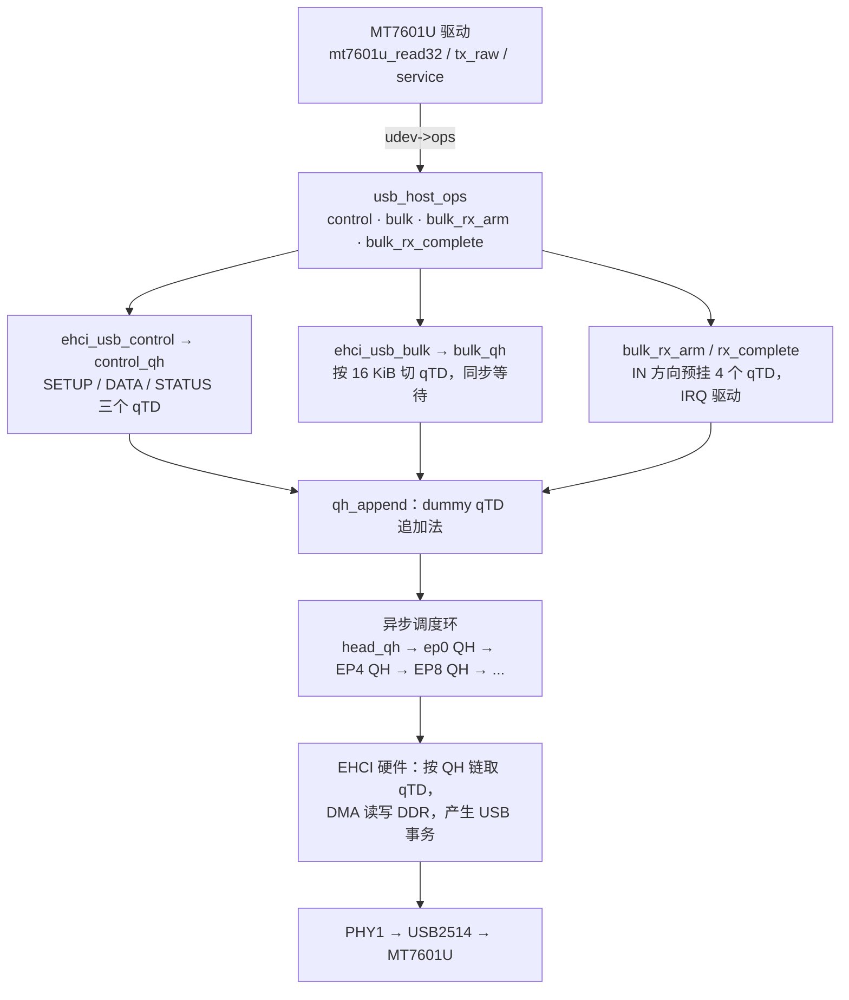
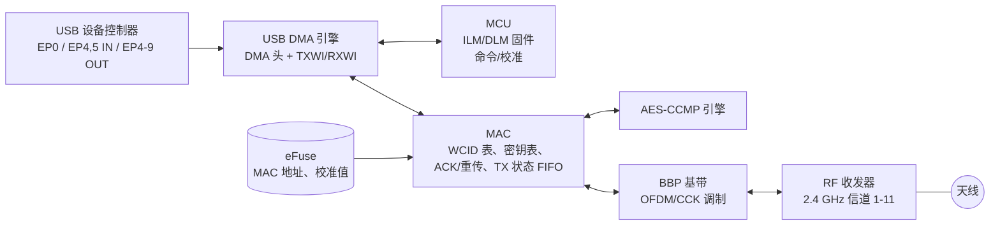
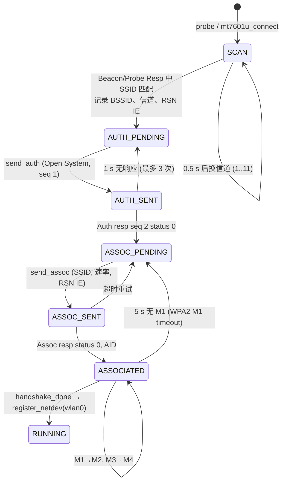
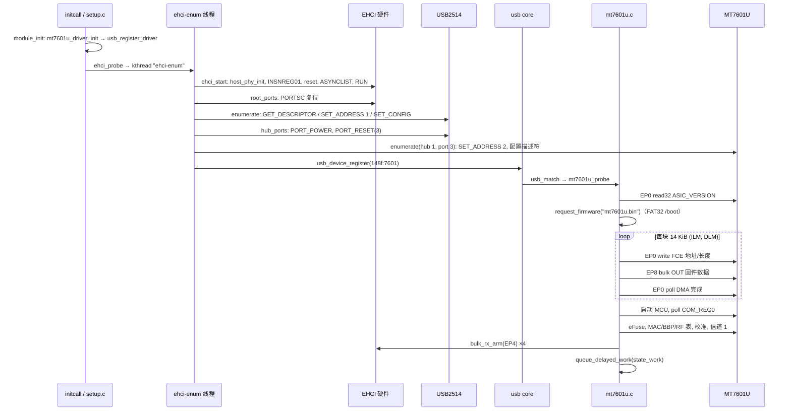
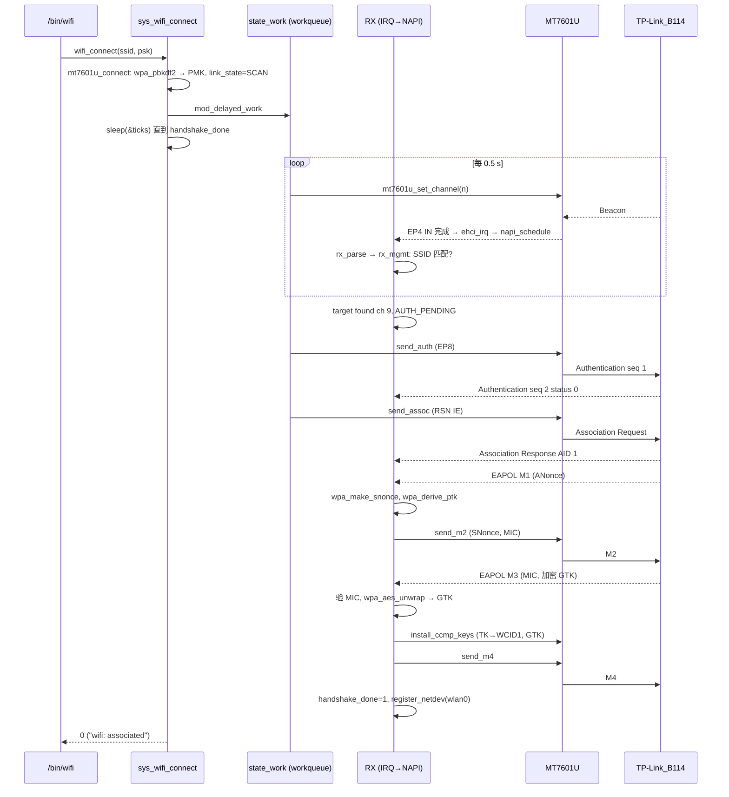
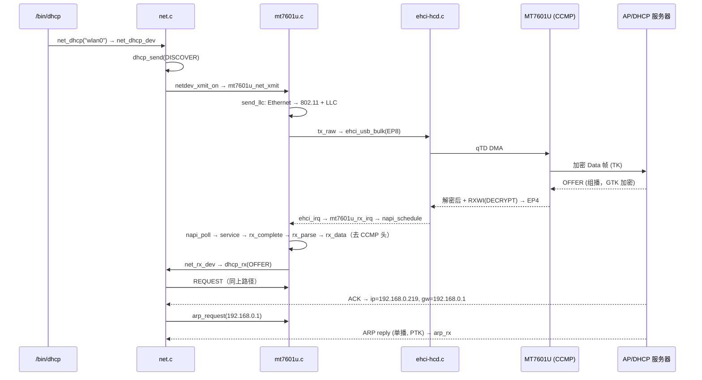

# Tiny210 MT7601U Wi-Fi 驱动架构详解

本文说明 Tiny210（S5PV210）上 xv6 的 USB Wi-Fi 链路：一个 MT7601U USB 网卡
从插在 SDK 底板 USB-A Host 口开始，到用 WPA2 连上 TP-Link_B114 路由器、DHCP
拿到 IP 为止，每一层用的是哪个驱动、哪个函数，以及实板串口上对应打印哪一行日志。

文中的日志都是 2026-11-14 在实板上抓到的真实输出（只删掉了重复行）。
LaTeX/PDF 版见 `doc/latex/tiny210-wifi/main.pdf`，内容相同，图用 TikZ 重画。

目录

1. 总体分层
2. 硬件连接
3. 软件架构与源文件
4. USB 各层（PHY → EHCI → Hub → USB core → 设备驱动）
5. MT7601U 硬件层（MCU、MAC/BBP/RF、TXWI/RXWI、WCID 密钥表）
6. 802.11 与 WPA2：网卡如何和路由器通信
7. 网络协议层（Ethernet/ARP/IPv4/UDP/DHCP/ICMP）
8. 时序图
9. 函数调用链与日志对照
10. 实板调试中踩过的坑（与架构的关系）

---

## 1. 总体分层

和 Linux 一样，整个链路按“谁只关心哪一层”切开。每层只通过一个窄接口和上下层说话：

| 层 | 作用 | xv6 中的实现 | 和下一层的接口 |
|---|---|---|---|
| 用户程序 | 读配置、连接、DHCP、ping | `user/wifi.c` `user/dhcp.c` `user/ping.c`，`init` 后台启动 | 系统调用 `wifi_connect` `net_dhcp` `icmp_send` |
| 系统调用 | 参数拷贝、找设备 | `kernel/sysnet.c` | `mt7601u_connect()` `net_dhcp_dev()` |
| 网络协议栈 (L3/L4) | IPv4 / UDP / ICMP / TCP / ARP / DHCP / 路由 | `kernel/net.c` | `struct net_device` + `netdev_xmit_on()` / `net_rx_dev()` |
| 网络设备层 | `wlan0`、NAPI、workqueue | `kernel/net.c`（register_netdev、napi_*），`kernel/workqueue.c` | `net_device_ops.start_xmit` |
| 802.11 SoftMAC (L2) | 扫描、认证、关联、WPA2 四次握手、802.11↔Ethernet 转换 | `kernel/drivers/net/wireless/mt7601u.c` + `wpa_crypto.c` | 厂商 USB 寄存器请求 + bulk 帧（TXWI/RXWI） |
| USB 设备驱动 | 匹配 VID:PID，probe，固件下载 | `mt7601u.c` 的 `usb_driver` | `usb_host_ops`（control / bulk / bulk_rx_arm / bulk_rx_complete） |
| USB core | usb 总线、设备/驱动匹配 | `kernel/drivers/usb/core/usb.c` | `usb_device_register()` |
| USB 主机控制器 (HCD) | EHCI 异步调度、qTD/QH、Hub、split | `kernel/drivers/usb/host/ehci-hcd.c` | 寄存器 + DMA 描述符 |
| 平台/板级 | 时钟、PHY 上电、中断号、物理地址 | `kernel/arch/arm/mach-s5pv210/devices.c` | platform device 资源 |
| 硬件 | S5PV210 USB Host PHY1 → USB2514 Hub → MT7601U → 2.4 GHz 射频 → 路由器 | | |

一句话：**用户态只看到“连接/DHCP/ping”；net.c 只看到一个能收发 Ethernet 帧的 `wlan0`；
mt7601u.c 把 Ethernet 帧翻译成 802.11 帧并管理连接状态；ehci-hcd.c 只负责把字节
按 USB 协议搬到设备的某个端点。**



---

## 2. 硬件连接

```mermaid
flowchart LR
  subgraph SoC[S5PV210 核心板]
    CPU[Cortex-A8 1 GHz]
    DDR[(DDR2 512 MiB<br/>0x20000000)]
    EHCI[USB Host EHCI<br/>0xEC200000 IRQ 55]
    OHCI[OHCI 0xEC300000<br/>未使用]
    PHY[USB PHY1 Host<br/>寄存器 0xEC100000]
    VIC[VIC 中断控制器]
    CPU <-->|AXI/AHB| EHCI
    EHCI <-->|DMA 读写 qTD/QH/缓冲区| DDR
    EHCI --> PHY
    EHCI -->|IRQ 55| VIC --> CPU
  end
  subgraph SDK[Tiny210 SDK 底板]
    HUB[SMSC USB2514<br/>4 口 HS Hub<br/>424:2514]
    A1[USB-A 口]
  end
  subgraph Dongle[USB 网卡]
    MT[MT7601U<br/>148f:7601<br/>MCU+MAC+BBP+RF]
    ANT((2.4 GHz 天线))
  end
  PHY -- USB 2.0 HS 480 Mbit/s D+/D- --> HUB
  HUB -- 端口 3 --> A1 --> MT
  MT --- ANT
  ANT -. 802.11n 1T1R 信道 9 .-> AP[TP-Link_B114<br/>BSSID f0:09:0d:cb:b1:14<br/>WPA2-CCMP<br/>DHCP 192.168.0.1]
```

要点：

* **只走 EHCI（USB-A Host 口），不走 OTG 口。** OTG 口是 DWC2 控制器（0xEC000000，
  IRQ 56），代码保留了但默认不启用（`S5PV210_USB_OTG=1` 才编）。
* SoC 的 Host 口只有一个根端口，SDK 底板上焊了一颗 USB2514 Hub，网卡插在 Hub
  的端口 3，所以枚举顺序是“根端口 → Hub(地址 1) → MT7601U(地址 2)”。
  Hub 是 HS Hub，网卡也是 HS，所以不需要 split transaction；全/低速设备才会
  用 Hub 的 TT（代码支持）。
* EHCI 是总线主设备，它自己从 DDR 读 QH/qTD 描述符和数据缓冲区。xv6 在 Tiny210
  上 D-cache 关闭，所以不需要做 cache 维护，但也意味着 CPU 访存很慢、会和
  EHCI 抢 DDR 带宽（见第 10 节 INSNREG01 问题）。
* MT7601U 内部有一个 8051 风格的 MCU（运行我们下载的固件），MAC、BBP（基带）、RF
  三组寄存器，以及自带的 AES-CCMP 硬件加解密引擎。

MT7601U 的 USB 端点（实板日志 `bulk in 4,5/512 out 8/512`）：

| 端点 | 方向 | 用途（本驱动） |
|---|---|---|
| EP0 | control | 厂商请求：读写 32 位寄存器（`mt7601u_read32/write32`）、eFuse、固件 DMA 控制 |
| EP 0x84 (IN#0) | bulk IN | 接收数据：RXWI + 802.11 帧（4 个 16 KiB 缓冲区循环） |
| EP 0x85 (IN#1) | bulk IN | MCU 命令响应 |
| EP 0x08 (OUT#0) | bulk OUT | 固件下载、MCU 命令、**以及本驱动的所有 802.11 发送帧** |
| EP 0x04-0x07, 0x09 | bulk OUT | Linux 中的各 AC/管理队列；Tiny210 上 0x09 一开始就 NAK，故不用 |

---

## 3. 软件架构与源文件



| 文件 | 主要内容 |
|---|---|
| `kernel/arch/arm/mach-s5pv210/devices.c` | `host_phy_init()`（USB PHY1 上电、时钟、复位），`s5p-ehci` 平台设备资源 |
| `kernel/drivers/usb/host/ehci-hcd.c` | `ehci_probe` → `ehci-enum` 内核线程；`ehci_start`、`root_ports`、`hub_ports`、`enumerate`、`parse_config`；`qh_create` `qh_append` `qh_flush` `wait_qtd`；`ehci_usb_control/bulk/bulk_rx_arm/bulk_rx_complete`；`ehci_irq` |
| `kernel/drivers/usb/core/usb.c` | `usb_bus`、`usb_match`（VID:PID 表）、`usb_probe`、`usb_device_register`、`usb_register_driver`、urb 辅助 |
| `kernel/usb.h` | `struct usb_device`（vendor/product、`bulk_in_ep`、`bulk_out_ep`、`ops`），`struct usb_host_ops` |
| `kernel/drivers/net/wireless/mt7601u.c` | probe、固件下载、eFuse/EEPROM、MAC/BBP/RF 表与校准、信道切换、扫描、认证/关联、EAPOL、CCMP 密钥安装、TX/RX 帧格式、NAPI、`net_device_ops`、`mt7601u_connect` |
| `kernel/drivers/net/wireless/wpa_crypto.c` | SHA1/HMAC、`wpa_pbkdf2`、`wpa_make_snonce`、`wpa_derive_ptk`、`wpa_eapol_mic`、AES-128 与 `wpa_aes_unwrap` |
| `kernel/drivers/base/firmware.c` | `request_firmware("mt7601u.bin")`：先读 FAT32 `/boot`（SD 卡），再退回内置副本 |
| `kernel/net.c` | `register_netdev`、`netdev_xmit_on`、`net_rx_dev`、`napi_schedule/napi_workfn`、ARP、IPv4、UDP、ICMP、TCP、DHCP 客户端、路由 |
| `kernel/sysnet.c` | `sys_wifi_connect`、`sys_net_dhcp` 等 |
| `kernel/arch/arm/time.c` | 100 Hz 时钟中断里调 `workqueue_timer_tick()`，驱动所有 delayed work |
| `user/wifi.c` `user/dhcp.c` `user/ping.c` | 用户程序；`/etc/wifi.conf`（`ssid=`/`psk=`，由 `ports/tiny210/wifi.conf` 打进 fs.img，不进 git） |

### 3.1 执行上下文（谁在哪个线程里跑）

| 上下文 | 做什么 |
|---|---|
| `ehci-enum` 内核线程 | 启动 EHCI、上电端口、枚举 Hub 和网卡；在这个线程里调用 `mt7601u_probe`（固件下载、射频初始化）。因为要等几百毫秒的复位/上电，所以不放在 initcall 里 |
| EHCI 中断（IRQ 55） | `ehci_irq` 清 USBSTS，调用 `mt7601u_rx_irq()` → `napi_schedule()`，只做排队 |
| `mt7601u_wq` 工作队列线程 | ① NAPI：`mt7601u_napi_poll` → `mt7601u_service(1,0)` 处理接收缓冲区；② `state_work`：`mt7601u_state_worker` → `mt7601u_service(0,1)` 推进扫描/认证/关联/超时状态机 |
| 时钟中断（PWM timer4，100 Hz） | `arm32_timer_tick` → `workqueue_timer_tick()`：到期的 delayed work 入队 |
| 用户进程（系统调用里） | `mt7601u_connect` 只设置目标并 `sleep(&ticks)` 等待 `handshake_done`；`dhcp`/`ping` 在系统调用里发帧、等回包 |

---

## 4. USB 各层架构



### 4.1 平台层：PHY 与控制器启动

* `devices.c: host_phy_init()`（参考 Linux `phy-s5pv210-usb2.c`）：
  `CLK_GATE_IP1`(0xE0100464) bit17 打开 USBHOST 时钟；`USB_PHY_CONTROL`(0xE010E80C) bit1
  解除 PHY1 隔离；PHY 寄存器块 0xEC100000 里 `UPHYCLK` 选 24 MHz 参考时钟，`UPHYPWR`
  清 bit6/7 让 PHY1 上电，`URSTCON` bit3/4 脉冲复位 PHY1 和 Host link。
* `ehci_start()`：
  1. `phy_init()`；读 CAPLENGTH 得到操作寄存器基址、HCSPARAMS 得到端口数（1）。
  2. 写 Samsung 私有寄存器 INSNREG00（burst 使能），**INSNREG01 = 0x00800080**
     （OUT/IN 包阈值都设为 512 字节：控制器缓存满一整包再上总线）。
  3. 停止、复位控制器；建立异步环的头 QH（H 位、halted overlay、指向自己）。
  4. `ASYNCLIST = head_qh`，`USBINTR = USBINT|ERR`，`USBCMD = RUN|ASE|ITC(1)`，
     `CONFIGFLAG = 1`；端口上电，等待 100 ms。

日志：

```text
ehci: s5p-ehci at -13e00000, enumeration deferred to ehci-enum
ehci: INSNREG01 thresholds <复位值> -> 800080
ehci: 1 port(s), running, async schedule on
```

（`-13e00000` 是 `0xEC200000` 被 `%d` 风格打印成有符号数。）

### 4.2 HCD 层：QH/qTD 与 dummy 追加法

EHCI 的异步调度是一个 QH（Queue Head，每个端点一个）组成的环。每个 QH 下挂一串
qTD（Queue Transfer Descriptor），每个 qTD 最多描述 5 个 4 KiB 页（≈16–20 KiB）。

* `qh_create(addr, ep, speed, mps, control, hub, port)`：填 epchar（设备地址、
  端点号、速度、最大包长）、epcap（Hub 地址/端口，用于 split），挂进环里。每个
  QH 初始挂一个不活动的 **dummy qTD**。
* `qh_append(q, first, last)`：Linux 的追加方法。不去改正在被硬件执行的链表，
  而是把新传输的第一个 qTD 的内容**拷进当前 dummy**，再接一个新的 dummy 在尾部；
  先激活后面的 qTD，最后才把第一个（原 dummy）的 Active 置位。这样硬件永远看到
  一致的链表，不用停异步调度。
* `wait_qtd(last, timeout)`：轮询最后一个 qTD 的 Active 位（同步传输）。
* `qh_flush(q, from)`：超时/出错时停异步调度，丢掉排队的 qTD，QH 重新指向 dummy；
  **保留 data toggle（DT）位**（见第 10 节）。
* `ehci_usb_bulk_rx_arm`：给 EP4 预挂一个 IN qTD（带 IOC），不等待；
  `ehci_usb_bulk_rx_complete`：从 `q->head` 取一个已完成的 qTD，返回实际长度。
  mt7601u 预挂 4 个 16 KiB 缓冲区，形成接收环。
* `ehci_irq`：USBSTS 的 USBINT/ERR 置位时调用弱符号 `mt7601u_rx_irq()`。

一次 bulk OUT 的硬件过程：EHCI 读 QH → 取 qTD → 从 DDR DMA 取数据 → 在 USB 上发
OUT token + DATA0/1 包（每包 512 字节）→ 设备回 ACK（或 NAK/NYET，HC 自动 PING
重试）→ qTD 的 Total Bytes 递减，完成后清 Active，若 IOC 则置 USBINT。

### 4.3 枚举与 Hub

`ehci_enum_thread` → `ehci_start` → `root_ports()`：

1. 根端口检测到连接 → 端口复位 50 ms → 确认高速（PORTSC.PE）→ `enumerate(speed, hub=0, port=0)`。
2. `enumerate`：在地址 0 上用 ep0 QH 读设备描述符前 8 字节（得到 ep0 最大包长）
   → `SET_ADDRESS` → 读完整设备描述符、配置描述符 → `parse_config` 记录 bulk/
   interrupt 端点 → `SET_CONFIGURATION`。
3. 设备类 9（Hub）→ `hub_ports()`：读 Hub 描述符（4 口），每口 `SET_FEATURE(PORT_POWER)`，
   读端口状态，有设备则 `SET_FEATURE(PORT_RESET)`，再对该口递归 `enumerate(…, hub=1, port=3)`。
4. 非 Hub 设备 → `usb_device_register(udev)` → usb 总线遍历驱动 `id_table`，
   148f:7601 命中 → `mt7601u_probe(udev)`。

日志：

```text
ehci: port 0: high-speed device connected
ehci: high-speed device 424:2514 class 9 at address 1 (hub 0 port 0)
ehci:   bulk in 0,0/0 out 0/0 intr in 1
ehci: hub 1: 4 ports
ehci: high-speed device 148f:7601 class 255 at address 2 (hub 1 port 3)
ehci:   bulk in 4,5/512 out 8/512 intr in 0
```

### 4.4 USB core 与设备驱动接口

```c
struct usb_host_ops {                       /* kernel/usb.h */
  int (*control)(struct usb_device*, uint8 type, uint8 req, uint16 value,
                 uint16 index, void *data, uint16 len);
  int (*bulk)(struct usb_device*, int ep, int in, void *data, int len);
  int (*bulk_rx_arm)(struct usb_device*, int ep, void *data, int len);
  int (*bulk_rx_complete)(struct usb_device*, int ep, void **data);
};
```

MT7601U 驱动完全不知道 EHCI 的存在，只调用 `udev->ops->…`；同一份驱动在
`S5PV210_USB_OTG=1` 时也能挂在 DWC2 上（日志里的 “EP4 receive uses DWC2 IRQ”
就是早期走 OTG 口时打印的）。

---

## 5. MT7601U 硬件层

### 5.1 芯片内部



### 5.2 probe 时的初始化（`mt7601u_probe`）

| 步骤 | 函数 | 做什么 | 日志 |
|---|---|---|---|
| 1 | `mt7601u_read32(MT_ASIC_VERSION)` | EP0 厂商请求读寄存器，确认 ASIC=0x7601 | `USB device 148f:7601 ASIC=76010001 MAC=76010500` |
| 2 | `mt7601u_validate_firmware` → `request_firmware` | 从 `/boot/mt7601u.bin` 读固件头，检查 ILM/DLM 长度 | `firmware v0.1.0 build=7640 size=45412 validated` |
| 3 | `mt7601u_load_firmware` → `mt7601u_dma_fw_range` → `mt7601u_dma_fw_chunk` | 每块 14 KiB：EP0 厂商请求 `WRITE_FCE` 写 `FCE_DMA_ADDR`/`FCE_DMA_LEN`，EP8 bulk OUT 送“TXINFO(目的 CPU_TX_PORT)+数据”，`TX_CPU_FROM_FCE_CPU_DESC_IDX`+1，轮询 `MCU_COM_REG1` bit31；先 ILM 后 DLM；最后启动 MCU，轮询 `COM_REG0` | `ILM firmware upload 14336/45316 … 45316/45316`，`MCU firmware running` |
| 4 | `mt7601u_read_eeprom` → `mt7601u_efuse_read_block` | 从 eFuse 读 MAC 地址、频偏、温度补偿等 | `EEPROM ver=d …`，`permanent mac=90:de:80:14:95:94` |
| 5 | `mt7601u_basic_hw_init` | WLAN 时钟/PLL、BBP 就绪、RF 引导 | `MAC/BBP/RF bootstrap ready; rx-ep=4 data, 5 MCU` |
| 6 | `mt7601u_mcu_channel_init` | MCU 命令通道（命令走 EP8，响应走 EP5） | `MCU command channel ready tx-ep=8 resp-ep=5` |
| 7 | `mt7601u_full_hw_init` | 写 MAC（44 项）/BBP（59 项）/RF（138 项）寄存器表，`mt7601u_calibrate` 做 RF 校准 | `MAC register table initialized (44 entries)` … `RF calibration complete; bulk endpoints ready` |
| 8 | `mt7601u_set_channel(1)` | 选信道 1，开始扫描 | |
| 9 | `bulk_rx_arm` ×4 | EP4 挂 4 个 16 KiB 接收缓冲 | `EP4 receive uses USB host IRQ with 4 buffers` |
| 10 | `queue_delayed_work(state_work, 50)` | 启动状态机（每 0.5 s 换一个信道） | `transport and MCU ready; SoftMAC initialization pending` |

### 5.3 USB 上的帧格式

MT7601U 是 **SoftMAC**：802.11 帧由主机驱动组好，芯片只负责加 PHY 头、调制、
ACK、重传和（可选的）加解密。

**发送**（`mt7601u_tx_raw`）：

```text
+-----------+---------------------------+--------------------------+--------+------+
| DMA 头 4B | TXWI 20B                  | 802.11 MPDU              | 填充   | 0 4B |
| len|80211 | rate=CCK1M ack=1 wcid len | FC Dur A1 A2 A3 Seq LLC… | 到 4B  | 结束 |
| [|WIV]    |                           |                          |        |      |
+-----------+---------------------------+--------------------------+--------+------+
```

* `MT_TXD_PKT_INFO_80211`：载荷是原始 802.11 帧。
* `WIV`（Without IV）：置位表示“帧里自带 IV / 不需要硬件加密”。管理帧和握手前的
  EAPOL 都置 WIV；**握手完成后数据帧不置 WIV**，`wcid=1`（AP 条目），MAC 用 WCID 1
  的 PTK 做 CCMP 加密并自动插入 CCMP 头和 MIC。
* 发完后 `mt7601u_tx_stat_drain` 读空 TX_STAT_FIFO。

**接收**（`mt7601u_rx_parse`）：一个 USB 缓冲区里可能有多个段，每段：

```text
| DMA 长度 4B | RXWI 28B (rxinfo, ctl=MPDU 长度, RSSI…) | 802.11 MPDU | 填充 | 4B |
```

RXINFO 关键位：bit8 CRC 错，bit9 ICV 错，bit10 MIC 错，bit14 L2 填充，
**bit16 DECRYPT（硬件已解密）**，bit4 单播给我，bit5 组播，bit6 广播，bit7 本 BSS。

实板 `rxinfo=1520e2` = DECRYPT + MYBSS + BROADCAST + MULTICAST + DATA；
`rxinfo=112092` = DECRYPT + MYBSS + U2M（发给我的单播，ARP 回复）。

### 5.4 WCID 与密钥表（`mt7601u_install_ccmp_keys`）

| 寄存器区 | 地址 | 内容 |
|---|---|---|
| 单播密钥表 | `0x8000 + WCID*32` | WCID 1（AP）的 TK = PTK[32..47] |
| IV/EIV 表 | `0xA000 + WCID*8` | 初始 PN，KeyID 位 `0x20`（ExtIV） |
| WCID 属性 | `0xA800 + WCID*4` | cipher=4（AES-CCMP），pairwise=1 |
| 共享（组）密钥 | `0xAC00 + idx*32` | GTK（从 M3 解出） |
| 共享密钥模式 | `0xB000` | 每个 key index 4 位，填 4 |

---

## 6. 802.11 与 WPA2：网卡如何和路由器通信

### 6.1 连接状态机



时间常量（jiffy = 10 ms）：扫描驻留 `MT_SCAN_DWELL_JIFFIES=50`（0.5 s），响应超时
`MT_RESPONSE_TIMEOUT_JIFFIES=100`（1 s），WPA 看门狗 `MT_WPA_TIMEOUT_JIFFIES=500`（5 s）。
状态机靠 delayed work 推进，**所以必须有 `workqueue_timer_tick()`**。

### 6.2 各阶段帧

| 阶段 | 方向 | 802.11 帧 | 驱动函数 | 关键字段 |
|---|---|---|---|---|
| 扫描 | AP→STA | Beacon (FC 0x0080) | `mt7601u_rx_mgmt` | SSID IE、DS 参数（信道）、RSN IE（WPA2/CCMP/PSK） |
| 认证 | STA→AP | Authentication (0x00B0) | `mt7601u_send_auth` | 算法 0 Open System，seq 1 |
| | AP→STA | Authentication | `mt7601u_rx_mgmt` | seq 2，status 0 |
| 关联 | STA→AP | Association Request (0x0000) | `mt7601u_send_assoc` | Capability、Listen interval、SSID、支持速率、**RSN IE（22 字节）** |
| | AP→STA | Association Response (0x0010) | `mt7601u_rx_mgmt` | status 0、AID=1 |
| 握手 M1 | AP→STA | Data + LLC/SNAP + EAPOL-Key (0x888e) | `mt7601u_rx_data` → `mt7601u_rx_eapol` | ANonce，key-info 0x008a |
| 握手 M2 | STA→AP | Data（未加密） | `mt7601u_send_m2` | SNonce、RSN IE、MIC(KCK) |
| 握手 M3 | AP→STA | Data | `mt7601u_rx_eapol` | MIC、Install、加密的 Key Data（GTK KDE） |
| 握手 M4 | STA→AP | Data | `mt7601u_send_m4` | MIC |
| 数据 | 双向 | Data，Protected，CCMP | `mt7601u_send_llc` / `mt7601u_rx_data` | ToDS/FromDS、CCMP 头 8 字节 |

### 6.3 WPA2-PSK 密钥推导（`wpa_crypto.c`）

```text
PMK  = PBKDF2-HMAC-SHA1(passphrase, SSID, 4096 次, 32 字节)       wpa_pbkdf2      (mt7601u_connect)
SNonce = PRF(PMK, ANonce, 计数器)                                   wpa_make_snonce (收到 M1)
PTK  = PRF-512(PMK, "Pairwise key expansion",
               min(AA,SPA)|max(AA,SPA)|min(AN,SN)|max(AN,SN))       wpa_derive_ptk
       PTK[0..15]  = KCK  → EAPOL MIC (HMAC-SHA1 截 16 字节)       wpa_eapol_mic
       PTK[16..31] = KEK  → 解 M3 里的 GTK (AES Key Wrap)          wpa_aes_unwrap
       PTK[32..47] = TK   → 写进芯片 WCID 1 密钥表，硬件 CCMP
GTK  = AES-Unwrap(KEK, M3 Key Data) 中 OUI 00-0f-ac type 1 的 KDE  → 共享密钥表
```

PBKDF2 要做 8192 次 HMAC-SHA1，在 D-cache 关闭的 Cortex-A8 上要几秒，所以只在
`mt7601u_connect` 里算一次。

### 6.4 802.11 数据帧 ⇄ Ethernet 帧

发送（`mt7601u_send_llc`）：

```text
Ethernet: | DA 6 | SA 6 | type 2 | payload |
   ↓
802.11:   | FC=0x4108 (Data, ToDS, Protected) | Dur | A1=BSSID | A2=本机 MAC | A3=DA | Seq |
          | AA AA 03 00 00 00 | type 2 | payload |          （CCMP 头和 MIC 由硬件插入）
```

接收（`mt7601u_rx_data`）：

```text
802.11:   | FC=0x4208 (Data, FromDS, Protected) | Dur | A1=DA | A2=BSSID | A3=SA | Seq |
          | [QoS 2] | [L2 填充 2] | CCMP 头 8 (PN, KeyID) | AA AA 03 00 00 00 | type | payload |
   ↓ 跳过 24(+2+2)+8 字节头，校验 LLC/SNAP
Ethernet: | DA=A1 | SA=A3 | type | payload |  → net_rx_dev(&wlan0)
```

`type == 0x888e`（EAPOL）交给 `mt7601u_rx_eapol`，其它在握手完成后交给协议栈。

---

## 7. 网络协议层

| 层 | 协议 | 实现函数（`kernel/net.c`） | 本链路中的作用 |
|---|---|---|---|
| L2 设备 | `net_device` | `register_netdev`、`netdev_find`、`netdev_xmit_on`、`net_rx_dev` | `wlan0` 对上层就是一块“以太网卡” |
| L2 | ARP | `arp_request`、`arp_rx`、`arp_lookup` | 解析网关 192.168.0.1 的 MAC（就是 AP 的 BSSID） |
| L3 | IPv4 + 路由 | `net_output_path`、`route_lookup`、`checksum` | 选出接口和下一跳；DHCP 后加默认路由 |
| L4 | UDP | `net_udp_send`、`udp_rx` | DHCP（67/68）、DNS |
| L4 | ICMP | `net_icmp_send`、`icmp_rx`、`net_icmp_recv` | ping |
| L4 | TCP | `tcp_rx`、`tcp_send_*` | socket 程序 |
| 应用 | DHCP 客户端 | `net_dhcp_dev`、`dhcp_send`、`dhcp_rx`、`dhcp_wait` | DISCOVER → OFFER → REQUEST → ACK |

接收分发（`net_rx_dev`）：`eth->type` = 0x0806 → `arp_rx`；0x0800 → 校验 IP 头 →
`proto` = 1 `icmp_rx`，6 `tcp_rx`，17 → 源端口 67/目的 68 时 `dhcp_rx`，再交 `udp_rx`。

DHCP 过程：

```text
DISCOVER  0.0.0.0:68 → 255.255.255.255:67   以太网 dst ff:ff:ff:ff:ff:ff（data tx type=800 len=342）
OFFER     192.168.0.1:67 → 广播               组播/广播加密帧，用 GTK 解密（rxinfo=1520e2）
REQUEST   广播，选项 50 = 192.168.0.219，54 = 服务器
ACK       → 设置 dev->ip_addr、网关、DNS，加默认路由
ARP       who-has 192.168.0.1（data tx type=806 len=42） → reply（单播，PTK 解密，rxinfo=112092）
```

---

## 8. 时序图

### 8.1 上电、枚举与固件下载



### 8.2 连接与 WPA2 四次握手



### 8.3 DHCP 与 ARP（数据路径）



---

## 9. 函数调用链与日志对照

### 9.1 驱动注册与 probe

```text
do_initcalls()
 ├─ mt7601u_driver_init()                     module_init
 │   └─ usb_register_driver(&mt7601u_driver)   id_table: 148f:7601 …
 └─ ehci_probe(platform dev "s5p-ehci")
     └─ kthread ehci_enum_thread()
         ├─ ehci_start()
         │   ├─ pdata->phy_init() = host_phy_init()
         │   └─ INSNREG01 = 0x800080, RUN, ASE         "ehci: INSNREG01 thresholds … -> 800080"
         └─ root_ports()                               "ehci: port 0: high-speed device connected"
             └─ enumerate(HS, 0, 0)                     "ehci: high-speed device 424:2514 class 9 at address 1"
                 └─ hub_ports(hub)                      "ehci: hub 1: 4 ports"
                     └─ enumerate(HS, 1, 3)             "ehci: high-speed device 148f:7601 class 255 at address 2"
                         ├─ parse_config()              "ehci:   bulk in 4,5/512 out 8/512 intr in 0"
                         └─ usb_device_register(udev)
                             └─ usb_match() → usb_probe() → mt7601u_probe(udev)
                                 ├─ mt7601u_read32(MT_ASIC_VERSION)
                                 │   └─ udev->ops->control → ehci_usb_control → control_qh
                                 │                       "mt7601u: USB device 148f:7601 ASIC=76010001 MAC=76010500"
                                 ├─ mt7601u_validate_firmware → request_firmware → fat32 /mt7601u.bin
                                 │                       "mt7601u: firmware v0.1.0 build=7640 size=45412 validated"
                                 ├─ mt7601u_load_firmware → mt7601u_dma_fw_range → mt7601u_dma_fw_chunk
                                 │   └─ udev->ops->bulk(EP8) → ehci_usb_bulk → bulk_qh → qh_append → wait_qtd
                                 │                       "mt7601u: ILM firmware upload 14336/45316" … "MCU firmware running"
                                 ├─ mt7601u_read_eeprom → mt7601u_efuse_read_block
                                 │                       "mt7601u: permanent mac=90:de:80:14:95:94"
                                 ├─ mt7601u_basic_hw_init / mt7601u_mcu_channel_init
                                 ├─ mt7601u_full_hw_init → bbp_write / rf_write / mt7601u_calibrate
                                 │                       "mt7601u: RF calibration complete; bulk endpoints ready"
                                 ├─ mt7601u_set_channel(1)
                                 ├─ netif_napi_add / init_delayed_work(state_work)
                                 ├─ ehci_usb_bulk_rx_arm(EP4) ×4
                                 │                       "mt7601u: EP4 receive uses USB host IRQ with 4 buffers"
                                 └─ queue_delayed_work(state_work, 50)
                                                         "mt7601u: transport and MCU ready; SoftMAC initialization pending"
```

### 9.2 接收路径（所有收到的帧都走这条）

```text
EHCI 完成 EP4 上的 IN qTD（IOC）
 └─ IRQ 55 → VIC → ehci_irq()                 清 USBSTS
     └─ mt7601u_rx_irq() → napi_schedule(&napi) → queue_work(mt7601u_wq)
         ⋯ 工作队列线程 ⋯
         napi_workfn() → mt7601u_napi_poll(budget)
          └─ mt7601u_service(service_rx=1, 0)
              ├─ udev->ops->bulk_rx_complete(EP4) = ehci_usb_bulk_rx_complete   取一个已完成 qTD
              ├─ mt7601u_rx_parse(buf, len)                                       逐段：DMA 长度 + RXWI
              │   ├─ 管理帧 → mt7601u_rx_mgmt()       Beacon / Auth / Assoc resp
              │   └─ 数据帧 → mt7601u_rx_data(frame, len, rxinfo)
              │        ├─ Protected 且 DECRYPT → 跳过 CCMP 头 8 字节
              │        ├─ type 0x888e → mt7601u_rx_eapol()      M1 / M3
              │        └─ 其他 → 拷成 Ethernet 帧到 dev->net_rx
              ├─ bulk_rx_arm(EP4, 同一缓冲)                                       重新挂回接收环
              └─ net_rx_dev(&wlan0, net_rx, len)     (握手完成且已注册)
                  ├─ arp_rx()                       "arp: dev=wlan0 gateway 192.168.0.1 is f0:9:d:cb:b1:14"
                  ├─ icmp_rx()
                  └─ dhcp_rx() / udp_rx()
```

### 9.3 连接（系统调用 + 状态机）

```text
init → fork → exec /bin/wifi                       读 /etc/wifi.conf
 └─ wifi_connect(ssid, psk)  [usys.S: r7=SYS_wifi_connect, svc 0]
     └─ sys_wifi_connect() (sysnet.c)              "wifi: connecting to TP-Link_B114"
         └─ mt7601u_connect(ssid, psk, 30000)
             ├─ wpa_pbkdf2(psk, ssid, pmk)
             ├─ link_state = SCAN; mod_delayed_work(state_work)   "mt7601u: joining TP-Link_B114"
             └─ sleep(&ticks) 循环，直到 dev->handshake_done

时钟中断 arm32_timer_tick → workqueue_timer_tick → state_work 到期
 └─ mt7601u_state_worker → mt7601u_service(0, 1)
     ├─ SCAN 且超时 → mt7601u_set_channel(next)
     ├─ AUTH_PENDING → mt7601u_send_auth → build_mgmt_header → mt7601u_tx_mgmt → mt7601u_tx_raw(wcid 0xff, WIV)
     │                                                         "mt7601u: authentication request sent"
     └─ ASSOC_PENDING → mt7601u_send_assoc → tx_mgmt → tx_raw  "mt7601u: association request sent rsn=22 bytes"

RX 路径 mt7601u_rx_mgmt:
 ├─ Beacon, SSID 匹配 → 记录 BSSID/信道/RSN IE, 写 BSSID 寄存器
 │                         "mt7601u: target TP-Link_B114 found bssid=f0:9:d:cb:b1:14 channel=9 WPA2"
 ├─ Auth seq 2 status 0 → ASSOC_PENDING        "mt7601u: Open-System authentication accepted"
 └─ Assoc resp status 0 → ASSOCIATED           "mt7601u: 802.11 associated aid=1; WPA2 handshake pending"

RX 路径 mt7601u_rx_eapol:
 ├─ M1: wpa_make_snonce → wpa_derive_ptk        "mt7601u: received WPA2 EAPOL M1 key-info=8a"
 │   └─ mt7601u_send_m2 → wpa_eapol_mic → mt7601u_send_llc(…, 0x888e, encrypted=0) → tx_raw(WCID 1, WIV)
 │                                               "mt7601u: sent WPA2 EAPOL M2 replay=0001"
 └─ M3: wpa_eapol_mic 校验 → wpa_aes_unwrap(KEK) → GTK KDE
     ├─ mt7601u_install_ccmp_keys()              TK→0x8000+32, IV→0xA000+8, attr→0xA800+4, GTK→0xAC00
     ├─ mt7601u_send_m4 → send_llc(encrypted=1)   "mt7601u: sent WPA2 EAPOL M4"
     └─ handshake_done = 1                        "mt7601u: WPA2 four-way handshake complete"

下一次 mt7601u_service → register_netdev(&wlan0)  "mt7601u: wlan0 registered mac=90:de:80:14:95:94"
mt7601u_connect 返回 0                            "wifi: associated"
```

### 9.4 发送路径（DHCP 举例）

```text
init → /bin/dhcp wlan0
 └─ net_dhcp("wlan0") → sys_net_dhcp → netdev_find("wlan0") → net_dhcp_dev(dev)
     └─ dhcp_send(DISCOVER) → 组 Ethernet+IP+UDP+BOOTP
         └─ netdev_xmit_on(dev, frame, 342) → dev->ops->start_xmit
             └─ mt7601u_net_xmit()
                 └─ mt7601u_send_llc(dst=ff:ff…, type 0x0800, encrypted=1)    FC=0x4108
                     └─ mt7601u_tx_raw(frame, n, MT_WCID_AP, hardware_iv=1)   DMA 头 + TXWI，无 WIV
                         ├─ udev->ops->bulk(EP8, OUT) → ehci_usb_bulk → bulk_qh → qh_append → wait_qtd(3 s)
                         └─ mt7601u_tx_stat_drain()
                                     "mt7601u: data tx type=800 len=342 dst=ff:ff:ff:ff:ff:ff -> 0"
     ⋯ OFFER 经 9.2 接收路径 → dhcp_rx ⋯   "mt7601u: data rx fc=4208 len=616 rxinfo=1520e2 a1=ff:ff:ff:ff:ff:ff"
     dhcp_send(REQUEST) → … → dhcp_rx(ACK)
                                     "dhcp: dev=wlan0 address=192.168.0.219 gateway=192.168.0.1 dns=192.168.0.1"
     arp_request(gw) → netdev_xmit_on → …  "mt7601u: data tx type=806 len=42 dst=ff:ff:ff:ff:ff:ff -> 0"
     arp_rx(reply)                         "mt7601u: data rx fc=4a08 len=68 rxinfo=112092 a1=90:de:80:14:95:94"
                                           "arp: dev=wlan0 gateway 192.168.0.1 is f0:9:d:cb:b1:14"
```

### 9.5 完整的实板日志（成功的一次）

```text
mt7601u: firmware v0.1.0 build=7640 size=45412 validated
mt7601u: ILM firmware upload 14336/45316
mt7601u: ILM firmware upload 28672/45316
mt7601u: ILM firmware upload 43008/45316
mt7601u: ILM firmware upload 45316/45316
mt7601u: MCU firmware running
mt7601u: EEPROM ver=d fae=0 country=ff freq=96 rssi=0,0 temp=-7 lna=0
mt7601u: permanent mac=90:de:80:14:95:94
mt7601u: MAC/BBP/RF bootstrap ready; rx-ep=4 data, 5 MCU
mt7601u: MCU command channel ready tx-ep=8 resp-ep=5
mt7601u: MAC register table initialized (44 entries)
mt7601u: BBP register table initialized (59 entries)
mt7601u: RF register table initialized (138 entries)
mt7601u: RF calibration complete; bulk endpoints ready
mt7601u: transport and MCU ready; SoftMAC initialization pending
mt7601u: joining TP-Link_B114
mt7601u: AP ssid=<hidden> bssid=4:17:b6:80:3d:2f channel=1 WPA2
mt7601u: target TP-Link_B114 found bssid=f0:9:d:cb:b1:14 channel=9 WPA2
mt7601u: authentication request sent
mt7601u: Open-System authentication accepted
mt7601u: association request sent rsn=22 bytes
mt7601u: 802.11 associated aid=1; WPA2 handshake pending
mt7601u: received WPA2 EAPOL M1 key-info=8a
mt7601u: sent WPA2 EAPOL M2 replay=0001
mt7601u: sent WPA2 EAPOL M4
mt7601u: WPA2 four-way handshake complete
mt7601u: wlan0 registered mac=90:de:80:14:95:94
wifi: associated
mt7601u: data tx type=800 len=342 dst=ff:ff:ff:ff:ff:ff -> 0
mt7601u: rx so far: usb buffers 244, frames 244 (mgmt 236 data 8), dropped 0
mt7601u: data rx fc=4208 len=616 rxinfo=1520e2 a1=ff:ff:ff:ff:ff:ff
dhcp: dev=wlan0 address=192.168.0.219 gateway=192.168.0.1 dns=192.168.0.1
mt7601u: data tx type=806 len=42 dst=ff:ff:ff:ff:ff:ff -> 0
arp: dev=wlan0 gateway 192.168.0.1 is f0:9:d:cb:b1:14
mt7601u: data rx fc=4a08 len=68 rxinfo=112092 a1=90:de:80:14:95:94
```

日志字段解读：

* `key-info=8a`：0x008a = 版本 2（HMAC-SHA1/AES）+ Pairwise + ACK，即 M1。
* `fc=4208`：Data + FromDS + Protected；`6208` 多了 More Data；`4a08` 多了 Retry。
* `rxinfo=1520e2`：bit16 DECRYPT=1（硬件用 GTK 解好了），广播/组播，本 BSS。
* `rx so far … dropped 0`：USB 缓冲 244 个，帧 244 个，其中管理帧 236（多为 Beacon），数据帧 8。
* `-> 0`：`mt7601u_tx_raw` 返回 0，即 EP8 bulk OUT 整帧送达。

---

## 10. 实板调试中踩过的坑（和架构的对应）

详见 `bringup-notes.md`，这里只按层列出：

| 层 | 现象 | 根因 | 修复 |
|---|---|---|---|
| HCD | 固件下载 `bulk ep8 out 14344 bytes failed`，qTD 状态 0xa0（Data Buffer Error） | D-cache 关闭、I-cache 也关时 CPU 取指占满 DDR，EHCI 默认阈值下发包中途欠载 | INSNREG01=0x800080 + 打开 I-cache（f9bfbc6） |
| 内核定时 | 扫描一直停在信道 1，`no handshake within 30000 ms` | ARM32 时钟中断从未调用 `workqueue_timer_tick()`，delayed work 永不到期 | `arm32_timer_tick` 里调用（0bd029e） |
| HCD | 握手后 EP8 永远 NAK | 出错后 `qh_flush` 把 QH 的 data toggle 清零，设备把下一个包当重传丢弃 | 保留 `TOK_DT`（f649f28） |
| 设备驱动 | 改用 EP 0x09 后第一个帧就 NAK | MT7601U 在本驱动的初始化方式下 OUT#5 不可用 | 回到 EP 0x08，并每帧后读空 TX 状态 FIFO（5ac8c59） |
| 802.11 | 握手成功但 `dhcp: no offer` | 硬件解密后的帧仍保留 Protected 位和 8 字节 CCMP 头，LLC/SNAP 校验失败，所有数据帧被丢 | `rx_data` 在 DECRYPT 时跳过 8 字节（b2326c2）→ DHCP 成功 |

还没做：ping 外网的实板确认；去掉/开关化 `data tx`、`data rx`、`rx so far`、`rx drop` 这些调试打印。
