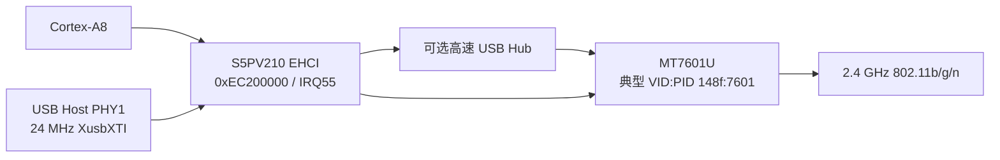
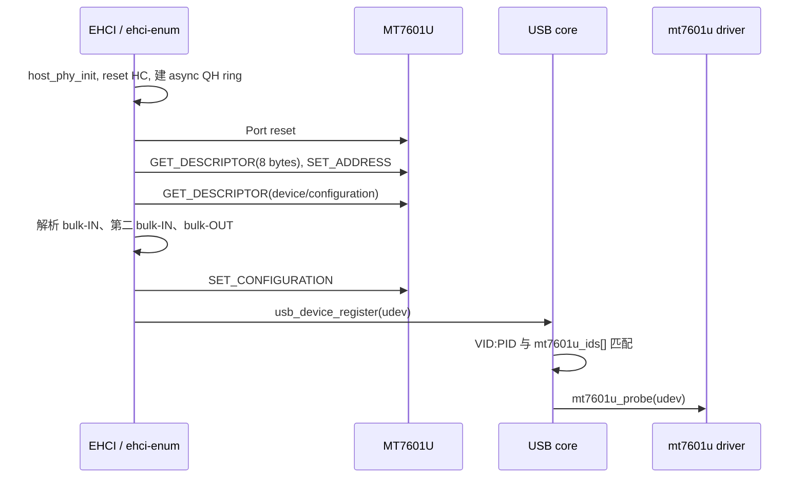
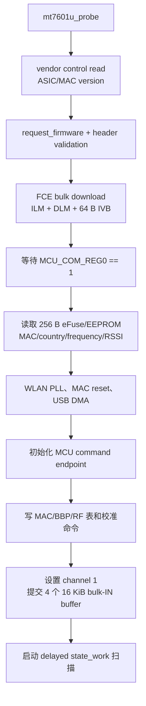
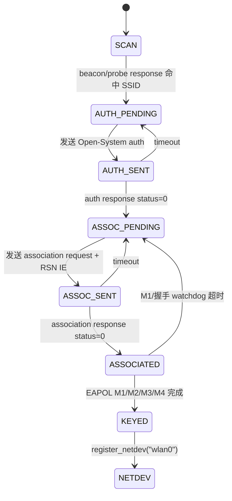
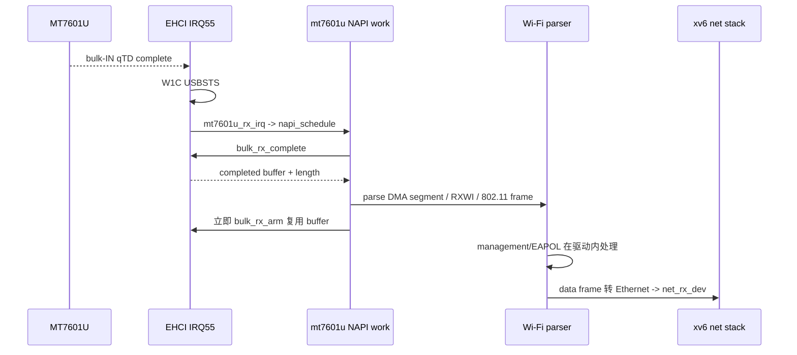

# Tiny210 MT7601U USB Wi-Fi 驱动

## 1. 当前支持范围

Tiny210 实板构建已经把以下组件连接成一条完整链路：

```text
S5PV210 USB Host PHY1
  -> EHCI host controller（USB-A，0xEC200000，IRQ 55）
  -> USB core / usb_bus
  -> MT7601U USB driver
  -> SoftMAC 扫描、Open-System 认证、关联
  -> WPA2-PSK/CCMP 四次握手
  -> net_device "wlan0"
  -> Ethernet/ARP/IPv4/UDP/ICMP/TCP
  -> DHCP、ping 和其他 socket 用户程序
```

默认目标是高速 USB MT7601U。QEMU `cubieboard` 替身没有这套 USB host，
`tiny210-qemu` 不会验证 Wi-Fi；枚举、固件、射频和真实收发必须在 Tiny210 实板测试。

主要源码：

- [`devices.c`](../../../kernel/arch/arm/mach-s5pv210/devices.c)：PHY1、EHCI resource。
- [`ehci-hcd.c`](../../../kernel/drivers/usb/host/ehci-hcd.c)：EHCI 枚举和 bulk 传输。
- [`usb.c`](../../../kernel/drivers/usb/core/usb.c)：USB bus、driver 匹配和 URB 生命周期。
- [`mt7601u.c`](../../../kernel/drivers/net/wireless/mt7601u.c)：芯片、SoftMAC、WPA2 和 netdev。
- [`wpa_crypto.c`](../../../kernel/drivers/net/wireless/wpa_crypto.c)：PBKDF2/PTK/MIC/AES unwrap。
- [`firmware.c`](../../../kernel/drivers/base/firmware.c)：`request_firmware()`。
- [`net.c`](../../../kernel/net.c)：net_device、NAPI、ARP/IP/DHCP 和 socket 网络栈。
- [`wifi.c`](../../../user/wifi.c)：用户态连接命令。

## 2. 硬件与 USB 拓扑

默认使用 Tiny210 底板 USB-A 口：



`host_phy_init()` 会：

1. 打开 USBHOST 时钟 gate；
2. 解除 PHY1 isolation；
3. 选择 24 MHz reference；
4. 清 PHY1 suspend/power-down；
5. pulse PHY1 和 host link reset。

EHCI device resource 是：

| 资源 | 值 |
| --- | --- |
| EHCI MMIO | `0xEC200000..0xEC2fffff` |
| IRQ | 55（`uhost`） |
| USB PHY MMIO | `0xEC100000..0xEC100fff` |

根口上的 full/low-speed 设备需要 OHCI，当前没有 OHCI 驱动；高速 MT7601U 可直接由
EHCI 管理。也可以通过 `S5PV210_USB_OTG=1` 编入 OTG/DWC2 host device，但默认
Wi-Fi 路径是 USB-A/EHCI。

## 3. 构建、firmware 和配置文件

实板 `ports/tiny210/Makefile` 会编入：

```text
usb/core/usb
usb/host/ehci-hcd
usb/dwc2/hcd
net/wireless/mt7601u
net/wireless/wpa_crypto
base/firmware
net + workqueue + epoll + sysnet
wifi + dhcp + ping 用户程序
```

固件文件必须存在于仓库的：

```text
firmware/mt7601u.bin
```

构建会把它链接到内核，并在 `make tiny210` 时复制到已挂载的 FAT32 bootfs：

```text
/Volumes/bootfs/mt7601u.bin
```

`request_firmware("mt7601u.bin")` 的优先级是：

```text
FAT32 根目录 /boot/mt7601u.bin
  -> 找不到或不可读
内核镜像中的 fw_mt7601u_start..fw_mt7601u_end
```

这样可以只替换 SD 卡上的固件进行测试，同时保留内置副本作为启动兜底。

可选 Wi-Fi 配置文件默认位于：

```text
ports/tiny210/wifi.conf
```

内容：

```ini
ssid=your-access-point
psk=your-passphrase
```

该文件被 `.gitignore` 排除。构建发现它时，通过 `mkfs --etc` 写入根文件系统的
`/etc/wifi.conf`。不要把真实密码提交到仓库。

## 4. initcall、枚举与驱动匹配

初始化顺序依靠 initcall level 和 order：

```text
netinit()                         注册 net bus
subsys_initcall("usbcore")       注册 usb bus
module_init_ord("mt7601u", 1)   注册 USB driver，建立 mt7601u_wq
module_init_ord("ehci-s5p", 2)  probe EHCI，申请 IRQ55，创建 ehci-enum
scheduler()                       CPU IRQ 打开，内核线程开始运行
ehci-enum                         PHY/host 初始化并枚举设备
```

EHCI 枚举流程：



MT7601U ID 表包含 `148f:7601` 以及多个 OEM VID:PID。USB core 使用 ID table
匹配，不依赖设备名。EHCI 枚举在内核线程而不是 initcall 中完成，是因为端口上电、
reset 和描述符事务会等待数百毫秒，需要调度器、timer 和 IRQ 已可用。

## 5. `mt7601u_probe()` 初始化阶段

probe 的主要阶段如下：



### 5.1 控制传输

MT7601U 寄存器不是 CPU MMIO。驱动通过 USB vendor control request 读写：

```text
mt7601u_read32/write32
  -> udev->ops->control
  -> EHCI EP0 SETUP/DATA/STATUS qTD
  -> MT7601U vendor request
```

### 5.2 固件下载

固件头给出 ILM/DLM 长度。驱动把数据按最大 `0x3800` 字节分块，增加 FCE TXINFO，
通过 bulk-OUT 下载：

```text
ILM: 目的地址从 64 B IVB 之后开始
DLM: 目的地址 0x80000
最后: DEV_MODE=0x12 携带 64 B IVB，启动 MCU
```

每块之后检查 FCE/MCU 状态，最后轮询 `MCU_COM_REG0 == 1`。

### 5.3 eFuse 和射频初始化

驱动读取 256 字节 eFuse，获得永久 MAC、country、晶振 frequency offset、RSSI
offset、参考温度和 LNA gain。随后初始化 MAC、BBP、RF 表，并通过 MCU command
endpoint 执行 R、TXDCOC、LOFT、TXIQ、RXIQ 和 DPD 等校准。

任何阶段失败都会使 probe 返回失败，`wlan0` 不会出现。

## 6. 扫描、认证和 WPA2 状态机

`/bin/wifi` 最终调用：

```text
wifi_connect(ssid, psk)
  -> SYS_wifi_connect
  -> sys_wifi_connect()
  -> mt7601u_connect(ssid, psk, 30000)
```

`mt7601u_connect()` 在进程上下文执行 PBKDF2 4096 轮生成 32 字节 PMK，然后设置
目标 SSID，唤醒 `mt7601u_wq` 的 delayed work，并睡眠等待最多 30 秒。



扫描在 2.4 GHz channel 1..11 间切换，每个 channel 解析 beacon/probe response，
最多保存 32 个 AP。WPA2 四次握手中：

1. 收到 M1：保存 ANonce，生成 SNonce，PMK 派生 PTK，发送 M2；
2. 收到 M3：校验 MIC，AES unwrap key data，提取 GTK；
3. 把 PTK/GTK 写进 MT7601U hardware key tables，启用 AES-CCMP；
4. 发送 M4，设置 `handshake_done`。

当前实现面向 WPA2-PSK/CCMP。没有完整支持 WPA3、802.1X/EAP、WEP、WPA-TKIP、
5 GHz、11n 高级速率控制或省电模式。

## 7. RX：IRQ + NAPI 风格下半部

probe 会在数据 bulk-IN endpoint 预提交 4 个 16 KiB buffer。数据到达时：



硬中断只确认 EHCI 状态并调度 NAPI work，不在 IRQ 上下文解析 beacon、EAPOL 或 IP。
NAPI 每轮 budget 是 4；若一次用满 budget，workqueue 会继续调度。状态机的 timeout
使用独立 `state_work`，因此 RX completion 与协议定时器互不阻塞。

## 8. TX 与网络栈

网络栈交给 `mt7601u_net_xmit()` 的是 Ethernet frame。驱动会：

1. 根据目标/源 MAC 和 EtherType 构造 802.11 ToDS header；
2. 添加 LLC/SNAP；
3. 关联后选择 AP 的 WCID；
4. 握手完成后让硬件使用已安装的 CCMP key；
5. 添加 MT7601U TXWI 和 USB DMA header；
6. 通过 bulk-OUT 同步发送。

RX 数据路径反向去掉 RXWI、802.11 header 和 LLC/SNAP，重建 Ethernet header 后调用
`net_rx_dev()`。握手完成以前，普通数据 frame 不会交给 IP 层。

驱动注册的真实接口名是 `wlan0`。当前一条日志仍写成 `wlan1 registered`，这是日志
字符串遗留，不代表存在第二个接口；DHCP 应使用 `wlan0`。

## 9. 自动连接和手工测试

如果根文件系统有 `/etc/wifi.conf`，Tiny210 `/init` 会后台重试连接最多 10 次；
`wifi` 成功后执行：

```sh
/bin/dhcp wlan0
```

手工连接：

```sh
/bin/wifi YOUR_SSID YOUR_PASSPHRASE
/bin/dhcp wlan0
/bin/ping 192.168.0.1
```

也可直接让 `wifi` 读取配置：

```sh
/bin/wifi
/bin/dhcp wlan0
```

成功的关键日志顺序通常是：

```text
ehci: high-speed device 148f:7601 ...
mt7601u: USB device 148f:7601 ASIC=...
firmware: mt7601u.bin loaded from /boot (... bytes)
mt7601u: MCU firmware running
mt7601u: permanent mac=...
mt7601u: MAC/BBP/RF bootstrap ready
mt7601u: RF calibration complete; bulk endpoints ready
mt7601u: target <ssid> found ... WPA2
mt7601u: Open-System authentication accepted
mt7601u: 802.11 associated ...
mt7601u: WPA2 four-way handshake complete
mt7601u: wlan1 registered ...     # 实际接口名 wlan0
dhcp: dev=wlan0 address=... gateway=... dns=...
```

## 10. 当前已知限制

- 只维护一个全局 `mt7601u_device`，不支持多块 MT7601U。
- EHCI 启动只在约 2 秒窗口内寻找设备，之后枚举线程永久睡眠；**不支持 USB 热插拔**。
  网卡应在启动前插好。
- 根口 full/low-speed 设备交给尚未实现的 OHCI；MT7601U 必须以 high-speed 工作。
- 扫描只覆盖 channel 1..11，没有根据 country 自动扩大/缩小 regulatory domain。
- `mt7601u_send_assoc()` 当前 association request 中仍有硬编码
  `TP-Link_B114`，虽然扫描和 `wifi_connect()` 接受任意 SSID；连接其他 SSID 前应把
  这里改成 `dev->want_ssid/dev->want_ssid_len`。
- TX bulk 是同步路径；高吞吐时会占用调用进程，尚无完整 TX queue/backpressure。
- 驱动没有 Linux mac80211/cfg80211 的速率控制、重连、扫描 API 和监管框架。
- D-cache 当前关闭，简化了 EHCI DMA 一致性；以后开启 D-cache 时必须补齐 DMA
  coherent allocation 或 cache clean/invalidate。
- Wi-Fi 配置是明文文件，系统没有密钥环或权限隔离。

## 11. 故障定位

| 最后日志/现象 | 优先检查 |
| --- | --- |
| 没有 `initcall: ehci-s5p` | 实板构建是否误用了 `QEMU_TEST=1` |
| `no high-speed device` | 网卡是否开机前插入、USB-A 供电、PHY1/时钟、是否被识别为 full-speed |
| 有 VID:PID，没有 probe | ID 是否在 `mt7601u_ids[]`、usbcore/driver initcall 顺序 |
| `firmware ... missing` | `/boot/mt7601u.bin` 和内置 `firmware/mt7601u.bin` |
| `MCU firmware start timeout` | bulk-OUT、FCE 地址/长度、固件版本、USB 错误 token |
| `calibration ... failed` | 第二 bulk-IN MCU response endpoint、eFuse/RF、供电和 USB 稳定性 |
| 能扫描但认证超时 | channel、BSSID、AP 是否允许 Open-System auth、USB RX completion |
| 关联后 M1 timeout | AP 安全模式应为 WPA2-PSK/CCMP，检查 EAPOL RX 和 receive filter |
| `M3 MIC verification failed` | 密码错误、PMK/PTK 派生或 replay/nonce |
| `wifi: associated` 但 DHCP 失败 | 使用 `wlan0`、ARP/DHCP response 是否进入 `net_rx_dev()` |
| 一直连不上非 TP-Link_B114 | 当前 association request 的硬编码 SSID 限制 |

## 12. USB/Wi-Fi 分层 Trace 开关

Tiny210 构建提供一个总开关和五个可独立覆盖的分层开关。一次打开全部日志：

```sh
make tiny210 USB_WIFI_TRACE=1
```

`USB_WIFI_TRACE=2` 会进一步打开 MT7601U 的逐寄存器和逐 802.11 帧日志；
`USB_XFER_TRACE` 本身也很密集，因此只建议短时间抓取：

```sh
make tiny210 USB_WIFI_TRACE=2
```

如果只想编译而不执行 Tiny210 SD 卡安装流程，可使用：

```sh
make -f ports/tiny210/Makefile USB_WIFI_TRACE=1 \
  build/tiny210/xv6-tiny210.uImage
```

各开关和输出前缀如下：

| 编译开关 | 日志前缀 | 覆盖的调用阶段 |
| --- | --- | --- |
| `USB_CORE_TRACE` | `usb-core:` | device/driver 注册、ID 匹配、probe/remove |
| `USB_ENUM_TRACE` | `usb-enum:` | EHCI 根口、Hub、描述符、地址与端点枚举 |
| `USB_XFER_TRACE` | `usb-xfer:` | control/bulk、QH/qTD、RX arm/completion 和 IRQ |
| `MT7601U_CONFIG_TRACE=1` | `wifi-config:` | probe、固件、eFuse、MAC/BBP/RF、校准和连接状态 |
| `MT7601U_CONFIG_TRACE=2` | `wifi-reg:` | 在上项基础上输出逐寄存器访问 |
| `MT7601U_DATA_TRACE=1` | `wifi-data:` | TX/RX、NAPI、Ethernet 与 USB 缓冲流转 |
| `MT7601U_DATA_TRACE=2` | `wifi-frame:` | 在上项基础上输出逐 802.11 帧摘要 |

总开关只是五个默认值的来源，仍可单独关闭噪声最大的层。例如保留枚举、
usbcore 和 Wi-Fi 日志，但关闭每笔 EHCI 传输：

```sh
make tiny210 USB_WIFI_TRACE=1 USB_XFER_TRACE=0
```

从启动到联网时，前缀顺序可直接映射到调用链：

```text
ehci_enum_thread / ehci_enumerate_device
  -> usb-enum: 描述符、地址、配置、端点
  -> usb_device_register
       -> usb-core: 匹配 148f:7601 并调用 mt7601u_probe
            -> wifi-config: 固件、eFuse、MAC/BBP/RF、校准
                 -> usb-xfer: EP8 OUT / EP4、EP5 IN 的 QH/qTD

EHCI IRQ 55
  -> usb-xfer: EP4 completion
  -> mt7601u_rx_irq -> NAPI -> mt7601u_rx_parse
       -> wifi-data: Ethernet/NAPI 收发
       -> wifi-frame: 逐 802.11 帧（仅 level 2）
```

错误、超时和初始化结果日志不依赖这些开关，关闭 Trace 后仍会保留。构建系统还会把
五个取值写入 `build/tiny210/.usb-wifi-trace`；值发生变化时会自动重编译
`usb.c`、`ehci-hcd.c` 和 `mt7601u.c`，无需先执行 `make clean`。

