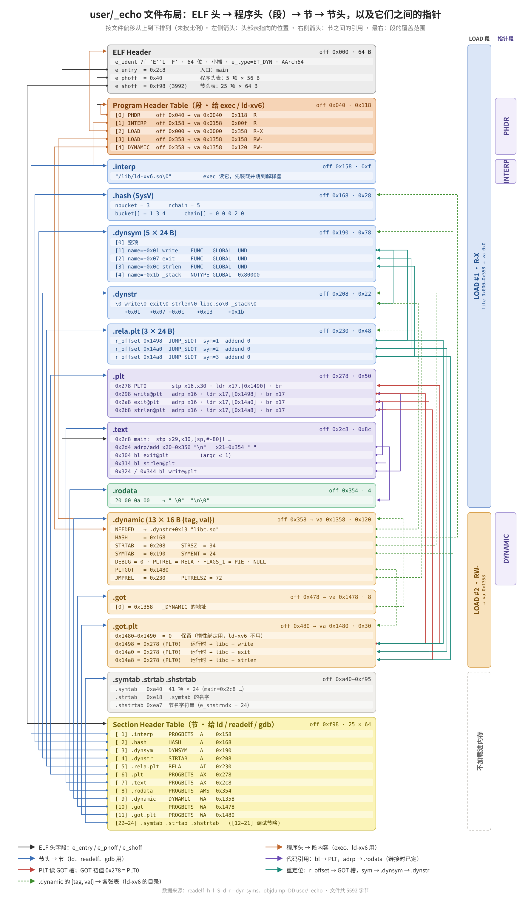
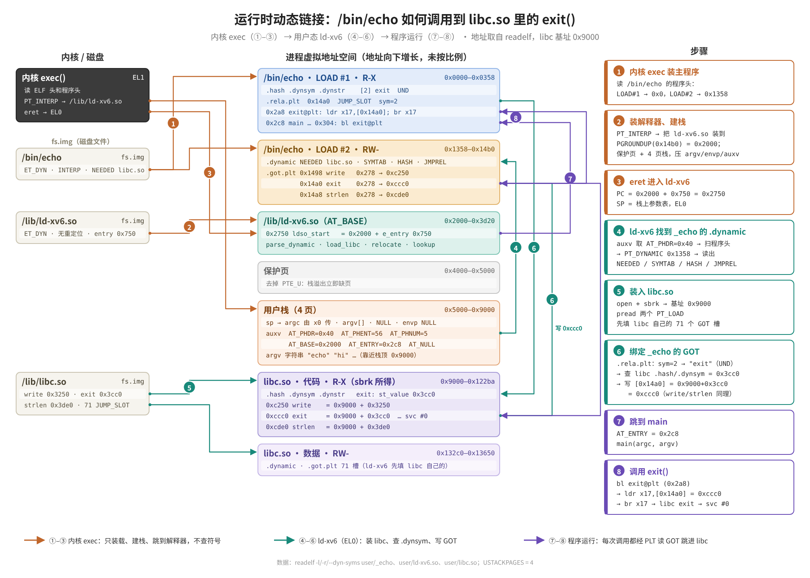

# libc.so 的动态链接与加载

本文从头到尾讲一个 xv6 用户程序如何用上共享的 `/lib/libc.so`：
1. 怎么构建；
2. ELF 文件里记录了哪些动态链接信息；
3. 一次 `strlen()` 调用怎样经过 PLT 和 GOT 跳进 libc；
4. 内核与 `/lib/ld.so` 怎样把它们装进内存、填好地址；
5. 多个进程怎样共用同一份 libc 物理页；
6. 出问题时怎么查。

文中的反汇编和 `readelf` 输出取自用 Ubuntu `aarch64-linux-gnu` 工具链构建的 QEMU 版本，代码在分支 `wip-cow-mmap-ldso`。在板子上用 Homebrew 的 `aarch64-elf` 工具链构建时，地址和大小会略有不同，结构完全一样。

相关文档：`readme_process_trap.md` 第二部分（写时复制、页缓存、mmap），书第 4.7 节和第 8.5 节。

> **两套实现**：第 1–10 节描述的是云端实验分支 `wip-cow-mmap-ldso` 上的 `/lib/ld.so`（用 mmap 从页缓存装载 libc、全系统共享、写时复制）。
> 你源码树 `rpi3-dynmodel` 当前使用的是 **`/lib/ld-xv6.so`**：用 `pread` 把 libc 读进 sbrk 堆，每个进程一份私有副本。它的完整分析见**第 11 节**。
> PLT/GOT 机制（第 3 节）、重定位类型（第 7 节）对两者完全相同。

---

## 0. 全景

```
          构建期                                   运行期
 ┌──────────────────────┐        exec("/bin/echo")
 │ ulib.c printf.c ...  │──-fPIC──► *.pic.o ──ld -shared──► /lib/libc.so (ET_DYN)
 │ echo.c               │──────────► echo.o ──ld -pie -dynamic-linker /lib/ld.so──► /bin/echo (ET_DYN, PT_INTERP)
 │ ldso.c ldso_start.S  │──-fPIC───► ld -shared -Bsymbolic -z text ──► /lib/ld.so
 └──────────────────────┘

 exec ─► 内核: 主程序装到 VA 0；读 PT_INTERP；ld.so 装在主程序之后；x0=argc x1=argv x2=auxv；从 ld.so 入口开始
      ─► ld.so: 自重定位 → 由 AT_PHDR 找到主程序的 PT_DYNAMIC → DT_NEEDED "libc.so"
               → open("/lib/libc.so") + mmap 映射到 0x10_0000_1000 一带
               → 重定位 libc 和主程序（填 GOT）→ 调用 AT_ENTRY(main)，再 exit(返回值)
      ─► main: bl strlen@plt → ldr x17, GOT[strlen] → br x17 → libc 的 strlen
```

## 1. 构建

```make
# libc 的每个源文件编成位置无关对象
$U/%.pic.o: $U/%.c
	$(CC) $(CFLAGS) -fPIC -c -o $@ $<

# 共享库：ET_DYN，SONAME = libc.so；-z text 保证没有文本重定位，代码页才能共享
$U/libc.so: $(LIBC_PIC_OBJS)
	$(LD) $(LDFLAGS) -shared --no-undefined --hash-style=sysv -z text -soname libc.so -o $@ $^

# 用户程序：PIE，并在 PT_INTERP 里写上动态链接器的路径
USER_LD_MODE = -pie -dynamic-linker /lib/ld.so --hash-style=sysv
_%: %.o $(ULIB) $(USER_LINK_STAMP)
	$(LD) $(LDFLAGS) $(USER_LD_MODE) -e main -o $@ ...

# 动态链接器本身：独立、全部符号 hidden、不允许文本重定位
$U/ld.so: $U/ldso_start.o $U/ldso.o
	$(LD) $(LDFLAGS) -shared -Bsymbolic --no-undefined -z text --hash-style=sysv \
	  -e _start -soname ld.so -o $@ $^
```

- **`--hash-style=sysv`**：生成 `DT_HASH`。内核加载器和 ld.so 都用 SysV 哈希查符号，不支持 GNU hash。
- **`-e main`**：程序入口就是 `main`。ld.so 以 `(argc, argv)` 调用它，然后用返回值调用 `exit`；所以 xv6 程序既可以 `exit()`，也可以直接 `return`。
- **模式戳 `.dynamic-ldso`**：链接方式改变时，旧二进制必须重新链接。换一个戳的名字就能强制所有程序重链。
- **静态回退**：`make DYNAMIC_USER=0` 退回静态 `libc.a`，生成 `ET_EXEC` 程序（`-N -Ttext 0`）。
- **安装**：`mkfs fs.img -L user/libc.so -L user/ld.so ...` 把两个共享对象放进 `/lib`；ext2 根镜像（`make ext2root-image`）也会写入这两个文件。

## 2. ELF 里的动态链接信息（以 `/bin/echo` 为例）

### 2.1 程序头

```
$ readelf -hlW user/_echo
  Type:          DYN (Position-Independent Executable file)
  Entry point:   0x320                                  ← main
  PHDR      0x000040  vaddr 0x40     0x188   R          ← 程序头表自身，ld.so 由它算出主程序基址
  INTERP    0x0001c8  vaddr 0x1c8    0x00b   R          ← "/lib/ld.so\0"
  LOAD      0x000000  vaddr 0x0      0x3ec   R E        ← 代码：ELF 头、PLT、.text、只读数据
  LOAD      0x000ec0  vaddr 0x1ec0   0x158   RW         ← .dynamic、GOT
  DYNAMIC   0x000ec0  vaddr 0x1ec0   0x120   RW
```

### 2.2 动态段 `.dynamic`

| 标签 | 值 | 含义 |
|---|---|---|
| `DT_NEEDED` | "libc.so" | 依赖的库（字符串表里的偏移） |
| `DT_HASH` | 0x1d8 | SysV 哈希表：nbucket、nchain、bucket[]、chain[] |
| `DT_SYMTAB` / `DT_STRTAB` / `DT_STRSZ` / `DT_SYMENT` | 0x200 / 0x260 / 27 / 24 | 动态符号表和它的字符串表 |
| `DT_PLTGOT` | 0x1fe8 | `.got.plt` 的地址 |
| `DT_JMPREL` / `DT_PLTRELSZ` / `DT_PLTREL` | 0x280 / 72 / RELA | PLT 的重定位表（3 条 × 24 字节） |
| `DT_FLAGS_1` | PIE | |

### 2.3 动态符号与重定位

```
$ readelf --dyn-syms -rW user/_echo
.dynsym: 1: write  FUNC GLOBAL UND      ← 未定义：要到 libc 里找
         2: exit   FUNC GLOBAL UND
         3: strlen FUNC GLOBAL UND
.rela.plt:
  Offset   Type                  Symbol
  0x2000   R_AARCH64_JUMP_SLOT   write     ← 把 write 的真实地址写到 VA 0x2000
  0x2008   R_AARCH64_JUMP_SLOT   exit
  0x2010   R_AARCH64_JUMP_SLOT   strlen
```

### 2.4 libc.so 的布局

```
$ readelf -SW user/libc.so
 .hash 0x158 | .dynsym 0x7d0 | .dynstr 0x1be0 | .rela.plt 0x25b8 (71 条)
 .plt 0x2c60 | .text 0x30f0 | .rodata 0x8e80                   ← 第一个 LOAD（R-X）
 .dynamic 0xcee0 | .got 0xcfe0 | .got.plt 0xcfe8 | .bss 0xd238  ← 第二个 LOAD（RW）
符号：write = 0x3214, strlen = 0x4260, exit = 0x4118, printf = 0x4fa4, __syscall = 0x4a3c
```

libc 的 71 条重定位**全部**是 `JUMP_SLOT`，目标都在 RW 段的 `.got.plt` 里，代码段一个字节都不用改。这就是代码页能在进程间共享的前提（第 6 节）。

## 3. 一次库函数调用：PLT 与 GOT

`echo` 的 `main` 调用 `strlen` 时，编译出来是一条普通的 `bl`，但目标不是 libc，而是本程序里一段 16 字节的桩代码（PLT 项）：

```
0000000000000320 <main>:
 ...
 368:  bl   310 <strlen@plt>          ← 调用 PLT 项，而不是 libc

0000000000000310 <strlen@plt>:
 310:  adrp x16, 2000                 ← GOT 所在页（PC 相对，与装载地址无关）
 314:  ldr  x17, [x16, #16]           ← 读 GOT[0x2010]：strlen 的真实地址
 318:  add  x16, x16, #0x10
 31c:  br   x17                       ← 跳过去
```

GOT（`.got.plt`）是数据，位于可写段。构建出来时它的内容是：

```
$ objdump -s -j .got.plt user/_echo
 1fe8 00000000 00000000 00000000 00000000   ← 保留项（延迟绑定用，此处不用）
 1ff8 00000000 00000000 d0020000 00000000
 2008 d0020000 00000000 d0020000 00000000   ← 0x2000/0x2008/0x2010 都指向 0x2d0（PLT0）
```

3 个槽的初值都是 `0x2d0`，即 PLT0，也就是 glibc 那样做"延迟绑定"时的解析入口。这里**不做延迟绑定**：PLT0 要用的保留槽是 0，真跳过去会崩溃。所以必须在 `main` 运行之前把这些槽改写成真实地址，这一步叫**急切绑定（eager binding）**。

ld.so 处理 `R_AARCH64_JUMP_SLOT strlen @ 0x2010`：
1. 在全局作用域（程序 → libc）查到 libc 的 `strlen`，`st_value = 0x4260`；
2. libc 被 mmap 到基址 `0x10_0000_1000`（第 5 节），所以写入 `*(0x2010) = 0x10_0000_1000 + 0x4260 = 0x10_0000_5260`。

之后 `bl strlen@plt` 就总是经过两次跳转到达 libc。代价是每次库调用多一次 `ldr` 和一次 `br`，换来的是：代码里没有任何绝对地址，代码页可以原样共享。

**libc 内部也走 PLT。** libc 以 `-shared` 链接，没有加 `-Bsymbolic`，它内部对导出函数的调用同样经过自己的 PLT：

```
0000000000004b14 <putc>:
 4b28:  bl  2e20 <write@plt>          ← libc 调用自己的 write 也走 PLT/GOT
```

所以 libc 有 71 条 `JUMP_SLOT`。好处是程序可以**覆盖（interpose）**libc 的函数：符号查找先找程序再找 libc，如果程序自己定义了 `malloc`，libc 内部对 `malloc` 的调用也会被解析到程序的版本。

## 4. 两条装载路径

| | A. PT_INTERP → `/lib/ld.so`（默认） | B. 内核内置加载器（兼容路径） |
|---|---|---|
| 适用 | 带 `PT_INTERP` 的程序（`-dynamic-linker /lib/ld.so` 链接） | `ET_DYN`、有 `DT_NEEDED` 但没有 `PT_INTERP`（旧的 `--no-dynamic-linker` 链接） |
| libc 放在哪 | mmap 区（`0x10_0000_0000` 起），由 ld.so 映射 | 紧跟主程序之后，`PGROUNDUP(sz)` |
| 谁做重定位 | 用户态 ld.so | 内核 `relocateimage()` |
| 依赖 | 多个库，到 `/lib` 下搜索 | 只能是一个 `/lib/libc.so` |
| 日志 | 无 | `exec: dynamic /bin/x, libc.so base=…, text shared` |

### 4.1 路径 A：内核这一半（`kernel/exec.c`）

1. 校验 ELF 头（`ET_EXEC` 或 `ET_DYN`，AArch64），`loadimage()` 把主程序的 PT_LOAD 装到 VA 0，并记下 `PT_DYNAMIC`、`PT_INTERP`、`PT_PHDR`。
2. 读出解释器路径（必须以 NUL 结尾、长度不超过 128）。
3. 打开 `/lib/ld.so`，`ET_DYN`，装在 `interpbase = PGROUNDUP(sz)`。它的只读页用 `shlib_map()` 从页缓存映射，所有进程共用。
4. 建用户栈：参数字符串、argv 数组，再压辅助向量：

```
x0 = argc   x1 = argv   x2 = auxv（{tag, value} 对，以 AT_NULL 结束）
AT_PHDR    = 主程序程序头地址（0x40）   AT_PHENT = 56   AT_PHNUM = 程序头个数
AT_PAGESZ  = 4096                       AT_BASE  = interpbase   AT_ENTRY = 0x320（main）
```

5. `elr = interpbase + ld.so 的 e_entry`，`eret` 后从 ld.so 的 `_start` 开始执行。

### 4.2 路径 A：ld.so 这一半（`user/ldso.c`）

```
_start (ldso_start.S): 清 x29/x30，bl ldso_main(argc, argv, auxv)
ldso_main:
  1. 解析 auxv 到 at[]
  2. 自重定位：遍历自己的 _DYNAMIC，处理 RELATIVE（实际构建出的 ld.so 一条都没有）
  3. 主程序：从 AT_PHDR 找 PT_PHDR → mainbase = AT_PHDR - phdr.vaddr（= 0）
             → PT_DYNAMIC → parse_dynamic(): NEEDED/HASH/STRTAB/SYMTAB/RELA/JMPREL
  4. 广度优先装载 DT_NEEDED：load_library("libc.so")
  5. 先库后程序做重定位：relocate_table(rela)、relocate_table(jmprel)
  6. status = ((int(*)(int,char**))AT_ENTRY)(argc, argv);  exit(status)
```

`load_library()` 用 mmap 装库：

```
fd = open("/lib/libc.so")
eh = mmap(0, 4096, PROT_READ, MAP_PRIVATE, fd, 0)        ← 读 ELF 头和程序头
span = 所有 PT_LOAD 覆盖的页范围（libc：0 .. 0xe000）
base = mmap(0, span, R|X, MAP_PRIVATE, fd, 0) - minv      ← 一次映射整个镜像，决定基址
对其余 PT_LOAD（libc 的 RW 段：vaddr 0xcee0, off 0xbee0）：
  mmap(base+0xc000, 0x2000, R|W, MAP_PRIVATE|MAP_FIXED, fd, 0xb000)   ← 两页：0xc000 与 0xd000
  .bss：把最后一个文件页的尾部清零；还不够的部分用 MAP_ANONYMOUS|MAP_FIXED 补上
munmap(eh); close(fd); parse_dynamic(); 库带 DT_TEXTREL 则拒绝
```

为什么能这样映射：GNU ld 保证 `p_vaddr ≡ p_offset (mod 页大小)`，所以每一页虚拟地址都对应文件里的一个整页偏移。

### 4.3 路径 B：内核内置加载器

主程序装完后：
1. `parsedynamic()` 读取 DT_*，要求 `DT_NEEDED` 恰好一个且就是 `"libc.so"`；
2. 打开 `/lib/libc.so`，`libbase = PGROUNDUP(sz)`；
3. `shlib_textsize()` 求出可共享的只读部分，`shlib_map()` 从页缓存映射它；其余页由 `loadimage()` 分配私有副本；
4. `relocateimage()` 先重定位 libc，再重定位主程序。写入代码区的重定位会被拒绝；
5. `elr = main` 的地址。

这条路径主要用来兼容旧方式链接的程序。

## 5. 一次 exec 后的地址空间（QEMU，`/bin/sh`）

```
0x0000_0000 ┌───────────────────────┐
            │ sh 代码 + 数据（私有） │  主程序：exec 装入，ld.so 改写它的 GOT
            ├───────────────────────┤  PGROUNDUP(sz)
            │ ld.so 代码（共享）     │  页缓存页，只读可执行
            │ ld.so 数据（私有）     │
            ├───────────────────────┤
            │ 保护页 + 4 页用户栈    │
            ├───────────────────────┤  sz
            │ sbrk 堆 ...            │
            ⋮                       ⋮
0x10_0000_1000 ┌────────────────────┐
            │ libc 代码 12 页（共享）│  页缓存页，R-X，每页 "shared by 4 mappings"
            │ libc 0xb000 页（共享） │  同一文件页：代码尾 R-X + .data 开头 R+COW
            │ libc GOT 页（私有）    │  ld.so 写过 → 已经 COW 出私有副本
            └────────────────────┘
```

可以用 `vmmap` 查看：每一页显示 `user RO X`、`cow`、`shared by N mappings`。

## 6. 为什么只有一份 libc 物理页

1. **libc 的代码不需要改**：PIC 代码通过 `adrp`/`add` 等 PC 相对指令访问数据，库函数调用经过 PLT，从 GOT 读地址；所有重定位都在 RW 段。
2. **页缓存（`kernel/pcache.c`）**：以"文件 + 页号"为键缓存物理页，缓存本身持有一份引用。mmap 一个文件页时，只是给这个物理页的引用计数加一，再映射进页表。
3. **写时复制**：RW 段以只读 + `PTE_COW` 映射。ld.so 改写 GOT 时触发写保护异常，内核只复制被写的那一页。
4. **ld.so 自己**的代码页同样来自页缓存。

QEMU 中实测，init、sh、vmmap 三个进程的 libc 代码页是同一组物理地址；`0xb000` 那一页同时被映射成代码尾和数据头，被引用 7 次；GOT 页各有私有副本。

## 7. 支持的重定位类型

| 类型 | 编号 | 计算 | 出现在 |
|---|---|---|---|
| `R_AARCH64_NONE` | 0 | 跳过 | |
| `R_AARCH64_ABS64` | 257 | S + A | 数据中的绝对指针 |
| `R_AARCH64_GLOB_DAT` | 1025 | S + A | `.got`：全局变量的地址 |
| `R_AARCH64_JUMP_SLOT` | 1026 | S + A | `.got.plt`：函数地址（急切绑定） |
| `R_AARCH64_RELATIVE` | 1027 | B + A | 本模块内部的指针（PIE 程序的指针表） |

S 是符号地址，A 是 addend，B 是模块基址。符号查找顺序：本模块的 `STB_LOCAL` 定义，然后全局作用域（程序 → 各库，按装载顺序）。弱符号找不到时按 0 处理，强符号找不到则报错退出。

**不支持**：`DT_REL`（只支持 RELA）、`R_AARCH64_COPY`、TLS 类重定位、`IFUNC`、GNU hash、延迟绑定。

## 8. 调试

### 8.1 常用命令（在主机上）

```sh
aarch64-elf-readelf -lW user/_sh          # 程序头：有没有 INTERP/PHDR，段布局
aarch64-elf-readelf -dW user/_sh          # 动态段：NEEDED、HASH、JMPREL…
aarch64-elf-readelf -rW user/libc.so      # 重定位：类型是否都受支持、目标在哪个段
aarch64-elf-readelf -dW user/libc.so | grep TEXTREL   # 库必须没有
aarch64-elf-objdump -d user/_sh | grep '@plt>'        # 哪些调用走 PLT
aarch64-elf-objdump -s -j .got.plt user/_sh           # GOT 初值
```

### 8.2 错误信息对照

| 信息 | 来自 | 原因 |
|---|---|---|
| `exec: /bin/x: cannot open interpreter /lib/ld.so` | 内核 | 根文件系统里没有 ld.so，fs.img 或 ext2 镜像没装 |
| `ld.so: cannot open /lib/libc.so` | ld.so | 缺库，或 `DT_NEEDED` 写错 |
| `ld.so: undefined symbol foo` | ld.so | 程序用了 libc 没有导出的函数 |
| `ld.so: unsupported relocation type in X` | ld.so | 出现了第 7 节表格以外的类型（例如 `R_AARCH64_COPY`） |
| `ld.so: text relocations are not supported in /lib/X` | ld.so | 库带 `DT_TEXTREL`：有对象没用 `-fPIC` 编译 |
| `ld.so: misaligned segment in X` | ld.so | 段的 vaddr 和 offset 模 4096 不相等 |
| `exec: unresolved dynamic symbol foo` | 内核（路径 B） | 同上，发生在内核加载器里 |
| `exec: relocation into shared text at …` | 内核（路径 B） | 要写进共享代码区的重定位 |
| `usertrap(): … ec=0x0 … elr=0x0` 紧跟 `init exiting` | 内核 | 程序是 ET_DYN，但内核不会动态加载（例如旧版 exec.c），GOT 保持 0，跳到了地址 0 |

### 8.3 判断走的是哪条路径

- 内核日志出现 `exec: dynamic /bin/x, libc.so base=…`：走的是路径 B。
- 没有这行但程序正常运行：走的是路径 A（ld.so）。`vmmap` 里 libc 在 `0x10_0000_xxxx`。
- 静态构建（`DYNAMIC_USER=0`）：程序是 `ET_EXEC`，两条路径都不经过。

## 9. 常见问题

**为什么不同程序里 libc 的基址不一样？**
- 路径 B：基址是"主程序末尾向上取整到页"，比如 login 是 0x2000，sh 是 0x3000。
- 路径 A：基址由 mmap 区当时的空闲位置决定，通常每次都是 `0x10_0000_1000`（第 0 页被 ld.so 读 ELF 头时暂用，之后释放）。

两种情况都不影响共享，因为代码页内容与装载地址无关。

**程序可以有文本重定位，库却不行？**
用户程序以 `-fno-pie` 编译、`-pie` 链接，只读段里的指针表需要 RELATIVE 重定位，所以带 `DT_TEXTREL`（usertests 就是这样）。程序是 exec 装进来的私有可写副本，改了没关系；库的代码页是所有进程共用的只读页，不能改。

**为什么不做延迟绑定？**
延迟绑定需要 PLT0 解析入口和运行时的符号查找服务（glibc 的 `_dl_runtime_resolve`）。xv6 的程序都很小，启动时一次性绑定更简单：一个 `echo` 只需要 3 条，libc 也只有 71 条。

**ld.so 自己怎么做到不需要重定位？**
`-fPIC -fvisibility=hidden` 加 `-Bsymbolic`：所有对自身代码和数据的访问都是 PC 相对的，链接器不需要留下任何 GOT 项。唯一的例外是带指针初值的全局变量，ld.so 刻意避免了这种写法，所以 `readelf -r user/ld.so` 显示没有重定位。

## 10. 与 Linux 的对比

| | xv6-aarch64 | Linux / glibc |
|---|---|---|
| 解释器 | `/lib/ld.so`，约 450 行 C | `ld-linux-aarch64.so.1` |
| 参数传递 | x0/x1/x2 = argc/argv/auxv | 全部在栈上（argc、argv、envp、auxv） |
| auxv | PHDR/PHENT/PHNUM/PAGESZ/BASE/ENTRY | 还有 HWCAP、RANDOM、EXECFN、SYSINFO_EHDR… |
| 绑定 | 急切绑定 | 默认延迟（`-z now` 时急切） |
| 共享方式 | 页缓存 + mmap MAP_PRIVATE + COW | 相同 |
| 地址随机化 | 无 | ASLR |
| 其他 | 无 dlopen、TLS、IFUNC、版本符号 | 都有 |

---

## 11. 当前源码树的实现：`/lib/ld-xv6.so`

`rpi3-dynmodel` 工作区里的实现（`user/ldso.c` 348 行，加上 `kernel/exec.c`、`Makefile`、`mkfs/mkfs.c` 的修改）走的是同一条 Linux 路线：内核只映射程序和解释器，libc 的加载和重定位都在用户态完成。但它的装载方式更简单：**不用 mmap，而是 `pread` + `sbrk`**。本节按执行顺序分析，最后列出发现的问题。下面的数字取自你 Mac 上这次构建的二进制。

### 11.1 构建与安装

```make
USER_LD_MODE = -pie -dynamic-linker /lib/ld-xv6.so        # 程序头里写 PT_INTERP
$U/ld-xv6.so: $U/ldso.pic.o $U/usys.pic.o
	$(LD) $(LDFLAGS) -shared -Bsymbolic -e ldso_start -o $@ $^
fs.img: ... mkfs/mkfs fs.img -L $U/libc.so -I $U/ld-xv6.so ...  # -I：把解释器放进 /lib
ext2root-image: ... echo "write $U/ld-xv6.so lib/ld-xv6.so"
```

- **组成**：`ld-xv6.so` 只由 `ldso.pic.o` 和 `usys.pic.o` 链成，用到的只是 libc 的 `__syscall` 网关。它在 libc 之前运行，不能依赖 libc。
- **`-Bsymbolic`**：所有对自身符号的引用在链接时就绑定，不经过 GOT/PLT。
- **入口**：`-e ldso_start` 让 C 函数直接作为入口，没有汇编 `_start`。
- **mkfs**：新增 `-I` 选项，把解释器写进 `/lib`。

`readelf` 验证：

```
$ readelf -hlrW user/ld-xv6.so
  Type: DYN (Shared object file)      Entry point: 0x750 (= ldso_start)
  LOAD 0x000000 vaddr 0x0     filesz 0xc3e  R E
  LOAD 0x000c40 vaddr 0x1c40  filesz 0xe0   RW     (.dynamic)
  There are no relocations in this file.        ← 关键：不需要自重定位
$ nm user/ld-xv6.so
  ldso_start memcpy memset __syscall  (T)   parse_dynamic lookup relocate … (t)
```

`ld-xv6.so` **没有任何重定位**，所以内核把它装到任意基址都能直接运行，也就不需要像 glibc 的 `ld.so` 那样先重定位自己。代价见 11.8 第 3 条。

### 11.2 内核这一半：exec

和改造前相比，`exec.c` 删掉了约 460 行：内核里的 `parsedynamic`、`relocateimage`、符号查找，以及第一步的 libc 代码页缓存全部去掉，只留下：

1. **`readinterp()`**：遍历程序头找 `PT_INTERP`。读出路径，必须以 NUL 结尾、不超过 128 字节，并且只能有一个。**ET_DYN 程序没有 PT_INTERP 时直接拒绝**，报 `exec: dynamic /bin/x has no valid PT_INTERP`。
2. **`loadimage(main, base 0)`**：把主程序的 PT_LOAD 装到 VA 0，得到私有副本。
3. **`loadimage(interp, interpbase = PGROUNDUP(sz))`**：把 `ld-xv6.so` 装在主程序之后，同样是私有副本，由内核分配页并 `loadseg` 读入。新加的检查 `base + minstart >= PGROUNDUP(*psz)` 防止两个镜像重叠。
4. **入口**：`initial_entry = interpbase + e_entry`（即 `ldso_start`），并打印 `exec: /bin/sh -> interpreter /lib/ld-xv6.so`。
5. **建立初始栈**：参数字符串之后，压入一张连续的表，**布局与 Linux 相同（只是 argc 不在栈上）**：

```
sp → argv[0] … argv[argc-1]  NULL      ← x1 指向这里；x0 = argc（系统调用返回值）
     envp[0] = NULL                    ← 空环境
     AT_PHDR  (3)  mainbase + e_phoff
     AT_PHENT (4)  56
     AT_PHNUM (5)  e_phnum
     AT_PAGESZ(6)  4096
     AT_BASE  (7)  interpbase          ← ld-xv6.so 没用到它（不做自重定位）
     AT_ENTRY (9)  mainbase + e_entry  ← main
     AT_NULL  (0)  0
```

`ustack` 数组扩大成 `MAXARG + 18`，用来容纳这些额外的字。`ldso_start` 用 `argv + argc + 2` 找到 auxv：跳过 argv 末尾的 NULL 和空的 envp。

### 11.3 ld-xv6.so 这一半：`ldso_start(argc, argv)`

```
ldso_start(argc, argv)                         ← 普通 C 函数，栈帧 0x530 字节
 ├─ aux = argv + argc + 2；扫描出 PHDR/PHENT/PHNUM/ENTRY，缺任何一项则 fail("invalid auxiliary vector")
 ├─ main_image(&main, phdr, phnum)             主程序基址视为 0
 │    └─ PT_DYNAMIC → parse_dynamic()：NEEDED/HASH/STRTAB/SYMTAB/RELA/JMPREL…；nsyms = hash[1]
 ├─ 检查：DT_NEEDED 恰好 1 个，且等于 "libc.so"
 ├─ load_libc(&libc)
 │    ├─ fd = open("/lib/libc.so")
 │    ├─ pread ELF 头；pread 程序头（最多 16 个）
 │    ├─ maxend = max(p_vaddr + p_memsz)       libc：0xa2c0 + 0x390 = 0xa650
 │    ├─ base = sbrk(PGROUNDUP(maxend))         一次向堆要 0xb000（11 页），新页已被清零
 │    ├─ 对每个 PT_LOAD：pread(fd, base + p_vaddr, p_filesz, p_offset)   .bss 自然为 0
 │    └─ close(fd)；parse_dynamic(libc)
 ├─ relocate(&libc, &main, &libc)              先 libc：71 条 JUMP_SLOT
 ├─ relocate(&main, &main, &libc)              再主程序：RELATIVE + JUMP_SLOT/GLOB_DAT
 ├─ write(2, "ld.so: relocated libc.so in user space\n")
 └─ status = main(argc, argv)；exit(status)
```

**符号查找**（`lookup`）：在动态符号表上**线性扫描**（`DT_HASH` 只用来取符号个数 `nchain`），顺序是主程序在前、libc 在后，所以程序可以覆盖 libc 的函数。弱符号找不到时取 0。libc 有 212 个全局函数，71 个 JUMP_SLOT 槽，每次 exec 大约要做 71 × 212 / 2 ≈ 7500 次字符串比较，对 xv6 的程序规模可以接受。

**支持的重定位**：NONE、RELATIVE、ABS64、GLOB_DAT、JUMP_SLOT，和第 7 节相同。遇到其他类型、越界写或找不到强符号，就报 `ld.so: relocation failed` 并以 127 退出。

### 11.4 /bin/sh 的地址空间（按这次构建推算）

```
0x0000 ┌────────────────────────┐
       │ sh 代码 R-X 0..0x1ab9  │  exec 装入（私有）
       │ sh 数据 RW 0x2ac0..2e10 │  ld-xv6 改写其 GOT
0x3000 ├────────────────────────┤  interpbase = PGROUNDUP(0x2e10)
       │ ld-xv6.so 代码/数据     │  exec 装入（私有），0x3000..0x4d20
0x5000 ├────────────────────────┤
       │ 保护页                  │
0x6000 │ 用户栈 4 页             │
0xa000 ├────────────────────────┤  exec 结束时的 sz
       │ libc.so  0xa000..0x14fff│  ld-xv6 sbrk(0xb000) 后用 pread 读入（私有）
0x15000├────────────────────────┤
       │ malloc 的堆 …           │  sbrk(0) 从这里开始
```

所有页都是这个进程私有的，用户可读、可写、可执行（`uvmalloc` 的属性是 `PTE_NORMAL|PTE_U`）。

### 11.5 和第一步、和 wip 分支的对比

| | 第一步（内核加载，c0aeb0e） | **ld-xv6.so（当前工作区）** | /lib/ld.so（wip 分支） |
|---|---|---|---|
| 谁加载 libc | 内核 exec | 用户态，`pread` | 用户态，`mmap` |
| libc 放在哪 | 主程序之后 | sbrk 堆的起点 | mmap 区 `0x10_0000_xxxx` |
| libc 代码页 | 跨进程共享（内核缓存） | **每个进程一份** | 共享（页缓存） |
| libc 页属性 | 代码只读 | 全部 RW+X | 代码只读，数据 COW |
| fork | 整页复制（共享页除外） | 整页复制，包括 libc | 写时复制 |
| 依赖 | 只有 libc.so | 只有 libc.so | 多个，在 /lib 下搜索 |
| 符号查找 | 线性扫描 | 线性扫描 | SysV 哈希 |
| 自重定位 | — | 不需要（依赖“无重定位”） | 有（RELATIVE） |
| 需要的内核功能 | 无 | 只要 `pread`、`sbrk` | mmap、页缓存、COW |
| 没有 PT_INTERP 的 ET_DYN | 支持 | **拒绝** | 走内核兼容路径 |

`ld-xv6.so` 的优点是对内核要求最少：不需要 mmap、页缓存，也不需要写时复制，内核的 `exec` 也是三者中最干净的。代价是丢掉了第一步得到的物理内存共享：每个进程要多花 11 页放 libc，fork 时还要再复制一遍。

### 11.6 问题与建议

**1. I-cache 一致性：真机上的隐患（建议优先处理）**

`ld-xv6.so` 用 `pread` 把 libc 的**代码**写进堆页。内核写这些页走的是 `copyout`，也就是数据缓存，之后没有任何 I-cache 维护：
- `exec` 末尾的 `uvmsync_icache(pagetable, sz)` 在 ld-xv6 运行之前就做完了，那时 libc 还没读进来；
- `SCTLR_EL1` 没有设置 UCI（bit 26），EL0 无法自己执行 `dc cvau`/`ic ivau`，执行了会陷入。

Cortex-A53 的 I-cache 不会侦听 D-cache。刚写进去的指令可能还在 L1 D-cache 里没写回，取指却从 L2 或内存拿到旧内容（比如 kalloc 填充的垃圾 `0x05`，或上一个使用者留下的代码）。这正是书第 4 章"缓存与 TLB：三个真机故障"中故障二（ls 跳到了不属于它的代码）那一类问题。QEMU 不模拟缓存，所以在 QEMU 里永远看不到。两种修法：

```c
// (a) Linux 的做法：打开 SCTLR_EL1.UCI，让 EL0 自己做缓存维护；ld-xv6 读完 libc 代码段后：
for(uint64 a = base; a < base + textsz; a += 64) asm volatile("dc cvau, %0" :: "r"(a));
asm volatile("dsb ish");
for(uint64 a = base; a < base + textsz; a += 64) asm volatile("ic ivau, %0" :: "r"(a));
asm volatile("dsb ish; isb");
// entry.S：初始化 SCTLR_EL1 时加上 (1 << 26)；也可以加 UCT (1 << 15)，以便读取 CTR_EL0 中的缓存行大小
```

```c
// (b) 内核提供一个系统调用 cacheflush(addr, len)，内部复用 uvmsync_icache 的那段 dc cvau + ic ialluis。
```

**2. libc 在 sbrk 堆里，每个进程一份，不共享**
- 每个动态进程多占 11 页（44 KiB）；fork 时 `uvmcopy` 把它们整页复制。
- libc 和用户堆挨在一起：用户程序 `sbrk` 负数缩到 0xa000 以下时，会把 libc 一起释放掉，下一次库调用就会出错。usertests 的 `sbrkbugs` 正是这样的测试，它只要求内核不崩溃，所以仍能通过。
- 如果想恢复共享，有两条路：
  - 按 wip 分支的做法，用 mmap 从页缓存映射；
  - 内核保留第一步那样的 libc 代码页缓存，再提供一个"映射共享库代码"的系统调用给 ld-xv6 用。

**3. 没有自重定位，正确性依赖"无重定位"这个构建性质**

目前 `readelf -r` 为空，没有问题。但以后只要在 `ldso.c` 里写一个带指针初值的全局变量（例如 `static const char *paths[] = {"/lib/"};`），链接器就会生成 `R_AARCH64_RELATIVE`。`ld-xv6` 不处理它，指针就会是未重定位的链接时地址，**而且不会报错**。建议任选其一：
- 在 Makefile 里加检查：`$(READELF) -r $@ | grep -q 'no relocations' || (echo "ld-xv6.so must be relocation-free"; exit 1)`；
- 或者在 `ldso_start` 开头用 `AT_BASE` 处理自己 `_DYNAMIC` 里的 RELATIVE，大约 15 行，参考 wip 分支的 `ldso.c`。

**4. 每次 exec 打印两行日志**

内核的 `exec: /bin/x -> interpreter /lib/ld-xv6.so` 和 ld-xv6 写到 stderr 的 `ld.so: relocated libc.so in user space`。shell 里每执行一条命令都会出现这两行，混在程序输出中。建议调试完成后去掉，或者用 `cmdline` 参数控制。

**5. 已有二进制必须重新链接**

`exec` 现在**拒绝**没有 PT_INTERP 的 ET_DYN 程序，但模式戳 `$U/.dynamic-user` 没有改名。从旧的 `--no-dynamic-linker` 切换过来时，如果没有 `make clean`，make 会认为旧二进制是最新的，结果开机时 `/init` 就会报 `exec: dynamic /init has no valid PT_INTERP`，然后 `panic: init exiting`。这次构建的时间戳都是 18:58，说明已经全部重新构建过。可以把戳改个名字（例如 `.dynamic-interp`），让切换时自动重链。

**6. 较小的问题**
- `AT_PHDR = mainbase + e_phoff`，隐含"第一个 PT_LOAD 从文件偏移 0 映射到 vaddr 0"。GNU ld 的 PIE 满足这一点，但更稳妥的做法是用 `PT_PHDR` 的 `p_vaddr`（程序里已经有 PT_PHDR）。
- 只支持一个 `DT_NEEDED`，路径固定为 `/lib/libc.so`；程序头最多 16 个；符号查找是线性的。
- 报错前缀写的是 `ld.so:`，不是 `ld-xv6.so:`，看日志时容易和 wip 分支混淆。
- `AT_BASE` 传了但没有用到。

### 11.7 报错对照（ld-xv6.so）

| 信息 | 来自 | 原因 |
|---|---|---|
| `exec: dynamic /bin/x has no valid PT_INTERP` | 内核 | 旧的 `--no-dynamic-linker` 二进制：需要重新链接 |
| `exec: cannot open interpreter /lib/ld-xv6.so` | 内核 | 根文件系统里没有 ld-xv6.so：检查 `mkfs -I` 或 ext2 镜像 |
| `exec: invalid interpreter /lib/ld-xv6.so` | 内核 | 不是 AArch64 ET_DYN，或段布局与主程序冲突 |
| `ld.so: invalid auxiliary vector` | ld-xv6 | 内核没有压 auxv，或栈布局不对 |
| `ld.so: invalid main dynamic image` | ld-xv6 | 主程序缺 PT_DYNAMIC 或 DT_HASH |
| `ld.so: cannot load /lib/libc.so` | ld-xv6 | DT_NEEDED 不是唯一的 "libc.so"、文件缺失，或 sbrk 失败 |
| `ld.so: relocation failed` | ld-xv6 | 不支持的重定位类型、找不到强符号，或越界 |

## 12. 图解：`/bin/echo` 的文件布局与运行时绑定

本节用两张图把前面的内容串起来。图中的偏移、地址和符号值都取自这次构建的 `readelf -h -l -S -d -r --dyn-syms` 与 `objdump -DD user/_echo`，libc 基址 `0x9000` 是按下文推算的值。

### 12.1 文件布局：头部表、节和段



**怎么读这张图**

- **中间一列**：文件内容按偏移从上到下排列（未按比例），每块都写出了解码后的内容。`.comment` 和 9 个 `.debug_*` 节（`-g` 生成，偏移 `0x4b0`–`0xa3a`）与加载无关，已省略。
- **左侧箭头**：三张“头部表”指向文件里的哪个位置。
  - ELF 头的 `e_entry = 0x2c8` 指向 main，`e_phoff = 0x40` 指向程序头表，`e_shoff = 0xf98` 指向节头表；
  - 程序头（橙色）是给 **exec 和 ld-xv6** 看的，按**段**描述；
  - 节头（蓝色）是给 **ld、readelf、gdb** 看的，按**节**描述。
- **右侧箭头**：文件内部节与节之间的引用。
  - 紫色：`bl` 跳到 PLT，`adrp/add` 取 `.rodata` 中的字符串，这些在链接时已经算好；
  - 红色：PLT 存根读取 GOT 槽，GOT 槽的初值 `0x278` 又指回 PLT0；
  - 青色：`.rela.plt` 的 `r_offset` 指向 GOT 槽，`sym` 指向 `.dynsym`，`.dynsym` 的 `st_name` 指向 `.dynstr`；
  - 绿色虚线：`.dynamic` 的 `{tag, val}` 指向各张表，这是 ld-xv6 找到它们的唯一途径。
- **最右两条色带**：
  - LOAD 段的覆盖范围：LOAD #1 R-X 是文件 `0x000`–`0x358` 映射到 VA 0，LOAD #2 RW- 是 `0x358` 映射到 VA `0x1358`；
  - 三个“指针段” PHDR、INTERP、DYNAMIC 分别指向哪一段内容。

**要点**

1. **加载只看程序头。** `exec` 遍历程序头表，只处理 `PT_LOAD`：用 `vaddr + memsz` 调用 `uvmalloc`，用 `(vaddr, off, filesz)` 调用 `loadseg`。节头表、`.symtab`、`.strtab` 都不在任何 LOAD 段里，`strip` 掉以后程序照样运行。
2. **section 被打包进 segment。** `.interp` 到 `.rodata` 共 8 个节合成 LOAD #1，`.dynamic`、`.got`、`.got.plt` 合成 LOAD #2。链接时没有用 `-z separate-code`，所以只读元数据、代码和常量同在一个 R-X 段，不像典型的 Linux 程序那样拆成 R / R-X / R 三段。
3. **第二个 LOAD 的 VA 不按页对齐。** `0x1358` 不是页的起点，ELF 只要求 `(vaddr - off) % align == 0`（`0x1358 - 0x358 = 0x1000`）。所以 `exec` 去掉了旧版 xv6 的 `vaddr % PGSIZE` 检查，并让 `loadseg` 能从页中间开始写入。`_echo` 的 `FileSiz == MemSiz`，没有 `.bss`；如果有，多出的部分由 `uvmalloc` 分配的零页提供。
4. **INTERP、DYNAMIC、PHDR 不单独加载。** 它们都落在某个 LOAD 段内部，只起“指路”的作用：
   - INTERP 给内核看，指明先装入并运行 `/lib/ld-xv6.so`；
   - PHDR 给 ld-xv6 看，用它和 `AT_PHDR` 相减可以算出主程序基址（这里是 0）；
   - DYNAMIC 也给 ld-xv6 看，是动态链接各张表的目录。
5. **ld-xv6 只能通过 `.dynamic` 找表。** 运行时没有节头可用，所以要靠 `DT_SYMTAB`、`DT_STRTAB`、`DT_HASH`、`DT_JMPREL`/`DT_PLTRELSZ` 和 `DT_NEEDED` 定位。
6. **PLT0 和 `GOT[0..2]` 用不上。** 它们是为惰性绑定保留的。ld-xv6 在程序开始前一次性填好所有 GOT 槽（立即绑定），所以 PLT0 永远不会被执行。如果真的走到 PLT0，它会跳到 `GOT[2]` 中的 0，现象就是 `elr=0` 的异常。

### 12.2 运行时：`exit()` 是怎样绑定到 libc 的



图中左列是内核和磁盘上的三个文件，中列是进程的虚拟地址空间（地址向下增长），右列是步骤说明。每条箭头都标有步骤序号，按颜色分三个阶段：

| 步骤 | 谁做 | 做什么 |
|---|---|---|
| ① | 内核 `exec` | 读 `/bin/echo` 的程序头，把 LOAD #1 装到 `0x0`、LOAD #2 装到 `0x1358` |
| ② | 内核 `exec` | 发现 `PT_INTERP`，把 `/lib/ld-xv6.so` 装到 `PGROUNDUP(0x14b0) = 0x2000`；分配 1 个保护页和 4 页栈（`0x4000`–`0x9000`），压入 argv、envp 和 auxv（`AT_PHDR=0x40`、`AT_BASE=0x2000`、`AT_ENTRY=0x2c8` 等） |
| ③ | 内核 `exec` | `elr = 0x2000 + 0x750 = 0x2750`（`ldso_start`），`eret` 回到 EL0 |
| ④ | ld-xv6 | 从 `argv + argc + 2` 找到 auxv，用 `AT_PHDR` 扫描程序头找到 `PT_DYNAMIC 0x1358`，读出 `NEEDED`、`SYMTAB`、`HASH`、`JMPREL` |
| ⑤ | ld-xv6 | `open("/lib/libc.so")`，`sbrk` 得到基址 `0x9000`，`pread` 两个 PT_LOAD；先处理 libc 自己的 71 个 `JUMP_SLOT` |
| ⑥ | ld-xv6 | 处理 `_echo` 的 `.rela.plt`。以 exit 为例：`sym=2` 是 `"exit"`，在主程序里是 UND，于是查 libc 的 `.hash` 和 `.dynsym`，得到 `st_value = 0x3cc0`，写入 `[0x14a0] = 0x9000 + 0x3cc0 = 0xccc0`。write、strlen 同理（`0xc250`、`0xcde0`） |
| ⑦ | ld-xv6 | 以 `(argc, argv)` 调用 `AT_ENTRY = 0x2c8`，即 main |
| ⑧ | 程序 | `bl exit@plt`（`0x2a8`），存根执行 `ldr x17, [0x14a0]` 得到 `0xccc0`，再 `br x17` 进入 libc 的 `exit`，最后 `svc #0` 进入内核 |

**说明**

- **libc 基址 `0x9000` 是怎么来的。** ld-xv6.so 的段止于 `0x2000 + 0x1d20 = 0x3d20`，向上取页得 `0x4000`。保护页占 `0x4000`–`0x5000`，4 页栈占 `0x5000`–`0x9000`，所以 exec 结束时 `sz = 0x9000`，ld-xv6 的第一次 `sbrk` 正好从这里开始。libc 代码段是 `0x9000`–`0x122ba`，数据段是 `0x132c0`–`0x13650`，`sbrk(0xb000)` 之后堆从 `0x14000` 开始。程序更大时这些值会整体上移（参见 §11.4 的 `/bin/sh`：libc 在 `0xa000`）。
- **内核从不查符号。** ①–③ 只负责“按程序头摆字节、建栈、跳到解释器”。符号查找和 GOT 填写全部在 EL0 由 ld-xv6 完成（④–⑥）。
- **绑定只发生一次。** ⑥ 结束后，`_echo` 的 3 个 GOT 槽已经是 libc 的真实地址。此后每次调用都只是“bl 到 PLT，读 GOT，br 跳转”三步，不再经过 ld-xv6。
- **真机注意 I-cache。** ⑤ 中 libc 的代码是通过 `pread` 以数据写入堆页的。在 Cortex-A53 上，执行之前需要先做 I-cache 维护，见 §11.6 第 1 条。
