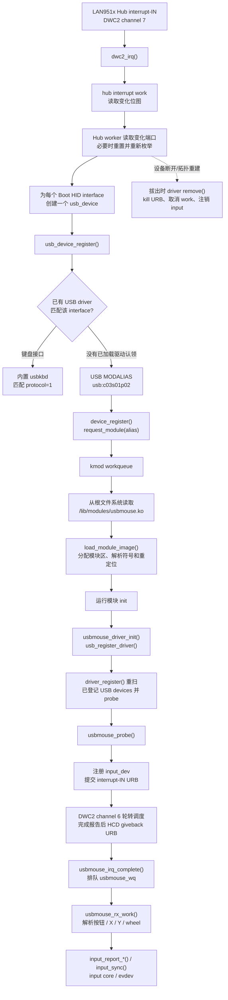
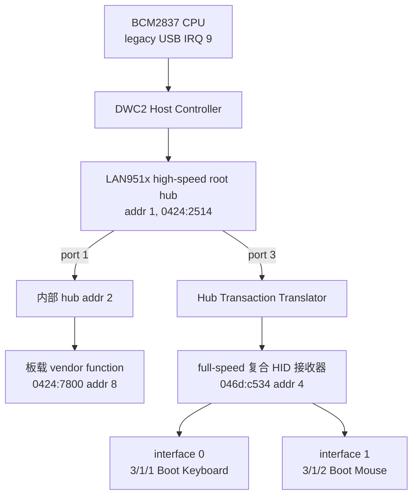
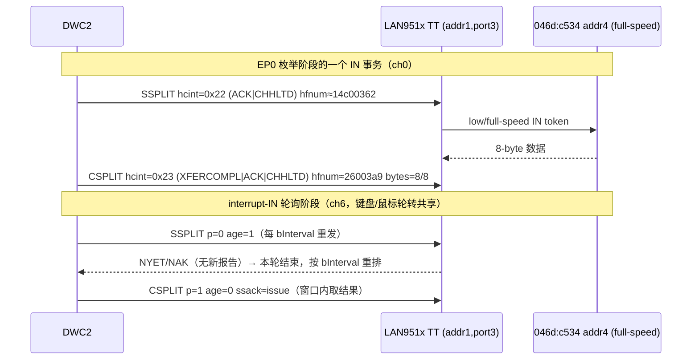

# USB 鼠标热插拔与动态驱动加载

本文按当前代码梳理 USB Boot Mouse 从 Hub 热插拔、USB 枚举，到内核按
`MODALIAS` 自动加载 `usbmouse.ko` 并绑定驱动的完整过程。相关实现主要位于
`kernel/dwc2.c`、`kernel/device.c`、`kernel/usb.c`、`kernel/module.c` 和
`kernel/usbmouse.c`；键盘报告及 DWC2 split 传输细节见
[`readme_usb_keyboard.md`](readme_usb_keyboard.md)。

## 总体调用图



## 1. 构建并安装 `.ko`

`Makefile` 将 `kernel/usbmouse.c` 列入 `MODULES`，而不是内核的 `OBJS`：
鼠标驱动不链接进内核镜像，而是单独编译、以 `ld -r` 保留可重定位信息，
生成 `kernel/usbmouse.ko`。

```make
MODULES = kernel/usbmouse.ko
```

`modules_install` 将模块暂存到 `build/lib/modules/`；制作 `fs.img` 时，
`mkfs` 把暂存目录中的模块文件放入根文件系统 `/lib/modules/`。因此完整流程为：

```sh
make kernel/usbmouse.ko
make modules_install
make fs.img
```

若通过 TFTP 更新设备，需再执行项目的镜像安装流程，将更新后的 `fs.img` 放到
实际使用的 TFTP 服务目录；仅编译 `.ko` 或仅更新内核镜像，不会更新设备根文件
系统里的模块文件。

模块中的
`module_init_exit_ord("usbhid-mouse", usbmouse_driver_init, usbmouse_driver_exit, 3)`
描述符同时记录加载初始化函数和卸载清理函数。`usbhid-mouse` 是内核模块名；
它与磁盘文件名 `usbmouse.ko` 不同。

## 2. Hub 事件触发设备重新发现

Hub 的 interrupt-IN endpoint 由 DWC2 channel 7 监听。Hub 返回非零端口变化位图
后，IRQ 将 Hub work 排入工作队列；worker 只读取发生变化的端口状态，并清除
相应的 port-change feature。连接位图确实变化时，当前实现会停止相关 host
channel、注销旧设备并重新初始化 DWC2，再扫描和枚举连接设备。

因此目前这是**事件触发检测、整棵 USB 拓扑重新枚举**，还不是只对变化端口做
局部增删。拔出时先注销设备；设备 core 调用对应驱动的 `remove()`。鼠标 remove
将设备标记为断开，调用 `usb_kill_urb()` 停止 DMA 并等待 completion，取消报告
work，再注销 input 设备并释放鼠标状态。随后控制器重枚举仍连接的设备。

复合 HID 设备可能在同一个 USB 地址上含键盘和鼠标接口。DWC2 会为每个支持的
Boot HID interface（class `03`、subclass `01`、protocol `01` 或 `02`，且带
interrupt-IN endpoint）分别建立 `usb_device`，使 USB bus 能为接口分别绑定驱动。
目前最多发布 `DWC2_HID_CHILDREN`（4）个这类接口。

## 3. 未匹配设备通过 MODALIAS 自动加载

USB bus 的 `usb_modalias()` 根据当前接口的 class/subclass/protocol 生成别名。
Boot Mouse 的值为：

```text
class=03 subclass=01 protocol=02
MODALIAS=usb:c03s01p02
```

内置键盘驱动只匹配 protocol `01`，所以不会认领鼠标接口。`device_register()`
先尝试已经注册到 USB bus 的驱动；没有已注册驱动匹配时，才调用 bus 的
`modalias()` 并把别名交给 `request_module()`。当前 device core 在 driver ID 匹配
后会调用 probe；即使 probe 失败，该接口也不会继续触发 modalias 自动加载，因此
自动加载是“没有已注册驱动匹配”路径，而不是 probe 失败后的备用驱动机制。

当前 `kernel/module.c` 以静态表代替 Linux 的
`/lib/modules/modules.alias`：

```text
usb:c03s01p02 -> usbmouse.ko
```

匹配成功后，`request_module()` 将模块文件名复制到 kmod 请求槽，并把加载任务排入
kmod workqueue。不能在设备注册/总线匹配路径同步读文件，因为文件系统读取可能睡眠；
worker 会从根文件系统读取 `/lib/modules/usbmouse.ko`，然后调用
`load_module_image()`。

启动期间若 DWC2 在根文件系统挂载前就枚举到鼠标，自动加载请求可以先进入队列；
kmod worker 在调度器开始运行后执行，此时启动 initcall 已完成根文件系统挂载。
这正是代码将模块文件读取放到 kmod workqueue 的原因。

## 4. ELF 模块加载与驱动绑定

`load_module_image()` 先检查 ELF 和 section table，再为模块的 `SHF_ALLOC`
sections 在模块区中分配连续空间。随后复制 section、解析符号表、应用
AArch64 RELA relocation，并同步指令缓存。未定义符号必须能在
`kernel/export.c` 的导出符号表中找到，否则模块加载失败。

模块映像中的 `.initcall.list` 保存模块描述符。加载器记录模块名、模块区范围和
exit 函数，释放模块区 spinlock 后调用 init。释放锁后再运行 init 很重要：
鼠标驱动注册时可能立即 probe 已登记的设备，probe 中的 USB 控制传输依赖 IRQ，
不能在关中断状态下等待传输完成。

`usbmouse_driver_init()` 初始化 `usbmouse_wq`，再调用
`usb_register_driver()`。`driver_register()` 不只登记驱动，还会重新遍历 USB
bus 上已有的设备；因此即使 USB interface 先登记并触发了异步模块加载，鼠标
驱动随后注册时仍会再次匹配并 probe 该 interface。无需用户手动执行 `insmod`。

`usbmouse_probe()` 检查 Boot Mouse 接口和 interrupt-IN endpoint，然后设置 HID
Boot Protocol/Idle，创建并注册 `input_dev`，填充 interrupt URB，最后提交给
DWC2 HCD。后续报告由 channel 6 的 HCD 完成路径交给 URB completion；回调只排入
`usbmouse_wq`，`usbmouse_rx_work()` 在进程上下文中比较按钮状态并上报按钮、
相对 X/Y 与滚轮事件。channel 6 由 DWC2 的 interrupt-IN scheduler 在多个已提交
URB 之间轮转共享，并非永久分配给鼠标；当前最多保留 4 个 interrupt-IN URB 请求。

## 5. 报告路径与拔出清理

```text
鼠标 interrupt-IN 报告
  -> DWC2 channel 6 轮转调度 / DMA
  -> dwc2_irq() 与 HCD completion work
  -> usb_hcd_giveback_urb()
  -> usbmouse_irq_complete()
  -> usbmouse_wq / usbmouse_rx_work()
  -> input_report_key() / input_report_rel() / input_sync()
  -> input core / evdev clients
  -> 重新提交同一个 interrupt URB
```

拔出时执行相反的资源顺序：

```text
device_unregister()
  -> USB bus remove()
  -> usbmouse_remove()
  -> 标记 disconnected
  -> usb_kill_urb()：停 DMA 并等待 completion
  -> cancel_work_sync()：等待报告处理退出
  -> input_unregister_device()
  -> 释放 URB 和鼠标状态
```

拔出**不会自动卸载** `usbmouse.ko`：驱动保持注册，后续新鼠标设备可以直接匹配。
若用户主动卸载模块，`usb_unregister_driver()` 会对由该驱动绑定的设备调用
remove，并保留设备注册；当前 driver core 不会仅因 `rmmod` 自动重新请求该模块，
所以已连接鼠标会暂时处于未绑定状态，直到设备被重新注册（例如拓扑变化触发
重新枚举）。

## 6. 手动加载、观察与卸载

自动加载是普通热插拔路径。需要手工验证时，可先加载模块：

```sh
insmod /lib/modules/usbmouse.ko
cat /proc/modules
```

模块 init 注册 USB driver 后，会立即扫描并绑定已经登记的鼠标接口。卸载参数是
模块描述符中的名字，而不是 `.ko` 文件名：

```sh
rmmod usbhid-mouse
```

`/proc/modules` 同样显示 `usbhid-mouse`。模块区使用简单的栈式分配，当前只允许
卸载位于模块区顶部的最新模块；卸载较早加载、但后面仍有模块占据其地址空间的
模块会失败。

**当前卸载路径有一个实现限制：**`unload_module()` 持有模块表 spinlock 时调用
模块 exit；鼠标 exit 会注销 USB driver，而 remove 可能同步等待 URB completion
或 work。此类等待不应在持有 spinlock 时发生。因此动态加载路径可按上文自动工作，
但对已绑定活动鼠标执行 `rmmod usbhid-mouse` 仍需先修正卸载锁的持有范围，不能把
它当成已验证安全的热卸载流程。

常见诊断点：

| 日志/现象 | 含义 |
|---|---|
| `dwc2: HID boot mouse ... handed to usb bus` | USB interface 已枚举并登记；不是驱动已成功 probe 的证明 |
| `request_module: loading /lib/modules/usbmouse.ko` | MODALIAS 命中，kmod 开始读取模块 |
| `module: loaded usbhid-mouse ...` | ELF 加载、重定位和模块 init 已完成 |
| `usbmouse: IRQ-driven boot mouse ready ...` | probe 成功，input 设备已注册且 URB 已提交 |
| `usbmouse: first report ...` | 首份有效鼠标报告已进入报告 worker |
| `request_module: ... not found (root mounted?)` | 模块文件未进入正在使用的根文件系统，或路径/文件名不匹配 |
| `unresolved symbol` | 模块引用的内核符号没有加入 `kernel/export.c` 导出表 |

如果模块文件在设备启动后才复制进根文件系统，先确认文件路径，再拔插鼠标以重新
触发未绑定设备的注册流程；当前没有文件系统变更监视器或通用 `depmod/modprobe`。

## 7. 当前边界

- alias 到 `.ko` 的映射是 `kernel/module.c` 中的静态表，不读取
  `modules.alias`，不支持通配符、依赖模块或通用 modalias 匹配。
- kmod 使用固定数量的请求槽；模块映像上限为 64 KiB，模块区最多容纳 8 个已加载
  模块，单模块 ELF section 数量也有限。
- 可供模块引用的内核 API 必须显式加入 `kernel/export.c`。
- 连接状态变化时当前会整体重置 DWC2 并重新枚举；USB 子设备模型仍是简化实现。
- 多个 interrupt-IN URB 共用 channel 6 的轮转调度，当前请求槽上限为 4；这不是
  每个 USB endpoint 独占一个硬件 channel 的通用 HCD 调度器。
- 用户态 `insmod` 走 `open/read -> init_module syscall -> load_module_image`；
  自动加载则由内核 kmod worker 直接从根文件系统读取同一 `.ko`，两条路径共用
  ELF 装载器。
- 自动加载针对有精确 alias 表项、且没有已注册驱动认领的设备；普通无匹配设备
  不会因为每个 `.ko` 都被逐一试探而加载模块。

## 8. 真机日志走读：复合接收器热插拔与 ext2 自动装载（046d:c534）

本节按一次真实串口日志逐行走读：把 Logitech 无线接收器（`046d:c534`）插入
LAN951x 外部 hub 的 port 3，观察“热插发现 → split 枚举 → 双 HID 接口分别登记 →
键盘即时绑定 → 鼠标接口经 MODALIAS 从 **ext2 根**自动装载 `.ko` → 拔出触发整树
重枚举”的完整链路。这台接收器是 **full-speed（12\,Mb/s）复合设备**，接口 0 是
Boot Keyboard、接口 1 是 Boot Mouse。与键盘专文里那台 low-speed 接收器不同的
关键点，本节会显式标注。

### 8.1 拓扑与连接位图

```text
dwc2: hub IRQ change=8 connected=2->a; reprobe
...
dwc2: hub port 3 after-reset status=103 speed=full
dwc2: hub port=3 child class=0 vid=46d pid=c534 mps=8
```

- `change=8` 是根 hub 的 port-change 位（bit3 → port 3）；`connected=2->a` 即
  连接位图从 `0x2`（bit1，仅 port 1）变为 `0xa`（bit1|bit3），新增设备来自 port 3。
- `status=103` 复位后为 `connected|enabled|speed(full)`。`after-reset status` 的
  bit[9:8] 速度域：`00`=full、`01`=low、`10`=high。这里是 **full-speed**，因此
  枚举时 `HCCHAR` 的 `LSPDDEV` 位**不置**，但设备仍在高速 hub 之后——full-speed
  与 low-speed 一样要经 hub 的 TT 做 split，只是低速才额外置 `LSPDDEV`。
- `class=0` 表示类别声明推迟到 interface；配置描述符里才给出 `3/1/1`（键盘）和
  `3/1/2`（鼠标）两个 Boot HID 接口。



拓扑扫描日志（`hub port 1 ... child class=9`、`scanning nested hub addr=2`、
`nested hub=2 port=1 child ... 0424:7800 addr=8`）先重建高速侧的 hub 树，再落到
port 3 上的接收器；这与键盘专文的发现路径一致，不重复展开。

### 8.2 分阶段时间线

把日志按语义切成九段，右侧标注该段实际证明了什么：

```text
(1) dwc2: hub IRQ change=8 ...; reprobe        # port3 插入，触发整树重枚举
(2) dwc2: firmware USB HCD power on ...        # 控制器重新上电、开 host-channel IRQ
(3) ... scanning nested hub addr=2 ...          # 重建高速 hub 拓扑
(4) hub port=3 child class=0 vid=46d pid=c534   # 接收器 reset，full-speed，地址 4
(5) ch0 SSPLIT ACK / CSPLIT complete ...        # EP0 枚举：每个 control 事务拆成 split
(6) input: USB HID Boot Keyboard registered     # interface0 匹配内置 usbkbd，注册 event0
    dwc2: ch6 armed addr=4 ep=1 ...             # 键盘 interrupt-IN 占用 channel 6
    usbkbd: IRQ-driven boot keyboard ready ...  # 键盘 probe 成功、URB 已提交
(7) dwc2: HID boot keyboard intf 0 handed ...   # 接口 0 设备发布完成
    dwc2: HID boot mouse intf 1 handed ...      # 接口 1 作为独立 usb_device 发布（方案 A）
(8) request_module: loading /lib/modules/usbmouse.ko   # 接口 1 无人认领→MODALIAS 自动装载
    workqueue: usbmouse_wq worker=0 pid=17      # 模块自己的 report workqueue 建立
    module: loaded usbhid-mouse (1808 bytes)    # ELF 重定位 + init 完成、driver_register
(9) dwc2: hub IRQ change=8 connected=a->2       # 拔出：连接位图回到仅 port1
    input: USB HID Boot Keyboard event0 disconnected
    dwc2: no supported USB child on external hub ports   # 重枚举后 port3 已空
```

阶段 (5) 的地址演进：先 `addr=0`（默认地址，读 Device Descriptor 前 8 字节拿到
EP0 MPS=8），`SET_ADDRESS(4)` 后转为 `addr=4`，继续读配置描述符（`bytes=8/8`、
`bytes=3/3` 等分块）并 `SET_CONFIGURATION`。整段 (5) 全是 `ch0 SSPLIT/CSPLIT`，
因为接收器在 hub 的 TT 之后。

阶段 (8) 是本次改动的验收点：`.ko` 从 **ext2 根文件系统**成功读出并加载，日志不再
出现 `panic: getsb: device has no xv6 filesystem`。这验证了两件事——`kmod_load()`
改走 `ip->iop->read()` 的 VFS 分派后能在 ext2 上读文件；以及复合接收器的鼠标接口
在内置键盘驱动（只匹配 `protocol=1`）不认领时，正确触发了
`request_module("usb:c03s01p02")`。

### 8.3 split 事务时序（本日志真实 HFNUM）

`dwc2 ch6 final ...` 与 `ch0 SSPLIT/CSPLIT ...` 里的 `hfnum` 是控制器帧计数。
下面取一次 EP0 完成事务和一个 ch6 轮询周期示意（微帧/帧号取自日志原值）：



对应日志片段：

```text
dwc2: ch0 SSPLIT ACK addr=0 in=1 hcint=22 ... hfnum=14c00362
dwc2: ch0 CSPLIT complete addr=0 bytes=8/8 hcint=23 ... hfnum=26003a9
...
dwc2 ch6 final p=0 int=0 uf=1 issue=35a1 age=0 ssack=35a0
dwc2 ch6 final p=1 int=0 uf=5 issue=3db5 age=0 ssack=3db4
```

`dwc2 ch6 final` 各字段（源自 `dwc2.c` IRQ 快速路径的诊断打印）：

| 字段 | 来源 | 含义 |
| --- | --- | --- |
| `p` | `req->complete_split` | 0=本轮处于 SSPLIT，1=处于 CSPLIT |
| `int` | `rd(HCINT(6))` | channel 6 中断状态原值（此处 `NAK/NYET/ACK` 不打印具体值） |
| `uf` | `rd(HFNUM) & 7` | 帧计数低 3 位，用于观察轮询落在哪一拍 |
| `issue` | `req->last_issue_frame` | 本次事务发出时的 HFNUM |
| `age` | `(HFNUM - last_issue_frame) & 0x3fff` | 距发出的帧数（CSPLIT 有效窗口判据） |
| `ssack` | `req->ssplit_ack_frame` | TT 接受 SSPLIT（回 ACK）时的 HFNUM |

`p=0/1` 交替、`age` 在 0/1 之间，正是 ch6 在键盘与鼠标两只 interrupt-IN URB 之间
轮转（方案 1）的体现：同一时刻只有一个 request 拥有 channel 6，另一个的 URB 排在
数组里等下一轮。

### 8.4 报文格式解码

**HCSPLT**（split 路由，本日志 `0x8000c083`）：

| 位域 | 宏 | `0x8000c083` 解码 |
| --- | --- | --- |
| bit31 | `HCSPLT_SPLTENA` | 1：启用 split |
| bit16 | `HCSPLT_COMPSPLT` | 0=SSPLIT；错误行 `0x8001c083` 里为 1=CSPLIT |
| bits15:14 | `HCSPLT_XACTPOS_ALL` | `0x0000c000`：整包 |
| bits10:7 | `HCSPLT_HUBADDR(a)` | `0x80`→hub 地址 1 |
| bits6:0 | `HCSPLT_PRTADDR(p)` | `0x03`→端口 3 |

**HCCHAR**（接收器 ch6，本日志 `0x810c8808`）：

| 位域 | 宏 | 解码 |
| --- | --- | --- |
| bit31 | `HCCHAR_CHENA` | 1：channel 已使能 |
| bits25:22 | `HCCHAR_DEVADDR` | 4 |
| bits19:18 | `HCCHAR_EPTYPE` | 3 = interrupt |
| bit17 | `HCCHAR_LSPDDEV` | **0**：full-speed（与 low-speed 键盘的关键区别） |
| bit15 | `HCCHAR_EPDIR_IN` | 1：IN |
| bits14:11 | `HCCHAR_EPNUM` | 1 |
| bits10:0 | `HCCHAR_MPS` | 8 |

**HCINT**（`dwc2.c` 宏，日志里出现的组合）：

| 值 | 组合 | 含义 |
| --- | --- | --- |
| `0x22` | `ACK\|CHHLTD` | TT 接受了 SSPLIT |
| `0x23` | `XFERCOMPL\|ACK\|CHHLTD` | CSPLIT 返回完整数据 |
| `0x21` | `XFERCOMPL\|ACK` | 完成（channel 未即时 halted 的记录形态） |
| `0x0a` | `STALL\|bit1` | ch0 control 被 STALL（阶段 8 里 `req=10` 的状态失败） |
| `0x82` | `XACTERR\|CHHLTD` | ch6 interrupt-IN 事务错误（拔出前 `HID ch6 error`） |

**HCTSIZ**：`PID<<29 | PKTCNT<<19 | XFERSIZE`。SETUP 阶段 `0x60080008` = PID=SETUP、
XFERSIZE=8；EP0 IN 收 8 字节数据时 `0x80008` 表示 PKTCNT=1、XFERSIZE=8。

**HID class control（SETUP 8 字节）**：鼠标 probe 依次发

```text
SET_PROTOCOL(BOOT): bmRequestType=0x21 bRequest=0x0b wValue=0 wIndex=intf wLength=0
SET_IDLE:           bmRequestType=0x21 bRequest=0x0a wValue=0 wIndex=intf wLength=0
```

日志 `control status failed req=10 addr=4` 中的 `req=10` 即 `0x0a`=SET_IDLE；
`usbmouse_probe()` 只在 SET_PROTOCOL 失败时才放弃，SET_IDLE 失败不致命。

**Boot Mouse 报告（`usbmouse.c`，`HID_MOUSE_REPORT_SIZE=4`）**：

| 偏移 | 字段 | 上报 |
| --- | --- | --- |
| byte0 | 按钮位图（bit0 左 / bit1 右 / bit2 中） | 逐个变化 `input_report_key(BTN_*)` |
| byte1 | X 相对位移（signed char） | `input_report_rel(REL_X)` |
| byte2 | Y 相对位移（signed char） | `input_report_rel(REL_Y)` |
| byte3 | 滚轮（signed char，报告≥4 字节时） | `input_report_rel(REL_WHEEL)` |

报告末尾统一 `input_sync()`。`actual_length>=3` 即接受（无滚轮字段的设备也可用）。

**MODALIAS 字符串**：`usb.c` 的 `usb_modalias()` 对 Boot Mouse 接口生成
`usb:c03s01p02`（class/subclass/protocol 的十六进制），`module.c` 静态 alias 表把它
映射到 `usbmouse.ko`。

### 8.5 从 IRQ 到鼠标驱动绑定的函数调用链

```text
dwc2: hub IRQ change=8 ...                          # channel 7 hub IN → dwc2_irq()
  -> dwc2_hub IRQ 快速路径 queue_work(dwc2_hub_wq)
  -> hub worker 读端口变化 → 位图变化 → 停止旧 channel、注销旧设备 → dwc2_init() 重枚举
     -> (ch0 SSPLIT/CSPLIT) 读配置描述符
     -> 为每个 Boot HID interface 建 usb_hid_child[i]，SET_CONFIG 后逐个 usb_device_register()
        -> device_register() → bus for_matched_drivers: usb_match()
           接口0 (3/1/1): 匹配内置 usbkbd -> usbkbd_probe() -> ch6 armed / event0
           接口1 (3/1/2): 无已注册驱动匹配
             -> bus->modalias(dev) = "usb:c03s01p02"
             -> request_module(alias)  (device.c)
                -> 命中静态 alias 表 -> queue_work(kmod_wq, slot.work)
                   -> kmod_run() -> kmod_load("/lib/modules/usbmouse.ko")
                      -> begin_op(); namei(); ilock()
                      -> ip->iop->read(ip,0,ko_image,0,sz)   # ext2 分派，非经典 readi()
                      -> load_module_image(): 分配模块区、复制 SHF_ALLOC、解析符号、RELA 重定位
                      -> run init: usbmouse_driver_init()
                         -> init_workqueue(usbmouse_wq)       # 日志 "workqueue: usbmouse_wq worker=0 pid=17"
                         -> usb_register_driver() -> driver_register()
                            -> 重扫已登记设备 -> usb_match(接口1) 命中
                            -> usbmouse_probe() -> SET_PROTOCOL/SET_IDLE, input_register, usb_submit_urb()
                               -> dwc2_submit_urb() -> dwc2_interrupt_schedule_locked()
                                  -> 若 ch6 空闲则 rx_start；否则排入 interrupt_rx[] 等轮转
```

关键并发点：`driver_register()` 会重扫总线上**已存在**的设备，所以“设备先登记并
异步排队装载、驱动后注册”的次序仍能绑定接口 1，无需手动 `insmod`。channel 6 由
`interrupt_rx[DWC2_INT_REQUESTS]` 轮转仲裁，键盘与鼠标共用一只硬件 channel。

### 8.6 本日志暴露的未完成项

严格按“日志只承认证据”的原则，本次链路**证明了自动装载本身跑通**，但**没有证明
鼠标数据通路端到端完成**：

- 全程没有出现 `usbmouse: IRQ-driven boot mouse ready ...`，也没有
  `usbmouse: first report ...`。也就是说 `usbmouse_probe()` 走到哪一步、interrupt-IN
  URB 是否成功 arm，日志不足以确认。
- 拔出前是 `dwc2: HID ch6 error intr=82`（`XACTERR|CHHLTD`）与
  `usbkbd: channel 6 transfer error; rearming` 连续四次：full-speed 复合设备在共享
  ch6 上、经 TT 做 split interrupt-IN 的调度仍未收敛，键盘与鼠标争用同一 channel 的
  时序是主要嫌疑。
- 阶段 (9) 拔出触发**整棵拓扑重枚举**，而非只对 port 3 做局部增删；这是与 Linux 的
  已知差距（见“当前边界”）。

因此本节的结论是：**ext2 上的 `.ko` 自动装载链（方案 A + MODALIAS + VFS 读 +
ELF 重定位）在真机验证成功；full-speed 复合接收器的鼠标 interrupt-IN 实际报告接收，
还需在共享 ch6 的 split 调度上继续排查。** 下一步诊断可在 `usbmouse_probe()` 各
返回前打印具体失败请求，并把 ch6 错误路径的 `hcsplt`/`hctsiz`/`HCCHAR` 一并 dump，
以区分是 SET_PROTOCOL 被 STALL、还是 interrupt-IN 的 CSPLIT 窗口错过。
